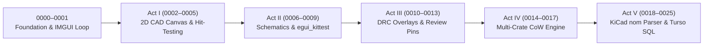

Welcome to the interactive course index.{{sidenote:Every lesson in this repository pairs an interactive HTML tutorial (with live in-browser simulators, code-completion labs, and retrieval quizzes) with a real, runnable Cargo project under `./apps/<NNNN-slug>/`.}} Each lesson introduces **one focused `egui` capability** alongside **one just-in-time Rust concept** and verifies assertion strength continuously using `cargo test` and [`cargo-mutants`](https://mutants.rs/).


_Five-Act Curriculum Progression: Every lesson builds toward a production Schematic & PCB Design Review System verified with unit tests and mutation coverage._

## Published Interactive Lessons (`0000`–`0009`)

Start with [Lesson 0000](./lessons/0000-project-setup-and-eframe-boot.html) to set up your Cargo project and mutation-testing harness, or jump directly to any completed module below:

{{widget:lesson-cards}}

## Reference Sheets & Printable Cheat Sheets

These reference documents compress the core Rust, immediate-mode GUI, and mutation-testing mechanics into quick-lookup tables designed for both screen review and clean paper printing:

| Reference Sheet | What It Covers |
| --- | --- |
| [**Glossary of Rust & `egui` Terms**](./reference/glossary.html) | Canonical definitions of Immediate-Mode vs. Retained-Mode GUI, `&mut` borrows, closures, `TSTransform`, `Sense`, and PCB domain analogies. |
| [**Immediate-Mode GUI Cheat Sheet**](./reference/immediate-mode-cheatsheet.html) | The 5-step single-frame mental model, panel layout ordering rules (`SidePanel` before `CentralPanel`), and custom 2D CAD painter idioms. |
| [**Testing & Mutation Coverage Cheat Sheet**](./reference/testing-and-mutation-cheatsheet.html) | Why line coverage lies, how `cargo-mutants` tests your tests, fast APFS copy-on-write workflows, and the 4-step evolutionary verification ladder. |

## Running the Companion Rust Apps Locally

Every lesson is backed by a standalone, runnable Cargo package under `./apps/<NNNN-lesson-slug>/` that is verified to compile with zero warnings and pass both `cargo test` and `cargo mutants`:

```bash
# Launch Lesson 0005's interactive PCB Reviewer desktop window
cargo run --manifest-path ./apps/0005-hit-testing-and-net-cross-probing/Cargo.toml

# Run unit tests and mutation coverage for Lesson 0005
cargo test --manifest-path ./apps/0005-hit-testing-and-net-cross-probing/Cargo.toml
cargo mutants -d ./apps/0005-hit-testing-and-net-cross-probing
```

:::teacher-prompt
**Ready to begin?** Start with [**Lesson 0000: Bootstrapping Your Rust & `eframe` Project**](./lessons/0000-project-setup-and-eframe-boot.html) or jump to [**Lesson 0005: Spatial Hit-Testing & Net Cross-Probing**](./lessons/0005-hit-testing-and-net-cross-probing.html).
:::
