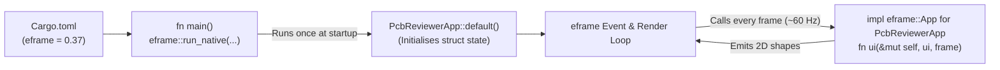

The joy of building a custom hardware tool is getting your own PCB viewport up on screen. The first hurdle, though, is getting past a blank terminal and figuring out which crate actually opens the window.

Before we wire up the layer-visibility toggles in [Lesson 0002](./0002-the-immediate-mode-loop.html), our code needs a real, runnable Rust project to live in. So, let's set up Cargo, sort out how [`eframe`](../reference/glossary.html) and [`egui`](../reference/glossary.html) divide the work, and get `fn main()` booting a native desktop window.

## 1. `egui` vs. `eframe`: Who Does What?

Turns out, Emil Ernerfeldt's `egui` crate doesn't actually open OS windows or talk directly to Metal, Vulkan, or OpenGL.{{sidenote:Because [`egui`](https://docs.rs/egui/latest/egui/) only takes input events and outputs 2D triangles and textures, it can be embedded inside game engines, custom CAD renderers, or headless test runners.}}

- **`egui` (The UI Core):** Computes widget layouts, processes pointer/keyboard state, and generates 2D vector shapes for a single frame.
- **`eframe` (The App Shell):** The official framework wrapper ([`docs.rs/eframe`](https://docs.rs/eframe/latest/eframe/)) that creates a native desktop window (or WebAssembly canvas), initialises the GPU painter, and calls your app's `ui()` method on every repaint.


_Figure 1.1: How Cargo and `eframe::run_native` initialise your state once, then drive the Lesson 0002 `ui()` loop every frame._

## 2. Creating the Project & Configuring `Cargo.toml`

In Rust, [`cargo new pcb-reviewer`](https://doc.rust-lang.org/cargo/guide/creating-a-new-project.html) generates a binary package (`--bin` is the default) with two key files: `Cargo.toml` (the manifest) and `src/main.rs` (the entry point). We then step into the directory and use [`cargo add`](https://doc.rust-lang.org/cargo/commands/cargo-add.html) to pull in `eframe`:{{sidenote:**Tip: Single Dependency Import.** Because `eframe` re-exports `egui` as `eframe::egui`, we only add `eframe` under `[dependencies]`. This guarantees your `egui` types never suffer a version mismatch with `eframe`.}}

```console
cargo new pcb-reviewer
cd pcb-reviewer
cargo add eframe
```

After running `cargo add eframe` and appending a `[profile.dev.package."*"]` optimisation block, here is the resulting `Cargo.toml` for our Schematic & PCB Reviewer:

```toml
[package]
name = "pcb-reviewer"
version = "0.1.0"
edition = "2024"

[dependencies]
eframe = "0.37"

# Optimise dependencies (like egui/eframe) even in debug builds so our
# 2D PCB canvas renders at 60 FPS while keeping our own code fast to compile.
[profile.dev.package."*"]
opt-level = 2
```

Now, those last three lines ([Cargo Profile Overrides](https://doc.rust-lang.org/cargo/reference/profiles.html#overrides)) are doing a lot of heavy lifting. If you run a 2D CAD canvas in a stock Rust debug build (`opt-level = 0`), software rasterising and tessellation can feel like wading through treacle. By setting `opt-level = 2` on `package."*"`, Cargo compiles third-party crates once at near-release speed so our viewport stays locked at 60 FPS, while our own edits in `src/main.rs` still recompile in under a second. Best of both worlds.

## 3. Anatomy of `src/main.rs`: Block by Block

Rather than staring at a 65-line wall of Rust and trying to decode everything at once, let's walk through `src/main.rs` one logical block at a time. Once we've unpacked all five pieces, we'll put the complete file together at the end of this section.

### Block 1: Importing `egui` & Booting the Native Window (`fn main`)

```rust
use eframe::egui;

fn main() -> eframe::Result {
    let mut options = eframe::NativeOptions::default();
    options.viewport = egui::ViewportBuilder::default()
        .with_inner_size([1024.0, 720.0]);

    eframe::run_native(
        "Schematic & PCB Design Reviewer",
        options,
        Box::new(|_cc| Ok(Box::new(PcbReviewerApp::default()))),
    )
}
```

- **`use eframe::egui;`**: Instead of pulling in a separate `egui` crate in `Cargo.toml`, we import `eframe`'s re-exported `egui` module so our UI code and window runner are guaranteed to use the exact same `egui` version.
- **`fn main() -> eframe::Result`**: Every Rust binary starts at `fn main()`. Returning `eframe::Result` allows `eframe` to report any window-creation or GPU initialisation errors cleanly back to the OS.{{sidenote:In Rust, [`Result<T, E>`](https://doc.rust-lang.org/book/ch09-02-recoverable-errors-with-result.html) represents an operation that either succeeds (`Ok(T)`) or fails (`Err(E)`). `eframe::Result` is a type alias for `Result<(), eframe::Error>`.}}
- **Configuring `NativeOptions` & `ViewportBuilder`**: In Rust, variables are immutable by default, so we write `let mut options` to make the struct mutable. We then replace `options.viewport` using the **builder pattern**: `egui::ViewportBuilder::default().with_inner_size([1024.0, 720.0])` starts from standard window defaults and chains `.with_inner_size(...)` to request a `1024×720` logical-point canvas.
- **`eframe::run_native(...)`**: Notice there is **no semicolon** after `eframe::run_native(...)`—in Rust, the final expression of a function without a trailing semicolon is automatically its return value. It takes three arguments:
  1. `"Schematic & PCB Design Reviewer"`: The native OS window title.
  2. `options`: The `NativeOptions` we just configured.
  3. `Box::new(|_cc| Ok(Box::new(PcbReviewerApp::default())))`: The **app creator closure**. [`eframe::run_native`](https://docs.rs/eframe/latest/eframe/fn.run_native.html) invokes this factory closure _once_ after the GPU and window context (`_cc: &CreationContext`) are ready. Inside, we construct `PcbReviewerApp::default()`, allocate it on the heap with [`Box::new`](https://doc.rust-lang.org/book/ch15-01-box.html), wrap it in `Ok(...)`, and hand ownership to `eframe`.

### Block 2: Defining Application State (`pub struct PcbReviewerApp`)

```rust
pub struct PcbReviewerApp {
    pub show_top_copper: bool,
    pub show_bottom_copper: bool,
    pub show_silkscreen: bool,
    pub show_ratsnest: bool,
}
```

- **Data-Only `struct`**: Rust doesn't have classes or inheritance hierarchies. Instead, you group your application's persistent state into a `struct` and attach behaviour via separate `impl` blocks.
- **Why State Lives Here**: Because `egui` is an immediate-mode GUI, widgets don't secretly store their own checkbox states between frames. `PcbReviewerApp` is the single source of truth that survives from frame to frame.
- **`pub` Visibility**: Marking the struct and its four `bool` fields `pub` (public) allows external modules and test harnesses to inspect or toggle our four PCB layers directly.

### Block 3: Initialising Default Layer Visibility (`impl Default` & `reset_layers`)

```rust
impl Default for PcbReviewerApp {
    fn default() -> Self {
        let mut app = Self {
            show_top_copper: false,
            show_bottom_copper: false,
            show_silkscreen: false,
            show_ratsnest: false,
        };
        app.reset_layers();
        app
    }
}

impl PcbReviewerApp {
    pub fn reset_layers(&mut self) {
        self.show_top_copper = true;
        self.show_bottom_copper = true;
        self.show_silkscreen = true;
        self.show_ratsnest = false;
    }
}
```

- **Why Custom `impl Default` Instead of `#[derive(Default)]`?**: Rust lets you slap `#[derive(Default)]` above a struct, which happily sets every `bool` field to `false`. Problem is, opening a PCB viewer where every copper and silkscreen layer is switched off looks suspiciously like a broken app! Implementing the [`Default`](https://doc.rust-lang.org/std/default/trait.Default.html) trait by hand lets us choose sensible startup defaults (`Self` is just an alias for the type being implemented, `PcbReviewerApp`).
- **Delegating to `reset_layers(&mut self)`**: Inside `fn default()`, we create `let mut app`, call `app.reset_layers()`, and return `app` (again, no trailing semicolon). The `impl PcbReviewerApp` block defines an inherent method where `&mut self` grants mutable borrow access to the struct's fields so it can enable the three physical board layers (`show_top_copper`, `show_bottom_copper`, `show_silkscreen`) while keeping the logical `show_ratsnest` airwires hidden until requested.
- **Why Extract `reset_layers`?**: The reason we pull `reset_layers(&mut self)` out into its own method is also interesting: `cargo-mutants` deliberately skips mutating `impl Default` blocks directly (since replacing `Default::default()` in generic code can cause infinite recursion). Extracting a helper method lets both our future "Reset Layers" UI button and our mutation runner exercise the exact same initialisation code.

### Block 4: Implementing the Frame Loop (`impl eframe::App`)

```rust
impl eframe::App for PcbReviewerApp {
    fn ui(&mut self, ui: &mut egui::Ui, _frame: &mut eframe::Frame) {
        // Lesson 0002's Panel and CentralPanel code lives right here!
        egui::CentralPanel::default().show(ui, |ui| {
            ui.heading("PCB Viewport Ready");
        });
    }
}
```

- **`impl eframe::App for PcbReviewerApp`**: In Rust, **traits** work like interfaces. Implementing `eframe::App` is the contract that connects our `PcbReviewerApp` struct to `eframe`'s event and render loop.
- **`fn ui(&mut self, ui: &mut egui::Ui, _frame: &mut eframe::Frame)`**: `eframe` calls this method on every repaint:
  - `&mut self`: Gives us mutable access to our `PcbReviewerApp` state so checkboxes and buttons can modify fields in place.
  - `ui: &mut egui::Ui`: The root UI region handle for the current frame, which tracks layout, input events, styling, and fonts across the window.
  - `_frame: &mut eframe::Frame`: Provides integration hooks into the surrounding `eframe` shell. Prefixing the parameter name with an underscore (`_frame`) tells the Rust compiler we intentionally aren't using it yet, keeping our build free of unused-variable warnings.
- **`egui::CentralPanel::default().show(ui, |ui| { ... })`**: Claims the main canvas area of the window and invokes our closure `|ui| { ... }`, passing in a scoped `&mut egui::Ui` region builder where `ui.heading("PCB Viewport Ready")` emits our startup heading.

### Block 5: Inline Unit Tests (`#[cfg(test)] mod tests`)

```rust
#[cfg(test)]
mod tests {
    use super::*;

    #[test]
    fn default_enables_physical_layers_and_hides_ratsnest() {
        let app = PcbReviewerApp::default();
        assert!(app.show_top_copper);
        assert!(app.show_bottom_copper);
        assert!(app.show_silkscreen);
        assert!(!app.show_ratsnest);
    }
}
```

- **`#[cfg(test)] mod tests`**: Rust makes unit testing frictionless by letting you place a `tests` submodule right at the bottom of the file you are testing. The `#[cfg(test)]` conditional compilation attribute tells `rustc` to compile this block _only_ when you run `cargo test` ([Rust Book §11.1](https://doc.rust-lang.org/book/ch11-01-writing-tests.html)), so zero test code bloats your production binary.
- **`use super::*;`**: Brings everything from the parent file (`PcbReviewerApp` and its methods) into scope inside the `tests` submodule.
- **`#[test]` and `assert!`**: Marking a function with `#[test]` registers it with Cargo's test runner. Inside, we construct `PcbReviewerApp::default()` and use `assert!(...)` (and `assert!(!...)` with the logical NOT operator `!`) to verify that every physical layer starts enabled and the ratsnest starts hidden.

### Complete `src/main.rs` Listing

Putting all five blocks together, here is the complete, runnable `src/main.rs`:

```rust
use eframe::egui;

fn main() -> eframe::Result {
    let mut options = eframe::NativeOptions::default();
    options.viewport = egui::ViewportBuilder::default()
        .with_inner_size([1024.0, 720.0]);

    eframe::run_native(
        "Schematic & PCB Design Reviewer",
        options,
        Box::new(|_cc| Ok(Box::new(PcbReviewerApp::default()))),
    )
}

pub struct PcbReviewerApp {
    pub show_top_copper: bool,
    pub show_bottom_copper: bool,
    pub show_silkscreen: bool,
    pub show_ratsnest: bool,
}

impl Default for PcbReviewerApp {
    fn default() -> Self {
        let mut app = Self {
            show_top_copper: false,
            show_bottom_copper: false,
            show_silkscreen: false,
            show_ratsnest: false,
        };
        app.reset_layers();
        app
    }
}

impl PcbReviewerApp {
    pub fn reset_layers(&mut self) {
        self.show_top_copper = true;
        self.show_bottom_copper = true;
        self.show_silkscreen = true;
        self.show_ratsnest = false;
    }
}

impl eframe::App for PcbReviewerApp {
    fn ui(&mut self, ui: &mut egui::Ui, _frame: &mut eframe::Frame) {
        // Lesson 0002's Panel and CentralPanel code lives right here!
        egui::CentralPanel::default().show(ui, |ui| {
            ui.heading("PCB Viewport Ready");
        });
    }
}

#[cfg(test)]
mod tests {
    use super::*;

    #[test]
    fn default_enables_physical_layers_and_hides_ratsnest() {
        let app = PcbReviewerApp::default();
        assert!(app.show_top_copper);
        assert!(app.show_bottom_copper);
        assert!(app.show_silkscreen);
        assert!(!app.show_ratsnest);
    }
}
```

## 4. Sanity-Saving Verification with `cargo-mutants`

Writing unit tests feels great, right up until you realise a test can execute every line of a function without actually asserting anything useful.

So, from Day 1, we pair `cargo test` with Martin Pool's [`cargo-mutants`](https://mutants.rs/) ([Testing & Mutation Cheat Sheet](../reference/testing-and-mutation-cheatsheet.html)).{{sidenote:Why mutation testing? Standard line coverage only checks whether a line of code _ran_ during a test. [`cargo-mutants`](https://mutants.rs/) deliberately hollows out method bodies or flips operators/booleans in your code and verifies that `cargo test` actually fails (a **Caught Mutant**) rather than silently passing (a **Missed Mutant**).}} It is a fantastic sanity-saver that keeps our tests honest as the reviewer grows.

Look at the `#[cfg(test)] mod tests` block at the bottom of `src/main.rs` above. The attribute `#[cfg(test)]` tells `rustc` to compile that module only when you run `cargo test` ([Rust Book §11.1](https://doc.rust-lang.org/book/ch11-01-writing-tests.html)). When `cargo-mutants` replaces the body of `PcbReviewerApp::reset_layers` with an empty no-op `()`, `assert!(app.show_top_copper)` immediately fails and catches the mutant.

### Installing `cargo-mutants`

`cargo-mutants` is a third-party Cargo subcommand that works directly with standard, stable Rust (no nightly toolchain required). Install it once globally with `cargo install`, then check it is on your `PATH`:

```bash
# Install the cargo-mutants subcommand once (takes ~30s to compile)
cargo install --locked cargo-mutants

# Verify the subcommand is installed
cargo mutants --version
```

To configure `cargo-mutants` so it mutates our application state logic without trying to launch the blocking OS window in `fn main()`, add a `.cargo/mutants.toml` file to your project:

```toml
# .cargo/mutants.toml
# Reuse the target directory across scratch builds so mutation runs finish quickly.
copy_target = true

# Skip the OS window launcher and raw panel draw loop until Lesson 0007
# introduces headless UI testing with egui_kittest.
exclude_re = [
    "replace main",
    "<impl eframe::App for PcbReviewerApp>::ui",
]
```

:::verify title="Interactive Lab 1: Crate Setup & Cargo Verification Gate" badge="cargo test + cargo mutants" tier="Tier 2: Unit Tests" caught="1 / 1 (100%)" missed="0 Missed"
Every lesson includes a **Cargo Verification & Mutation Coverage** gate. Check off each step in your terminal to establish your baseline:

- [ ] **1. Scaffold the binary crate:** Run `cargo new pcb-reviewer`, `cd pcb-reviewer`, and `cargo add eframe`, then add `[profile.dev.package."*"] opt-level = 2` to `Cargo.toml`.
- [ ] **2. Paste `src/main.rs` and verify the unit test:** Run `cargo test` and confirm `test tests::default_enables_physical_layers_and_hides_ratsnest ... ok` passes.
- [ ] **3. Run your first mutation coverage check:** Install `cargo install --locked cargo-mutants` (once), save `.cargo/mutants.toml` above, and run `cargo mutants`. Confirm it reports `1 mutant tested: 1 caught` (replacing `PcbReviewerApp::reset_layers` with `()`). Try commenting out the three `assert!(app.show_...);` lines in your test to watch that mutant flip from **Caught** to **Missed**!
:::

:::exercise title="Interactive Lab 2: Complete the Boot Sequence" badge="Skill Practice • Tight Feedback Loop"
Fill in the three blanks below so our project re-exports `egui` from `eframe`, initialises `PcbReviewerApp` with its default layer state, and implements the `eframe::App` trait:

```rust
use eframe::{{blank:egui|Which UI crate does `eframe` re-export at the top of `src/main.rs`?|/* 1: crate */|110px}};

fn main() -> eframe::Result {
    let options = eframe::NativeOptions::default();
    eframe::run_native(
        "PCB Reviewer",
        options,
        Box::new(|_cc| Ok(Box::new(PcbReviewerApp::{{blank:default()|Call the `Default` trait constructor function on `PcbReviewerApp` (don't forget `()`).|/* 2: init fn */|140px}}))),
    )
}

impl {{blank:eframe::App|Which trait from `eframe` defines the per-frame `ui` method?|/* 3: trait */|145px}} for PcbReviewerApp {
    fn ui(&mut self, ui: &mut egui::Ui, _frame: &mut eframe::Frame) {
        // Frame loop body
    }
}
```
:::prompts
hint: **Hints:** (1) Re-export `egui` via `use eframe::egui;`. (2) Construct initial state with `default()`. (3) Implement `eframe::App`.
success: **All correct!** Your binary imports `eframe::egui`, constructs `PcbReviewerApp::default()` once inside `run_native`, and implements `eframe::App`.
:::
:::

:::quiz title="Retrieval Practice: Project Structure & Lifecycle"
Test your retention from memory before moving into the frame loop in [Lesson 0002](./0002-the-immediate-mode-loop.html).

Q: Why do we depend on `eframe` and import `use eframe::egui;` instead of listing both crates separately?
- [ ] Listing two crates disables native GPU rendering
- [ ] Cargo rejects each manifest with paired packages
- [x] Single imports prevent version drift across egui
- [ ] Unlinked crates cannot compile inside debug mode
why: Using `eframe::egui` guarantees that the `egui` types your code uses are the exact same version that `eframe` was compiled against.
hint: Think about what happens in Cargo if you accidentally upgrade `egui` without upgrading `eframe`.

Q: What does `[profile.dev.package."*"] opt-level = 2` in `Cargo.toml` achieve during development?
- [x] Dependencies run fast while builds stay quick
- [ ] Dependencies skip type checks during dev runs
- [ ] Applications ship with fewer debug line items
- [ ] Optimisation cuts off borrow checks near main
why: It compiles external dependencies (`eframe`, `egui`, renderer backends) with optimisations (`opt-level = 2`) once so your 2D canvas runs at 60 FPS, while your own crate still compiles incrementally in debug mode.
hint: Notice that the selector targets `package."*"` (dependencies) under `profile.dev`.

Q: When does the `Box::new(|_cc| Ok(Box::new(PcbReviewerApp::default())))` factory closure run?
- [ ] During every single frame before panels draw
- [ ] Whenever your window resizes across the desk
- [ ] Moments after your native window closes down
- [x] Once during startup to initialise root state
why: `eframe::run_native` invokes the creation closure once at startup after creating the window and GPU context, constructing your `PcbReviewerApp` state before the `ui()` loop begins.
hint: Contrast `PcbReviewerApp::default()` in `run_native` with `fn ui(&mut self, ...)`.
:::

## Recommended Primary Source

:::callout
**Read (5 mins):** [`eframe` Crate Documentation — "Usage, native"](https://docs.rs/eframe/latest/eframe/#usage-native).
Compare the minimal `eframe::run_native` example in the official docs with our `PcbReviewerApp` skeleton above.
:::

:::teacher-prompt
**Next Step & Questions:** Have any questions about `Cargo.toml`, `Box::new`, or how `eframe::run_native` hands off to `ui()`? Ask me in chat! Otherwise, click straight through to [**Lesson 0002: The Immediate-Mode Loop & Mutable State (`&mut`)**](./0002-the-immediate-mode-loop.html) to build the interactive PCB Layer Inspector inside `ui()`.
:::
