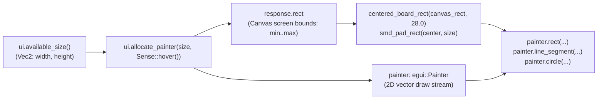

In [Lesson 0001](./0001-the-immediate-mode-loop.html), our `CentralPanel` only printed placeholder text labels (`"Rendering Top Copper..."`) when a layer checkbox was toggled. Now we begin **Act I: The 2D CAD Canvas & Viewport** by replacing those text placeholders with an actual 2D vector canvas that draws an FR4 PCB substrate, Top and Bottom Copper traces, rectangular SMD pads, plated through-hole vias, Silkscreen courtyards, and unrouted Ratsnest airwires.

## 1. Reserving Canvas Space with `ui.allocate_painter`

Unlike standard widgets (`ui.checkbox`, `ui.button`) that compute their own size, a 2D CAD viewport needs you to explicitly tell `egui` how much rectangle space to claim and what mouse interactions to listen for.{{sidenote:See [`Ui::allocate_painter`](https://docs.rs/egui/latest/egui/struct.Ui.html#method.allocate_painter) in the official `egui` docs: it returns a two-element Rust tuple `(Response, Painter)` clipped to the allocated rectangle.}}

```rust
egui::CentralPanel::default().show(ctx, |ui| {
    let (response, painter) =
        ui.allocate_painter(ui.available_size(), egui::Sense::hover());
    self.paint_static_board(&painter, response.rect);
});
```

Look at what happens in that single call:

- **`ui.available_size()`** queries the remaining width and height inside `CentralPanel` as an [`egui::Vec2`](https://docs.rs/egui/latest/egui/struct.Vec2.html).
- **`(response, painter)`** destructures the returned tuple: `response.rect` is the screen-space [`egui::Rect`](https://docs.rs/egui/latest/egui/struct.Rect.html) reserved for our canvas, and `painter` ([`egui::Painter`](https://docs.rs/egui/latest/egui/struct.Painter.html)) emits 2D vector primitives clipped to that rectangle.


_Figure 2.1: `ui.allocate_painter` reserves a screen-space `Rect` and returns a clipped `Painter` for drawing PCB layers._

## 2. Screen-Space Primitives & Rust's `Copy` Trait

In `egui`, screen coordinates are measured in logical points from the top-left corner of the window (`(0.0, 0.0)`), where `+x` points right and `+y` points down. Five lightweight types power all 2D CAD drawing:{{sidenote:In Rust ([Rust Book §4.1](https://doc.rust-lang.org/book/ch04-01-what-is-ownership.html#stack-only-data-copy)), small stack-only types like `Pos2` (8 bytes), `Vec2` (8 bytes), `Rect` (16 bytes), `Color32` (4 bytes), and `Stroke` (8 bytes) implement the `Copy` trait. Passing `f_cu_stroke` into three `painter.line_segment(...)` calls copies 8 bytes on the stack each time—ownership never moves!}}

1. **Position (`Pos2` / `pos2(x, y)`):** A specific 2D coordinate point (e.g. a via center or pad center). Adding a displacement vector to a point yields a new point: `origin + vec2(80.0, 90.0)`.
2. **Displacement / Size (`Vec2` / `vec2(w, h)`):** A 2D offset or width/height pair (e.g. `vec2(20.0, 12.0)` for an SMD pad's dimensions).
3. **Bounding Box (`Rect`):** Defined by its top-left `min: Pos2` and bottom-right `max: Pos2` corners.
4. **Color & Outline (`Color32` & `Stroke`):** `Color32::from_rgb(r, g, b)` specifies a color, and `Stroke::new(width_f32, color)` bundles line thickness and color for traces and component outlines.

## 3. Extracting Pure Geometry Functions for `cargo mutants`

If you bury all coordinate math directly inside `paint_static_board`, you cannot unit-test your pad or board bounds without spinning up a full UI frame. Instead, extract pure geometry helpers that take `Copy` inputs (`Rect`, `Pos2`, `Vec2`) and return a `Rect`:{{sidenote:Notice why we write `Stroke::new(5.0_f32, ...)` with an explicit `_f32` suffix: `Stroke::new` accepts generic `impl Into<f32>`, and Rust 1.97+ warns if an untyped float literal falls back to `f32` through a generic trait bound.}}

```rust
/// Computes the inset FR4 board outline `Rect` inside the allocated `canvas_rect`
/// by shrinking all four edges inward by `margin` screen points.
pub fn centered_board_rect(canvas_rect: Rect, margin: f32) -> Rect {
    Rect::from_min_max(
        pos2(canvas_rect.min.x + margin, canvas_rect.min.y + margin),
        pos2(canvas_rect.max.x - margin, canvas_rect.max.y - margin),
    )
}

/// Computes the bounding `Rect` for a rectangular SMD pad centered at `center`
/// with width `size.x` and height `size.y`.
pub fn smd_pad_rect(center: Pos2, size: Vec2) -> Rect {
    let half_w = size.x / 2.0;
    let half_h = size.y / 2.0;
    Rect::from_min_max(
        pos2(center.x - half_w, center.y - half_h),
        pos2(center.x + half_w, center.y + half_h),
    )
}
```

{{widget:painter-canvas-sim}}

:::exercise title="Interactive Lab 2: Allocate the Canvas & Compute Pad Bounds" badge="Skill Practice • Tight Feedback Loop"
Fill in the three blanks below to (1) compute half the pad width from `size.x`, (2) allocate the 2D canvas painter inside `CentralPanel`, and (3) pass the allocated screen rectangle from `response` into `paint_static_board`:

```rust
pub fn smd_pad_rect(center: Pos2, size: Vec2) -> Rect {
    let half_w = {{blank:size.x / 2.0;;size.x * 0.5|Divide the pad width `size.x` by `2.0` to get half its width.|/* 1: half x */|130px}};
    let half_h = size.y / 2.0;
    Rect::from_min_max(
        pos2(center.x - half_w, center.y - half_h),
        pos2(center.x + half_w, center.y + half_h),
    )
}

// Inside PcbReviewerApp::update:
egui::CentralPanel::default().show(ctx, |ui| {
    let (response, painter) = ui.{{blank:allocate_painter|Call the `Ui` method that reserves a rectangle and returns `(Response, Painter)`.|/* 2: allocate fn */|170px}}(ui.available_size(), Sense::hover());
    self.paint_static_board(&painter, {{blank:response.rect|Access the allocated screen-space `Rect` field on `response`.|/* 3: rect field */|145px}});
});
```
:::prompts
hint: **Hints:** (1) `size.x / 2.0`. (2) `allocate_painter`. (3) `response.rect`.
success: **Nailed it!** Your helper computes symmetric pad bounds from `size.x / 2.0`, allocates the canvas via `ui.allocate_painter(...)`, and passes `response.rect` to the board renderer.
:::
:::

:::verify title="Interactive Lab 3: Catching Arithmetic Sign & Factor Mutants" badge="cargo test + cargo mutants" tier="Tier 2: Geometry Unit Tests" caught="23 Caught (2 Unviable)" missed="0 Missed"
When `cargo mutants` inspects `centered_board_rect` and `smd_pad_rect`, it systematically mutates every `+` to `-` and `*`, every `-` to `+` and `/`, and every `/` to `*` and `%` (25 total mutants across the file!). Notice why our test uses non-zero, asymmetric coordinates like `pos2(100.0, 60.0)` and `vec2(16.0, 10.0)`—if you tested at `pos2(0.0, 0.0)`, then `0.0 - half_w` mutated to `0.0 / half_w` would both evaluate to `0.0` when `half_w == 0.0`!

```rust
#[test]
fn centered_board_rect_insets_all_four_edges_by_margin() {
    let canvas = Rect::from_min_max(pos2(10.0, 20.0), pos2(310.0, 220.0));
    let board = centered_board_rect(canvas, 25.0);

    assert_eq!(board.min, pos2(35.0, 45.0));
    assert_eq!(board.max, pos2(285.0, 195.0));
}

#[test]
fn smd_pad_rect_computes_symmetric_bounds_around_center() {
    let pad = smd_pad_rect(pos2(100.0, 60.0), vec2(16.0, 10.0));

    assert_eq!(pad.min, pos2(92.0, 55.0));
    assert_eq!(pad.max, pos2(108.0, 65.0));
}
```

- [ ] **1. Run `cargo test` in `apps/0002-custom-2d-canvas-and-painter`:** Confirm all 5 unit tests pass with zero warnings.
- [ ] **2. Run `cargo mutants --in-place`:** Verify that all 23 viable arithmetic and state mutants are **Caught** (and 2 type-incompatible mutants are marked **Unviable**), leaving **0 missed mutants**.
:::

:::quiz title="Retrieval Practice: 2D Painter & `Copy` Value Semantics"
Q: What does `ui.allocate_painter(ui.available_size(), Sense::hover())` do inside `CentralPanel`?
- [ ] It opens a secondary desktop window thread
- [x] It claims canvas space and returns Painter
- [ ] It clears every prior panel from rendering
- [ ] It blocks mouse input across other widgets
why: `ui.allocate_painter` reserves the requested size in the current `Ui` layout and returns `(Response, Painter)` clipped to that rectangle.
hint: Look at the two values returned in the tuple `(response, painter)`.

Q: Why can you pass `f_cu_stroke` or `board_rect` into multiple `painter` calls without `.clone()`?
- [ ] Painter macros rewrite borrows at build time
- [ ] Rust moves heap buffers back after rendering
- [ ] Structs inside egui use global static memory
- [x] Core geometry types implement the Copy trait
why: `Pos2`, `Vec2`, `Rect`, `Color32`, and `Stroke` are small stack-only structs that implement `Copy`, so passing them by value duplicates a few bytes on the stack without moving ownership.
hint: Think about how Rust handles small stack-only value types versus heap-allocated structs.

Q: Why did we test `smd_pad_rect` at `pos2(100.0, 60.0)` instead of `pos2(0.0, 0.0)` under `cargo mutants`?
- [x] Zero coordinates let plus match minus mutants
- [ ] Zero coordinates cause panics inside Rect min
- [ ] Zero coordinates skip bounds checks in assert
- [ ] Zero coordinates make cargo test skip asserts
why: Using non-zero, distinct coordinates ensures that when `cargo mutants` replaces `-` with `/` or `+` with `*`, every mutated arithmetic expression produces a different float that fails `assert_eq!`.
hint: Evaluate `0.0 - half_w` versus `0.0 / half_w` when coordinates are zero.
:::

## Recommended Primary Source

:::callout
**Read (5 mins):** [`egui::Painter` Official Documentation](https://docs.rs/egui/latest/egui/struct.Painter.html) and [`egui_demo_lib` Painting Example](https://github.com/emilk/egui/blob/master/crates/egui_demo_lib/src/demo/painting.rs).
Compare how `allocate_painter` reserves a `Rect` and clips all shapes drawn within that region.
:::

:::teacher-prompt
**Next Step:** Right now our board coordinates are hardcoded in screen pixels relative to `board_rect.min`. Ready to express the board in real physical millimeters (`mm`) and add smooth pan and cursor-anchored zoom in [**Lesson 0003: World-to-Screen Transforms, Pan, and Zoom (`TSTransform`)**](./0003-world-to-screen-transforms-pan-and-zoom.html)?
:::
