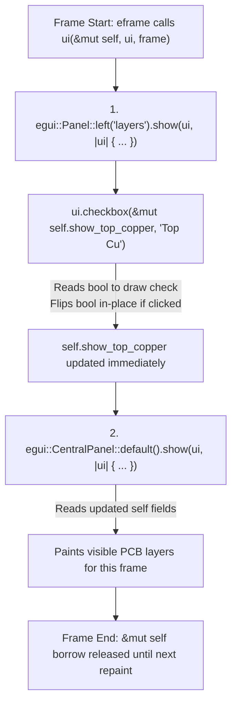

If you have spent years building UIs in HTML/React, Qt, or Flutter, your muscle memory is wired for [retained-mode](../reference/glossary.html) widgets: you construct a checkbox object once, wire up an `onChange` callback, and spend the rest of the afternoon keeping its internal state synchronised with your data model.{{sidenote:See Emil Ernerfeldt's official [Understanding Immediate Mode](https://docs.rs/egui/latest/egui/#understanding-immediate-mode) section in the `egui` documentation for why eliminating widget callbacks prevents out-of-sync UI bugs.}}

Turns out, `egui` throws all of that out the window.

In [Lesson 0001](./0001-project-setup-and-eframe-boot.html), we created our `pcb-reviewer` Cargo crate and booted a native window with `eframe::run_native`. Now, we are going to fill in the heart of that file—`PcbReviewerApp::ui`—to build our **Layer Visibility Inspector**: toggling _Top Copper (`F.Cu`)_, _Bottom Copper (`B.Cu`)_, _Silkscreen (`F.SilkS`)_, and the unrouted _Ratsnest_ on and off.

In `egui`, **there are no persistent checkbox or button objects**. Instead, your plain Rust [`struct`](../reference/glossary.html) holds the single source of truth, and on every frame, your [`eframe::App::ui`](../reference/glossary.html) method runs straight from top to bottom.


_Figure 2.1: Inside a single call to `ui(&mut self, ui, frame)`, `Panel::left` mutates `self` in-place via `&mut` before `CentralPanel` reads `self` to paint the board._

## 1. Your Rust `struct` Is the Only State

Recall the `PcbReviewerApp` struct we initialised in [Lesson 0001](./0001-project-setup-and-eframe-boot.html). Four `bool` fields track which PCB layers are currently visible:

```rust
pub struct PcbReviewerApp {
    pub show_top_copper: bool,
    pub show_bottom_copper: bool,
    pub show_silkscreen: bool,
    pub show_ratsnest: bool,
}
```

## 2. Why `egui` Widgets Take `&mut` References

When `eframe` redraws your window, it calls:{{sidenote:In [`eframe::App::ui`](https://docs.rs/eframe/latest/eframe/trait.App.html#tymethod.ui), `&mut self` is shorthand for `self: &mut PcbReviewerApp`—an exclusive mutable borrow of your struct for the duration of a single frame ([Rust Book §4.2](https://doc.rust-lang.org/book/ch04-02-references-and-borrowing.html#mutable-references)).}}

```rust
fn ui(&mut self, ui: &mut egui::Ui, _frame: &mut eframe::Frame)
```

So, inside `ui`, we place a left [`egui::Panel`](https://docs.rs/egui/latest/egui/containers/panel/struct.Panel.html) for our layer controls, followed by an [`egui::CentralPanel`](https://docs.rs/egui/latest/egui/containers/panel/struct.CentralPanel.html) for our 2D PCB canvas. Look closely at what we pass into [`ui.checkbox`](https://docs.rs/egui/latest/egui/struct.Ui.html#method.checkbox):

```rust
egui::Panel::left("layer_panel").show(ui, |ui| {
    ui.heading("PCB Layers");
    ui.checkbox(&mut self.show_top_copper, "Top Copper (F.Cu)");
    ui.checkbox(&mut self.show_bottom_copper, "Bottom Copper (B.Cu)");
    ui.checkbox(&mut self.show_silkscreen, "Silkscreen (F.SilkS)");
    ui.checkbox(&mut self.show_ratsnest, "Ratsnest (Unrouted)");
});
```

Two Rust mechanics make those six lines work without a single callback:{{sidenote:Always declare `Panel::left`, `Panel::right`, `Panel::top`, and `Panel::bottom` **before** `CentralPanel`. According to the [`CentralPanel` docs](https://docs.rs/egui/latest/egui/containers/panel/struct.CentralPanel.html), it claims all remaining space in the root `Ui` after outer panels have been laid out.}}

1. **The Closure (`|ui| { ... }`):** `.show(ui, |ui| { ... })` takes an inline anonymous function ([Rust Book §13.1](https://doc.rust-lang.org/book/ch13-01-closures.html)) receiving a temporary [`&mut egui::Ui`](../reference/glossary.html) region. When the closure ends, the inner `ui` is dropped—only your `self` struct persists to the next frame.
2. **The Mutable Borrow (`&mut self.show_top_copper`):** Passing `&mut` grants `ui.checkbox` temporary read-write access to that single `bool` field. In one function call, `ui.checkbox` _reads_ the boolean to draw the tick mark, checks whether the mouse clicked that rectangle this frame, and if so, _flips the boolean in place_ before returning. No listeners, no state-sync plumbing.

## 3. Making Button Actions Testable & Mutant-Proof: Block by Block

Now, what about preset buttons like **"Isolate Top Copper"** or **"Show All Layers"**? When you click a button, `ui.button("...").clicked()` returns `true` for that single frame.

It is tempting to inline the boolean assignments right inside the `if ui.button(...).clicked()` block. But, if you extract that state transition into a method on `PcbReviewerApp` taking `&mut self`, your `ui()` loop stays clean _and_ you can test and mutate every state transition with `cargo test` and [`cargo mutants`](https://mutants.rs/) ([Testing & Mutation Cheat Sheet](../reference/testing-and-mutation-cheatsheet.html)).{{sidenote:The reason our unit test setup matters here is interesting: if a test starts from a state where `show_top_copper` is _already_ `true` and the other layers are already `false`, and then calls `app.isolate_top_copper()`, `cargo mutants` can replace the body of `isolate_top_copper` with an empty no-op `()` and the test will still pass! Starting from the opposite state forces the method to actually flip every field.}}

Let's walk through the new code added to `src/main.rs` in this lesson block by block, then inspect the complete runnable file in context.

### Block 1: Pure Layer Preset Methods (`impl PcbReviewerApp`)

```rust
impl PcbReviewerApp {
    pub fn reset_layers(&mut self) {
        self.show_top_copper = true;
        self.show_bottom_copper = true;
        self.show_silkscreen = true;
        self.show_ratsnest = false;
    }

    pub fn isolate_top_copper(&mut self) {
        self.show_top_copper = true;
        self.show_bottom_copper = false;
        self.show_silkscreen = false;
        self.show_ratsnest = false;
    }

    pub fn show_all_layers(&mut self) {
        self.show_top_copper = true;
        self.show_bottom_copper = true;
        self.show_silkscreen = true;
        self.show_ratsnest = true;
    }
}
```

- **`pub fn isolate_top_copper(&mut self)`**: Takes an exclusive mutable borrow (`&mut self`) of `PcbReviewerApp` so it can enable `self.show_top_copper` while turning off the three remaining layer flags in place.
- **`pub fn show_all_layers(&mut self)`**: Mutably borrows `self` and sets all four `bool` fields—including the unrouted `self.show_ratsnest` overlay—to `true`.
- **Why Keep State Transitions Out of `ui()`**: Because these methods only touch plain Rust booleans on `self` and don't require an `egui::Ui` handle or GPU window, we can call them directly in `#[test]` functions and verify every field assignment with `cargo-mutants`.

### Block 2: The Left Layer Inspector & Central Viewport (`impl eframe::App`)

```rust
impl eframe::App for PcbReviewerApp {
    fn ui(&mut self, ui: &mut egui::Ui, _frame: &mut eframe::Frame) {
        egui::Panel::left("layer_panel").show(ui, |ui| {
            ui.heading("PCB Layers");
            ui.checkbox(&mut self.show_top_copper, "Top Copper (F.Cu)");
            ui.checkbox(&mut self.show_bottom_copper, "Bottom Copper (B.Cu)");
            ui.checkbox(&mut self.show_silkscreen, "Silkscreen (F.SilkS)");
            ui.checkbox(&mut self.show_ratsnest, "Ratsnest (Unrouted)");

            ui.separator();
            if ui.button("Isolate Top Copper").clicked() {
                self.isolate_top_copper();
            }
            if ui.button("Show All Layers").clicked() {
                self.show_all_layers();
            }
        });

        egui::CentralPanel::default().show(ui, |ui| {
            ui.heading("PCB Viewport Ready");
            if self.show_top_copper {
                ui.label("Rendering Top Copper (F.Cu)...");
            }
            if self.show_bottom_copper {
                ui.label("Rendering Bottom Copper (B.Cu)...");
            }
            if self.show_silkscreen {
                ui.label("Rendering Silkscreen (F.SilkS)...");
            }
            if self.show_ratsnest {
                ui.label("Rendering Ratsnest (Unrouted)...");
            }
        });
    }
}
```

- **`egui::Panel::left("layer_panel").show(ui, |ui| { ... })`**: Carves out a resizable left sidebar identified by the unique ID string `"layer_panel"` before `CentralPanel` claims the rest of the window.
- **`ui.checkbox(&mut self.show_..., "...")`**: Each checkbox temporarily borrows one boolean field mutably (`&mut`), draws its current state, and flips the `bool` immediately if clicked during this frame.
- **`ui.separator()` & `ui.button("...").clicked()`**: `ui.separator()` draws a horizontal dividing line. `ui.button(...)` returns an [`egui::Response`](https://docs.rs/egui/latest/egui/struct.Response.html) value; calling `.clicked()` returns `true` on the frame the user clicks the button, triggering `self.isolate_top_copper()` or `self.show_all_layers()`.
- **Immediate Same-Frame Consistency in `CentralPanel`**: Because `Panel::left` runs *before* `CentralPanel::default().show(...)`, any change made by a checkbox or preset button in the left panel is already stored in `self` when `CentralPanel` checks `if self.show_top_copper` a few microseconds later in the exact same frame.

### Block 3: Unit Tests for Layer Preset Transitions (`#[cfg(test)] mod tests`)

```rust
    #[test]
    fn isolate_top_copper_forces_only_top_copper_visible() {
        let mut app = PcbReviewerApp {
            show_top_copper: false,
            show_bottom_copper: true,
            show_silkscreen: true,
            show_ratsnest: true,
        };

        app.isolate_top_copper();

        assert!(app.show_top_copper);
        assert!(!app.show_bottom_copper);
        assert!(!app.show_silkscreen);
        assert!(!app.show_ratsnest);
    }

    #[test]
    fn show_all_layers_enables_every_layer() {
        let mut app = PcbReviewerApp {
            show_top_copper: false,
            show_bottom_copper: false,
            show_silkscreen: false,
            show_ratsnest: false,
        };

        app.show_all_layers();

        assert!(app.show_top_copper);
        assert!(app.show_bottom_copper);
        assert!(app.show_silkscreen);
        assert!(app.show_ratsnest);
    }
```

- **Starting from the Opposite State (`let mut app = PcbReviewerApp { ... }`)**: Notice that `isolate_top_copper_forces_only_top_copper_visible` starts with `show_top_copper: false` and the other three layers `true`, while `show_all_layers_enables_every_layer` starts with all four fields `false`. That forces each method to actively flip every single boolean it touches.
- **Exhaustive Field Assertions**: Checking all four fields with `assert!(...)` and `assert!(!...)` guarantees that if `cargo-mutants` replaces either method body with `()`, the test suite immediately catches the fault.

### Complete `src/main.rs` Listing

Here is the complete, runnable `apps/0002-the-immediate-mode-loop/src/main.rs` file with all blocks assembled in context:

```rust
use eframe::egui;

fn main() -> eframe::Result {
    let mut options = eframe::NativeOptions::default();
    options.viewport = egui::ViewportBuilder::default()
        .with_inner_size([1024.0, 720.0]);

    eframe::run_native(
        "Schematic & PCB Design Reviewer",
        options,
        Box::new(|_cc| Ok(Box::new(PcbReviewerApp::default()))),
    )
}

pub struct PcbReviewerApp {
    pub show_top_copper: bool,
    pub show_bottom_copper: bool,
    pub show_silkscreen: bool,
    pub show_ratsnest: bool,
}

impl Default for PcbReviewerApp {
    fn default() -> Self {
        let mut app = Self {
            show_top_copper: false,
            show_bottom_copper: false,
            show_silkscreen: false,
            show_ratsnest: false,
        };
        app.reset_layers();
        app
    }
}

impl PcbReviewerApp {
    pub fn reset_layers(&mut self) {
        self.show_top_copper = true;
        self.show_bottom_copper = true;
        self.show_silkscreen = true;
        self.show_ratsnest = false;
    }

    pub fn isolate_top_copper(&mut self) {
        self.show_top_copper = true;
        self.show_bottom_copper = false;
        self.show_silkscreen = false;
        self.show_ratsnest = false;
    }

    pub fn show_all_layers(&mut self) {
        self.show_top_copper = true;
        self.show_bottom_copper = true;
        self.show_silkscreen = true;
        self.show_ratsnest = true;
    }
}

impl eframe::App for PcbReviewerApp {
    fn ui(&mut self, ui: &mut egui::Ui, _frame: &mut eframe::Frame) {
        egui::Panel::left("layer_panel").show(ui, |ui| {
            ui.heading("PCB Layers");
            ui.checkbox(&mut self.show_top_copper, "Top Copper (F.Cu)");
            ui.checkbox(&mut self.show_bottom_copper, "Bottom Copper (B.Cu)");
            ui.checkbox(&mut self.show_silkscreen, "Silkscreen (F.SilkS)");
            ui.checkbox(&mut self.show_ratsnest, "Ratsnest (Unrouted)");

            ui.separator();
            if ui.button("Isolate Top Copper").clicked() {
                self.isolate_top_copper();
            }
            if ui.button("Show All Layers").clicked() {
                self.show_all_layers();
            }
        });

        egui::CentralPanel::default().show(ui, |ui| {
            ui.heading("PCB Viewport Ready");
            if self.show_top_copper {
                ui.label("Rendering Top Copper (F.Cu)...");
            }
            if self.show_bottom_copper {
                ui.label("Rendering Bottom Copper (B.Cu)...");
            }
            if self.show_silkscreen {
                ui.label("Rendering Silkscreen (F.SilkS)...");
            }
            if self.show_ratsnest {
                ui.label("Rendering Ratsnest (Unrouted)...");
            }
        });
    }
}

#[cfg(test)]
mod tests {
    use super::*;

    #[test]
    fn default_enables_physical_layers_and_hides_ratsnest() {
        let app = PcbReviewerApp::default();
        assert!(app.show_top_copper);
        assert!(app.show_bottom_copper);
        assert!(app.show_silkscreen);
        assert!(!app.show_ratsnest);
    }

    #[test]
    fn isolate_top_copper_forces_only_top_copper_visible() {
        let mut app = PcbReviewerApp {
            show_top_copper: false,
            show_bottom_copper: true,
            show_silkscreen: true,
            show_ratsnest: true,
        };

        app.isolate_top_copper();

        assert!(app.show_top_copper);
        assert!(!app.show_bottom_copper);
        assert!(!app.show_silkscreen);
        assert!(!app.show_ratsnest);
    }

    #[test]
    fn show_all_layers_enables_every_layer() {
        let mut app = PcbReviewerApp {
            show_top_copper: false,
            show_bottom_copper: false,
            show_silkscreen: false,
            show_ratsnest: false,
        };

        app.show_all_layers();

        assert!(app.show_top_copper);
        assert!(app.show_bottom_copper);
        assert!(app.show_silkscreen);
        assert!(app.show_ratsnest);
    }
}
```

{{widget:pcb-layer-sim}}

:::exercise title="Interactive Lab 2: Wire Up the Layer Inspector in Rust" badge="Skill Practice • Tight Feedback Loop"
Complete the three missing expressions in `PcbReviewerApp::ui` below so that: (1) the checkbox mutably borrows `self.show_ratsnest`, (2) the `"Isolate Top Copper"` button checks whether it was clicked this frame, and (3) the `CentralPanel` closure receives the `ui` handle.

```rust
impl eframe::App for PcbReviewerApp {
    fn ui(&mut self, ui: &mut egui::Ui, _frame: &mut eframe::Frame) {
        egui::Panel::left("layers").show(ui, |ui| {
            ui.heading("Layers");
            ui.checkbox({{blank:&mut self.show_ratsnest|Remember that `ui.checkbox` needs a mutable reference (`&mut ...`) to the `show_ratsnest` field on `self`.|/* 1: borrow field */|180px}}, "Ratsnest");

            if ui.button("Isolate Top Copper").{{blank:clicked()|`ui.button(...)` returns an `egui::Response`; call the method that checks if it was clicked this frame (don't forget parentheses `()`).|/* 2: method */|145px}} {
                self.show_top_copper = true;
                self.show_bottom_copper = false;
                self.show_silkscreen = false;
                self.show_ratsnest = false;
            }
        });

        egui::CentralPanel::default().show(ui, {{blank:|ui|;;|ui: &mut egui::Ui||Pass the closure parameter syntax that binds the panel's `Ui` handle using vertical pipes.|/* 3: arg */|110px}} {
            if self.show_top_copper {
                ui.label("Rendering Top Copper (F.Cu)...");
            }
        });
    }
}
```
:::prompts
hint: **Hints:** (1) Pass a mutable borrow: `&mut self.show_ratsnest`. (2) Query the button's `Response` with `clicked()`. (3) Start the closure with `|ui|`.
success: **Spot on!** Your `Panel::left` borrows `&mut self.show_ratsnest` in place, inspects `.clicked()` on the button's `Response`, and passes `|ui|` to the `CentralPanel` closure.
:::
:::

:::verify title="Interactive Lab 3: Cargo Verification & Catching a Missed Mutant" badge="cargo test + cargo mutants" tier="Tier 2: State Unit Tests" caught="3 / 3 Functions (100%)" missed="0 Missed"
Add the two unit tests below to your `#[cfg(test)] mod tests` block in `src/main.rs`. Notice why we start with `show_top_copper: false` and the other layers `true` _before_ calling `app.isolate_top_copper()`—so when `cargo mutants` replaces `isolate_top_copper` or `show_all_layers` with a no-op `()`, the test assertions immediately catch the mutant!

```rust
#[test]
fn isolate_top_copper_forces_only_top_copper_visible() {
    let mut app = PcbReviewerApp {
        show_top_copper: false,
        show_bottom_copper: true,
        show_silkscreen: true,
        show_ratsnest: true,
    };

    app.isolate_top_copper();

    assert!(app.show_top_copper);
    assert!(!app.show_bottom_copper);
    assert!(!app.show_silkscreen);
    assert!(!app.show_ratsnest);
}

#[test]
fn show_all_layers_enables_every_layer() {
    let mut app = PcbReviewerApp {
        show_top_copper: false,
        show_bottom_copper: false,
        show_silkscreen: false,
        show_ratsnest: false,
    };

    app.show_all_layers();

    assert!(app.show_top_copper);
    assert!(app.show_bottom_copper);
    assert!(app.show_silkscreen);
    assert!(app.show_ratsnest);
}
```

- [ ] **1. Run `cargo test`:** Verify that all 3 unit tests (`default_enables_physical_layers_and_hides_ratsnest`, `isolate_top_copper_forces_only_top_copper_visible`, and `show_all_layers_enables_every_layer`) pass.
- [ ] **2. Run `cargo mutants`:** (If you haven't installed it yet, run `cargo install --locked cargo-mutants` once.) Verify that `cargo mutants` reports `3 mutants tested: 3 caught` (**0 missed mutants**) across `reset_layers`, `isolate_top_copper`, and `show_all_layers`.
:::

:::quiz title="Retrieval Practice: Lock It Into Long-Term Memory"
Answer from memory before peeking back at the prose or the [Immediate-Mode Cheat Sheet](../reference/immediate-mode-cheatsheet.html). Effortful retrieval builds long-term storage strength.

Q: In egui, why do you pass `&mut self.show_top_copper` instead of `self.show_top_copper` into `ui.checkbox(...)`?
- [ ] It copies the boolean into graphics memory
- [x] It lets checkboxes read then mutate states
- [ ] It stores each widget object across frames
- [ ] It locks your window thread during drawing
why: A mutable borrow (`&mut`) allows `ui.checkbox` to both read the current boolean value to draw the check state and flip the boolean in-place if the user clicked it this frame.
hint: Think about what `ui.checkbox` has to do in a single immediate-mode call: both inspect the current `bool` and flip it if clicked.

Q: Why must `egui::Panel::left` be declared before `egui::CentralPanel` inside `ui()`?
- [ ] Panel::left creates the shared window background
- [ ] CentralPanel clears all previous panel widgets
- [ ] Panel::left cannot use mutable struct variables
- [x] CentralPanel claims all remaining window space
why: Edge panels (`Panel::left`, `Panel::right`, `Panel::top`, `Panel::bottom`) carve out their widths/heights from the available root `Ui` rect first; `CentralPanel` then consumes whatever space remains in the centre.
hint: Check the panel layout order rule in the Immediate-Mode Cheat Sheet: how does `CentralPanel` decide how large it should be?

Q: What happens to the local `ui` handle inside `|ui| { ... }` when a panel closure finishes?
- [x] Ui drops while your struct state persists
- [ ] Ui stays saved inside your struct forever
- [ ] Ui locks mutexes across every next redraw
- [ ] Ui moves ownership of self into rendering
why: `ui` is just a temporary region builder for the current frame. When the closure finishes, `ui` goes out of scope and is dropped, while your `PcbReviewerApp` struct (`self`) persists to the next frame.
hint: Remember what persists across frames in immediate mode versus what is created temporarily just to lay out one frame.
:::

## Recommended Primary Source

:::callout
**Read (5 mins):** [`egui` Crate Root Documentation — "Understanding Immediate Mode" & "Quick Start"](https://docs.rs/egui/latest/egui/#understanding-immediate-mode) by Emil Ernerfeldt.
Pay special attention to how `ui.label`, `ui.button`, and mutable state fit together, and why `egui` has no widget lifecycle callbacks.
:::

:::teacher-prompt
**Ask Your Teacher:** Anything in this lesson feel fuzzy—such as how Rust's borrow checker treats `&mut self` inside closures, or when `eframe` decides to run `ui()` vs. sleep? Ask me any follow-up question in chat, or click straight through to [**Lesson 0003: Custom 2D Canvas & `egui::Painter`**](./0003-custom-2d-canvas-and-painter.html)!
:::
