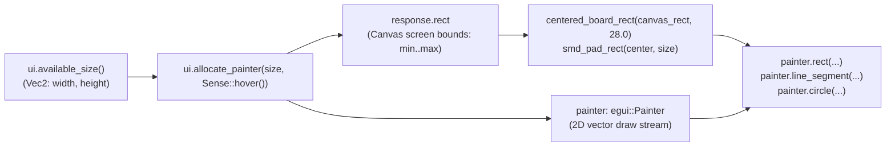

Printing `"Rendering Top Copper..."` as a text label in [Lesson 0002](./0002-the-immediate-mode-loop.html) proved our checkboxes were wired up, but it is a pretty underwhelming way to inspect a circuit board.

So, welcome to **Act I: The 2D CAD Canvas & Viewport**. We are going to replace those text placeholders with a real 2D vector canvas that draws an FR4 PCB substrate, Top and Bottom Copper traces, rectangular SMD pads, plated through-hole vias, Silkscreen courtyards, and unrouted Ratsnest airwires.

## 1. Reserving Canvas Space with `ui.allocate_painter`

Unlike standard widgets (`ui.checkbox`, `ui.button`) that know their own size, a 2D CAD viewport needs you to explicitly tell `egui` how much rectangular space to claim and what mouse interactions to listen for.{{sidenote:See [`Ui::allocate_painter`](https://docs.rs/egui/latest/egui/struct.Ui.html#method.allocate_painter) in the official `egui` docs: it returns a two-element Rust tuple `(Response, Painter)` clipped to the allocated rectangle.}}

```rust
egui::CentralPanel::default().show(ui, |ui| {
    let (response, painter) =
        ui.allocate_painter(ui.available_size(), egui::Sense::hover());
    self.paint_static_board(&painter, response.rect);
});
```

Look at what happens in that single call:

- **`ui.available_size()`** queries the remaining width and height inside `CentralPanel` as an [`egui::Vec2`](https://docs.rs/egui/latest/egui/struct.Vec2.html).
- **`(response, painter)`** destructures the returned tuple: `response.rect` is the screen-space [`egui::Rect`](https://docs.rs/egui/latest/egui/struct.Rect.html) reserved for our canvas, and `painter` ([`egui::Painter`](https://docs.rs/egui/latest/egui/struct.Painter.html)) emits 2D vector primitives clipped to that rectangle.


_Figure 3.1: `ui.allocate_painter` reserves a screen-space `Rect` and returns a clipped `Painter` for drawing PCB layers._

## 2. Screen-Space Primitives & Rust's `Copy` Trait

In `egui`, screen coordinates are measured in logical points from the top-left corner of the window (`(0.0, 0.0)`), where `+x` points right and `+y` points down. Five lightweight types power all of our 2D CAD drawing:{{sidenote:In Rust ([Rust Book §4.1](https://doc.rust-lang.org/book/ch04-01-what-is-ownership.html#stack-only-data-copy)), small stack-only types like `Pos2` (8 bytes), `Vec2` (8 bytes), `Rect` (16 bytes), `Color32` (4 bytes), and `Stroke` (8 bytes) implement the `Copy` trait. Passing `f_cu_stroke` into three `painter.line_segment(...)` calls copies 8 bytes on the stack each time—ownership never moves!}}

1. **Position (`Pos2` / `pos2(x, y)`):** A specific 2D coordinate point (e.g. a via centre or pad centre). Adding a displacement vector to a point yields a new point: `origin + vec2(80.0, 90.0)`.
2. **Displacement / Size (`Vec2` / `vec2(w, h)`):** A 2D offset or width/height pair (e.g. `vec2(20.0, 12.0)` for an SMD pad's dimensions).
3. **Bounding Box (`Rect`):** Defined by its top-left `min: Pos2` and bottom-right `max: Pos2` corners.
4. **Colour & Outline (`Color32` & `Stroke`):** `Color32::from_rgb(r, g, b)` specifies an RGB colour, and `Stroke::new(width_f32, color)` bundles line thickness and colour for traces and component outlines.

## 3. Painting the Static Board & Extracting Pure Geometry: Block by Block

Now, if you bury all of your coordinate maths directly inside `paint_static_board`, you cannot unit-test your pad or board bounds without spinning up a full UI frame.

Instead, let's walk through all four blocks of code introduced in `apps/0003-custom-2d-canvas-and-painter/src/main.rs`: the expanded `egui` geometry imports and pure `Rect` helpers, the multi-layer `paint_static_board` method, the updated `eframe::App::ui` layout, and the geometry unit tests.{{sidenote:Turns out, writing `Stroke::new(5.0_f32, ...)` with an explicit `_f32` suffix saves you a compiler warning: `Stroke::new` accepts generic `impl Into<f32>`, and Rust 1.97+ warns if an untyped float literal falls back to `f32` through a generic trait bound.}}

### Block 1: Geometry Imports & Pure Bounding-Box Helpers (`centered_board_rect` & `smd_pad_rect`)

```rust
use eframe::egui::{self, Color32, Pos2, Rect, Sense, Stroke, StrokeKind, Vec2, pos2, vec2};

/// Computes the inset FR4 board outline `Rect` inside the allocated `canvas_rect`
/// by shrinking all four edges inward by `margin` screen points.
pub fn centered_board_rect(canvas_rect: Rect, margin: f32) -> Rect {
    Rect::from_min_max(
        pos2(canvas_rect.min.x + margin, canvas_rect.min.y + margin),
        pos2(canvas_rect.max.x - margin, canvas_rect.max.y - margin),
    )
}

/// Computes the bounding `Rect` for a rectangular SMD pad centered at `center`
/// with width `size.x` and height `size.y`.
pub fn smd_pad_rect(center: Pos2, size: Vec2) -> Rect {
    let half_w = size.x / 2.0;
    let half_h = size.y / 2.0;
    Rect::from_min_max(
        pos2(center.x - half_w, center.y - half_h),
        pos2(center.x + half_w, center.y + half_h),
    )
}
```

- **`use eframe::egui::{self, Color32, Pos2, Rect, Sense, Stroke, StrokeKind, Vec2, pos2, vec2};`**: Rust's nested `use` syntax imports both the `egui` module itself (`self`) and the specific 2D types and constructor functions (`pos2`, `vec2`) we use on every line of CAD code.
- **`pub fn centered_board_rect(canvas_rect: Rect, margin: f32) -> Rect`**: Takes a `Rect` by value (`Rect` is `Copy`, so 16 bytes on the stack) and constructs an inset `Rect` via `Rect::from_min_max(...)` by adding `margin` to `min` (top-left) and subtracting `margin` from `max` (bottom-right).
- **`pub fn smd_pad_rect(center: Pos2, size: Vec2) -> Rect`**: Computes `half_w = size.x / 2.0` and `half_h = size.y / 2.0` so a rectangular SMD pad is symmetric around its `center: Pos2`. Extracting these two pure functions makes all `+`, `-`, and `/` coordinate arithmetic directly testable by `cargo test` and `cargo-mutants`.

### Block 2: Drawing the Multi-Layer Board with `egui::Painter` (`paint_static_board`)

```rust
    fn paint_static_board(&self, painter: &egui::Painter, canvas_rect: Rect) {
        // 1. Dark CAD background
        painter.rect_filled(canvas_rect, 0.0, Color32::from_rgb(12, 16, 14));

        // 2. Inset FR4 PCB substrate outline
        let board_rect = centered_board_rect(canvas_rect, 28.0);
        painter.rect(
            board_rect,
            6.0,
            Color32::from_rgb(16, 40, 30),
            Stroke::new(2.0_f32, Color32::from_rgb(47, 111, 82)),
            StrokeKind::Inside,
        );

        let origin = board_rect.min;

        // 3. Bottom Copper (B.Cu - Blue)
        if self.show_bottom_copper {
            let b_cu_stroke = Stroke::new(5.0_f32, Color32::from_rgb(59, 142, 234));
            painter.line_segment(
                [origin + vec2(80.0, 180.0), origin + vec2(220.0, 180.0)],
                b_cu_stroke,
            );
            painter.line_segment(
                [origin + vec2(220.0, 180.0), origin + vec2(280.0, 120.0)],
                b_cu_stroke,
            );
        }

        // 4. Top Copper (F.Cu - Terracotta Red) + SMD Pads + Plated Via
        if self.show_top_copper {
            let f_cu_color = Color32::from_rgb(224, 82, 67);
            let f_cu_stroke = Stroke::new(5.0_f32, f_cu_color);

            let pad_a = origin + vec2(80.0, 90.0);
            let pad_b = origin + vec2(80.0, 130.0);
            let via_pos = origin + vec2(280.0, 120.0);

            painter.line_segment([pad_a, origin + vec2(200.0, 90.0)], f_cu_stroke);
            painter.line_segment([origin + vec2(200.0, 90.0), via_pos], f_cu_stroke);
            painter.line_segment([pad_b, origin + vec2(170.0, 130.0)], f_cu_stroke);

            let pad_size = vec2(20.0, 12.0);
            painter.rect_filled(smd_pad_rect(pad_a, pad_size), 2.0, f_cu_color);
            painter.rect_filled(smd_pad_rect(pad_b, pad_size), 2.0, f_cu_color);

            // Plated through-hole via ring + drill hole
            painter.circle(
                via_pos,
                8.0,
                Color32::from_rgb(16, 40, 30),
                Stroke::new(3.5_f32, Color32::from_rgb(230, 193, 90)),
            );
        }

        // 5. Front Silkscreen (F.SilkS - Cream component courtyard)
        if self.show_silkscreen {
            let u1_rect = Rect::from_min_size(origin + vec2(62.0, 68.0), vec2(54.0, 132.0));
            painter.rect_stroke(
                u1_rect,
                2.0,
                Stroke::new(1.5_f32, Color32::from_rgb(240, 230, 140)),
                StrokeKind::Outside,
            );
        }

        // 6. Unrouted Ratsnest airwire
        if self.show_ratsnest {
            painter.line_segment(
                [origin + vec2(80.0, 130.0), origin + vec2(220.0, 180.0)],
                Stroke::new(1.5_f32, Color32::from_rgb(111, 247, 255)),
            );
        }
    }
```

- **Shared Borrow (`&self`) & `&egui::Painter`**: Because `paint_static_board` only *reads* `self.show_...` flags and emits shapes into `painter`, it takes an immutable reference `&self` rather than `&mut self`.
- **`painter.rect_filled`, `painter.rect`, and `painter.rect_stroke`**:
  - `rect_filled(rect, corner_radius, fill_color)` draws a solid filled rectangle (used for the dark viewport backdrop and the two SMD pads computed by `smd_pad_rect`).
  - `rect(rect, corner_radius, fill_color, stroke, StrokeKind::Inside)` draws both the green FR4 substrate fill and its border stroke in one call.
  - `rect_stroke(rect, corner_radius, stroke, StrokeKind::Outside)` draws an unfilled outline for the `U1` silkscreen courtyard.
- **`painter.line_segment([p0, p1], stroke)` & `Copy` Reuse**: Takes a two-element array `[Pos2; 2]` and a `Stroke`. Notice how `b_cu_stroke` and `f_cu_stroke` are passed by value into multiple `line_segment` calls without `.clone()` because `Stroke` implements `Copy`.
- **`painter.circle(center, radius, fill_color, stroke)`**: Draws the plated through-hole via at `via_pos` with a gold annular ring (`Stroke`) and dark drill-hole centre (`fill_color`).

### Block 3: Allocating the Painter in `CentralPanel` (`impl eframe::App`)

```rust
impl eframe::App for PcbReviewerApp {
    fn ui(&mut self, ui: &mut egui::Ui, _frame: &mut eframe::Frame) {
        egui::Panel::left("layer_panel").show(ui, |ui| {
            ui.heading("PCB Layers");
            ui.checkbox(&mut self.show_top_copper, "Top Copper (F.Cu)");
            ui.checkbox(&mut self.show_bottom_copper, "Bottom Copper (B.Cu)");
            ui.checkbox(&mut self.show_silkscreen, "Silkscreen (F.SilkS)");
            ui.checkbox(&mut self.show_ratsnest, "Ratsnest (Unrouted)");

            ui.separator();
            if ui.button("Isolate Top Copper").clicked() {
                self.isolate_top_copper();
            }
            if ui.button("Show All Layers").clicked() {
                self.show_all_layers();
            }
            if ui.button("Reset Defaults").clicked() {
                self.reset_layers();
            }
        });

        egui::CentralPanel::default().show(ui, |ui| {
            let (response, painter) = ui.allocate_painter(ui.available_size(), Sense::hover());
            self.paint_static_board(&painter, response.rect);
        });
    }
}
```

- **`if ui.button("Reset Defaults").clicked()`**: Wires up a third preset button in `Panel::left` that calls `self.reset_layers()` to restore the default layer state.
- **`let (response, painter) = ui.allocate_painter(ui.available_size(), Sense::hover());`**: Claims the entire remaining `CentralPanel` area (`ui.available_size()`), registers hover sensing (`Sense::hover()`), and returns both the layout `Response` (`response.rect`) and the clipped `Painter`.
- **`self.paint_static_board(&painter, response.rect);`**: Passes a shared reference `&painter` and the `Copy` `response.rect` into our board renderer.

### Block 4: Unit Tests for Board & Pad Geometry (`#[cfg(test)] mod tests`)

```rust
    #[test]
    fn centered_board_rect_insets_all_four_edges_by_margin() {
        let canvas = Rect::from_min_max(pos2(10.0, 20.0), pos2(310.0, 220.0));
        let board = centered_board_rect(canvas, 25.0);

        assert_eq!(board.min, pos2(35.0, 45.0));
        assert_eq!(board.max, pos2(285.0, 195.0));
    }

    #[test]
    fn smd_pad_rect_computes_symmetric_bounds_around_center() {
        let pad = smd_pad_rect(pos2(100.0, 60.0), vec2(16.0, 10.0));

        assert_eq!(pad.min, pos2(92.0, 55.0));
        assert_eq!(pad.max, pos2(108.0, 65.0));
    }
```

- **Asymmetric, Non-Zero Test Inputs**: `canvas` uses distinct `min.x` (`10.0`), `min.y` (`20.0`), `max.x` (`310.0`), and `max.y` (`220.0`) values, and `smd_pad_rect` uses `pos2(100.0, 60.0)` with `vec2(16.0, 10.0)`.
- **`assert_eq!` on `Pos2`**: Verifies both `min` and `max` corners so that any `+`/`-`/`*`/`/` operator flip introduced by `cargo-mutants` immediately fails an assertion.

### Complete `src/main.rs` Listing

Putting all four blocks together, here is the complete, runnable `apps/0003-custom-2d-canvas-and-painter/src/main.rs`:

```rust
use eframe::egui::{self, Color32, Pos2, Rect, Sense, Stroke, StrokeKind, Vec2, pos2, vec2};

fn main() -> eframe::Result {
    let mut options = eframe::NativeOptions::default();
    options.viewport = egui::ViewportBuilder::default().with_inner_size([1024.0, 720.0]);

    eframe::run_native(
        "Schematic & PCB Design Reviewer — Lesson 0003",
        options,
        Box::new(|_cc| Ok(Box::new(PcbReviewerApp::default()))),
    )
}

/// Computes the inset FR4 board outline `Rect` inside the allocated `canvas_rect`
/// by shrinking all four edges inward by `margin` screen points.
pub fn centered_board_rect(canvas_rect: Rect, margin: f32) -> Rect {
    Rect::from_min_max(
        pos2(canvas_rect.min.x + margin, canvas_rect.min.y + margin),
        pos2(canvas_rect.max.x - margin, canvas_rect.max.y - margin),
    )
}

/// Computes the bounding `Rect` for a rectangular SMD pad centered at `center`
/// with width `size.x` and height `size.y`.
pub fn smd_pad_rect(center: Pos2, size: Vec2) -> Rect {
    let half_w = size.x / 2.0;
    let half_h = size.y / 2.0;
    Rect::from_min_max(
        pos2(center.x - half_w, center.y - half_h),
        pos2(center.x + half_w, center.y + half_h),
    )
}

pub struct PcbReviewerApp {
    pub show_top_copper: bool,
    pub show_bottom_copper: bool,
    pub show_silkscreen: bool,
    pub show_ratsnest: bool,
}

impl Default for PcbReviewerApp {
    fn default() -> Self {
        let mut app = Self {
            show_top_copper: false,
            show_bottom_copper: false,
            show_silkscreen: false,
            show_ratsnest: false,
        };
        app.reset_layers();
        app
    }
}

impl PcbReviewerApp {
    pub fn reset_layers(&mut self) {
        self.show_top_copper = true;
        self.show_bottom_copper = true;
        self.show_silkscreen = true;
        self.show_ratsnest = false;
    }

    pub fn isolate_top_copper(&mut self) {
        self.show_top_copper = true;
        self.show_bottom_copper = false;
        self.show_silkscreen = false;
        self.show_ratsnest = false;
    }

    pub fn show_all_layers(&mut self) {
        self.show_top_copper = true;
        self.show_bottom_copper = true;
        self.show_silkscreen = true;
        self.show_ratsnest = true;
    }

    fn paint_static_board(&self, painter: &egui::Painter, canvas_rect: Rect) {
        // 1. Dark CAD background
        painter.rect_filled(canvas_rect, 0.0, Color32::from_rgb(12, 16, 14));

        // 2. Inset FR4 PCB substrate outline
        let board_rect = centered_board_rect(canvas_rect, 28.0);
        painter.rect(
            board_rect,
            6.0,
            Color32::from_rgb(16, 40, 30),
            Stroke::new(2.0_f32, Color32::from_rgb(47, 111, 82)),
            StrokeKind::Inside,
        );

        let origin = board_rect.min;

        // 3. Bottom Copper (B.Cu - Blue)
        if self.show_bottom_copper {
            let b_cu_stroke = Stroke::new(5.0_f32, Color32::from_rgb(59, 142, 234));
            painter.line_segment(
                [origin + vec2(80.0, 180.0), origin + vec2(220.0, 180.0)],
                b_cu_stroke,
            );
            painter.line_segment(
                [origin + vec2(220.0, 180.0), origin + vec2(280.0, 120.0)],
                b_cu_stroke,
            );
        }

        // 4. Top Copper (F.Cu - Terracotta Red) + SMD Pads + Plated Via
        if self.show_top_copper {
            let f_cu_color = Color32::from_rgb(224, 82, 67);
            let f_cu_stroke = Stroke::new(5.0_f32, f_cu_color);

            let pad_a = origin + vec2(80.0, 90.0);
            let pad_b = origin + vec2(80.0, 130.0);
            let via_pos = origin + vec2(280.0, 120.0);

            painter.line_segment([pad_a, origin + vec2(200.0, 90.0)], f_cu_stroke);
            painter.line_segment([origin + vec2(200.0, 90.0), via_pos], f_cu_stroke);
            painter.line_segment([pad_b, origin + vec2(170.0, 130.0)], f_cu_stroke);

            let pad_size = vec2(20.0, 12.0);
            painter.rect_filled(smd_pad_rect(pad_a, pad_size), 2.0, f_cu_color);
            painter.rect_filled(smd_pad_rect(pad_b, pad_size), 2.0, f_cu_color);

            // Plated through-hole via ring + drill hole
            painter.circle(
                via_pos,
                8.0,
                Color32::from_rgb(16, 40, 30),
                Stroke::new(3.5_f32, Color32::from_rgb(230, 193, 90)),
            );
        }

        // 5. Front Silkscreen (F.SilkS - Cream component courtyard)
        if self.show_silkscreen {
            let u1_rect = Rect::from_min_size(origin + vec2(62.0, 68.0), vec2(54.0, 132.0));
            painter.rect_stroke(
                u1_rect,
                2.0,
                Stroke::new(1.5_f32, Color32::from_rgb(240, 230, 140)),
                StrokeKind::Outside,
            );
        }

        // 6. Unrouted Ratsnest airwire
        if self.show_ratsnest {
            painter.line_segment(
                [origin + vec2(80.0, 130.0), origin + vec2(220.0, 180.0)],
                Stroke::new(1.5_f32, Color32::from_rgb(111, 247, 255)),
            );
        }
    }
}

impl eframe::App for PcbReviewerApp {
    fn ui(&mut self, ui: &mut egui::Ui, _frame: &mut eframe::Frame) {
        egui::Panel::left("layer_panel").show(ui, |ui| {
            ui.heading("PCB Layers");
            ui.checkbox(&mut self.show_top_copper, "Top Copper (F.Cu)");
            ui.checkbox(&mut self.show_bottom_copper, "Bottom Copper (B.Cu)");
            ui.checkbox(&mut self.show_silkscreen, "Silkscreen (F.SilkS)");
            ui.checkbox(&mut self.show_ratsnest, "Ratsnest (Unrouted)");

            ui.separator();
            if ui.button("Isolate Top Copper").clicked() {
                self.isolate_top_copper();
            }
            if ui.button("Show All Layers").clicked() {
                self.show_all_layers();
            }
            if ui.button("Reset Defaults").clicked() {
                self.reset_layers();
            }
        });

        egui::CentralPanel::default().show(ui, |ui| {
            let (response, painter) = ui.allocate_painter(ui.available_size(), Sense::hover());
            self.paint_static_board(&painter, response.rect);
        });
    }
}

#[cfg(test)]
mod tests {
    use super::*;

    #[test]
    fn default_enables_physical_layers_and_hides_ratsnest() {
        let app = PcbReviewerApp::default();
        assert!(app.show_top_copper);
        assert!(app.show_bottom_copper);
        assert!(app.show_silkscreen);
        assert!(!app.show_ratsnest);
    }

    #[test]
    fn isolate_top_copper_forces_only_top_copper_visible() {
        let mut app = PcbReviewerApp {
            show_top_copper: false,
            show_bottom_copper: true,
            show_silkscreen: true,
            show_ratsnest: true,
        };

        app.isolate_top_copper();

        assert!(app.show_top_copper);
        assert!(!app.show_bottom_copper);
        assert!(!app.show_silkscreen);
        assert!(!app.show_ratsnest);
    }

    #[test]
    fn show_all_layers_enables_every_layer() {
        let mut app = PcbReviewerApp {
            show_top_copper: false,
            show_bottom_copper: false,
            show_silkscreen: false,
            show_ratsnest: false,
        };

        app.show_all_layers();

        assert!(app.show_top_copper);
        assert!(app.show_bottom_copper);
        assert!(app.show_silkscreen);
        assert!(app.show_ratsnest);
    }

    #[test]
    fn centered_board_rect_insets_all_four_edges_by_margin() {
        let canvas = Rect::from_min_max(pos2(10.0, 20.0), pos2(310.0, 220.0));
        let board = centered_board_rect(canvas, 25.0);

        assert_eq!(board.min, pos2(35.0, 45.0));
        assert_eq!(board.max, pos2(285.0, 195.0));
    }

    #[test]
    fn smd_pad_rect_computes_symmetric_bounds_around_center() {
        let pad = smd_pad_rect(pos2(100.0, 60.0), vec2(16.0, 10.0));

        assert_eq!(pad.min, pos2(92.0, 55.0));
        assert_eq!(pad.max, pos2(108.0, 65.0));
    }
}
```

{{widget:painter-canvas-sim}}

:::exercise title="Interactive Lab 2: Allocate the Canvas & Compute Pad Bounds" badge="Skill Practice • Tight Feedback Loop"
Fill in the three blanks below to (1) compute half the pad width from `size.x`, (2) allocate the 2D canvas painter inside `CentralPanel`, and (3) pass the allocated screen rectangle from `response` into `paint_static_board`:

```rust
pub fn smd_pad_rect(center: Pos2, size: Vec2) -> Rect {
    let half_w = {{blank:size.x / 2.0;;size.x * 0.5|Divide the pad width `size.x` by `2.0` to get half its width.|/* 1: half x */|130px}};
    let half_h = size.y / 2.0;
    Rect::from_min_max(
        pos2(center.x - half_w, center.y - half_h),
        pos2(center.x + half_w, center.y + half_h),
    )
}

// Inside PcbReviewerApp::ui:
egui::CentralPanel::default().show(ui, |ui| {
    let (response, painter) = ui.{{blank:allocate_painter|Call the `Ui` method that reserves a rectangle and returns `(Response, Painter)`.|/* 2: allocate fn */|170px}}(ui.available_size(), Sense::hover());
    self.paint_static_board(&painter, {{blank:response.rect|Access the allocated screen-space `Rect` field on `response`.|/* 3: rect field */|145px}});
});
```
:::prompts
hint: **Hints:** (1) `size.x / 2.0`. (2) `allocate_painter`. (3) `response.rect`.
success: **Nailed it!** Your helper computes symmetric pad bounds from `size.x / 2.0`, allocates the canvas via `ui.allocate_painter(...)`, and passes `response.rect` to the board renderer.
:::
:::

:::verify title="Interactive Lab 3: Catching Arithmetic Sign & Factor Mutants" badge="cargo test + cargo mutants" tier="Tier 2: Geometry Unit Tests" caught="23 Caught (2 Unviable)" missed="0 Missed"
When `cargo mutants` inspects `centered_board_rect` and `smd_pad_rect`, it systematically mutates every `+` to `-` and `*`, every `-` to `+` and `/`, and every `/` to `*` and `%` (25 total mutants across the file!). The reason our test uses non-zero, asymmetric coordinates like `pos2(100.0, 60.0)` and `vec2(16.0, 10.0)` is interesting: if you tested at `pos2(0.0, 0.0)`, then `0.0 - half_w` mutated to `0.0 / half_w` would both evaluate to `0.0` when `half_w == 0.0`!

```rust
#[test]
fn centered_board_rect_insets_all_four_edges_by_margin() {
    let canvas = Rect::from_min_max(pos2(10.0, 20.0), pos2(310.0, 220.0));
    let board = centered_board_rect(canvas, 25.0);

    assert_eq!(board.min, pos2(35.0, 45.0));
    assert_eq!(board.max, pos2(285.0, 195.0));
}

#[test]
fn smd_pad_rect_computes_symmetric_bounds_around_center() {
    let pad = smd_pad_rect(pos2(100.0, 60.0), vec2(16.0, 10.0));

    assert_eq!(pad.min, pos2(92.0, 55.0));
    assert_eq!(pad.max, pos2(108.0, 65.0));
}
```

- [ ] **1. Run `cargo test` in `apps/0003-custom-2d-canvas-and-painter`:** Confirm all 5 unit tests pass with zero warnings.
- [ ] **2. Run `cargo mutants --in-place`:** Verify that all 23 viable arithmetic and state mutants are **Caught** (and 2 type-incompatible mutants are marked **Unviable**), leaving **0 missed mutants**.
:::

:::quiz title="Retrieval Practice: 2D Painter & `Copy` Value Semantics"
Q: What does `ui.allocate_painter(ui.available_size(), Sense::hover())` do inside `CentralPanel`?
- [ ] It opens a secondary desktop window thread
- [x] It claims canvas space and returns Painter
- [ ] It clears every prior panel from rendering
- [ ] It blocks mouse input across other widgets
why: `ui.allocate_painter` reserves the requested size in the current `Ui` layout and returns `(Response, Painter)` clipped to that rectangle.
hint: Look at the two values returned in the tuple `(response, painter)`.

Q: Why can you pass `f_cu_stroke` or `board_rect` into multiple `painter` calls without `.clone()`?
- [ ] Painter macros rewrite borrows at build time
- [ ] Rust moves heap buffers back after rendering
- [ ] Structs inside egui use global static memory
- [x] Core geometry types implement the Copy trait
why: `Pos2`, `Vec2`, `Rect`, `Color32`, and `Stroke` are small stack-only structs that implement `Copy`, so passing them by value duplicates a few bytes on the stack without moving ownership.
hint: Think about how Rust handles small stack-only value types versus heap-allocated structs.

Q: Why did we test `smd_pad_rect` at `pos2(100.0, 60.0)` instead of `pos2(0.0, 0.0)` under `cargo mutants`?
- [x] Zero coordinates let plus match minus mutants
- [ ] Zero coordinates cause panics inside Rect min
- [ ] Zero coordinates skip bounds checks in assert
- [ ] Zero coordinates make cargo test skip asserts
why: Using non-zero, distinct coordinates ensures that when `cargo mutants` replaces `-` with `/` or `+` with `*`, every mutated arithmetic expression produces a different float that fails `assert_eq!`.
hint: Evaluate `0.0 - half_w` versus `0.0 / half_w` when coordinates are zero.
:::

## Recommended Primary Source

:::callout
**Read (5 mins):** [`egui::Painter` Official Documentation](https://docs.rs/egui/latest/egui/struct.Painter.html) and [`egui_demo_lib` Painting Example](https://github.com/emilk/egui/blob/master/crates/egui_demo_lib/src/demo/painting.rs).
Compare how `allocate_painter` reserves a `Rect` and clips all shapes drawn within that region.
:::

:::teacher-prompt
**Next Step:** Right now our board coordinates are hardcoded in screen pixels relative to `board_rect.min`. Ready to express the board in real physical millimetres (`mm`) and add smooth pan and cursor-anchored zoom in [**Lesson 0004: World-to-Screen Transforms, Pan, and Zoom (`TSTransform`)**](./0004-world-to-screen-transforms-pan-and-zoom.html)?
:::
