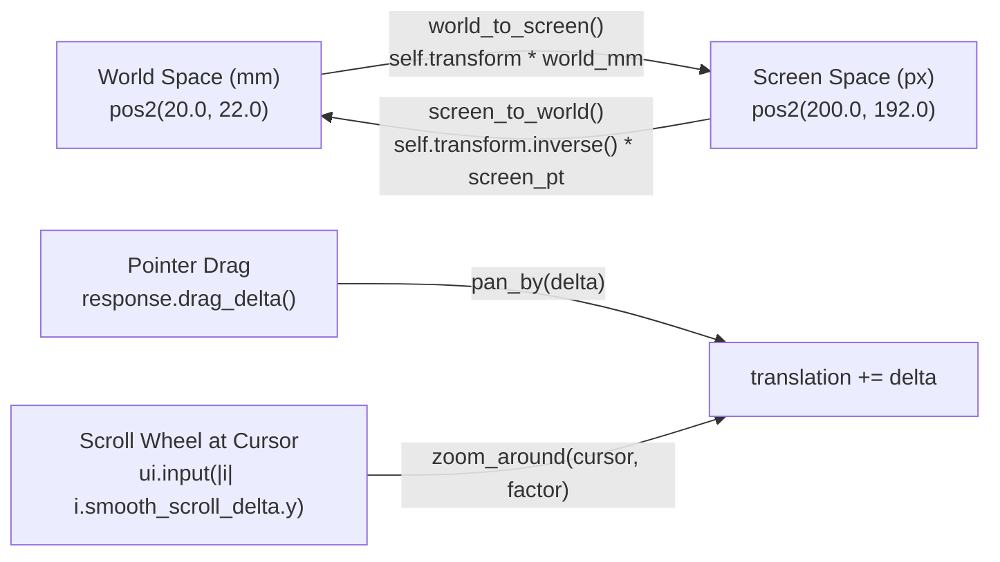

Hardcoding PCB pads in screen pixels works fine for a static demo, right up until you try to inspect a real board.

In [Lesson 0002](./0002-custom-2d-canvas-and-painter.html), our pads and traces were drawn at fixed pixel offsets from the top-left corner of the window. Real KiCad boards, however, live in **physical millimetres (`mm`)**—say, a `100 mm × 70 mm` board with a `0.8 mm` power trace and a `4.0 mm × 2.2 mm` SMD pad—and you need to pan across the board and zoom smoothly into dense pin pitches around your mouse cursor.

## 1. Two Coordinate Spaces: World (`mm`) vs. Screen (`px`)

So, every 2D CAD viewport maintains a mathematical camera that converts between two coordinate systems:{{sidenote:Turns out, `egui`'s maths crate (`emath`) provides [`egui::emath::TSTransform`](https://docs.rs/emath/latest/emath/struct.TSTransform.html) ("Translation + Scaling Transform") out of the box, complete with operator overloading (`transform * pos`) and `.inverse()`.}}

- **World Space (`world_mm: Pos2`):** Physical board coordinates in millimetres. A pad at `pos2(20.0, 22.0)` stays at `(20.0 mm, 22.0 mm)` forever, regardless of window size or zoom level.
- **Screen Space (`screen_pt: Pos2`):** Logical window points passed to `egui::Painter`.

The forward mapping (**World → Screen**) scales the millimetre coordinate by `scaling` (pixels per millimetre) and adds the camera offset `translation`:

$$\text{screen\_pt} = \text{scaling} \cdot \text{world\_mm} + \text{translation}$$

And the inverse mapping (**Screen → World**, implemented by `self.transform.inverse() * screen_pt`) subtracts `translation` and divides by `scaling`:

$$\text{world\_mm} = \frac{\text{screen\_pt} - \text{translation}}{\text{scaling}}$$


_Figure 3.1: `BoardViewport` wraps `TSTransform` to convert bi-directionally between physical millimetres and screen pixels._

## 2. Encapsulating the Camera in `struct BoardViewport`

Let's wrap `TSTransform` inside a dedicated `BoardViewport` struct with four testable methods:{{sidenote:The reason `zoom_around` adjusts `translation` is a classic CAD rite of passage: if you simply multiply `self.transform.scaling *= zoom_factor` on its own, the board zooms toward `(0, 0)` in the top-left corner and flies right away from your mouse cursor! Recording `world_anchor = self.screen_to_world(screen_anchor)` before scaling and solving $\text{translation} = \text{screen\_anchor} - \text{world\_anchor} \cdot \text{new\_scale}$ keeps the exact PCB pad under your cursor pinned in place.}}

```rust
pub const MIN_ZOOM: f32 = 1.5;
pub const MAX_ZOOM: f32 = 60.0;

#[derive(Clone, Copy, Debug, PartialEq)]
pub struct BoardViewport {
    pub transform: TSTransform,
}

impl Default for BoardViewport {
    fn default() -> Self {
        Self {
            transform: TSTransform::new(vec2(80.0, 60.0), 6.0),
        }
    }
}

impl BoardViewport {
    pub fn world_to_screen(&self, world_mm: Pos2) -> Pos2 {
        self.transform * world_mm
    }

    pub fn screen_to_world(&self, screen_pt: Pos2) -> Pos2 {
        self.transform.inverse() * screen_pt
    }

    pub fn pan_by(&mut self, screen_delta: Vec2) {
        self.transform.translation += screen_delta;
    }

    pub fn zoom_around(&mut self, screen_anchor: Pos2, zoom_factor: f32) {
        let world_anchor = self.screen_to_world(screen_anchor);
        let new_scale = (self.transform.scaling * zoom_factor).clamp(MIN_ZOOM, MAX_ZOOM);
        self.transform.scaling = new_scale;
        self.transform.translation =
            screen_anchor.to_vec2() - world_anchor.to_vec2() * new_scale;
    }
}
```

## 3. Wiring Drag-to-Pan & Scroll-to-Zoom in `CentralPanel`

Now, inside `PcbReviewerApp::update`, we upgrade our canvas allocation from `Sense::hover()` to [`Sense::drag()`](https://docs.rs/egui/latest/egui/struct.Sense.html#method.drag) and inspect both `response.dragged()` and [`ui.input(|i| i.smooth_scroll_delta.y)`](https://docs.rs/egui/latest/egui/struct.Ui.html#method.input):

```rust
let (response, painter) = ui.allocate_painter(ui.available_size(), Sense::drag());

if response.dragged() {
    self.viewport.pan_by(response.drag_delta());
}

if let Some(hover_pos) = response.hover_pos() {
    let scroll_y = ui.input(|i| i.smooth_scroll_delta.y);
    if scroll_y != 0.0 {
        let zoom_factor = (scroll_y * 0.005).exp();
        self.viewport.zoom_around(hover_pos, zoom_factor);
    }
}
```

{{widget:viewport-transform-sim}}

:::exercise title="Interactive Lab 2: Implement `BoardViewport` Transform Methods" badge="Skill Practice • Tight Feedback Loop"
Complete the three blanks below so that (1) `screen_to_world` uses the inverse of `self.transform`, (2) `zoom_around` clamps the new scale between `MIN_ZOOM` and `MAX_ZOOM`, and (3) dragging the canvas pans by `response.drag_delta()`:

```rust
impl BoardViewport {
    pub fn screen_to_world(&self, screen_pt: Pos2) -> Pos2 {
        self.transform.{{blank:inverse()|Call the method on `TSTransform` that returns the inverted screen-to-world transform.|/* 1: invert */|120px}} * screen_pt
    }

    pub fn zoom_around(&mut self, screen_anchor: Pos2, zoom_factor: f32) {
        let world_anchor = self.screen_to_world(screen_anchor);
        let new_scale = (self.transform.scaling * zoom_factor).{{blank:clamp(MIN_ZOOM, MAX_ZOOM)|Use `f32::clamp(MIN_ZOOM, MAX_ZOOM)` to bound the zoom scale.|/* 2: clamp min..max */|195px}};
        self.transform.scaling = new_scale;
        self.transform.translation =
            screen_anchor.to_vec2() - world_anchor.to_vec2() * new_scale;
    }
}

// Inside PcbReviewerApp::update:
if response.dragged() {
    self.viewport.pan_by(response.{{blank:drag_delta()|Call the method on `Response` that returns the pointer movement vector since the previous frame.|/* 3: delta fn */|140px}});
}
```
:::prompts
hint: **Hints:** (1) `inverse()`. (2) `clamp(MIN_ZOOM, MAX_ZOOM)`. (3) `drag_delta()`.
success: **Spot on!** `self.transform.inverse()` maps screen points back to physical millimetres, `.clamp(MIN_ZOOM, MAX_ZOOM)` prevents zoom underflow/overflow, and `response.drag_delta()` drives panning.
:::
:::

:::verify title="Interactive Lab 3: Round-Trip & Cursor-Anchor Invariant Tests" badge="cargo test + cargo mutants" tier="Tier 2: Transform Invariants" caught="14 Caught (6 Unviable)" missed="0 Missed"
In `apps/0003-world-to-screen-transforms-pan-and-zoom`, we test three geometric invariants: (1) `world_to_screen` and `screen_to_world` are exact inverses, (2) `pan_by` shifts screen coordinates by the exact drag vector, and (3) `zoom_around(cursor_screen, 2.0)` leaves `vp.screen_to_world(cursor_screen)` unchanged while clamping at `MIN_ZOOM` and `MAX_ZOOM`.

```rust
#[test]
fn zoom_around_keeps_cursor_world_point_stationary_and_clamps_scale() {
    let mut vp = BoardViewport::default();
    let cursor_screen = pos2(200.0, 180.0);
    let world_under_cursor_before = vp.screen_to_world(cursor_screen);

    vp.zoom_around(cursor_screen, 2.0);
    assert_eq!(vp.transform.scaling, 12.0);

    let world_under_cursor_after = vp.screen_to_world(cursor_screen);
    assert!((world_under_cursor_after.x - world_under_cursor_before.x).abs() < 1e-4);
    assert!((world_under_cursor_after.y - world_under_cursor_before.y).abs() < 1e-4);

    vp.zoom_around(cursor_screen, 100.0);
    assert_eq!(vp.transform.scaling, MAX_ZOOM);

    vp.zoom_around(cursor_screen, 0.001);
    assert_eq!(vp.transform.scaling, MIN_ZOOM);
}
```

- [ ] **1. Run `cargo test` in `apps/0003-world-to-screen-transforms-pan-and-zoom`:** Confirm all 6 unit tests pass.
- [ ] **2. Run `cargo mutants --in-place`:** Verify that all 14 viable mutants across `BoardViewport` and `PcbReviewerApp` are **Caught** (with 6 **Unviable** and **0 Missed**).
:::

:::quiz title="Retrieval Practice: Coordinate Transforms & Viewport Input"
Q: How does `TSTransform` map a physical board coordinate `world_mm` into screen space (`self.transform * world_mm`)?
- [ ] It divides world points by four translations
- [ ] It rotates world points around window centre
- [x] It scales world points then adds translation
- [ ] It clamps world points inside screen margins
why: `TSTransform` multiplies the input point by `scaling` (pixels per millimetre) and adds the 2D `translation` offset vector.
hint: Recall what the 'T' and 'S' in `TSTransform` stand for: Translation and Scaling.

Q: Why does `zoom_around(screen_anchor, factor)` compute `world_anchor = self.screen_to_world(screen_anchor)` before updating `scaling`?
- [x] World coords under your cursor remain pinned
- [ ] Scroll deltas must reset before canvas draws
- [ ] Vertex buffers need world bounds before draw
- [ ] Window resize events block direct scale math
why: Capturing the physical board coordinate under the cursor before scaling allows us to recompute `translation` so that exact world point projects back to `screen_anchor` after scaling.
hint: Think about what happens visually when you zoom with your cursor hovering over pin 1 of `U1`.

Q: Why did we pass `Sense::drag()` instead of `Sense::hover()` to `ui.allocate_painter` in Lesson 0003?
- [ ] Hover mode blocks smooth scroll wheel input
- [ ] Hover mode disables clip rectangles on draw
- [ ] Hover mode clears keyboard focus each frame
- [x] Drag sensing tracks pointer delta on motion
why: `Sense::drag()` tells `egui` to track mouse-down drag gestures on the canvas rect so `response.dragged()` and `response.drag_delta()` report live pan movements.
hint: Which `Response` methods do we call right after `ui.allocate_painter` to pan the camera?
:::

## Recommended Primary Source

:::callout
**Read (5 mins):** [`egui::emath::TSTransform` API Documentation](https://docs.rs/emath/latest/emath/struct.TSTransform.html).
Inspect how `TSTransform::inverse()` and `Mul<Pos2>` are implemented in `emath`.
:::

:::teacher-prompt
**Next Step:** Ready to replace our individual hardcoded trace calls with a structured `Vec<TraceSegment>` and `enum PcbLayer` sorted in deterministic back-to-front Z-order in [**Lesson 0004: Modeling Layers, Traces, and Z-Order Rendering**](./0004-modeling-layers-traces-and-footprints.html)?
:::
