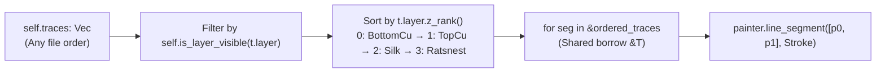

In [Lesson 0003](./0003-world-to-screen-transforms-pan-and-zoom.html), we transformed physical millimetre coordinates into screen space, but our traces were still individual hardcoded lines inside `paint_board`. Real KiCad files, on the other hand, contain thousands of segments across multiple layers—and they can appear in whatever order the router happened to save them.

Now, because `egui::Painter` uses the classic **painter's algorithm** (every shape you emit is drawn directly on top of earlier shapes), drawing traces in raw file order means a `BottomCopper` ground trace can paint right over the top of a `TopCopper` pad or `Silkscreen` label. Not ideal when you are trying to debug a board.


_Figure 4.1: Filtering visible segments and sorting by `PcbLayer::z_rank()` guarantees deterministic back-to-front CAD rendering every frame._

## 1. Exhaustive Layer Modelling with `enum PcbLayer`

So, instead of scattering four separate boolean `if` blocks across our renderer, let's model a PCB layer as a proper Rust [`enum`](https://doc.rust-lang.org/book/ch06-01-defining-an-enum.html) and attach pure methods using exhaustive [`match`](https://doc.rust-lang.org/book/ch06-02-match.html) expressions:{{sidenote:Because Rust's `match` is exhaustive at compile time, if you add an inner copper layer like `PcbLayer::In1Cu` later, `rustc` immediately flags every `match` block (`z_rank`, `color`, `is_layer_visible`) that needs updating.}}

```rust
#[derive(Clone, Copy, Debug, PartialEq, Eq)]
pub enum PcbLayer {
    BottomCopper,
    TopCopper,
    Silkscreen,
    Ratsnest,
}

impl PcbLayer {
    /// Deterministic back-to-front draw rank (0 = furthest back, 3 = topmost overlay).
    pub fn z_rank(self) -> u8 {
        match self {
            PcbLayer::BottomCopper => 0,
            PcbLayer::TopCopper => 1,
            PcbLayer::Silkscreen => 2,
            PcbLayer::Ratsnest => 3,
        }
    }

    pub fn color(self) -> Color32 {
        match self {
            PcbLayer::BottomCopper => Color32::from_rgb(59, 142, 234),
            PcbLayer::TopCopper => Color32::from_rgb(224, 82, 67),
            PcbLayer::Silkscreen => Color32::from_rgb(240, 230, 140),
            PcbLayer::Ratsnest => Color32::from_rgb(111, 247, 255),
        }
    }
}
```

## 2. Dynamic Collections (`Vec<T>`) & Shared Loop Borrowing

Next, we store our board's segments in a growable heap vector [`Vec<TraceSegment>`](https://doc.rust-lang.org/book/ch08-01-vectors.html) on `PcbReviewerApp`.{{sidenote:Turns out, writing `for seg in self.traces` without an `&` is a rite-of-passage error in Rust: iterating over a `Vec` by value _moves and consumes_ the vector on Frame #1! Borrowing with `&self.traces` (or `self.traces.iter()`) lets you read all segments 60 times a second while `self.traces` keeps ownership.}}

```rust
#[derive(Clone, Copy, Debug, PartialEq)]
pub struct TraceSegment {
    pub start: Pos2,
    pub end: Pos2,
    pub width_mm: f32,
    pub layer: PcbLayer,
}

impl PcbReviewerApp {
    pub fn is_layer_visible(&self, layer: PcbLayer) -> bool {
        match layer {
            PcbLayer::BottomCopper => self.show_bottom_copper,
            PcbLayer::TopCopper => self.show_top_copper,
            PcbLayer::Silkscreen => self.show_silkscreen,
            PcbLayer::Ratsnest => self.show_ratsnest,
        }
    }

    pub fn visible_traces_in_z_order(&self) -> Vec<TraceSegment> {
        let mut visible: Vec<TraceSegment> = self
            .traces
            .iter()
            .copied()
            .filter(|t| self.is_layer_visible(t.layer))
            .collect();
        visible.sort_by_key(|t| t.layer.z_rank());
        visible
    }
}
```

{{widget:layer-zorder-sim}}

:::exercise title="Interactive Lab 2: Filter & Sort Visible Traces" badge="Skill Practice • Tight Feedback Loop"
Fill in the three blanks below so that (1) `PcbLayer::Silkscreen` maps to `self.show_silkscreen`, (2) `visible_traces_in_z_order` filters by `self.is_layer_visible(t.layer)`, and (3) the collected vector is sorted by `t.layer.z_rank()`:

```rust
pub fn is_layer_visible(&self, layer: PcbLayer) -> bool {
    match layer {
        PcbLayer::BottomCopper => self.show_bottom_copper,
        PcbLayer::TopCopper => self.show_top_copper,
        {{blank:PcbLayer::Silkscreen|Match the `Silkscreen` variant of `PcbLayer`.|/* 1: silk variant */|190px}} => self.show_silkscreen,
        PcbLayer::Ratsnest => self.show_ratsnest,
    }
}

pub fn visible_traces_in_z_order(&self) -> Vec<TraceSegment> {
    let mut visible: Vec<TraceSegment> = self
        .traces
        .iter()
        .copied()
        .{{blank:filter|Call the iterator adapter that keeps only elements matching a boolean predicate.|/* 2: adapter */|110px}}(|t| self.is_layer_visible(t.layer))
        .collect();
    visible.sort_by_key(|t| {{blank:t.layer.z_rank()|Return the numeric Z-rank of the segment's layer (`t.layer.z_rank()`).|/* 3: rank key */|160px}});
    visible
}
```
:::prompts
hint: **Hints:** (1) `PcbLayer::Silkscreen`. (2) `filter`. (3) `t.layer.z_rank()`.
success: **All correct!** Your exhaustive `match` checks `PcbLayer::Silkscreen`, `.filter(...)` removes hidden layers, and `sort_by_key(|t| t.layer.z_rank())` orders segments back-to-front.
:::
:::

:::verify title="Interactive Lab 3: Eliminating Match-Arm Mutants" badge="cargo test + cargo mutants" tier="Tier 2: Domain & Z-Order Tests" caught="20 Caught (7 Unviable)" missed="0 Missed"
One of `cargo-mutants`'s best tricks is **match-arm mutation**: it tries deleting or swapping individual `match` arms inside `z_rank()`, `color()`, and `is_layer_visible()`. By asserting each variant's exact rank, colour, and visibility toggle in isolation, our 9 unit tests catch all 20 viable mutants!

```rust
#[test]
fn visible_traces_in_z_order_filters_hidden_layers_and_sorts_back_to_front() {
    let mut app = PcbReviewerApp::default();
    // Input traces are deliberately stored in reverse (front-to-back) order:
    // Ratsnest (3) -> Silkscreen (2) -> TopCopper (1) -> BottomCopper (0)
    let default_visible = app.visible_traces_in_z_order();
    let default_layers: Vec<PcbLayer> = default_visible.iter().map(|t| t.layer).collect();
    assert_eq!(
        default_layers,
        vec![
            PcbLayer::BottomCopper,
            PcbLayer::TopCopper,
            PcbLayer::Silkscreen
        ]
    );
}
```

- [ ] **1. Run `cargo test` in `apps/0004-modeling-layers-traces-and-footprints`:** Confirm all 9 unit tests pass.
- [ ] **2. Run `cargo mutants --in-place`:** Verify that all 20 viable mutants (including every `match` arm in `z_rank`, `color`, and `is_layer_visible`) are **Caught** with **0 Missed**.
:::

:::quiz title="Retrieval Practice: `enum`, `Vec<T>` & Z-Ordering"
Q: Why do we iterate over `&self.traces` (or `self.traces.iter()`) inside `update()` instead of `for seg in self.traces`?
- [ ] Consuming Vec copies all segments into memory
- [x] Borrowing Vec preserves data across all draws
- [ ] Consuming Vec corrupts a vertex buffer layout
- [ ] Consuming Vec blocks threads during panel run
why: Iterating over `self.traces` by value moves and consumes the vector on the first frame; borrowing with `&` reads the segments while keeping `self.traces` intact for every future frame.
hint: Remember what happens to ownership of a `Vec<T>` if you pass it by value into a `for` loop.

Q: Why does `visible_traces_in_z_order()` sort visible segments by `PcbLayer::z_rank()` before `Painter` draws them?
- [ ] Painter drops segments when layers are mixed
- [ ] Sorting merges copper lines into one polygon
- [ ] Sorting prevents heap clones on every redraw
- [x] Painter draws later shapes over earlier ones
why: `egui::Painter` paints shapes in the exact sequence they are emitted (the painter's algorithm), so sorting back-to-front ensures `TopCopper` and `Silkscreen` draw above `BottomCopper`.
hint: Think about what happens in the 2D painter's algorithm when two shapes overlap at the same screen coordinate.

Q: What happens when `cargo mutants` alters a single `match` arm inside `PcbLayer::z_rank()` or `is_layer_visible()`?
- [x] Testing every enum variant catches the fault
- [ ] Cargo skips any function with match branches
- [ ] Window loops ignore any deleted match branch
- [ ] Static lints block all enum match assertions
why: Because our unit tests explicitly assert each `PcbLayer` variant's `z_rank()`, `color()`, and visibility flag, mutating any branch immediately fails a test assertion.
hint: Look at `pcb_layer_ranks_and_colors_are_distinct_and_ordered_back_to_front` and `is_layer_visible_reflects_each_individual_layer_flag`.
:::

## Recommended Primary Source

:::callout
**Read (5 mins):** [The Rust Programming Language — §6.2 "The `match` Control Flow Construct"](https://doc.rust-lang.org/book/ch06-02-match.html).
Review how exhaustive pattern matching works on custom `enum` types.
:::

:::teacher-prompt
**Next Step:** Now that our board renders physical traces and pads in deterministic Z-order, let's complete Act I by adding interactive mouse hit-testing and net highlighting in [**Lesson 0005: Hit-Testing & Net Cross-Probing (`Option<NetId>`)**](./0005-hit-testing-and-net-cross-probing.html)!
:::
