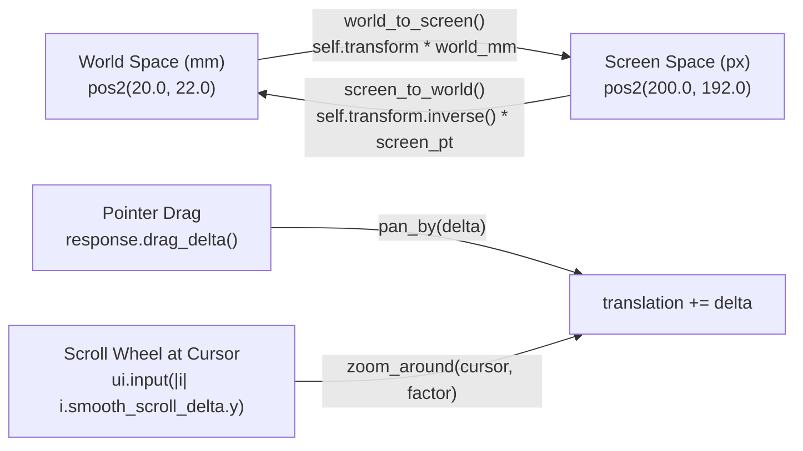

Hardcoding PCB pads in screen pixels works fine for a static demo, right up until you try to inspect a real board.

In [Lesson 0003](./0003-custom-2d-canvas-and-painter.html), our pads and traces were drawn at fixed pixel offsets from the top-left corner of the window. Real KiCad boards, however, live in **physical millimetres (`mm`)**—say, a `100 mm × 70 mm` board with a `0.8 mm` power trace and a `4.0 mm × 2.2 mm` SMD pad—and you need to pan across the board and zoom smoothly into dense pin pitches around your mouse cursor.

## 1. Two Coordinate Spaces: World (`mm`) vs. Screen (`px`)

So, every 2D CAD viewport maintains a mathematical camera that converts between two coordinate systems:{{sidenote:Turns out, `egui`'s maths crate (`emath`) provides [`egui::emath::TSTransform`](https://docs.rs/emath/latest/emath/struct.TSTransform.html) ("Translation + Scaling Transform") out of the box, complete with operator overloading (`transform * pos`) and `.inverse()`.}}

- **World Space (`world_mm: Pos2`):** Physical board coordinates in millimetres. A pad at `pos2(20.0, 22.0)` stays at `(20.0 mm, 22.0 mm)` forever, regardless of window size or zoom level.
- **Screen Space (`screen_pt: Pos2`):** Logical window points passed to `egui::Painter`.

The forward mapping (**World → Screen**) scales the millimetre coordinate by `scaling` (pixels per millimetre) and adds the camera offset `translation`:

$$\text{screen\_pt} = \text{scaling} \cdot \text{world\_mm} + \text{translation}$$

And the inverse mapping (**Screen → World**, implemented by `self.transform.inverse() * screen_pt`) subtracts `translation` and divides by `scaling`:

$$\text{world\_mm} = \frac{\text{screen\_pt} - \text{translation}}{\text{scaling}}$$


_Figure 4.1: `BoardViewport` wraps `TSTransform` to convert bi-directionally between physical millimetres and screen pixels._

## 2. Building the Camera & World-Space Renderer: Block by Block

Let's walk through all four blocks of code added or updated in `apps/0004-world-to-screen-transforms-pan-and-zoom/src/main.rs` before viewing the complete file in context.

### Block 1: Encapsulating the Camera (`struct BoardViewport`)

Let's wrap `TSTransform` inside a dedicated `BoardViewport` struct with four testable methods:{{sidenote:The reason `zoom_around` adjusts `translation` is a classic CAD rite of passage: if you simply multiply `self.transform.scaling *= zoom_factor` on its own, the board zooms toward `(0, 0)` in the top-left corner and flies right away from your mouse cursor! Recording `world_anchor = self.screen_to_world(screen_anchor)` before scaling and solving $\text{translation} = \text{screen\_anchor} - \text{world\_anchor} \cdot \text{new\_scale}$ keeps the exact PCB pad under your cursor pinned in place.}}

```rust
pub const MIN_ZOOM: f32 = 1.5;
pub const MAX_ZOOM: f32 = 60.0;

/// Maps physical PCB coordinates in millimeters (`world_mm`) to `egui` screen points
/// using a translation + uniform-scaling transform (`TSTransform`).
#[derive(Clone, Copy, Debug, PartialEq)]
pub struct BoardViewport {
    pub transform: TSTransform,
}

impl Default for BoardViewport {
    fn default() -> Self {
        Self {
            transform: TSTransform::new(vec2(80.0, 60.0), 6.0),
        }
    }
}

impl BoardViewport {
    pub fn world_to_screen(&self, world_mm: Pos2) -> Pos2 {
        self.transform * world_mm
    }

    pub fn screen_to_world(&self, screen_pt: Pos2) -> Pos2 {
        self.transform.inverse() * screen_pt
    }

    pub fn pan_by(&mut self, screen_delta: Vec2) {
        self.transform.translation += screen_delta;
    }

    /// Zooms the viewport around `screen_anchor` (such as the mouse cursor position)
    /// so the physical board point under the cursor stays stationary on screen.
    pub fn zoom_around(&mut self, screen_anchor: Pos2, zoom_factor: f32) {
        let world_anchor = self.screen_to_world(screen_anchor);
        let new_scale = (self.transform.scaling * zoom_factor).clamp(MIN_ZOOM, MAX_ZOOM);
        self.transform.scaling = new_scale;
        self.transform.translation =
            screen_anchor.to_vec2() - world_anchor.to_vec2() * new_scale;
    }
}
```

- **`pub const MIN_ZOOM: f32 = 1.5;` & `MAX_ZOOM: f32 = 60.0;`**: Compile-time `const` bounds in pixels per millimetre (`px/mm`) so the user can neither zoom out until the board vanishes into a sub-pixel dot nor zoom in until floating-point precision breaks down.
- **`#[derive(Clone, Copy, Debug, PartialEq)]`**: Automatically implements stack-copying (`Copy` / `Clone`), formatted printing for test failure output (`Debug`), and `==` equality checks (`PartialEq`) for `assert_eq!`.
- **`TSTransform::new(vec2(80.0, 60.0), 6.0)`**: Initialises the default camera with an `(80 px, 60 px)` top-left margin and a scale of `6.0 px/mm` (so a `100 mm × 70 mm` board spans `600 px × 420 px` on startup).
- **`world_to_screen` & `screen_to_world`**: `TSTransform` overloads the `*` operator (`Mul<Pos2>`) so `self.transform * world_mm` applies scaling + translation, and `self.transform.inverse() * screen_pt` reverses it.
- **`pan_by` & `zoom_around`**: `pan_by` adds the pointer drag vector directly to `self.transform.translation`. `zoom_around` captures `world_anchor` under the cursor, clamps `new_scale` via `f32::clamp(MIN_ZOOM, MAX_ZOOM)`, and solves for the new `translation` using `.to_vec2()` (which converts a `Pos2` point into a `Vec2` displacement from the origin so vector subtraction is type-safe).

### Block 2: Storing `viewport` on `PcbReviewerApp` & Rendering Physical Millimetres (`paint_board`)

```rust
pub struct PcbReviewerApp {
    pub show_top_copper: bool,
    pub show_bottom_copper: bool,
    pub show_silkscreen: bool,
    pub show_ratsnest: bool,
    pub viewport: BoardViewport,
}

impl PcbReviewerApp {
    // ... reset_layers, isolate_top_copper, show_all_layers ...

    pub fn reset_viewport(&mut self) {
        self.viewport = BoardViewport::default();
    }

    fn paint_board(&self, painter: &egui::Painter, canvas_rect: Rect) {
        painter.rect_filled(canvas_rect, 0.0, Color32::from_rgb(12, 16, 14));

        // Physical 100 mm x 70 mm FR4 PCB outline in world space
        let board_min = self.viewport.world_to_screen(pos2(0.0, 0.0));
        let board_max = self.viewport.world_to_screen(pos2(100.0, 70.0));
        let board_rect = Rect::from_min_max(board_min, board_max);
        let scale = self.viewport.transform.scaling;

        painter.rect(
            board_rect,
            1.5 * scale,
            Color32::from_rgb(16, 40, 30),
            Stroke::new((0.4 * scale).max(1.0), Color32::from_rgb(47, 111, 82)),
            StrokeKind::Inside,
        );

        // Bottom Copper (B.Cu - Blue, physical mm coordinates)
        if self.show_bottom_copper {
            let b_stroke = Stroke::new((0.8 * scale).max(1.5), Color32::from_rgb(59, 142, 234));
            painter.line_segment(
                [
                    self.viewport.world_to_screen(pos2(20.0, 48.0)),
                    self.viewport.world_to_screen(pos2(55.0, 48.0)),
                ],
                b_stroke,
            );
            painter.line_segment(
                [
                    self.viewport.world_to_screen(pos2(55.0, 48.0)),
                    self.viewport.world_to_screen(pos2(68.0, 35.0)),
                ],
                b_stroke,
            );
        }

        // Top Copper (F.Cu - Terracotta Red, physical mm coordinates)
        if self.show_top_copper {
            let f_color = Color32::from_rgb(224, 82, 67);
            let f_stroke = Stroke::new((0.8 * scale).max(1.5), f_color);

            let pad_a = self.viewport.world_to_screen(pos2(20.0, 22.0));
            let pad_b = self.viewport.world_to_screen(pos2(20.0, 32.0));
            let mid = self.viewport.world_to_screen(pos2(52.0, 22.0));
            let via = self.viewport.world_to_screen(pos2(68.0, 35.0));

            painter.line_segment([pad_a, mid], f_stroke);
            painter.line_segment([mid, via], f_stroke);
            painter.line_segment(
                [pad_b, self.viewport.world_to_screen(pos2(45.0, 32.0))],
                f_stroke,
            );

            let pad_size = vec2(4.0 * scale, 2.2 * scale);
            painter.rect_filled(Rect::from_center_size(pad_a, pad_size), 0.4 * scale, f_color);
            painter.rect_filled(Rect::from_center_size(pad_b, pad_size), 0.4 * scale, f_color);

            painter.circle(
                via,
                1.6 * scale,
                Color32::from_rgb(16, 40, 30),
                Stroke::new((0.6 * scale).max(1.2), Color32::from_rgb(230, 193, 90)),
            );
        }

        // Silkscreen (F.SilkS - Cream component courtyard in mm)
        if self.show_silkscreen {
            let u1_min = self.viewport.world_to_screen(pos2(14.0, 16.0));
            let u1_max = self.viewport.world_to_screen(pos2(28.0, 54.0));
            painter.rect_stroke(
                Rect::from_min_max(u1_min, u1_max),
                0.3 * scale,
                Stroke::new(1.5_f32, Color32::from_rgb(240, 230, 140)),
                StrokeKind::Outside,
            );
        }

        // Unrouted Ratsnest airwire
        if self.show_ratsnest {
            painter.line_segment(
                [
                    self.viewport.world_to_screen(pos2(20.0, 32.0)),
                    self.viewport.world_to_screen(pos2(55.0, 48.0)),
                ],
                Stroke::new(1.5_f32, Color32::from_rgb(111, 247, 255)),
            );
        }
    }
}
```

- **`pub viewport: BoardViewport` & `pub fn reset_viewport(&mut self)`**: Adds the persistent camera state to `PcbReviewerApp` and provides a one-click reset back to `BoardViewport::default()`.
- **Projecting World Coordinates (`self.viewport.world_to_screen(pos2(...))`)**: Every board feature is now specified in real millimetres—from the `100.0 mm × 70.0 mm` FR4 outline down to the `0.8 mm` copper trace widths (`(0.8 * scale).max(1.5)`) and `4.0 mm × 2.2 mm` SMD pads (`Rect::from_center_size(pad_a, pad_size)`).
- **Minimum Hairline Clamping (`.max(1.5)`)**: Scaling physical trace widths by `scale` makes traces thicken as you zoom in, while `.max(1.5)` guarantees they never vanish below `1.5 px` when zoomed all the way out.

### Block 3: Wiring Drag-to-Pan & Scroll-to-Zoom in `ui()` (`impl eframe::App`)

Now, inside `PcbReviewerApp::ui`, we upgrade our canvas allocation from `Sense::hover()` to [`Sense::drag()`](https://docs.rs/egui/latest/egui/struct.Sense.html#method.drag) and inspect both `response.dragged()` and [`ui.input(|i| i.smooth_scroll_delta.y)`](https://docs.rs/egui/latest/egui/struct.Ui.html#method.input):

```rust
impl eframe::App for PcbReviewerApp {
    fn ui(&mut self, ui: &mut egui::Ui, _frame: &mut eframe::Frame) {
        egui::Panel::left("layer_panel").show(ui, |ui| {
            ui.heading("PCB Layers");
            ui.checkbox(&mut self.show_top_copper, "Top Copper (F.Cu)");
            ui.checkbox(&mut self.show_bottom_copper, "Bottom Copper (B.Cu)");
            ui.checkbox(&mut self.show_silkscreen, "Silkscreen (F.SilkS)");
            ui.checkbox(&mut self.show_ratsnest, "Ratsnest (Unrouted)");

            ui.separator();
            if ui.button("Isolate Top Copper").clicked() {
                self.isolate_top_copper();
            }
            if ui.button("Show All Layers").clicked() {
                self.show_all_layers();
            }

            ui.separator();
            ui.label(format!("Zoom: {:.1} px/mm", self.viewport.transform.scaling));
            if ui.button("Reset Camera (Fit)").clicked() {
                self.reset_viewport();
            }
        });

        egui::CentralPanel::default().show(ui, |ui| {
            let (response, painter) = ui.allocate_painter(ui.available_size(), Sense::drag());

            if response.dragged() {
                self.viewport.pan_by(response.drag_delta());
            }

            if let Some(hover_pos) = response.hover_pos() {
                let scroll_y = ui.input(|i| i.smooth_scroll_delta.y);
                if scroll_y != 0.0 {
                    let zoom_factor = (scroll_y * 0.005).exp();
                    self.viewport.zoom_around(hover_pos, zoom_factor);
                }
            }

            self.paint_board(&painter, response.rect);
        });
    }
}
```

- **`format!("Zoom: {:.1} px/mm", self.viewport.transform.scaling)`**: Formats the current camera scale to one decimal place (`.1`) for the sidebar readout, paired with a `"Reset Camera (Fit)"` button calling `self.reset_viewport()`.
- **`Sense::drag()` & `response.drag_delta()`**: Allocating the painter with `Sense::drag()` instructs `egui` to track mouse drag gestures inside the canvas rectangle. Whenever `response.dragged()` is `true`, `response.drag_delta()` returns the `Vec2` pointer displacement since the previous frame.
- **`if let Some(hover_pos) = response.hover_pos()`**: `hover_pos()` returns `Option<Pos2>`—`Some(pos)` when the pointer is inside the canvas rectangle, or `None` when the pointer is over the sidebar or outside the window.
- **`ui.input(|i| i.smooth_scroll_delta.y)` & `(scroll_y * 0.005).exp()`**: Reads the vertical trackpad/mouse-wheel scroll delta from `egui::InputState` via a short read-only closure. Converting `scroll_y` with the exponential function `.exp()` produces a smooth, symmetric multiplicative `zoom_factor` (`> 1.0` when scrolling up, `< 1.0` when scrolling down) that we pass into `self.viewport.zoom_around(hover_pos, zoom_factor)`.

### Block 4: Transform Invariant Unit Tests (`#[cfg(test)] mod tests`)

```rust
    #[test]
    fn world_and_screen_transforms_are_exact_inverses() {
        let vp = BoardViewport::default();
        let world_pad = pos2(25.0, 40.0);

        let screen_pt = vp.world_to_screen(world_pad);
        assert_eq!(screen_pt, pos2(230.0, 300.0));

        let round_trip = vp.screen_to_world(screen_pt);
        assert!((round_trip.x - world_pad.x).abs() < 1e-4);
        assert!((round_trip.y - world_pad.y).abs() < 1e-4);
    }

    #[test]
    fn pan_by_translates_screen_coordinates_and_reset_restores_default() {
        let mut app = PcbReviewerApp::default();
        let before = app.viewport.world_to_screen(pos2(10.0, 10.0));

        app.viewport.pan_by(vec2(15.0, -25.0));
        let after = app.viewport.world_to_screen(pos2(10.0, 10.0));
        assert_eq!(after, before + vec2(15.0, -25.0));

        app.reset_viewport();
        assert_eq!(app.viewport, BoardViewport::default());
    }

    #[test]
    fn zoom_around_keeps_cursor_world_point_stationary_and_clamps_scale() {
        let mut vp = BoardViewport::default();
        let cursor_screen = pos2(200.0, 180.0);
        let world_under_cursor_before = vp.screen_to_world(cursor_screen);

        vp.zoom_around(cursor_screen, 2.0);
        assert_eq!(vp.transform.scaling, 12.0);

        let world_under_cursor_after = vp.screen_to_world(cursor_screen);
        assert!((world_under_cursor_after.x - world_under_cursor_before.x).abs() < 1e-4);
        assert!((world_under_cursor_after.y - world_under_cursor_before.y).abs() < 1e-4);

        // Verify clamping at both extremes
        vp.zoom_around(cursor_screen, 100.0);
        assert_eq!(vp.transform.scaling, MAX_ZOOM);

        vp.zoom_around(cursor_screen, 0.001);
        assert_eq!(vp.transform.scaling, MIN_ZOOM);
    }
```

- **Round-Trip Inverse Check**: Verifies both the exact forward projection (`pos2(25.0, 40.0)` → `pos2(230.0, 300.0)` at `6.0 px/mm` + `(80, 60)` offset) and that `screen_to_world` recovers the original millimetre coordinate within floating-point tolerance (`1e-4`).
- **Pan & Reset Verification**: Confirms `pan_by(vec2(15.0, -25.0))` shifts projected screen coordinates by the exact drag delta and that `reset_viewport()` restores `BoardViewport::default()`.
- **Stationary Anchor & Clamp Verification**: Asserts that `zoom_around(cursor_screen, 2.0)` doubles `scaling` to `12.0` while keeping `vp.screen_to_world(cursor_screen)` stationary, and tests both `MAX_ZOOM` and `MIN_ZOOM` clamp boundaries.

### Complete `src/main.rs` Listing

Here is the complete, runnable `apps/0004-world-to-screen-transforms-pan-and-zoom/src/main.rs` with all blocks assembled in context:

```rust
use eframe::egui::{
    self, Color32, Pos2, Rect, Sense, Stroke, StrokeKind, Vec2, emath::TSTransform, pos2, vec2,
};

pub const MIN_ZOOM: f32 = 1.5;
pub const MAX_ZOOM: f32 = 60.0;

fn main() -> eframe::Result {
    let mut options = eframe::NativeOptions::default();
    options.viewport = egui::ViewportBuilder::default().with_inner_size([1024.0, 720.0]);

    eframe::run_native(
        "Schematic & PCB Design Reviewer — Lesson 0004",
        options,
        Box::new(|_cc| Ok(Box::new(PcbReviewerApp::default()))),
    )
}

/// Maps physical PCB coordinates in millimeters (`world_mm`) to `egui` screen points
/// using a translation + uniform-scaling transform (`TSTransform`).
#[derive(Clone, Copy, Debug, PartialEq)]
pub struct BoardViewport {
    pub transform: TSTransform,
}

impl Default for BoardViewport {
    fn default() -> Self {
        Self {
            transform: TSTransform::new(vec2(80.0, 60.0), 6.0),
        }
    }
}

impl BoardViewport {
    pub fn world_to_screen(&self, world_mm: Pos2) -> Pos2 {
        self.transform * world_mm
    }

    pub fn screen_to_world(&self, screen_pt: Pos2) -> Pos2 {
        self.transform.inverse() * screen_pt
    }

    pub fn pan_by(&mut self, screen_delta: Vec2) {
        self.transform.translation += screen_delta;
    }

    /// Zooms the viewport around `screen_anchor` (such as the mouse cursor position)
    /// so the physical board point under the cursor stays stationary on screen.
    pub fn zoom_around(&mut self, screen_anchor: Pos2, zoom_factor: f32) {
        let world_anchor = self.screen_to_world(screen_anchor);
        let new_scale = (self.transform.scaling * zoom_factor).clamp(MIN_ZOOM, MAX_ZOOM);
        self.transform.scaling = new_scale;
        self.transform.translation =
            screen_anchor.to_vec2() - world_anchor.to_vec2() * new_scale;
    }
}

pub struct PcbReviewerApp {
    pub show_top_copper: bool,
    pub show_bottom_copper: bool,
    pub show_silkscreen: bool,
    pub show_ratsnest: bool,
    pub viewport: BoardViewport,
}

impl Default for PcbReviewerApp {
    fn default() -> Self {
        let mut app = Self {
            show_top_copper: false,
            show_bottom_copper: false,
            show_silkscreen: false,
            show_ratsnest: false,
            viewport: BoardViewport::default(),
        };
        app.reset_layers();
        app
    }
}

impl PcbReviewerApp {
    pub fn reset_layers(&mut self) {
        self.show_top_copper = true;
        self.show_bottom_copper = true;
        self.show_silkscreen = true;
        self.show_ratsnest = false;
    }

    pub fn isolate_top_copper(&mut self) {
        self.show_top_copper = true;
        self.show_bottom_copper = false;
        self.show_silkscreen = false;
        self.show_ratsnest = false;
    }

    pub fn show_all_layers(&mut self) {
        self.show_top_copper = true;
        self.show_bottom_copper = true;
        self.show_silkscreen = true;
        self.show_ratsnest = true;
    }

    pub fn reset_viewport(&mut self) {
        self.viewport = BoardViewport::default();
    }

    fn paint_board(&self, painter: &egui::Painter, canvas_rect: Rect) {
        painter.rect_filled(canvas_rect, 0.0, Color32::from_rgb(12, 16, 14));

        // Physical 100 mm x 70 mm FR4 PCB outline in world space
        let board_min = self.viewport.world_to_screen(pos2(0.0, 0.0));
        let board_max = self.viewport.world_to_screen(pos2(100.0, 70.0));
        let board_rect = Rect::from_min_max(board_min, board_max);
        let scale = self.viewport.transform.scaling;

        painter.rect(
            board_rect,
            1.5 * scale,
            Color32::from_rgb(16, 40, 30),
            Stroke::new((0.4 * scale).max(1.0), Color32::from_rgb(47, 111, 82)),
            StrokeKind::Inside,
        );

        // Bottom Copper (B.Cu - Blue, physical mm coordinates)
        if self.show_bottom_copper {
            let b_stroke = Stroke::new((0.8 * scale).max(1.5), Color32::from_rgb(59, 142, 234));
            painter.line_segment(
                [
                    self.viewport.world_to_screen(pos2(20.0, 48.0)),
                    self.viewport.world_to_screen(pos2(55.0, 48.0)),
                ],
                b_stroke,
            );
            painter.line_segment(
                [
                    self.viewport.world_to_screen(pos2(55.0, 48.0)),
                    self.viewport.world_to_screen(pos2(68.0, 35.0)),
                ],
                b_stroke,
            );
        }

        // Top Copper (F.Cu - Terracotta Red, physical mm coordinates)
        if self.show_top_copper {
            let f_color = Color32::from_rgb(224, 82, 67);
            let f_stroke = Stroke::new((0.8 * scale).max(1.5), f_color);

            let pad_a = self.viewport.world_to_screen(pos2(20.0, 22.0));
            let pad_b = self.viewport.world_to_screen(pos2(20.0, 32.0));
            let mid = self.viewport.world_to_screen(pos2(52.0, 22.0));
            let via = self.viewport.world_to_screen(pos2(68.0, 35.0));

            painter.line_segment([pad_a, mid], f_stroke);
            painter.line_segment([mid, via], f_stroke);
            painter.line_segment(
                [pad_b, self.viewport.world_to_screen(pos2(45.0, 32.0))],
                f_stroke,
            );

            let pad_size = vec2(4.0 * scale, 2.2 * scale);
            painter.rect_filled(Rect::from_center_size(pad_a, pad_size), 0.4 * scale, f_color);
            painter.rect_filled(Rect::from_center_size(pad_b, pad_size), 0.4 * scale, f_color);

            painter.circle(
                via,
                1.6 * scale,
                Color32::from_rgb(16, 40, 30),
                Stroke::new((0.6 * scale).max(1.2), Color32::from_rgb(230, 193, 90)),
            );
        }

        // Silkscreen (F.SilkS - Cream component courtyard in mm)
        if self.show_silkscreen {
            let u1_min = self.viewport.world_to_screen(pos2(14.0, 16.0));
            let u1_max = self.viewport.world_to_screen(pos2(28.0, 54.0));
            painter.rect_stroke(
                Rect::from_min_max(u1_min, u1_max),
                0.3 * scale,
                Stroke::new(1.5_f32, Color32::from_rgb(240, 230, 140)),
                StrokeKind::Outside,
            );
        }

        // Unrouted Ratsnest airwire
        if self.show_ratsnest {
            painter.line_segment(
                [
                    self.viewport.world_to_screen(pos2(20.0, 32.0)),
                    self.viewport.world_to_screen(pos2(55.0, 48.0)),
                ],
                Stroke::new(1.5_f32, Color32::from_rgb(111, 247, 255)),
            );
        }
    }
}

impl eframe::App for PcbReviewerApp {
    fn ui(&mut self, ui: &mut egui::Ui, _frame: &mut eframe::Frame) {
        egui::Panel::left("layer_panel").show(ui, |ui| {
            ui.heading("PCB Layers");
            ui.checkbox(&mut self.show_top_copper, "Top Copper (F.Cu)");
            ui.checkbox(&mut self.show_bottom_copper, "Bottom Copper (B.Cu)");
            ui.checkbox(&mut self.show_silkscreen, "Silkscreen (F.SilkS)");
            ui.checkbox(&mut self.show_ratsnest, "Ratsnest (Unrouted)");

            ui.separator();
            if ui.button("Isolate Top Copper").clicked() {
                self.isolate_top_copper();
            }
            if ui.button("Show All Layers").clicked() {
                self.show_all_layers();
            }

            ui.separator();
            ui.label(format!("Zoom: {:.1} px/mm", self.viewport.transform.scaling));
            if ui.button("Reset Camera (Fit)").clicked() {
                self.reset_viewport();
            }
        });

        egui::CentralPanel::default().show(ui, |ui| {
            let (response, painter) = ui.allocate_painter(ui.available_size(), Sense::drag());

            if response.dragged() {
                self.viewport.pan_by(response.drag_delta());
            }

            if let Some(hover_pos) = response.hover_pos() {
                let scroll_y = ui.input(|i| i.smooth_scroll_delta.y);
                if scroll_y != 0.0 {
                    let zoom_factor = (scroll_y * 0.005).exp();
                    self.viewport.zoom_around(hover_pos, zoom_factor);
                }
            }

            self.paint_board(&painter, response.rect);
        });
    }
}

#[cfg(test)]
mod tests {
    use super::*;

    #[test]
    fn default_enables_physical_layers_and_hides_ratsnest() {
        let app = PcbReviewerApp::default();
        assert!(app.show_top_copper);
        assert!(app.show_bottom_copper);
        assert!(app.show_silkscreen);
        assert!(!app.show_ratsnest);
    }

    #[test]
    fn isolate_top_copper_forces_only_top_copper_visible() {
        let mut app = PcbReviewerApp {
            show_top_copper: false,
            show_bottom_copper: true,
            show_silkscreen: true,
            show_ratsnest: true,
            viewport: BoardViewport::default(),
        };

        app.isolate_top_copper();

        assert!(app.show_top_copper);
        assert!(!app.show_bottom_copper);
        assert!(!app.show_silkscreen);
        assert!(!app.show_ratsnest);
    }

    #[test]
    fn show_all_layers_enables_every_layer() {
        let mut app = PcbReviewerApp {
            show_top_copper: false,
            show_bottom_copper: false,
            show_silkscreen: false,
            show_ratsnest: false,
            viewport: BoardViewport::default(),
        };

        app.show_all_layers();

        assert!(app.show_top_copper);
        assert!(app.show_bottom_copper);
        assert!(app.show_silkscreen);
        assert!(app.show_ratsnest);
    }

    #[test]
    fn world_and_screen_transforms_are_exact_inverses() {
        let vp = BoardViewport::default();
        let world_pad = pos2(25.0, 40.0);

        let screen_pt = vp.world_to_screen(world_pad);
        assert_eq!(screen_pt, pos2(230.0, 300.0));

        let round_trip = vp.screen_to_world(screen_pt);
        assert!((round_trip.x - world_pad.x).abs() < 1e-4);
        assert!((round_trip.y - world_pad.y).abs() < 1e-4);
    }

    #[test]
    fn pan_by_translates_screen_coordinates_and_reset_restores_default() {
        let mut app = PcbReviewerApp::default();
        let before = app.viewport.world_to_screen(pos2(10.0, 10.0));

        app.viewport.pan_by(vec2(15.0, -25.0));
        let after = app.viewport.world_to_screen(pos2(10.0, 10.0));
        assert_eq!(after, before + vec2(15.0, -25.0));

        app.reset_viewport();
        assert_eq!(app.viewport, BoardViewport::default());
    }

    #[test]
    fn zoom_around_keeps_cursor_world_point_stationary_and_clamps_scale() {
        let mut vp = BoardViewport::default();
        let cursor_screen = pos2(200.0, 180.0);
        let world_under_cursor_before = vp.screen_to_world(cursor_screen);

        vp.zoom_around(cursor_screen, 2.0);
        assert_eq!(vp.transform.scaling, 12.0);

        let world_under_cursor_after = vp.screen_to_world(cursor_screen);
        assert!((world_under_cursor_after.x - world_under_cursor_before.x).abs() < 1e-4);
        assert!((world_under_cursor_after.y - world_under_cursor_before.y).abs() < 1e-4);

        // Verify clamping at both extremes
        vp.zoom_around(cursor_screen, 100.0);
        assert_eq!(vp.transform.scaling, MAX_ZOOM);

        vp.zoom_around(cursor_screen, 0.001);
        assert_eq!(vp.transform.scaling, MIN_ZOOM);
    }
}
```

{{widget:viewport-transform-sim}}

:::exercise title="Interactive Lab 2: Implement `BoardViewport` Transform Methods" badge="Skill Practice • Tight Feedback Loop"
Complete the three blanks below so that (1) `screen_to_world` uses the inverse of `self.transform`, (2) `zoom_around` clamps the new scale between `MIN_ZOOM` and `MAX_ZOOM`, and (3) dragging the canvas pans by `response.drag_delta()`:

```rust
impl BoardViewport {
    pub fn screen_to_world(&self, screen_pt: Pos2) -> Pos2 {
        self.transform.{{blank:inverse()|Call the method on `TSTransform` that returns the inverted screen-to-world transform.|/* 1: invert */|120px}} * screen_pt
    }

    pub fn zoom_around(&mut self, screen_anchor: Pos2, zoom_factor: f32) {
        let world_anchor = self.screen_to_world(screen_anchor);
        let new_scale = (self.transform.scaling * zoom_factor).{{blank:clamp(MIN_ZOOM, MAX_ZOOM)|Use `f32::clamp(MIN_ZOOM, MAX_ZOOM)` to bound the zoom scale.|/* 2: clamp min..max */|195px}};
        self.transform.scaling = new_scale;
        self.transform.translation =
            screen_anchor.to_vec2() - world_anchor.to_vec2() * new_scale;
    }
}

// Inside PcbReviewerApp::ui:
if response.dragged() {
    self.viewport.pan_by(response.{{blank:drag_delta()|Call the method on `Response` that returns the pointer movement vector since the previous frame.|/* 3: delta fn */|140px}});
}
```
:::prompts
hint: **Hints:** (1) `inverse()`. (2) `clamp(MIN_ZOOM, MAX_ZOOM)`. (3) `drag_delta()`.
success: **Spot on!** `self.transform.inverse()` maps screen points back to physical millimetres, `.clamp(MIN_ZOOM, MAX_ZOOM)` prevents zoom underflow/overflow, and `response.drag_delta()` drives panning.
:::
:::

:::verify title="Interactive Lab 3: Round-Trip & Cursor-Anchor Invariant Tests" badge="cargo test + cargo mutants" tier="Tier 2: Transform Invariants" caught="14 Caught (6 Unviable)" missed="0 Missed"
In `apps/0004-world-to-screen-transforms-pan-and-zoom`, we test three geometric invariants: (1) `world_to_screen` and `screen_to_world` are exact inverses, (2) `pan_by` shifts screen coordinates by the exact drag vector, and (3) `zoom_around(cursor_screen, 2.0)` leaves `vp.screen_to_world(cursor_screen)` unchanged while clamping at `MIN_ZOOM` and `MAX_ZOOM`.

```rust
#[test]
fn zoom_around_keeps_cursor_world_point_stationary_and_clamps_scale() {
    let mut vp = BoardViewport::default();
    let cursor_screen = pos2(200.0, 180.0);
    let world_under_cursor_before = vp.screen_to_world(cursor_screen);

    vp.zoom_around(cursor_screen, 2.0);
    assert_eq!(vp.transform.scaling, 12.0);

    let world_under_cursor_after = vp.screen_to_world(cursor_screen);
    assert!((world_under_cursor_after.x - world_under_cursor_before.x).abs() < 1e-4);
    assert!((world_under_cursor_after.y - world_under_cursor_before.y).abs() < 1e-4);

    vp.zoom_around(cursor_screen, 100.0);
    assert_eq!(vp.transform.scaling, MAX_ZOOM);

    vp.zoom_around(cursor_screen, 0.001);
    assert_eq!(vp.transform.scaling, MIN_ZOOM);
}
```

- [ ] **1. Run `cargo test` in `apps/0004-world-to-screen-transforms-pan-and-zoom`:** Confirm all 6 unit tests pass.
- [ ] **2. Run `cargo mutants --in-place`:** Verify that all 14 viable mutants across `BoardViewport` and `PcbReviewerApp` are **Caught** (with 6 **Unviable** and **0 Missed**).
:::

:::quiz title="Retrieval Practice: Coordinate Transforms & Viewport Input"
Q: How does `TSTransform` map a physical board coordinate `world_mm` into screen space (`self.transform * world_mm`)?
- [ ] It divides world points by four translations
- [ ] It rotates world points around window centre
- [x] It scales world points then adds translation
- [ ] It clamps world points inside screen margins
why: `TSTransform` multiplies the input point by `scaling` (pixels per millimetre) and adds the 2D `translation` offset vector.
hint: Recall what the 'T' and 'S' in `TSTransform` stand for: Translation and Scaling.

Q: Why does `zoom_around(screen_anchor, factor)` compute `world_anchor = self.screen_to_world(screen_anchor)` before updating `scaling`?
- [x] World coords under your cursor remain pinned
- [ ] Scroll deltas must reset before canvas draws
- [ ] Vertex buffers need world bounds before draw
- [ ] Window resize events block direct scale math
why: Capturing the physical board coordinate under the cursor before scaling allows us to recompute `translation` so that exact world point projects back to `screen_anchor` after scaling.
hint: Think about what happens visually when you zoom with your cursor hovering over pin 1 of `U1`.

Q: Why did we pass `Sense::drag()` instead of `Sense::hover()` to `ui.allocate_painter` in Lesson 0004?
- [ ] Hover mode blocks smooth scroll wheel input
- [ ] Hover mode disables clip rectangles on draw
- [ ] Hover mode clears keyboard focus each frame
- [x] Drag sensing tracks pointer delta on motion
why: `Sense::drag()` tells `egui` to track mouse-down drag gestures on the canvas rect so `response.dragged()` and `response.drag_delta()` report live pan movements.
hint: Which `Response` methods do we call right after `ui.allocate_painter` to pan the camera?
:::

## Recommended Primary Source

:::callout
**Read (5 mins):** [`egui::emath::TSTransform` API Documentation](https://docs.rs/emath/latest/emath/struct.TSTransform.html).
Inspect how `TSTransform::inverse()` and `Mul<Pos2>` are implemented in `emath`.
:::

:::teacher-prompt
**Next Step:** Ready to replace our individual hardcoded trace calls with a structured `Vec<TraceSegment>` and `enum PcbLayer` sorted in deterministic back-to-front Z-order in [**Lesson 0005: Modeling Layers, Traces, and Z-Order Rendering**](./0005-modeling-layers-traces-and-footprints.html)?
:::
