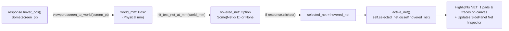

In [Lesson 0004](./0004-modeling-layers-traces-and-footprints.html), we rendered our PCB traces in deterministic back-to-front Z-order. Now we complete **Act I** by making the 2D board interactive: when an engineer hovers over or clicks an SMD pad on the canvas, our application converts the mouse pointer from screen pixels back into physical millimeters (`screen_to_world`), checks which visible pad contains that coordinate, highlights every trace and pad belonging to that electrical net across all layers, and displays the net's details in the left `SidePanel`.


_Figure 5.1: Pointer screen coordinates are inverted into physical millimeters, hit-tested against visible pads in Z-order, and stored as `Option<NetId>`_

## 1. Modeling Optional Selection with `Option<NetId>`

When the mouse cursor sits over empty FR4 fiberglass, _no electrical net is hovered_. Languages with `null` pointers often represent this with `null` or magic numbers like `-1`. Rust eliminates null-pointer bugs at compile time using the standard library enum [`Option<T>`](https://doc.rust-lang.org/std/option/enum.Option.html):{{sidenote:Notice how `pub struct NetId(pub u32);` is a **tuple struct** ([Rust Book §5.1](https://doc.rust-lang.org/book/ch05-01-defining-structs.html#using-tuple-structs-without-named-fields-to-create-different-types))—a zero-cost wrapper around `u32` so you can never accidentally pass a pin count or layer rank where a `NetId` is expected!}}

```rust
#[derive(Clone, Copy, Debug, PartialEq, Eq)]
pub struct NetId(pub u32);

pub struct PcbReviewerApp {
    // ...
    pub hovered_net: Option<NetId>,
    pub selected_net: Option<NetId>,
}
```

What if the user has clicked to lock `selected_net = Some(NetId(1))`, while also moving their mouse over `hovered_net = Some(NetId(2))`? Using [`Option::or`](https://doc.rust-lang.org/std/option/enum.Option.html#method.or) expresses the priority rule in a single expression:

```rust
/// Returns `selected_net` if a net is locked by click, otherwise falls back to `hovered_net`.
pub fn active_net(&self) -> Option<NetId> {
    self.selected_net.or(self.hovered_net)
}
```

## 2. World-Space Hit-Testing Respecting Visibility & Z-Order

Each SMD pad on the board knows its physical center (`center_mm`), dimensions (`size_mm`), layer (`PcbLayer`), and electrical net (`NetId`). Look at how `hit_test_net_at_mm` combines three rules:{{sidenote:Why check `self.is_layer_visible(p.layer)` during hit-testing? If an engineer hides `TopCopper` to inspect `BottomCopper` routing underneath an IC, clicking where a hidden `TopCopper` pad used to be must _not_ select the hidden layer!}}

1. Only pads on **currently visible layers** (`self.is_layer_visible(p.layer)`) can be hit.
2. The world coordinate must fall inside `p.bounds_mm().contains(world_mm)`.
3. If pads on two visible layers overlap at the same `(x, y)` coordinate, sorting by `p.layer.z_rank()` and taking `.last()` selects the **topmost** visible pad.

```rust
impl SmdPad {
    pub fn bounds_mm(&self) -> Rect {
        Rect::from_center_size(self.center_mm, self.size_mm)
    }

    pub fn contains_world_point(&self, world_mm: Pos2) -> bool {
        self.bounds_mm().contains(world_mm)
    }
}

impl PcbReviewerApp {
    pub fn hit_test_net_at_mm(&self, world_mm: Pos2) -> Option<NetId> {
        let mut matching_pads: Vec<SmdPad> = self
            .pads
            .iter()
            .copied()
            .filter(|p| self.is_layer_visible(p.layer) && p.contains_world_point(world_mm))
            .collect();
        matching_pads.sort_by_key(|p| p.layer.z_rank());
        matching_pads.last().map(|p| p.net)
    }
}
```

## 3. Unpacking `Option<NetId>` with `if let Some(...)`

Inside the left `SidePanel`, we use [`if let Some(net) = self.active_net()`](https://doc.rust-lang.org/book/ch06-03-if-let.html) to display the active net's name and a **"Clear Selection"** button only when a net is actually hovered or selected:

```rust
ui.heading("Net Inspector");
if let Some(net) = self.active_net() {
    ui.label(format!("Active Net: NET_{}", net.0));
    if ui.button("Clear Selection").clicked() {
        self.selected_net = None;
    }
} else {
    ui.label("Hover or click a pad to cross-probe its net.");
}
```

{{widget:hittest-sim}}

:::exercise title="Interactive Lab 2: Complete the Hit-Tester & `Option` Combinator" badge="Skill Practice • Tight Feedback Loop"
Fill in the three blanks below so that (1) `active_net` prioritizes `self.selected_net` over `self.hovered_net` using `.or(...)`, (2) the canvas allocates pointer sensing for both clicks and drags, and (3) clicking the canvas locks `self.selected_net`:

```rust
pub fn active_net(&self) -> Option<NetId> {
    self.selected_net.{{blank:or(self.hovered_net)|Call `or(self.hovered_net)` on `self.selected_net`.|/* 1: fallback hover */|175px}}
}

// Inside PcbReviewerApp::update:
let (response, painter) =
    ui.allocate_painter(ui.available_size(), Sense::{{blank:click_and_drag()|Use the `Sense` constructor that listens for both clicks and drags (`click_and_drag()`).|/* 2: click+drag */|165px}});

if let Some(hover_pos) = response.hover_pos() {
    let world_mm = self.viewport.screen_to_world(hover_pos);
    self.hovered_net = self.hit_test_net_at_mm(world_mm);
    if response.{{blank:clicked()|Check whether `response` was clicked this frame (`clicked()`).|/* 3: click? */|115px}} {
        self.selected_net = self.hovered_net;
    }
}
```
:::prompts
hint: **Hints:** (1) `or(self.hovered_net)`. (2) `click_and_drag()`. (3) `clicked()`.
success: **Bravo!** Your Net Inspector prioritizes locked selections with `.or(self.hovered_net)`, senses both clicks and drags on the 2D canvas, and locks `self.selected_net` on click.
:::
:::

:::verify title="Interactive Lab 3: Catching `&&` vs. `||` Hit-Test Mutants" badge="cargo test + cargo mutants" tier="Tier 2: Hit-Test & Net Logic" caught="25 Caught (10 Unviable)" missed="0 Missed"
In `hit_test_net_at_mm`, look at the filter condition `self.is_layer_visible(p.layer) && p.contains_world_point(world_mm)`. When `cargo mutants` flips `&&` to `||`, any test that only checks hitting a visible pad would still pass! By also testing (a) a point in empty space while layers are visible and (b) a point inside a pad whose layer is hidden, our unit test suite catches all 25 viable mutants across the entire Act I application!

```rust
#[test]
fn hit_test_net_at_mm_respects_pad_bounds_layer_visibility_and_z_order() {
    let mut app = PcbReviewerApp::default();

    // 1. Point inside TopCopper pad at (20.0, 22.0) -> Some(NetId(1))
    assert_eq!(app.hit_test_net_at_mm(pos2(20.5, 22.2)), Some(NetId(1)));

    // 2. Point in empty board space -> None (catches && -> || mutant!)
    assert_eq!(app.hit_test_net_at_mm(pos2(80.0, 60.0)), None);

    // 3. Hiding TopCopper makes the pad un-hittable -> None
    app.show_top_copper = false;
    assert_eq!(app.hit_test_net_at_mm(pos2(20.5, 22.2)), None);
}
```

- [ ] **1. Run `cargo test` in `apps/0005-hit-testing-and-net-cross-probing`:** Confirm all 11 unit tests pass.
- [ ] **2. Run `cargo mutants --in-place`:** Verify that all 25 viable mutants across Act I (`0000`–`0005`) are **Caught** (with 10 **Unviable** and **0 Missed**).
:::

:::quiz title="Retrieval Practice: `Option<NetId>` & World-Space Hit-Testing"
Q: Why does `hit_test_net_at_mm` return `Option<NetId>` instead of a sentinel integer like `0`?
- [ ] Signed values cause panics inside test builds
- [ ] Option values disable borrow checks on draws
- [x] Option requires callers to handle empty hits
- [ ] Option stores texture tables inside GPU vram
why: Returning `Option<NetId>` (`Some(NetId)` vs. `None`) forces the caller to explicitly handle the case where the cursor is over empty board space.
hint: Think about how Rust prevents null-pointer and magic-number bugs at compile time.

Q: What does `self.selected_net.or(self.hovered_net)` return when `selected_net` is `Some(NetId(1))` and `hovered_net` is `Some(NetId(2))`?
- [x] It returns Some containing the selected net
- [ ] It returns Some containing the hovered item
- [ ] It returns None because two nets conflicted
- [ ] It panics because two Option fields matched
why: `Option::or` returns the first `Option` (`self.selected_net`) if it is `Some`, and only evaluates the fallback (`self.hovered_net`) when the first is `None`.
hint: Check which `Option` appears on the left-hand side of `.or(...)`.

Q: Why must we convert `hover_pos` via `self.viewport.screen_to_world(hover_pos)` before calling `hit_test_net_at_mm`?
- [ ] Pointer events arrive scaled in meters first
- [ ] Screen points vanish after panel closure run
- [ ] Painter resets pointer coords on every frame
- [x] Pad bounds live in physical millimeter space
why: `response.hover_pos()` is reported in window screen pixels, whereas `SmdPad::bounds_mm()` is stored in physical board millimeters (`world_mm`).
hint: Compare the coordinate units of `response.hover_pos()` with `SmdPad.center_mm`.
:::

## Recommended Primary Source

:::callout
**Read (5 mins):** [The Rust Programming Language — §6.1 "The `Option` Enum"](https://doc.rust-lang.org/book/ch06-01-defining-an-enum.html#the-option-enum-and-its-advantages-over-null-values) and [`egui::Sense` API Docs](https://docs.rs/egui/latest/egui/struct.Sense.html).
:::

:::teacher-prompt
**Act I Complete!** You have built a pan/zoomable, multi-layer 2D PCB viewport in physical millimeters with Z-ordered rendering, interactive pad hit-testing, and net cross-probing—backed by 11 unit tests and 100% caught mutants (`25 caught, 0 missed`). Continue to [**Lesson 0006: Schematic Symbols, Text Rendering & Headless UI Verification (`egui_kittest`)**](./0006-schematic-symbols-and-text-rendering.html)!
:::
