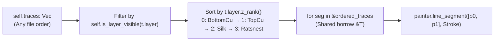

In [Lesson 0004](./0004-world-to-screen-transforms-pan-and-zoom.html), we transformed physical millimetre coordinates into screen space, but our traces were still individual hardcoded lines inside `paint_board`. Real KiCad files, on the other hand, contain thousands of segments across multiple layers—and they can appear in whatever order the router happened to save them.

Now, because `egui::Painter` uses the classic **painter's algorithm** (every shape you emit is drawn directly on top of earlier shapes), drawing traces in raw file order means a `BottomCopper` ground trace can paint right over the top of a `TopCopper` pad or `Silkscreen` label. Not ideal when you are trying to debug a board.


_Figure 5.1: Filtering visible segments and sorting by `PcbLayer::z_rank()` guarantees deterministic back-to-front CAD rendering every frame._

## 1. Modelling Layers, Traces & Z-Ordering: Block by Block

Let's walk through all four blocks of code added or updated in `apps/0005-modeling-layers-traces-and-footprints/src/main.rs` before viewing the complete file in context.

### Block 1: Exhaustive Layer Modelling & Trace Segments (`enum PcbLayer` & `struct TraceSegment`)

So, instead of scattering four separate boolean `if` blocks across our renderer, let's model a PCB layer as a proper Rust [`enum`](https://doc.rust-lang.org/book/ch06-01-defining-an-enum.html) and attach pure methods using exhaustive [`match`](https://doc.rust-lang.org/book/ch06-02-match.html) expressions:{{sidenote:Because Rust's `match` is exhaustive at compile time, if you add an inner copper layer like `PcbLayer::In1Cu` later, `rustc` immediately flags every `match` block (`z_rank`, `color`, `is_layer_visible`) that needs updating.}}

```rust
/// Physical and logical PCB layers rendered from back (`BottomCopper`) to front (`Ratsnest`).
#[derive(Clone, Copy, Debug, PartialEq, Eq)]
pub enum PcbLayer {
    BottomCopper,
    TopCopper,
    Silkscreen,
    Ratsnest,
}

impl PcbLayer {
    /// Deterministic back-to-front draw rank (0 = furthest back, 3 = topmost overlay).
    pub fn z_rank(self) -> u8 {
        match self {
            PcbLayer::BottomCopper => 0,
            PcbLayer::TopCopper => 1,
            PcbLayer::Silkscreen => 2,
            PcbLayer::Ratsnest => 3,
        }
    }

    /// Standard dark-mode CAD layer color swatch.
    pub fn color(self) -> Color32 {
        match self {
            PcbLayer::BottomCopper => Color32::from_rgb(59, 142, 234),
            PcbLayer::TopCopper => Color32::from_rgb(224, 82, 67),
            PcbLayer::Silkscreen => Color32::from_rgb(240, 230, 140),
            PcbLayer::Ratsnest => Color32::from_rgb(111, 247, 255),
        }
    }
}

/// A straight segment on a PCB layer with start/end coordinates in millimeters (`world_mm`).
#[derive(Clone, Copy, Debug, PartialEq)]
pub struct TraceSegment {
    pub start: Pos2,
    pub end: Pos2,
    pub width_mm: f32,
    pub layer: PcbLayer,
}
```

- **`#[derive(Clone, Copy, Debug, PartialEq, Eq)]` on `enum PcbLayer`**: Because an `enum` without heap fields is just a 1-byte discriminant tag, it implements `Copy` and `Eq` (total equality, unlike floating-point structs which only implement `PartialEq` because `NaN != NaN`).
- **`pub fn z_rank(self) -> u8` & `pub fn color(self) -> Color32`**: Taking `self` by value (since `PcbLayer` is `Copy`) lets callers write `seg.layer.z_rank()` and `seg.layer.color()`. Each `match` expression exhaustively maps all four variants to a deterministic draw rank (`0..=3`) or RGB colour swatch.
- **`pub struct TraceSegment`**: Bundles the segment's world-space endpoints (`start: Pos2`, `end: Pos2`), physical trace width (`width_mm: f32`), and `layer: PcbLayer` into a 24-byte `Copy` struct.

### Block 2: Dynamic Collections (`Vec<TraceSegment>`), Z-Order Sorting & `paint_board`

Next, we store our board's segments in a growable heap vector [`Vec<TraceSegment>`](https://doc.rust-lang.org/book/ch08-01-vectors.html) on `PcbReviewerApp`.{{sidenote:Turns out, writing `for seg in self.traces` without an `&` is a rite-of-passage error in Rust: iterating over a `Vec` by value _moves and consumes_ the vector on Frame #1! Borrowing with `&ordered_traces` (or `self.traces.iter()`) lets you read all segments 60 times a second while `self.traces` keeps ownership.}}

```rust
fn sample_traces() -> Vec<TraceSegment> {
    vec![
        TraceSegment {
            start: pos2(20.0, 32.0),
            end: pos2(55.0, 48.0),
            width_mm: 0.25,
            layer: PcbLayer::Ratsnest,
        },
        TraceSegment {
            start: pos2(14.0, 16.0),
            end: pos2(28.0, 16.0),
            width_mm: 0.3,
            layer: PcbLayer::Silkscreen,
        },
        TraceSegment {
            start: pos2(20.0, 22.0),
            end: pos2(52.0, 22.0),
            width_mm: 0.8,
            layer: PcbLayer::TopCopper,
        },
        TraceSegment {
            start: pos2(52.0, 22.0),
            end: pos2(68.0, 35.0),
            width_mm: 0.8,
            layer: PcbLayer::TopCopper,
        },
        TraceSegment {
            start: pos2(20.0, 48.0),
            end: pos2(55.0, 48.0),
            width_mm: 0.8,
            layer: PcbLayer::BottomCopper,
        },
        TraceSegment {
            start: pos2(55.0, 48.0),
            end: pos2(68.0, 35.0),
            width_mm: 0.8,
            layer: PcbLayer::BottomCopper,
        },
    ]
}

impl PcbReviewerApp {
    // ... reset_layers, isolate_top_copper, show_all_layers, reset_viewport ...

    pub fn is_layer_visible(&self, layer: PcbLayer) -> bool {
        match layer {
            PcbLayer::BottomCopper => self.show_bottom_copper,
            PcbLayer::TopCopper => self.show_top_copper,
            PcbLayer::Silkscreen => self.show_silkscreen,
            PcbLayer::Ratsnest => self.show_ratsnest,
        }
    }

    /// Returns all currently visible `TraceSegment`s sorted back-to-front by `PcbLayer::z_rank`.
    pub fn visible_traces_in_z_order(&self) -> Vec<TraceSegment> {
        let mut visible: Vec<TraceSegment> = self
            .traces
            .iter()
            .copied()
            .filter(|t| self.is_layer_visible(t.layer))
            .collect();
        visible.sort_by_key(|t| t.layer.z_rank());
        visible
    }

    fn paint_board(&self, painter: &egui::Painter, canvas_rect: Rect) {
        painter.rect_filled(canvas_rect, 0.0, Color32::from_rgb(12, 16, 14));

        let board_min = self.viewport.world_to_screen(pos2(0.0, 0.0));
        let board_max = self.viewport.world_to_screen(pos2(100.0, 70.0));
        let board_rect = Rect::from_min_max(board_min, board_max);
        let scale = self.viewport.transform.scaling;

        painter.rect(
            board_rect,
            1.5 * scale,
            Color32::from_rgb(16, 40, 30),
            Stroke::new((0.4 * scale).max(1.0), Color32::from_rgb(47, 111, 82)),
            StrokeKind::Inside,
        );

        let ordered_traces = self.visible_traces_in_z_order();
        for seg in &ordered_traces {
            let p0 = self.viewport.world_to_screen(seg.start);
            let p1 = self.viewport.world_to_screen(seg.end);
            let stroke_px = (seg.width_mm * scale).max(1.5);
            painter.line_segment([p0, p1], Stroke::new(stroke_px, seg.layer.color()));
        }
    }
}
```

- **`vec![...]` in `sample_traces()`**: Allocates a `Vec<TraceSegment>` deliberately ordered from front (`Ratsnest`) to back (`BottomCopper`) so our Z-sort has real work to do.
- **Iterator Pipeline (`.iter().copied().filter(...).collect()`)**:
  - `self.traces.iter()` borrows each element as `&TraceSegment` without consuming `self.traces`.
  - `.copied()` copies each `24-byte` `TraceSegment` by value.
  - `.filter(|t| self.is_layer_visible(t.layer))` keeps only segments whose layer checkbox is currently enabled.
  - `.collect()` gathers the filtered items into `let mut visible: Vec<TraceSegment>`, and `visible.sort_by_key(|t| t.layer.z_rank())` performs a stable sort in ascending `z_rank` order (`0` → `3`).
- **`for seg in &ordered_traces` in `paint_board`**: Replaces four separate layer-specific `if` blocks from Lesson 0004 with a single 6-line loop that projects `seg.start` and `seg.end`, scales `seg.width_mm * scale`, and draws with `seg.layer.color()`.

### Block 3: Displaying Visible Segment Counts in `ui()` (`impl eframe::App`)

```rust
impl eframe::App for PcbReviewerApp {
    fn ui(&mut self, ui: &mut egui::Ui, _frame: &mut eframe::Frame) {
        egui::Panel::left("layer_panel").show(ui, |ui| {
            ui.heading("PCB Layers");
            ui.checkbox(&mut self.show_top_copper, "Top Copper (F.Cu)");
            ui.checkbox(&mut self.show_bottom_copper, "Bottom Copper (B.Cu)");
            ui.checkbox(&mut self.show_silkscreen, "Silkscreen (F.SilkS)");
            ui.checkbox(&mut self.show_ratsnest, "Ratsnest (Unrouted)");

            ui.separator();
            if ui.button("Isolate Top Copper").clicked() {
                self.isolate_top_copper();
            }
            if ui.button("Show All Layers").clicked() {
                self.show_all_layers();
            }

            ui.separator();
            ui.label(format!("Zoom: {:.1} px/mm", self.viewport.transform.scaling));
            ui.label(format!(
                "Visible segments: {} / {}",
                self.visible_traces_in_z_order().len(),
                self.traces.len()
            ));
            if ui.button("Reset Camera (Fit)").clicked() {
                self.reset_viewport();
            }
        });

        egui::CentralPanel::default().show(ui, |ui| {
            let (response, painter) = ui.allocate_painter(ui.available_size(), Sense::drag());

            if response.dragged() {
                self.viewport.pan_by(response.drag_delta());
            }

            if let Some(hover_pos) = response.hover_pos() {
                let scroll_y = ui.input(|i| i.smooth_scroll_delta.y);
                if scroll_y != 0.0 {
                    let zoom_factor = (scroll_y * 0.005).exp();
                    self.viewport.zoom_around(hover_pos, zoom_factor);
                }
            }

            self.paint_board(&painter, response.rect);
        });
    }
}
```

- **`self.visible_traces_in_z_order().len()` vs. `self.traces.len()`**: Displays a live `"Visible segments: 5 / 6"` counter in `Panel::left` that updates immediately as you toggle layer checkboxes or click `"Isolate Top Copper"`.

### Block 4: Match-Arm & Z-Order Unit Tests (`#[cfg(test)] mod tests`)

```rust
    #[test]
    fn pcb_layer_ranks_and_colors_are_distinct_and_ordered_back_to_front() {
        assert_eq!(PcbLayer::BottomCopper.z_rank(), 0);
        assert_eq!(PcbLayer::TopCopper.z_rank(), 1);
        assert_eq!(PcbLayer::Silkscreen.z_rank(), 2);
        assert_eq!(PcbLayer::Ratsnest.z_rank(), 3);

        assert_eq!(PcbLayer::BottomCopper.color(), Color32::from_rgb(59, 142, 234));
        assert_eq!(PcbLayer::TopCopper.color(), Color32::from_rgb(224, 82, 67));
        assert_eq!(PcbLayer::Silkscreen.color(), Color32::from_rgb(240, 230, 140));
        assert_eq!(PcbLayer::Ratsnest.color(), Color32::from_rgb(111, 247, 255));
    }

    #[test]
    fn is_layer_visible_reflects_each_individual_layer_flag() {
        let mut app = PcbReviewerApp {
            show_top_copper: false,
            show_bottom_copper: false,
            show_silkscreen: false,
            show_ratsnest: false,
            viewport: BoardViewport::default(),
            traces: vec![],
        };

        assert!(!app.is_layer_visible(PcbLayer::BottomCopper));
        assert!(!app.is_layer_visible(PcbLayer::TopCopper));
        assert!(!app.is_layer_visible(PcbLayer::Silkscreen));
        assert!(!app.is_layer_visible(PcbLayer::Ratsnest));

        app.show_bottom_copper = true;
        assert!(app.is_layer_visible(PcbLayer::BottomCopper));
        assert!(!app.is_layer_visible(PcbLayer::TopCopper));

        app.show_bottom_copper = false;
        app.show_top_copper = true;
        assert!(app.is_layer_visible(PcbLayer::TopCopper));
        assert!(!app.is_layer_visible(PcbLayer::Silkscreen));

        app.show_top_copper = false;
        app.show_silkscreen = true;
        assert!(app.is_layer_visible(PcbLayer::Silkscreen));
        assert!(!app.is_layer_visible(PcbLayer::Ratsnest));

        app.show_silkscreen = false;
        app.show_ratsnest = true;
        assert!(app.is_layer_visible(PcbLayer::Ratsnest));
        assert!(!app.is_layer_visible(PcbLayer::BottomCopper));
    }

    #[test]
    fn visible_traces_in_z_order_filters_hidden_layers_and_sorts_back_to_front() {
        let mut app = PcbReviewerApp::default();
        app.traces = vec![
            TraceSegment {
                start: pos2(0.0, 0.0),
                end: pos2(1.0, 1.0),
                width_mm: 0.2,
                layer: PcbLayer::Ratsnest,
            },
            TraceSegment {
                start: pos2(2.0, 2.0),
                end: pos2(3.0, 3.0),
                width_mm: 0.3,
                layer: PcbLayer::Silkscreen,
            },
            TraceSegment {
                start: pos2(4.0, 4.0),
                end: pos2(5.0, 5.0),
                width_mm: 0.8,
                layer: PcbLayer::TopCopper,
            },
            TraceSegment {
                start: pos2(6.0, 6.0),
                end: pos2(7.0, 7.0),
                width_mm: 0.8,
                layer: PcbLayer::BottomCopper,
            },
        ];

        // Default hides Ratsnest and sorts BottomCopper -> TopCopper -> Silkscreen
        let default_visible = app.visible_traces_in_z_order();
        let default_layers: Vec<PcbLayer> = default_visible.iter().map(|t| t.layer).collect();
        assert_eq!(
            default_layers,
            vec![
                PcbLayer::BottomCopper,
                PcbLayer::TopCopper,
                PcbLayer::Silkscreen
            ]
        );

        // Enabling all layers includes Ratsnest at the very end (highest z_rank)
        app.show_all_layers();
        let all_visible = app.visible_traces_in_z_order();
        let all_layers: Vec<PcbLayer> = all_visible.iter().map(|t| t.layer).collect();
        assert_eq!(
            all_layers,
            vec![
                PcbLayer::BottomCopper,
                PcbLayer::TopCopper,
                PcbLayer::Silkscreen,
                PcbLayer::Ratsnest
            ]
        );
    }
```

- **Testing Every `match` Arm Individually**: `pcb_layer_ranks_and_colors_are_distinct_and_ordered_back_to_front` and `is_layer_visible_reflects_each_individual_layer_flag` toggle and assert one `PcbLayer` variant at a time so `cargo-mutants` cannot delete or swap any `match` arm undetected.
- **Reverse-Ordered Input Vector**: `visible_traces_in_z_order_filters_hidden_layers_and_sorts_back_to_front` feeds segments in reverse (`Ratsnest` first, `BottomCopper` last) to prove that `visible.sort_by_key(|t| t.layer.z_rank())` actively reorders the output.

### Complete `src/main.rs` Listing

Here is the complete, runnable `apps/0005-modeling-layers-traces-and-footprints/src/main.rs` with all blocks assembled in context:

```rust
use eframe::egui::{
    self, Color32, Pos2, Rect, Sense, Stroke, StrokeKind, Vec2, emath::TSTransform, pos2, vec2,
};

pub const MIN_ZOOM: f32 = 1.5;
pub const MAX_ZOOM: f32 = 60.0;

fn main() -> eframe::Result {
    let mut options = eframe::NativeOptions::default();
    options.viewport = egui::ViewportBuilder::default().with_inner_size([1024.0, 720.0]);

    eframe::run_native(
        "Schematic & PCB Design Reviewer — Lesson 0005",
        options,
        Box::new(|_cc| Ok(Box::new(PcbReviewerApp::default()))),
    )
}

/// Physical and logical PCB layers rendered from back (`BottomCopper`) to front (`Ratsnest`).
#[derive(Clone, Copy, Debug, PartialEq, Eq)]
pub enum PcbLayer {
    BottomCopper,
    TopCopper,
    Silkscreen,
    Ratsnest,
}

impl PcbLayer {
    /// Deterministic back-to-front draw rank (0 = furthest back, 3 = topmost overlay).
    pub fn z_rank(self) -> u8 {
        match self {
            PcbLayer::BottomCopper => 0,
            PcbLayer::TopCopper => 1,
            PcbLayer::Silkscreen => 2,
            PcbLayer::Ratsnest => 3,
        }
    }

    /// Standard dark-mode CAD layer color swatch.
    pub fn color(self) -> Color32 {
        match self {
            PcbLayer::BottomCopper => Color32::from_rgb(59, 142, 234),
            PcbLayer::TopCopper => Color32::from_rgb(224, 82, 67),
            PcbLayer::Silkscreen => Color32::from_rgb(240, 230, 140),
            PcbLayer::Ratsnest => Color32::from_rgb(111, 247, 255),
        }
    }
}

/// A straight segment on a PCB layer with start/end coordinates in millimeters (`world_mm`).
#[derive(Clone, Copy, Debug, PartialEq)]
pub struct TraceSegment {
    pub start: Pos2,
    pub end: Pos2,
    pub width_mm: f32,
    pub layer: PcbLayer,
}

#[derive(Clone, Copy, Debug, PartialEq)]
pub struct BoardViewport {
    pub transform: TSTransform,
}

impl Default for BoardViewport {
    fn default() -> Self {
        Self {
            transform: TSTransform::new(vec2(80.0, 60.0), 6.0),
        }
    }
}

impl BoardViewport {
    pub fn world_to_screen(&self, world_mm: Pos2) -> Pos2 {
        self.transform * world_mm
    }

    pub fn screen_to_world(&self, screen_pt: Pos2) -> Pos2 {
        self.transform.inverse() * screen_pt
    }

    pub fn pan_by(&mut self, screen_delta: Vec2) {
        self.transform.translation += screen_delta;
    }

    pub fn zoom_around(&mut self, screen_anchor: Pos2, zoom_factor: f32) {
        let world_anchor = self.screen_to_world(screen_anchor);
        let new_scale = (self.transform.scaling * zoom_factor).clamp(MIN_ZOOM, MAX_ZOOM);
        self.transform.scaling = new_scale;
        self.transform.translation =
            screen_anchor.to_vec2() - world_anchor.to_vec2() * new_scale;
    }
}

fn sample_traces() -> Vec<TraceSegment> {
    vec![
        TraceSegment {
            start: pos2(20.0, 32.0),
            end: pos2(55.0, 48.0),
            width_mm: 0.25,
            layer: PcbLayer::Ratsnest,
        },
        TraceSegment {
            start: pos2(14.0, 16.0),
            end: pos2(28.0, 16.0),
            width_mm: 0.3,
            layer: PcbLayer::Silkscreen,
        },
        TraceSegment {
            start: pos2(20.0, 22.0),
            end: pos2(52.0, 22.0),
            width_mm: 0.8,
            layer: PcbLayer::TopCopper,
        },
        TraceSegment {
            start: pos2(52.0, 22.0),
            end: pos2(68.0, 35.0),
            width_mm: 0.8,
            layer: PcbLayer::TopCopper,
        },
        TraceSegment {
            start: pos2(20.0, 48.0),
            end: pos2(55.0, 48.0),
            width_mm: 0.8,
            layer: PcbLayer::BottomCopper,
        },
        TraceSegment {
            start: pos2(55.0, 48.0),
            end: pos2(68.0, 35.0),
            width_mm: 0.8,
            layer: PcbLayer::BottomCopper,
        },
    ]
}

pub struct PcbReviewerApp {
    pub show_top_copper: bool,
    pub show_bottom_copper: bool,
    pub show_silkscreen: bool,
    pub show_ratsnest: bool,
    pub viewport: BoardViewport,
    pub traces: Vec<TraceSegment>,
}

impl Default for PcbReviewerApp {
    fn default() -> Self {
        let mut app = Self {
            show_top_copper: false,
            show_bottom_copper: false,
            show_silkscreen: false,
            show_ratsnest: false,
            viewport: BoardViewport::default(),
            traces: sample_traces(),
        };
        app.reset_layers();
        app
    }
}

impl PcbReviewerApp {
    pub fn reset_layers(&mut self) {
        self.show_top_copper = true;
        self.show_bottom_copper = true;
        self.show_silkscreen = true;
        self.show_ratsnest = false;
    }

    pub fn isolate_top_copper(&mut self) {
        self.show_top_copper = true;
        self.show_bottom_copper = false;
        self.show_silkscreen = false;
        self.show_ratsnest = false;
    }

    pub fn show_all_layers(&mut self) {
        self.show_top_copper = true;
        self.show_bottom_copper = true;
        self.show_silkscreen = true;
        self.show_ratsnest = true;
    }

    pub fn reset_viewport(&mut self) {
        self.viewport = BoardViewport::default();
    }

    pub fn is_layer_visible(&self, layer: PcbLayer) -> bool {
        match layer {
            PcbLayer::BottomCopper => self.show_bottom_copper,
            PcbLayer::TopCopper => self.show_top_copper,
            PcbLayer::Silkscreen => self.show_silkscreen,
            PcbLayer::Ratsnest => self.show_ratsnest,
        }
    }

    /// Returns all currently visible `TraceSegment`s sorted back-to-front by `PcbLayer::z_rank`.
    pub fn visible_traces_in_z_order(&self) -> Vec<TraceSegment> {
        let mut visible: Vec<TraceSegment> = self
            .traces
            .iter()
            .copied()
            .filter(|t| self.is_layer_visible(t.layer))
            .collect();
        visible.sort_by_key(|t| t.layer.z_rank());
        visible
    }

    fn paint_board(&self, painter: &egui::Painter, canvas_rect: Rect) {
        painter.rect_filled(canvas_rect, 0.0, Color32::from_rgb(12, 16, 14));

        let board_min = self.viewport.world_to_screen(pos2(0.0, 0.0));
        let board_max = self.viewport.world_to_screen(pos2(100.0, 70.0));
        let board_rect = Rect::from_min_max(board_min, board_max);
        let scale = self.viewport.transform.scaling;

        painter.rect(
            board_rect,
            1.5 * scale,
            Color32::from_rgb(16, 40, 30),
            Stroke::new((0.4 * scale).max(1.0), Color32::from_rgb(47, 111, 82)),
            StrokeKind::Inside,
        );

        let ordered_traces = self.visible_traces_in_z_order();
        for seg in &ordered_traces {
            let p0 = self.viewport.world_to_screen(seg.start);
            let p1 = self.viewport.world_to_screen(seg.end);
            let stroke_px = (seg.width_mm * scale).max(1.5);
            painter.line_segment([p0, p1], Stroke::new(stroke_px, seg.layer.color()));
        }
    }
}

impl eframe::App for PcbReviewerApp {
    fn ui(&mut self, ui: &mut egui::Ui, _frame: &mut eframe::Frame) {
        egui::Panel::left("layer_panel").show(ui, |ui| {
            ui.heading("PCB Layers");
            ui.checkbox(&mut self.show_top_copper, "Top Copper (F.Cu)");
            ui.checkbox(&mut self.show_bottom_copper, "Bottom Copper (B.Cu)");
            ui.checkbox(&mut self.show_silkscreen, "Silkscreen (F.SilkS)");
            ui.checkbox(&mut self.show_ratsnest, "Ratsnest (Unrouted)");

            ui.separator();
            if ui.button("Isolate Top Copper").clicked() {
                self.isolate_top_copper();
            }
            if ui.button("Show All Layers").clicked() {
                self.show_all_layers();
            }

            ui.separator();
            ui.label(format!("Zoom: {:.1} px/mm", self.viewport.transform.scaling));
            ui.label(format!(
                "Visible segments: {} / {}",
                self.visible_traces_in_z_order().len(),
                self.traces.len()
            ));
            if ui.button("Reset Camera (Fit)").clicked() {
                self.reset_viewport();
            }
        });

        egui::CentralPanel::default().show(ui, |ui| {
            let (response, painter) = ui.allocate_painter(ui.available_size(), Sense::drag());

            if response.dragged() {
                self.viewport.pan_by(response.drag_delta());
            }

            if let Some(hover_pos) = response.hover_pos() {
                let scroll_y = ui.input(|i| i.smooth_scroll_delta.y);
                if scroll_y != 0.0 {
                    let zoom_factor = (scroll_y * 0.005).exp();
                    self.viewport.zoom_around(hover_pos, zoom_factor);
                }
            }

            self.paint_board(&painter, response.rect);
        });
    }
}

#[cfg(test)]
mod tests {
    use super::*;

    #[test]
    fn default_enables_physical_layers_and_hides_ratsnest() {
        let app = PcbReviewerApp::default();
        assert!(app.show_top_copper);
        assert!(app.show_bottom_copper);
        assert!(app.show_silkscreen);
        assert!(!app.show_ratsnest);
    }

    #[test]
    fn isolate_top_copper_forces_only_top_copper_visible() {
        let mut app = PcbReviewerApp::default();
        app.show_top_copper = false;
        app.show_ratsnest = true;

        app.isolate_top_copper();

        assert!(app.show_top_copper);
        assert!(!app.show_bottom_copper);
        assert!(!app.show_silkscreen);
        assert!(!app.show_ratsnest);
    }

    #[test]
    fn show_all_layers_enables_every_layer() {
        let mut app = PcbReviewerApp::default();
        app.show_top_copper = false;
        app.show_bottom_copper = false;
        app.show_silkscreen = false;
        app.show_ratsnest = false;

        app.show_all_layers();

        assert!(app.show_top_copper);
        assert!(app.show_bottom_copper);
        assert!(app.show_silkscreen);
        assert!(app.show_ratsnest);
    }

    #[test]
    fn world_and_screen_transforms_are_exact_inverses() {
        let vp = BoardViewport::default();
        let world_pad = pos2(25.0, 40.0);

        let screen_pt = vp.world_to_screen(world_pad);
        assert_eq!(screen_pt, pos2(230.0, 300.0));

        let round_trip = vp.screen_to_world(screen_pt);
        assert!((round_trip.x - world_pad.x).abs() < 1e-4);
        assert!((round_trip.y - world_pad.y).abs() < 1e-4);
    }

    #[test]
    fn pan_by_translates_screen_coordinates_and_reset_restores_default() {
        let mut app = PcbReviewerApp::default();
        let before = app.viewport.world_to_screen(pos2(10.0, 10.0));

        app.viewport.pan_by(vec2(15.0, -25.0));
        let after = app.viewport.world_to_screen(pos2(10.0, 10.0));
        assert_eq!(after, before + vec2(15.0, -25.0));

        app.reset_viewport();
        assert_eq!(app.viewport, BoardViewport::default());
    }

    #[test]
    fn zoom_around_keeps_cursor_world_point_stationary_and_clamps_scale() {
        let mut vp = BoardViewport::default();
        let cursor_screen = pos2(200.0, 180.0);
        let world_under_cursor_before = vp.screen_to_world(cursor_screen);

        vp.zoom_around(cursor_screen, 2.0);
        assert_eq!(vp.transform.scaling, 12.0);

        let world_under_cursor_after = vp.screen_to_world(cursor_screen);
        assert!((world_under_cursor_after.x - world_under_cursor_before.x).abs() < 1e-4);
        assert!((world_under_cursor_after.y - world_under_cursor_before.y).abs() < 1e-4);

        vp.zoom_around(cursor_screen, 100.0);
        assert_eq!(vp.transform.scaling, MAX_ZOOM);

        vp.zoom_around(cursor_screen, 0.001);
        assert_eq!(vp.transform.scaling, MIN_ZOOM);
    }

    #[test]
    fn pcb_layer_ranks_and_colors_are_distinct_and_ordered_back_to_front() {
        assert_eq!(PcbLayer::BottomCopper.z_rank(), 0);
        assert_eq!(PcbLayer::TopCopper.z_rank(), 1);
        assert_eq!(PcbLayer::Silkscreen.z_rank(), 2);
        assert_eq!(PcbLayer::Ratsnest.z_rank(), 3);

        assert_eq!(PcbLayer::BottomCopper.color(), Color32::from_rgb(59, 142, 234));
        assert_eq!(PcbLayer::TopCopper.color(), Color32::from_rgb(224, 82, 67));
        assert_eq!(PcbLayer::Silkscreen.color(), Color32::from_rgb(240, 230, 140));
        assert_eq!(PcbLayer::Ratsnest.color(), Color32::from_rgb(111, 247, 255));
    }

    #[test]
    fn is_layer_visible_reflects_each_individual_layer_flag() {
        let mut app = PcbReviewerApp {
            show_top_copper: false,
            show_bottom_copper: false,
            show_silkscreen: false,
            show_ratsnest: false,
            viewport: BoardViewport::default(),
            traces: vec![],
        };

        assert!(!app.is_layer_visible(PcbLayer::BottomCopper));
        assert!(!app.is_layer_visible(PcbLayer::TopCopper));
        assert!(!app.is_layer_visible(PcbLayer::Silkscreen));
        assert!(!app.is_layer_visible(PcbLayer::Ratsnest));

        app.show_bottom_copper = true;
        assert!(app.is_layer_visible(PcbLayer::BottomCopper));
        assert!(!app.is_layer_visible(PcbLayer::TopCopper));

        app.show_bottom_copper = false;
        app.show_top_copper = true;
        assert!(app.is_layer_visible(PcbLayer::TopCopper));
        assert!(!app.is_layer_visible(PcbLayer::Silkscreen));

        app.show_top_copper = false;
        app.show_silkscreen = true;
        assert!(app.is_layer_visible(PcbLayer::Silkscreen));
        assert!(!app.is_layer_visible(PcbLayer::Ratsnest));

        app.show_silkscreen = false;
        app.show_ratsnest = true;
        assert!(app.is_layer_visible(PcbLayer::Ratsnest));
        assert!(!app.is_layer_visible(PcbLayer::BottomCopper));
    }

    #[test]
    fn visible_traces_in_z_order_filters_hidden_layers_and_sorts_back_to_front() {
        let mut app = PcbReviewerApp::default();
        app.traces = vec![
            TraceSegment {
                start: pos2(0.0, 0.0),
                end: pos2(1.0, 1.0),
                width_mm: 0.2,
                layer: PcbLayer::Ratsnest,
            },
            TraceSegment {
                start: pos2(2.0, 2.0),
                end: pos2(3.0, 3.0),
                width_mm: 0.3,
                layer: PcbLayer::Silkscreen,
            },
            TraceSegment {
                start: pos2(4.0, 4.0),
                end: pos2(5.0, 5.0),
                width_mm: 0.8,
                layer: PcbLayer::TopCopper,
            },
            TraceSegment {
                start: pos2(6.0, 6.0),
                end: pos2(7.0, 7.0),
                width_mm: 0.8,
                layer: PcbLayer::BottomCopper,
            },
        ];

        // Default hides Ratsnest and sorts BottomCopper -> TopCopper -> Silkscreen
        let default_visible = app.visible_traces_in_z_order();
        let default_layers: Vec<PcbLayer> = default_visible.iter().map(|t| t.layer).collect();
        assert_eq!(
            default_layers,
            vec![
                PcbLayer::BottomCopper,
                PcbLayer::TopCopper,
                PcbLayer::Silkscreen
            ]
        );

        // Enabling all layers includes Ratsnest at the very end (highest z_rank)
        app.show_all_layers();
        let all_visible = app.visible_traces_in_z_order();
        let all_layers: Vec<PcbLayer> = all_visible.iter().map(|t| t.layer).collect();
        assert_eq!(
            all_layers,
            vec![
                PcbLayer::BottomCopper,
                PcbLayer::TopCopper,
                PcbLayer::Silkscreen,
                PcbLayer::Ratsnest
            ]
        );
    }
}
```

{{widget:layer-zorder-sim}}

:::exercise title="Interactive Lab 2: Filter & Sort Visible Traces" badge="Skill Practice • Tight Feedback Loop"
Fill in the three blanks below so that (1) `PcbLayer::Silkscreen` maps to `self.show_silkscreen`, (2) `visible_traces_in_z_order` filters by `self.is_layer_visible(t.layer)`, and (3) the collected vector is sorted by `t.layer.z_rank()`:

```rust
pub fn is_layer_visible(&self, layer: PcbLayer) -> bool {
    match layer {
        PcbLayer::BottomCopper => self.show_bottom_copper,
        PcbLayer::TopCopper => self.show_top_copper,
        {{blank:PcbLayer::Silkscreen|Match the `Silkscreen` variant of `PcbLayer`.|/* 1: silk variant */|190px}} => self.show_silkscreen,
        PcbLayer::Ratsnest => self.show_ratsnest,
    }
}

pub fn visible_traces_in_z_order(&self) -> Vec<TraceSegment> {
    let mut visible: Vec<TraceSegment> = self
        .traces
        .iter()
        .copied()
        .{{blank:filter|Call the iterator adapter that keeps only elements matching a boolean predicate.|/* 2: adapter */|110px}}(|t| self.is_layer_visible(t.layer))
        .collect();
    visible.sort_by_key(|t| {{blank:t.layer.z_rank()|Return the numeric Z-rank of the segment's layer (`t.layer.z_rank()`).|/* 3: rank key */|160px}});
    visible
}
```
:::prompts
hint: **Hints:** (1) `PcbLayer::Silkscreen`. (2) `filter`. (3) `t.layer.z_rank()`.
success: **All correct!** Your exhaustive `match` checks `PcbLayer::Silkscreen`, `.filter(...)` removes hidden layers, and `sort_by_key(|t| t.layer.z_rank())` orders segments back-to-front.
:::
:::

:::verify title="Interactive Lab 3: Eliminating Match-Arm Mutants" badge="cargo test + cargo mutants" tier="Tier 2: Domain & Z-Order Tests" caught="20 Caught (7 Unviable)" missed="0 Missed"
One of `cargo-mutants`'s best tricks is **match-arm mutation**: it tries deleting or swapping individual `match` arms inside `z_rank()`, `color()`, and `is_layer_visible()`. By asserting each variant's exact rank, colour, and visibility toggle in isolation, our 9 unit tests catch all 20 viable mutants!

```rust
#[test]
fn visible_traces_in_z_order_filters_hidden_layers_and_sorts_back_to_front() {
    let mut app = PcbReviewerApp::default();
    // Input traces are deliberately stored in reverse (front-to-back) order:
    // Ratsnest (3) -> Silkscreen (2) -> TopCopper (1) -> BottomCopper (0)
    let default_visible = app.visible_traces_in_z_order();
    let default_layers: Vec<PcbLayer> = default_visible.iter().map(|t| t.layer).collect();
    assert_eq!(
        default_layers,
        vec![
            PcbLayer::BottomCopper,
            PcbLayer::TopCopper,
            PcbLayer::Silkscreen
        ]
    );
}
```

- [ ] **1. Run `cargo test` in `apps/0005-modeling-layers-traces-and-footprints`:** Confirm all 9 unit tests pass.
- [ ] **2. Run `cargo mutants --in-place`:** Verify that all 20 viable mutants (including every `match` arm in `z_rank`, `color`, and `is_layer_visible`) are **Caught** with **0 Missed**.
:::

:::quiz title="Retrieval Practice: `enum`, `Vec<T>` & Z-Ordering"
Q: Why do we iterate over `&self.traces` (or `self.traces.iter()`) inside `ui()` instead of `for seg in self.traces`?
- [ ] Consuming Vec copies all segments into memory
- [x] Borrowing Vec preserves data across all draws
- [ ] Consuming Vec corrupts a vertex buffer layout
- [ ] Consuming Vec blocks threads during panel run
why: Iterating over `self.traces` by value moves and consumes the vector on the first frame; borrowing with `&` reads the segments while keeping `self.traces` intact for every future frame.
hint: Remember what happens to ownership of a `Vec<T>` if you pass it by value into a `for` loop.

Q: Why does `visible_traces_in_z_order()` sort visible segments by `PcbLayer::z_rank()` before `Painter` draws them?
- [ ] Painter drops segments when layers are mixed
- [ ] Sorting merges copper lines into one polygon
- [ ] Sorting prevents heap clones on every redraw
- [x] Painter draws later shapes over earlier ones
why: `egui::Painter` paints shapes in the exact sequence they are emitted (the painter's algorithm), so sorting back-to-front ensures `TopCopper` and `Silkscreen` draw above `BottomCopper`.
hint: Think about what happens in the 2D painter's algorithm when two shapes overlap at the same screen coordinate.

Q: What happens when `cargo mutants` alters a single `match` arm inside `PcbLayer::z_rank()` or `is_layer_visible()`?
- [x] Testing every enum variant catches the fault
- [ ] Cargo skips any function with match branches
- [ ] Window loops ignore any deleted match branch
- [ ] Static lints block all enum match assertions
why: Because our unit tests explicitly assert each `PcbLayer` variant's `z_rank()`, `color()`, and visibility flag, mutating any branch immediately fails a test assertion.
hint: Look at `pcb_layer_ranks_and_colors_are_distinct_and_ordered_back_to_front` and `is_layer_visible_reflects_each_individual_layer_flag`.
:::

## Recommended Primary Source

:::callout
**Read (5 mins):** [The Rust Programming Language — §6.2 "The `match` Control Flow Construct"](https://doc.rust-lang.org/book/ch06-02-match.html).
Review how exhaustive pattern matching works on custom `enum` types.
:::

:::teacher-prompt
**Next Step:** Now that our board renders physical traces and pads in deterministic Z-order, let's complete Act I by adding interactive mouse hit-testing and net highlighting in [**Lesson 0006: Hit-Testing & Net Cross-Probing (`Option<NetId>`)**](./0006-hit-testing-and-net-cross-probing.html)!
:::
