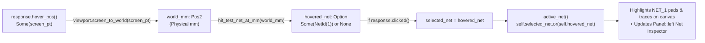

Drawing a PCB in physical millimetres is a great start. Being able to hover over an SMD pad, see which electrical net it belongs to, and watch every connected trace light up across the board is when it starts feeling like a real CAD tool.

In [Lesson 0005](./0005-modeling-layers-traces-and-footprints.html), we rendered our PCB traces in deterministic back-to-front Z-order. Now, we complete **Act I** by making the 2D board interactive: when you hover over or click an SMD pad on the canvas, our app converts the mouse pointer from screen pixels back into physical millimetres (`screen_to_world`), checks which visible pad contains that coordinate, highlights every trace and pad on that net across all layers, and updates the left `Panel`.


_Figure 6.1: Pointer screen coordinates are inverted into physical millimetres, hit-tested against visible pads in Z-order, and stored as `Option<NetId>`_

## 1. Implementing Hit-Testing & Cross-Probing: Block by Block

Let's walk through all four blocks of code added or updated in `apps/0006-hit-testing-and-net-cross-probing/src/main.rs` before viewing the complete file in context.

### Block 1: Strongly-Typed `NetId`, `Option<NetId>`, & `struct SmdPad`

Most of the time, your mouse cursor is sitting over empty FR4 fibreglass—meaning _no electrical net is hovered_. Languages with `null` pointers usually reach for `null` or a magic number like `-1`. Rust eliminates null-pointer bugs at compile time using the standard library enum [`Option<T>`](https://doc.rust-lang.org/std/option/enum.Option.html):{{sidenote:Notice how `pub struct NetId(pub u32);` is a **tuple struct** ([Rust Book §5.1](https://doc.rust-lang.org/book/ch05-01-defining-structs.html#using-tuple-structs-without-named-fields-to-create-different-types))—a zero-cost wrapper around `u32` so you can never accidentally pass a pin count or layer rank where a `NetId` is expected!}}

```rust
/// Strongly-typed identifier for an electrical net (e.g. `NetId(1)` = `VCC_3V3`).
#[derive(Clone, Copy, Debug, PartialEq, Eq)]
pub struct NetId(pub u32);

#[derive(Clone, Copy, Debug, PartialEq)]
pub struct TraceSegment {
    pub start: Pos2,
    pub end: Pos2,
    pub width_mm: f32,
    pub layer: PcbLayer,
    pub net: Option<NetId>,
}

#[derive(Clone, Copy, Debug, PartialEq)]
pub struct SmdPad {
    pub center_mm: Pos2,
    pub size_mm: Vec2,
    pub layer: PcbLayer,
    pub net: NetId,
}

impl SmdPad {
    pub fn bounds_mm(&self) -> Rect {
        Rect::from_center_size(self.center_mm, self.size_mm)
    }

    pub fn contains_world_point(&self, world_mm: Pos2) -> bool {
        self.bounds_mm().contains(world_mm)
    }
}
```

- **`pub struct NetId(pub u32)`**: A single-field tuple struct wrapping a `u32` net identifier. Accessing the inner number uses `.0` (`net.0`).
- **`pub net: Option<NetId>` on `TraceSegment` vs. `pub net: NetId` on `SmdPad`**: Copper and ratsnest segments carry `Some(NetId(...))` while purely mechanical `Silkscreen` segments carry `None`. Every physical `SmdPad`, however, belongs to a specific `NetId`.
- **`SmdPad::bounds_mm(&self)` & `contains_world_point(&self, world_mm: Pos2)`**: `Rect::from_center_size(self.center_mm, self.size_mm)` computes the pad's axis-aligned bounding box in millimetres, and `Rect::contains(world_mm)` tests whether a world coordinate lies inside those bounds.

### Block 2: World-Space Hit-Testing (`hit_test_net_at_mm`), Priority (`active_net`), & Highlighted `paint_board`

Each SMD pad on the board knows its physical centre (`center_mm`), dimensions (`size_mm`), layer (`PcbLayer`), and electrical net (`NetId`). Look at how `hit_test_net_at_mm` combines three rules:{{sidenote:The reason we check `self.is_layer_visible(p.layer)` during hit-testing is easy to overlook until it bites you: if you hide `TopCopper` to inspect `BottomCopper` routing underneath an IC, clicking where a hidden `TopCopper` pad used to be must _not_ select the hidden layer!}}

1. Only pads on **currently visible layers** (`self.is_layer_visible(p.layer)`) can be hit.
2. The world coordinate must fall inside `p.bounds_mm().contains(world_mm)`.
3. If pads on two visible layers overlap at the same `(x, y)` coordinate, sorting by `p.layer.z_rank()` and taking `.last()` selects the **topmost** visible pad.

And what if you have clicked a pad to lock `selected_net = Some(NetId(1))`, and then move your mouse across `hovered_net = Some(NetId(2))`? Turns out, [`Option::or`](https://doc.rust-lang.org/std/option/enum.Option.html#method.or) expresses that exact priority rule in a single one-liner:

```rust
pub struct PcbReviewerApp {
    pub show_top_copper: bool,
    pub show_bottom_copper: bool,
    pub show_silkscreen: bool,
    pub show_ratsnest: bool,
    pub viewport: BoardViewport,
    pub traces: Vec<TraceSegment>,
    pub pads: Vec<SmdPad>,
    pub hovered_net: Option<NetId>,
    pub selected_net: Option<NetId>,
}

impl PcbReviewerApp {
    // ... reset_layers, isolate_top_copper, show_all_layers, reset_viewport,
    //     is_layer_visible, visible_traces_in_z_order ...

    /// Hit-tests visible SMD pads in back-to-front Z-order and returns the `NetId`
    /// of the topmost visible pad containing `world_mm`, or `None` if no pad is hit.
    pub fn hit_test_net_at_mm(&self, world_mm: Pos2) -> Option<NetId> {
        let mut matching_pads: Vec<SmdPad> = self
            .pads
            .iter()
            .copied()
            .filter(|p| self.is_layer_visible(p.layer) && p.contains_world_point(world_mm))
            .collect();
        matching_pads.sort_by_key(|p| p.layer.z_rank());
        matching_pads.last().map(|p| p.net)
    }

    /// Returns the active net to highlight on the canvas (`selected_net` takes priority over `hovered_net`).
    pub fn active_net(&self) -> Option<NetId> {
        self.selected_net.or(self.hovered_net)
    }

    fn paint_board(&self, painter: &egui::Painter, canvas_rect: Rect) {
        painter.rect_filled(canvas_rect, 0.0, Color32::from_rgb(12, 16, 14));

        let board_min = self.viewport.world_to_screen(pos2(0.0, 0.0));
        let board_max = self.viewport.world_to_screen(pos2(100.0, 70.0));
        let board_rect = Rect::from_min_max(board_min, board_max);
        let scale = self.viewport.transform.scaling;
        let active = self.active_net();

        painter.rect(
            board_rect,
            1.5 * scale,
            Color32::from_rgb(16, 40, 30),
            Stroke::new((0.4 * scale).max(1.0), Color32::from_rgb(47, 111, 82)),
            StrokeKind::Inside,
        );

        for seg in &self.visible_traces_in_z_order() {
            let p0 = self.viewport.world_to_screen(seg.start);
            let p1 = self.viewport.world_to_screen(seg.end);
            let is_highlighted = active.is_some() && seg.net == active;
            let color = if is_highlighted {
                Color32::from_rgb(255, 230, 100)
            } else {
                seg.layer.color()
            };
            let stroke_px = (seg.width_mm * scale).max(1.5) * if is_highlighted { 1.4 } else { 1.0 };
            painter.line_segment([p0, p1], Stroke::new(stroke_px, color));
        }

        for pad in &self.pads {
            if !self.is_layer_visible(pad.layer) {
                continue;
            }
            let bounds = pad.bounds_mm();
            let screen_rect = Rect::from_min_max(
                self.viewport.world_to_screen(bounds.min),
                self.viewport.world_to_screen(bounds.max),
            );
            let is_highlighted = active == Some(pad.net);
            let fill = if is_highlighted {
                Color32::from_rgb(255, 230, 100)
            } else {
                pad.layer.color()
            };
            painter.rect_filled(screen_rect, 0.3 * scale, fill);
        }
    }
}
```

- **`matching_pads.last().map(|p| p.net)`**: `.last()` on a slice returns `Option<&SmdPad>` (`Some(&topmost_pad)` if at least one visible pad matched, or `None` if `matching_pads` is empty). Chaining `.map(|p| p.net)` transforms `Option<&SmdPad>` into `Option<NetId>` cleanly without `unwrap()`.
- **`self.selected_net.or(self.hovered_net)`**: Returns `self.selected_net` whenever it is `Some(...)`, or falls back to `self.hovered_net` when `selected_net` is `None`.
- **Cross-Probing Highlight in `paint_board`**: Queries `let active = self.active_net()` once at the top of `paint_board`. Any visible `TraceSegment` with `active.is_some() && seg.net == active` (and any visible `SmdPad` with `active == Some(pad.net)`) lights up in bright gold (`Color32::from_rgb(255, 230, 100)`) with a `1.4x` stroke boost.

### Block 3: The Net Inspector & Click-and-Drag Canvas (`impl eframe::App`)

So, inside the left `Panel`, we use [`if let Some(net) = self.active_net()`](https://doc.rust-lang.org/book/ch06-03-if-let.html) to display the active net's name and a **"Clear Selection"** button only when a net is actually hovered or selected, while `CentralPanel` upgrades to `Sense::click_and_drag()`:

```rust
impl eframe::App for PcbReviewerApp {
    fn ui(&mut self, ui: &mut egui::Ui, _frame: &mut eframe::Frame) {
        egui::Panel::left("layer_panel").show(ui, |ui| {
            ui.heading("PCB Layers");
            ui.checkbox(&mut self.show_top_copper, "Top Copper (F.Cu)");
            ui.checkbox(&mut self.show_bottom_copper, "Bottom Copper (B.Cu)");
            ui.checkbox(&mut self.show_silkscreen, "Silkscreen (F.SilkS)");
            ui.checkbox(&mut self.show_ratsnest, "Ratsnest (Unrouted)");

            ui.separator();
            if ui.button("Isolate Top Copper").clicked() {
                self.isolate_top_copper();
            }
            if ui.button("Show All Layers").clicked() {
                self.show_all_layers();
            }

            ui.separator();
            ui.heading("Net Inspector");
            if let Some(net) = self.active_net() {
                ui.label(format!("Active Net: NET_{}", net.0));
                if ui.button("Clear Selection").clicked() {
                    self.selected_net = None;
                }
            } else {
                ui.label("Hover or click a pad to cross-probe its net.");
            }
        });

        egui::CentralPanel::default().show(ui, |ui| {
            let (response, painter) =
                ui.allocate_painter(ui.available_size(), Sense::click_and_drag());

            if response.dragged() {
                self.viewport.pan_by(response.drag_delta());
            }

            if let Some(hover_pos) = response.hover_pos() {
                let scroll_y = ui.input(|i| i.smooth_scroll_delta.y);
                if scroll_y != 0.0 {
                    let zoom_factor = (scroll_y * 0.005).exp();
                    self.viewport.zoom_around(hover_pos, zoom_factor);
                }

                let world_mm = self.viewport.screen_to_world(hover_pos);
                self.hovered_net = self.hit_test_net_at_mm(world_mm);
                if response.clicked() {
                    self.selected_net = self.hovered_net;
                }
            } else {
                self.hovered_net = None;
            }

            self.paint_board(&painter, response.rect);
        });
    }
}
```

- **`if let Some(net) = self.active_net()`**: Pattern-matches `Option<NetId>`. When `Some(net)` matches, `net.0` extracts the inner `u32` ID for `format!("Active Net: NET_{}", net.0)`, and clicking `"Clear Selection"` resets `self.selected_net = None`.
- **`Sense::click_and_drag()`**: Enables both click detection (`response.clicked()`) and drag panning (`response.dragged()`) on the same canvas widget.
- **Screen → World Hit-Test Pipeline**: When `response.hover_pos()` is `Some(hover_pos)`, we invert the screen pixel coordinate into millimetres (`self.viewport.screen_to_world(hover_pos)`), store `self.hovered_net = self.hit_test_net_at_mm(world_mm)`, and—if the user clicked this frame—lock `self.selected_net = self.hovered_net`. When the cursor leaves the canvas (`else`), `self.hovered_net` resets to `None`.

### Block 4: Hit-Testing & Selection Priority Unit Tests (`#[cfg(test)] mod tests`)

```rust
    #[test]
    fn hit_test_net_at_mm_respects_pad_bounds_layer_visibility_and_z_order() {
        let mut app = PcbReviewerApp::default();

        // Point inside TopCopper pad at (20.0, 22.0) -> NetId(1)
        assert_eq!(app.hit_test_net_at_mm(pos2(20.5, 22.2)), Some(NetId(1)));

        // Point in empty board space -> None
        assert_eq!(app.hit_test_net_at_mm(pos2(80.0, 60.0)), None);

        // Hiding TopCopper makes the TopCopper pad at (20.0, 22.0) un-hittable
        app.show_top_copper = false;
        assert_eq!(app.hit_test_net_at_mm(pos2(20.5, 22.2)), None);

        // When a TopCopper pad overlaps a BottomCopper pad at the same coordinate,
        // TopCopper (higher z_rank) wins when both layers are visible.
        app.show_top_copper = true;
        app.show_bottom_copper = true;
        app.pads.push(SmdPad {
            center_mm: pos2(20.0, 48.0),
            size_mm: vec2(4.0, 2.4),
            layer: PcbLayer::TopCopper,
            net: NetId(99),
        });
        assert_eq!(app.hit_test_net_at_mm(pos2(20.0, 48.0)), Some(NetId(99)));
    }

    #[test]
    fn active_net_prefers_selected_net_over_hovered_net() {
        let mut app = PcbReviewerApp::default();
        assert_eq!(app.active_net(), None);

        app.hovered_net = Some(NetId(2));
        assert_eq!(app.active_net(), Some(NetId(2)));

        app.selected_net = Some(NetId(1));
        assert_eq!(app.active_net(), Some(NetId(1)));
    }
```

- **Four-Way Hit-Test Coverage**: Tests (1) hitting a visible pad, (2) missing in empty board space (which catches `&&` mutated to `||`), (3) missing a pad whose layer is hidden, and (4) overlapping `TopCopper` vs. `BottomCopper` pads at `pos2(20.0, 48.0)` to prove the higher `z_rank` pad wins.
- **Selection Priority Coverage**: Confirms `active_net()` returns `None` initially, `Some(NetId(2))` when only hovered, and `Some(NetId(1))` when both `selected_net` and `hovered_net` are populated.

### Complete `src/main.rs` Listing

Here is the complete, runnable `apps/0006-hit-testing-and-net-cross-probing/src/main.rs` with all blocks assembled in context:

```rust
use eframe::egui::{
    self, Color32, Pos2, Rect, Sense, Stroke, StrokeKind, Vec2, emath::TSTransform, pos2, vec2,
};

pub const MIN_ZOOM: f32 = 1.5;
pub const MAX_ZOOM: f32 = 60.0;

fn main() -> eframe::Result {
    let mut options = eframe::NativeOptions::default();
    options.viewport = egui::ViewportBuilder::default().with_inner_size([1024.0, 720.0]);

    eframe::run_native(
        "Schematic & PCB Design Reviewer — Lesson 0006",
        options,
        Box::new(|_cc| Ok(Box::new(PcbReviewerApp::default()))),
    )
}

/// Strongly-typed identifier for an electrical net (e.g. `NetId(1)` = `VCC_3V3`).
#[derive(Clone, Copy, Debug, PartialEq, Eq)]
pub struct NetId(pub u32);

/// Physical and logical PCB layers rendered from back (`BottomCopper`) to front (`Ratsnest`).
#[derive(Clone, Copy, Debug, PartialEq, Eq)]
pub enum PcbLayer {
    BottomCopper,
    TopCopper,
    Silkscreen,
    Ratsnest,
}

impl PcbLayer {
    pub fn z_rank(self) -> u8 {
        match self {
            PcbLayer::BottomCopper => 0,
            PcbLayer::TopCopper => 1,
            PcbLayer::Silkscreen => 2,
            PcbLayer::Ratsnest => 3,
        }
    }

    pub fn color(self) -> Color32 {
        match self {
            PcbLayer::BottomCopper => Color32::from_rgb(59, 142, 234),
            PcbLayer::TopCopper => Color32::from_rgb(224, 82, 67),
            PcbLayer::Silkscreen => Color32::from_rgb(240, 230, 140),
            PcbLayer::Ratsnest => Color32::from_rgb(111, 247, 255),
        }
    }
}

#[derive(Clone, Copy, Debug, PartialEq)]
pub struct TraceSegment {
    pub start: Pos2,
    pub end: Pos2,
    pub width_mm: f32,
    pub layer: PcbLayer,
    pub net: Option<NetId>,
}

#[derive(Clone, Copy, Debug, PartialEq)]
pub struct SmdPad {
    pub center_mm: Pos2,
    pub size_mm: Vec2,
    pub layer: PcbLayer,
    pub net: NetId,
}

impl SmdPad {
    pub fn bounds_mm(&self) -> Rect {
        Rect::from_center_size(self.center_mm, self.size_mm)
    }

    pub fn contains_world_point(&self, world_mm: Pos2) -> bool {
        self.bounds_mm().contains(world_mm)
    }
}

#[derive(Clone, Copy, Debug, PartialEq)]
pub struct BoardViewport {
    pub transform: TSTransform,
}

impl Default for BoardViewport {
    fn default() -> Self {
        Self {
            transform: TSTransform::new(vec2(80.0, 60.0), 6.0),
        }
    }
}

impl BoardViewport {
    pub fn world_to_screen(&self, world_mm: Pos2) -> Pos2 {
        self.transform * world_mm
    }

    pub fn screen_to_world(&self, screen_pt: Pos2) -> Pos2 {
        self.transform.inverse() * screen_pt
    }

    pub fn pan_by(&mut self, screen_delta: Vec2) {
        self.transform.translation += screen_delta;
    }

    pub fn zoom_around(&mut self, screen_anchor: Pos2, zoom_factor: f32) {
        let world_anchor = self.screen_to_world(screen_anchor);
        let new_scale = (self.transform.scaling * zoom_factor).clamp(MIN_ZOOM, MAX_ZOOM);
        self.transform.scaling = new_scale;
        self.transform.translation =
            screen_anchor.to_vec2() - world_anchor.to_vec2() * new_scale;
    }
}

fn sample_traces() -> Vec<TraceSegment> {
    vec![
        TraceSegment {
            start: pos2(20.0, 32.0),
            end: pos2(55.0, 48.0),
            width_mm: 0.25,
            layer: PcbLayer::Ratsnest,
            net: Some(NetId(2)),
        },
        TraceSegment {
            start: pos2(14.0, 16.0),
            end: pos2(28.0, 16.0),
            width_mm: 0.3,
            layer: PcbLayer::Silkscreen,
            net: None,
        },
        TraceSegment {
            start: pos2(20.0, 22.0),
            end: pos2(52.0, 22.0),
            width_mm: 0.8,
            layer: PcbLayer::TopCopper,
            net: Some(NetId(1)),
        },
        TraceSegment {
            start: pos2(52.0, 22.0),
            end: pos2(68.0, 35.0),
            width_mm: 0.8,
            layer: PcbLayer::TopCopper,
            net: Some(NetId(1)),
        },
        TraceSegment {
            start: pos2(20.0, 48.0),
            end: pos2(55.0, 48.0),
            width_mm: 0.8,
            layer: PcbLayer::BottomCopper,
            net: Some(NetId(2)),
        },
        TraceSegment {
            start: pos2(55.0, 48.0),
            end: pos2(68.0, 35.0),
            width_mm: 0.8,
            layer: PcbLayer::BottomCopper,
            net: Some(NetId(1)),
        },
    ]
}

fn sample_pads() -> Vec<SmdPad> {
    vec![
        SmdPad {
            center_mm: pos2(20.0, 22.0),
            size_mm: vec2(4.0, 2.4),
            layer: PcbLayer::TopCopper,
            net: NetId(1),
        },
        SmdPad {
            center_mm: pos2(20.0, 32.0),
            size_mm: vec2(4.0, 2.4),
            layer: PcbLayer::TopCopper,
            net: NetId(2),
        },
        SmdPad {
            center_mm: pos2(20.0, 48.0),
            size_mm: vec2(4.0, 2.4),
            layer: PcbLayer::BottomCopper,
            net: NetId(2),
        },
    ]
}

pub struct PcbReviewerApp {
    pub show_top_copper: bool,
    pub show_bottom_copper: bool,
    pub show_silkscreen: bool,
    pub show_ratsnest: bool,
    pub viewport: BoardViewport,
    pub traces: Vec<TraceSegment>,
    pub pads: Vec<SmdPad>,
    pub hovered_net: Option<NetId>,
    pub selected_net: Option<NetId>,
}

impl Default for PcbReviewerApp {
    fn default() -> Self {
        let mut app = Self {
            show_top_copper: false,
            show_bottom_copper: false,
            show_silkscreen: false,
            show_ratsnest: false,
            viewport: BoardViewport::default(),
            traces: sample_traces(),
            pads: sample_pads(),
            hovered_net: None,
            selected_net: None,
        };
        app.reset_layers();
        app
    }
}

impl PcbReviewerApp {
    pub fn reset_layers(&mut self) {
        self.show_top_copper = true;
        self.show_bottom_copper = true;
        self.show_silkscreen = true;
        self.show_ratsnest = false;
    }

    pub fn isolate_top_copper(&mut self) {
        self.show_top_copper = true;
        self.show_bottom_copper = false;
        self.show_silkscreen = false;
        self.show_ratsnest = false;
    }

    pub fn show_all_layers(&mut self) {
        self.show_top_copper = true;
        self.show_bottom_copper = true;
        self.show_silkscreen = true;
        self.show_ratsnest = true;
    }

    pub fn reset_viewport(&mut self) {
        self.viewport = BoardViewport::default();
    }

    pub fn is_layer_visible(&self, layer: PcbLayer) -> bool {
        match layer {
            PcbLayer::BottomCopper => self.show_bottom_copper,
            PcbLayer::TopCopper => self.show_top_copper,
            PcbLayer::Silkscreen => self.show_silkscreen,
            PcbLayer::Ratsnest => self.show_ratsnest,
        }
    }

    pub fn visible_traces_in_z_order(&self) -> Vec<TraceSegment> {
        let mut visible: Vec<TraceSegment> = self
            .traces
            .iter()
            .copied()
            .filter(|t| self.is_layer_visible(t.layer))
            .collect();
        visible.sort_by_key(|t| t.layer.z_rank());
        visible
    }

    /// Hit-tests visible SMD pads in back-to-front Z-order and returns the `NetId`
    /// of the topmost visible pad containing `world_mm`, or `None` if no pad is hit.
    pub fn hit_test_net_at_mm(&self, world_mm: Pos2) -> Option<NetId> {
        let mut matching_pads: Vec<SmdPad> = self
            .pads
            .iter()
            .copied()
            .filter(|p| self.is_layer_visible(p.layer) && p.contains_world_point(world_mm))
            .collect();
        matching_pads.sort_by_key(|p| p.layer.z_rank());
        matching_pads.last().map(|p| p.net)
    }

    /// Returns the active net to highlight on the canvas (`selected_net` takes priority over `hovered_net`).
    pub fn active_net(&self) -> Option<NetId> {
        self.selected_net.or(self.hovered_net)
    }

    fn paint_board(&self, painter: &egui::Painter, canvas_rect: Rect) {
        painter.rect_filled(canvas_rect, 0.0, Color32::from_rgb(12, 16, 14));

        let board_min = self.viewport.world_to_screen(pos2(0.0, 0.0));
        let board_max = self.viewport.world_to_screen(pos2(100.0, 70.0));
        let board_rect = Rect::from_min_max(board_min, board_max);
        let scale = self.viewport.transform.scaling;
        let active = self.active_net();

        painter.rect(
            board_rect,
            1.5 * scale,
            Color32::from_rgb(16, 40, 30),
            Stroke::new((0.4 * scale).max(1.0), Color32::from_rgb(47, 111, 82)),
            StrokeKind::Inside,
        );

        for seg in &self.visible_traces_in_z_order() {
            let p0 = self.viewport.world_to_screen(seg.start);
            let p1 = self.viewport.world_to_screen(seg.end);
            let is_highlighted = active.is_some() && seg.net == active;
            let color = if is_highlighted {
                Color32::from_rgb(255, 230, 100)
            } else {
                seg.layer.color()
            };
            let stroke_px = (seg.width_mm * scale).max(1.5) * if is_highlighted { 1.4 } else { 1.0 };
            painter.line_segment([p0, p1], Stroke::new(stroke_px, color));
        }

        for pad in &self.pads {
            if !self.is_layer_visible(pad.layer) {
                continue;
            }
            let bounds = pad.bounds_mm();
            let screen_rect = Rect::from_min_max(
                self.viewport.world_to_screen(bounds.min),
                self.viewport.world_to_screen(bounds.max),
            );
            let is_highlighted = active == Some(pad.net);
            let fill = if is_highlighted {
                Color32::from_rgb(255, 230, 100)
            } else {
                pad.layer.color()
            };
            painter.rect_filled(screen_rect, 0.3 * scale, fill);
        }
    }
}

impl eframe::App for PcbReviewerApp {
    fn ui(&mut self, ui: &mut egui::Ui, _frame: &mut eframe::Frame) {
        egui::Panel::left("layer_panel").show(ui, |ui| {
            ui.heading("PCB Layers");
            ui.checkbox(&mut self.show_top_copper, "Top Copper (F.Cu)");
            ui.checkbox(&mut self.show_bottom_copper, "Bottom Copper (B.Cu)");
            ui.checkbox(&mut self.show_silkscreen, "Silkscreen (F.SilkS)");
            ui.checkbox(&mut self.show_ratsnest, "Ratsnest (Unrouted)");

            ui.separator();
            if ui.button("Isolate Top Copper").clicked() {
                self.isolate_top_copper();
            }
            if ui.button("Show All Layers").clicked() {
                self.show_all_layers();
            }

            ui.separator();
            ui.heading("Net Inspector");
            if let Some(net) = self.active_net() {
                ui.label(format!("Active Net: NET_{}", net.0));
                if ui.button("Clear Selection").clicked() {
                    self.selected_net = None;
                }
            } else {
                ui.label("Hover or click a pad to cross-probe its net.");
            }
        });

        egui::CentralPanel::default().show(ui, |ui| {
            let (response, painter) =
                ui.allocate_painter(ui.available_size(), Sense::click_and_drag());

            if response.dragged() {
                self.viewport.pan_by(response.drag_delta());
            }

            if let Some(hover_pos) = response.hover_pos() {
                let scroll_y = ui.input(|i| i.smooth_scroll_delta.y);
                if scroll_y != 0.0 {
                    let zoom_factor = (scroll_y * 0.005).exp();
                    self.viewport.zoom_around(hover_pos, zoom_factor);
                }

                let world_mm = self.viewport.screen_to_world(hover_pos);
                self.hovered_net = self.hit_test_net_at_mm(world_mm);
                if response.clicked() {
                    self.selected_net = self.hovered_net;
                }
            } else {
                self.hovered_net = None;
            }

            self.paint_board(&painter, response.rect);
        });
    }
}

#[cfg(test)]
mod tests {
    use super::*;

    #[test]
    fn default_enables_physical_layers_and_hides_ratsnest() {
        let app = PcbReviewerApp::default();
        assert!(app.show_top_copper);
        assert!(app.show_bottom_copper);
        assert!(app.show_silkscreen);
        assert!(!app.show_ratsnest);
    }

    #[test]
    fn isolate_top_copper_forces_only_top_copper_visible() {
        let mut app = PcbReviewerApp::default();
        app.show_top_copper = false;
        app.show_ratsnest = true;

        app.isolate_top_copper();

        assert!(app.show_top_copper);
        assert!(!app.show_bottom_copper);
        assert!(!app.show_silkscreen);
        assert!(!app.show_ratsnest);
    }

    #[test]
    fn show_all_layers_enables_every_layer() {
        let mut app = PcbReviewerApp::default();
        app.show_top_copper = false;
        app.show_bottom_copper = false;
        app.show_silkscreen = false;
        app.show_ratsnest = false;

        app.show_all_layers();

        assert!(app.show_top_copper);
        assert!(app.show_bottom_copper);
        assert!(app.show_silkscreen);
        assert!(app.show_ratsnest);
    }

    #[test]
    fn world_and_screen_transforms_are_exact_inverses() {
        let vp = BoardViewport::default();
        let world_pad = pos2(25.0, 40.0);

        let screen_pt = vp.world_to_screen(world_pad);
        assert_eq!(screen_pt, pos2(230.0, 300.0));

        let round_trip = vp.screen_to_world(screen_pt);
        assert!((round_trip.x - world_pad.x).abs() < 1e-4);
        assert!((round_trip.y - world_pad.y).abs() < 1e-4);
    }

    #[test]
    fn pan_by_translates_screen_coordinates_and_reset_restores_default() {
        let mut app = PcbReviewerApp::default();
        let before = app.viewport.world_to_screen(pos2(10.0, 10.0));

        app.viewport.pan_by(vec2(15.0, -25.0));
        let after = app.viewport.world_to_screen(pos2(10.0, 10.0));
        assert_eq!(after, before + vec2(15.0, -25.0));

        app.reset_viewport();
        assert_eq!(app.viewport, BoardViewport::default());
    }

    #[test]
    fn zoom_around_keeps_cursor_world_point_stationary_and_clamps_scale() {
        let mut vp = BoardViewport::default();
        let cursor_screen = pos2(200.0, 180.0);
        let world_under_cursor_before = vp.screen_to_world(cursor_screen);

        vp.zoom_around(cursor_screen, 2.0);
        assert_eq!(vp.transform.scaling, 12.0);

        let world_under_cursor_after = vp.screen_to_world(cursor_screen);
        assert!((world_under_cursor_after.x - world_under_cursor_before.x).abs() < 1e-4);
        assert!((world_under_cursor_after.y - world_under_cursor_before.y).abs() < 1e-4);

        vp.zoom_around(cursor_screen, 100.0);
        assert_eq!(vp.transform.scaling, MAX_ZOOM);

        vp.zoom_around(cursor_screen, 0.001);
        assert_eq!(vp.transform.scaling, MIN_ZOOM);
    }

    #[test]
    fn pcb_layer_ranks_and_colors_are_distinct_and_ordered_back_to_front() {
        assert_eq!(PcbLayer::BottomCopper.z_rank(), 0);
        assert_eq!(PcbLayer::TopCopper.z_rank(), 1);
        assert_eq!(PcbLayer::Silkscreen.z_rank(), 2);
        assert_eq!(PcbLayer::Ratsnest.z_rank(), 3);

        assert_eq!(PcbLayer::BottomCopper.color(), Color32::from_rgb(59, 142, 234));
        assert_eq!(PcbLayer::TopCopper.color(), Color32::from_rgb(224, 82, 67));
        assert_eq!(PcbLayer::Silkscreen.color(), Color32::from_rgb(240, 230, 140));
        assert_eq!(PcbLayer::Ratsnest.color(), Color32::from_rgb(111, 247, 255));
    }

    #[test]
    fn is_layer_visible_reflects_each_individual_layer_flag() {
        let mut app = PcbReviewerApp::default();
        app.show_top_copper = false;
        app.show_bottom_copper = false;
        app.show_silkscreen = false;
        app.show_ratsnest = false;

        assert!(!app.is_layer_visible(PcbLayer::BottomCopper));
        assert!(!app.is_layer_visible(PcbLayer::TopCopper));
        assert!(!app.is_layer_visible(PcbLayer::Silkscreen));
        assert!(!app.is_layer_visible(PcbLayer::Ratsnest));

        app.show_bottom_copper = true;
        assert!(app.is_layer_visible(PcbLayer::BottomCopper));
        assert!(!app.is_layer_visible(PcbLayer::TopCopper));

        app.show_bottom_copper = false;
        app.show_top_copper = true;
        assert!(app.is_layer_visible(PcbLayer::TopCopper));
        assert!(!app.is_layer_visible(PcbLayer::Silkscreen));

        app.show_top_copper = false;
        app.show_silkscreen = true;
        assert!(app.is_layer_visible(PcbLayer::Silkscreen));
        assert!(!app.is_layer_visible(PcbLayer::Ratsnest));

        app.show_silkscreen = false;
        app.show_ratsnest = true;
        assert!(app.is_layer_visible(PcbLayer::Ratsnest));
        assert!(!app.is_layer_visible(PcbLayer::BottomCopper));
    }

    #[test]
    fn visible_traces_in_z_order_filters_hidden_layers_and_sorts_back_to_front() {
        let mut app = PcbReviewerApp::default();
        let default_visible = app.visible_traces_in_z_order();
        let default_layers: Vec<PcbLayer> = default_visible.iter().map(|t| t.layer).collect();
        assert_eq!(
            default_layers,
            vec![
                PcbLayer::BottomCopper,
                PcbLayer::BottomCopper,
                PcbLayer::TopCopper,
                PcbLayer::TopCopper,
                PcbLayer::Silkscreen,
            ]
        );

        app.show_all_layers();
        let all_visible = app.visible_traces_in_z_order();
        assert_eq!(all_visible.last().map(|t| t.layer), Some(PcbLayer::Ratsnest));
    }

    #[test]
    fn hit_test_net_at_mm_respects_pad_bounds_layer_visibility_and_z_order() {
        let mut app = PcbReviewerApp::default();

        // Point inside TopCopper pad at (20.0, 22.0) -> NetId(1)
        assert_eq!(app.hit_test_net_at_mm(pos2(20.5, 22.2)), Some(NetId(1)));

        // Point in empty board space -> None
        assert_eq!(app.hit_test_net_at_mm(pos2(80.0, 60.0)), None);

        // Hiding TopCopper makes the TopCopper pad at (20.0, 22.0) un-hittable
        app.show_top_copper = false;
        assert_eq!(app.hit_test_net_at_mm(pos2(20.5, 22.2)), None);

        // When a TopCopper pad overlaps a BottomCopper pad at the same coordinate,
        // TopCopper (higher z_rank) wins when both layers are visible.
        app.show_top_copper = true;
        app.show_bottom_copper = true;
        app.pads.push(SmdPad {
            center_mm: pos2(20.0, 48.0),
            size_mm: vec2(4.0, 2.4),
            layer: PcbLayer::TopCopper,
            net: NetId(99),
        });
        assert_eq!(app.hit_test_net_at_mm(pos2(20.0, 48.0)), Some(NetId(99)));
    }

    #[test]
    fn active_net_prefers_selected_net_over_hovered_net() {
        let mut app = PcbReviewerApp::default();
        assert_eq!(app.active_net(), None);

        app.hovered_net = Some(NetId(2));
        assert_eq!(app.active_net(), Some(NetId(2)));

        app.selected_net = Some(NetId(1));
        assert_eq!(app.active_net(), Some(NetId(1)));
    }
}
```

{{widget:hittest-sim}}

:::exercise title="Interactive Lab 2: Complete the Hit-Tester & `Option` Combinator" badge="Skill Practice • Tight Feedback Loop"
Fill in the three blanks below so that (1) `active_net` prioritises `self.selected_net` over `self.hovered_net` using `.or(...)`, (2) the canvas allocates pointer sensing for both clicks and drags, and (3) clicking the canvas locks `self.selected_net`:

```rust
pub fn active_net(&self) -> Option<NetId> {
    self.selected_net.{{blank:or(self.hovered_net)|Call `or(self.hovered_net)` on `self.selected_net`.|/* 1: fallback hover */|175px}}
}

// Inside PcbReviewerApp::ui:
let (response, painter) =
    ui.allocate_painter(ui.available_size(), Sense::{{blank:click_and_drag()|Use the `Sense` constructor that listens for both clicks and drags (`click_and_drag()`).|/* 2: click+drag */|165px}});

if let Some(hover_pos) = response.hover_pos() {
    let world_mm = self.viewport.screen_to_world(hover_pos);
    self.hovered_net = self.hit_test_net_at_mm(world_mm);
    if response.{{blank:clicked()|Check whether `response` was clicked this frame (`clicked()`).|/* 3: click? */|115px}} {
        self.selected_net = self.hovered_net;
    }
}
```
:::prompts
hint: **Hints:** (1) `or(self.hovered_net)`. (2) `click_and_drag()`. (3) `clicked()`.
success: **Bravo!** Your Net Inspector prioritises locked selections with `.or(self.hovered_net)`, senses both clicks and drags on the 2D canvas, and locks `self.selected_net` on click.
:::
:::

:::verify title="Interactive Lab 3: Catching `&&` vs. `||` Hit-Test Mutants" badge="cargo test + cargo mutants" tier="Tier 2: Hit-Test & Net Logic" caught="25 Caught (10 Unviable)" missed="0 Missed"
In `hit_test_net_at_mm`, look at the filter condition `self.is_layer_visible(p.layer) && p.contains_world_point(world_mm)`. When `cargo mutants` flips `&&` to `||`, any test that only checks hitting a visible pad will still pass! By also testing (a) a point in empty space while layers are visible and (b) a point inside a pad whose layer is hidden, our unit test suite catches all 25 viable mutants across the entire Act I application.

```rust
#[test]
fn hit_test_net_at_mm_respects_pad_bounds_layer_visibility_and_z_order() {
    let mut app = PcbReviewerApp::default();

    // 1. Point inside TopCopper pad at (20.0, 22.0) -> Some(NetId(1))
    assert_eq!(app.hit_test_net_at_mm(pos2(20.5, 22.2)), Some(NetId(1)));

    // 2. Point in empty board space -> None (catches && -> || mutant!)
    assert_eq!(app.hit_test_net_at_mm(pos2(80.0, 60.0)), None);

    // 3. Hiding TopCopper makes the pad un-hittable -> None
    app.show_top_copper = false;
    assert_eq!(app.hit_test_net_at_mm(pos2(20.5, 22.2)), None);
}
```

- [ ] **1. Run `cargo test` in `apps/0006-hit-testing-and-net-cross-probing`:** Confirm all 11 unit tests pass.
- [ ] **2. Run `cargo mutants --in-place`:** Verify that all 25 viable mutants across Act I (`0001`–`0006`) are **Caught** (with 10 **Unviable** and **0 Missed**).
:::

:::quiz title="Retrieval Practice: `Option<NetId>` & World-Space Hit-Testing"
Q: Why does `hit_test_net_at_mm` return `Option<NetId>` instead of a sentinel integer like `0`?
- [ ] Signed values cause panics inside test builds
- [ ] Option values disable borrow checks on draws
- [x] Option requires callers to handle empty hits
- [ ] Option stores texture tables inside GPU vram
why: Returning `Option<NetId>` (`Some(NetId)` vs. `None`) forces the caller to explicitly handle the case where the cursor is over empty board space.
hint: Think about how Rust prevents null-pointer and magic-number bugs at compile time.

Q: What does `self.selected_net.or(self.hovered_net)` return when `selected_net` is `Some(NetId(1))` and `hovered_net` is `Some(NetId(2))`?
- [x] It returns Some containing the selected net
- [ ] It returns Some containing the hovered item
- [ ] It returns None because two nets conflicted
- [ ] It panics because two Option fields matched
why: `Option::or` returns the first `Option` (`self.selected_net`) if it is `Some`, and only evaluates the fallback (`self.hovered_net`) when the first is `None`.
hint: Check which `Option` appears on the left-hand side of `.or(...)`.

Q: Why must we convert `hover_pos` via `self.viewport.screen_to_world(hover_pos)` before calling `hit_test_net_at_mm`?
- [ ] Pointer events arrive scaled in metres first
- [ ] Screen points vanish after panel closure run
- [ ] Painter resets pointer coords on every frame
- [x] Pad bounds live in physical millimetre space
why: `response.hover_pos()` is reported in window screen pixels, whereas `SmdPad::bounds_mm()` is stored in physical board millimetres (`world_mm`).
hint: Compare the coordinate units of `response.hover_pos()` with `SmdPad.center_mm`.
:::

## Recommended Primary Source

:::callout
**Read (5 mins):** [The Rust Programming Language — §6.1 "The `Option` Enum"](https://doc.rust-lang.org/book/ch06-01-defining-an-enum.html#the-option-enum-and-its-advantages-over-null-values) and [`egui::Sense` API Docs](https://docs.rs/egui/latest/egui/struct.Sense.html).
:::

:::teacher-prompt
**Act I Complete!** You have built a pan/zoomable, multi-layer 2D PCB viewport in physical millimetres with Z-ordered rendering, interactive pad hit-testing, and net cross-probing—backed by 11 unit tests and 100% caught mutants (`25 caught, 0 missed`). Continue to [**Lesson 0007: Schematic Symbols, Text Rendering & Headless UI Verification (`egui_kittest`)**](./0007-schematic-symbols-and-text-rendering.html)!
:::
