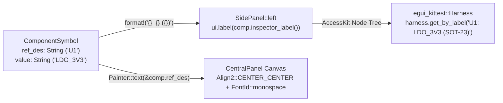

Welcome to **Act II**! In [Lesson 0006](./0006-hit-testing-and-net-cross-probing.html), we built interactive pad hit-testing and net highlighting. But, staring at anonymous red and blue rectangles gets old fast—when you are reviewing a real board or schematic, you navigate by **reference designators** (`U1`, `R12`, `J1`), component values (`LDO_3V3`, `10k`), and human-readable net names (`VCC_3V3`, `SPI_CLK`).

Or, moreover, Lesson 0007 marks a huge milestone in our testing story. Remember how we excluded `<impl eframe::App for PcbReviewerApp>::update` in `.cargo/mutants.toml` back in Lesson 0001? Today, we add [`egui_kittest`](https://docs.rs/egui_kittest/latest/egui_kittest/) to `[dev-dependencies]`, boot our `PcbReviewerApp` headlessly inside `cargo test`, and **take `eframe::App::update` off the exclusion list** so `cargo-mutants` actively guards our rendered UI panels.


_Figure 7.1: Component metadata feeds both `Painter::text` on the 2D canvas and semantic `ui.label` nodes verified headlessly by `egui_kittest::Harness`._

## 1. Just-in-Time Rust: Owned `String` vs. Borrowed `&str` & `format!()`

When modelling a component symbol or net label in Rust, you will immediately run into two string types ([Rust Book §8.2](https://doc.rust-lang.org/book/ch08-02-strings.html)):{{sidenote:Because `&String` automatically coerces to `&str` (via the `Deref` trait), a function that accepts `&str` can take both string literals like `"U1"` and borrowed heap strings like `&comp.ref_des` without copying a single byte!}}

- **`&str` (String Slice):** An immutable, fat-pointer view (`ptr + len`) borrowing existing UTF-8 bytes in memory (such as a compile-time string literal `"Top Copper (F.Cu)"` or a slice of a `String`). It is `Copy` and does not own heap memory.
- **`String` (Owned UTF-8 Buffer):** A growable, heap-allocated UTF-8 buffer (backed by `Vec<u8>`) owned by a struct field (like `pub ref_des: String`) or freshly constructed at runtime with the [`format!()`](https://doc.rust-lang.org/std/macro.format.html) macro.

```rust
#[derive(Clone, Debug, PartialEq)]
pub struct ComponentSymbol {
    pub ref_des: String,
    pub value: String,
    pub package_name: String,
    pub center_mm: Pos2,
    pub body_size_mm: Vec2,
}

impl ComponentSymbol {
    /// Formats a human-readable summary for the SidePanel Component Inspector.
    pub fn inspector_label(&self) -> String {
        format!("{}: {} ({})", self.ref_des, self.value, self.package_name)
    }
}
```

## 2. Drawing Silkscreen Reference Designators with `Painter::text`

On the 2D canvas, [`Painter::text`](https://docs.rs/egui/latest/egui/struct.Painter.html#method.text) renders crisp vector-rasterised glyphs anchored to any screen-space `Pos2` using [`Align2`](https://docs.rs/egui/latest/egui/enum.Align2.html) and [`FontId`](https://docs.rs/egui/latest/egui/struct.FontId.html):{{sidenote:Using `Align2::CENTER_CENTER` places the exact geometric centre of the rendered glyph bounding box at `center_px`, keeping `U1` centred inside its IC body at any zoom level.}}

```rust
let center_px = self.viewport.world_to_screen(comp.center_mm);
painter.text(
    center_px,
    egui::Align2::CENTER_CENTER,
    &comp.ref_des,
    egui::FontId::monospace((2.2 * scale).clamp(9.0, 22.0)),
    PcbLayer::Silkscreen.color(),
);
```

## 3. Headless UI Verification with `egui_kittest::Harness`

So, how do you test a GUI without opening a real OS window and hijacking your mouse cursor?

Turns out, `egui_kittest` solves this cleanly by tapping into AccessKit's semantic accessibility node tree. By adding `egui_kittest = { version = "0.33", features = ["eframe"] }` under `[dev-dependencies]`, we can spin up our entire `eframe::App` headlessly in milliseconds, query widgets by their label, and click buttons directly from `cargo test`:

```rust
use egui_kittest::{Harness, kittest::Queryable};

#[test]
fn headless_ui_renders_component_labels_and_toggles_layers() {
    let mut harness = Harness::new_eframe(|_cc| PcbReviewerApp::default());

    // 1. Verify silkscreen component labels are rendered in the SidePanel
    assert!(harness.query_by_label("U1: LDO_3V3 (SOT-23)").is_some());
    assert!(harness.query_by_label("R12: 10k (0603)").is_some());

    // 2. Click "Isolate Top Copper" and run a frame
    harness.get_by_label("Isolate Top Copper").click();
    harness.run();
    assert!(!harness.state().show_bottom_copper);
    assert!(!harness.state().show_silkscreen);
    assert!(harness.query_by_label("U1: LDO_3V3 (SOT-23)").is_none());
}
```

{{widget:sch-text-sim}}

:::exercise title="Interactive Lab 2: Complete `inspector_label` & the `egui_kittest` Assertion" badge="format!() • Align2 • Queryable"
Fill in the three blanks below to (1) format an owned `String` in `inspector_label`, (2) centre-align the reference designator glyph on the canvas, and (3) click the `"Isolate Top Copper"` button inside our headless `egui_kittest` test:

```rust
impl ComponentSymbol {
    pub fn inspector_label(&self) -> String {
        {{blank:format!|Use the Rust standard library macro that interpolates values into an owned `String` (`format!`).|/* 1: macro */|110px}}("{}: {} ({})", self.ref_des, self.value, self.package_name)
    }
}

// Inside paint_board():
painter.text(
    center_px,
    Align2::{{blank:CENTER_CENTER|Use the `Align2` constant that centres horizontally and vertically (`CENTER_CENTER`).|/* 2: center anchor */|155px}},
    &comp.ref_des,
    FontId::monospace(12.0),
    PcbLayer::Silkscreen.color(),
);

// Inside #[test] fn headless_ui_renders_component_labels_and_toggles_layers():
let mut harness = Harness::new_eframe(|_cc| PcbReviewerApp::default());
harness.{{blank:get_by_label|Call the `Queryable` method that retrieves a widget node by its accessible text label (`get_by_label`).|/* 3: find node */|145px}}("Isolate Top Copper").click();
harness.run();
```
:::prompts
hint: **Hints:** (1) `format!`. (2) `CENTER_CENTER`. (3) `get_by_label`.
success: **Spot on!** `format!` builds the owned `String` summary, `Align2::CENTER_CENTER` anchors the silkscreen glyph, and `harness.get_by_label(...).click()` drives the UI headlessly.
:::
:::

:::verify title="Interactive Lab 3: Un-Skipping `eframe::App::update` with `egui_kittest`" badge="cargo test + cargo mutants" tier="Tier 6: Headless UI (egui_kittest)" caught="35 Caught (10 Unviable)" missed="0 Missed"
Look at `apps/0007-schematic-symbols-and-text-rendering/.cargo/mutants.toml`: we have removed `"<impl eframe::App for PcbReviewerApp>::update"` from `exclude_re`! Because our `egui_kittest::Harness` test queries the rendered `SidePanel` labels and clicks its buttons, `cargo mutants` now mutates `update()` and `render_side_panel()`—and catches every single mutant.

```toml
# apps/0007-schematic-symbols-and-text-rendering/.cargo/mutants.toml
copy_target = true

# Notice that `<impl eframe::App for PcbReviewerApp>::update` and `render_side_panel`
# are NO LONGER excluded! Only the OS window launcher and raw Painter canvas remain excluded.
exclude_re = [
    "replace main",
    "PcbReviewerApp::render_canvas",
    "PcbReviewerApp::paint_board",
    "sample_traces",
    "sample_pads",
    "sample_components",
]
```

- [ ] **1. Run `cargo test` in `apps/0007-schematic-symbols-and-text-rendering`:** Confirm all 14 unit + headless `egui_kittest` tests pass.
- [ ] **2. Run `cargo mutants --in-place`:** Verify that all 35 viable mutants (including `update`, `render_side_panel`, `inspector_label`, and `NetId::signal_name`) are **Caught** with **0 Missed**.
:::

:::quiz title="Retrieval Practice: `String` vs. `&str`, `Align2`, and `egui_kittest`"
Q: Why does a read-only helper often accept `&str` while `format!()` returns an owned `String`?
- [x] String slices borrow existing UTF-8 bytes
- [ ] String slices allocate buffers every pass
- [ ] Owned strings forbid dynamic runtime text
- [ ] Owned strings require static global state
why: A `&str` slice borrows existing UTF-8 bytes without allocating, whereas `format!()` constructs a brand-new string at runtime and returns an owned heap-allocated `String`.
hint: Compare borrowing existing bytes (`&str`) with constructing new formatted bytes at runtime (`String`).

Q: What does `Align2::CENTER_CENTER` do when passed to `painter.text(anchor_px, ...)`?
- [ ] It scales font glyphs around board edges
- [x] It centres text bounds over anchor point
- [ ] It rotates text labels along copper nets
- [ ] It clamps font sizes inside panel frames
why: `Align2::CENTER_CENTER` positions the geometric centre of the rendered text bounding box directly on `anchor_px`.
hint: Think about which point of the text's bounding rectangle is placed at `anchor_px`.

Q: How does `egui_kittest::Harness` let us remove `eframe::App::update` from `.cargo/mutants.toml`?
- [ ] It builds GPU shaders without using rustc
- [ ] It skips widget layout during cargo tests
- [ ] It mutates private fields inside main app
- [x] It drives frames and queries widget nodes
why: `egui_kittest::Harness` runs `eframe::App::update` headlessly and exposes the AccessKit widget tree so tests can query labels and simulate clicks.
hint: Consider how `Harness::new_eframe` executes `update()` and inspects rendered widgets during `cargo test`.
:::

## Recommended Primary Source

:::callout
**Read (5 mins):** [`egui_kittest::Harness` Official API Docs](https://docs.rs/egui_kittest/latest/egui_kittest/struct.Harness.html) and [The Rust Programming Language — §8.2 "Storing UTF-8 Encoded Text with Strings"](https://doc.rust-lang.org/book/ch08-02-strings.html).
:::

:::teacher-prompt
**Up Next (Lesson 0008):** Now that we can render component symbols and verify our UI headlessly with `egui_kittest`, head to [**Lesson 0008: Split Viewports, `egui::Scene` & Borrow-Checker State Splits**](./0008-split-viewports-and-egui-scene.html) to build a side-by-side Schematic + PCB cross-probing workspace!
:::
