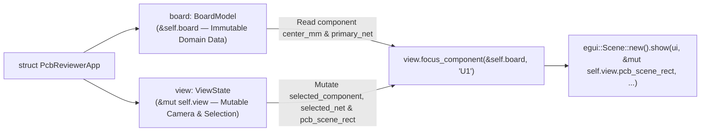

In [Lesson 0006](./0006-schematic-symbols-and-text-rendering.html), we added reference designators (`U1`, `R12`, `J1`) and verified our UI panels headlessly with `egui_kittest::Harness`. In a real PCB design review workflow, engineers work with **two synchronized views**: a **Schematic View** showing logical symbols and a **PCB Layout View** showing physical footprints. When you click `U1` in the schematic, the PCB viewport should immediately highlight `U1`'s electrical net _and_ pan/zoom the PCB camera straight to `U1`'s physical coordinates!


_Figure 7.1: Splitting immutable domain data (`BoardModel`) from mutable camera state (`ViewState`) allows simultaneous shared + mutable borrows across split viewports._

## 1. Just-in-Time Rust: Disjoint Field Borrowing (`&BoardModel` vs. `&mut ViewState`)

Suppose you iterate over components in your app while trying to call a `&mut self` method to recenter the camera:{{sidenote:This pattern—separating read-only domain data from mutable UI/camera state—also prepares our code for Act IV (Lesson 0014), where `BoardModel` moves into its own standalone `pcb-doc` crate!}}

```rust
// ❌ COMPILER ERROR: cannot borrow `*self` as mutable because `self.components` is borrowed as immutable!
for comp in &self.components {
    if ui.button(&comp.ref_des).clicked() {
        self.focus_on_component(&comp.ref_des); // Borrows all of `&mut self`!
    }
}
```

Rust's borrow checker tracks borrows at the **struct field level**. When we group immutable board data into `pub board: BoardModel` and mutable UI/camera state into `pub view: ViewState`, Rust knows that `&self.board` and `&mut self.view` never alias in memory!

```rust
pub struct BoardModel {
    pub traces: Vec<TraceSegment>,
    pub pads: Vec<SmdPad>,
    pub components: Vec<ComponentSymbol>,
}

pub struct ViewState {
    pub selected_component: Option<String>,
    pub selected_net: Option<NetId>,
    pub hovered_net: Option<NetId>,
    pub pcb_scene_rect: Rect,
    pub viewport: BoardViewport,
}

impl ViewState {
    /// Reads `&BoardModel` immutably while mutating `&mut self` (`ViewState`)!
    pub fn focus_component(&mut self, board: &BoardModel, ref_des: &str) -> bool {
        if let Some(comp) = board.find_component(ref_des) {
            self.selected_component = Some(comp.ref_des.clone());
            self.selected_net = Some(comp.primary_net);
            self.pcb_scene_rect = Rect::from_center_size(comp.center_mm, vec2(40.0, 30.0));
            true
        } else {
            false
        }
    }
}
```

## 2. Multi-Panel Layouts with `TopBottomPanel` & `egui::Scene`

Alongside our custom `TSTransform` canvas from Lesson 0003, `egui` provides a built-in pan-and-zoom container called [`egui::Scene`](https://docs.rs/egui/latest/egui/containers/scene/struct.Scene.html). You pass `&mut self.view.pcb_scene_rect` into `Scene::new().show(...)`, and `Scene` automatically updates that `Rect` whenever the user drags or scrolls—or whenever our schematic cross-probe overwrites `pcb_scene_rect` to jump the camera to a component!

```rust
egui::TopBottomPanel::top("schematic_cross_probe_bar").show(ctx, |ui| {
    ui.horizontal(|ui| {
        ui.label("Schematic Symbols (Click to Cross-Probe):");
        for comp in &self.board.components {
            let btn_label = format!("Probe {} ({})", comp.ref_des, comp.value);
            if ui.button(btn_label).clicked() {
                self.view.focus_component(&self.board, &comp.ref_des);
            }
        }
    });
});
```

{{widget:dual-scene-sim}}

:::exercise title="Interactive Lab 2: Complete the Split-Borrow Cross-Probe Call" badge="Borrow Checker • TopBottomPanel • Rect::from_center_size"
Fill in the three blanks below so that (1) `focus_component` borrows `board` immutably, (2) centers `self.pcb_scene_rect` around `comp.center_mm`, and (3) the top schematic bar passes `&self.board` while mutating `self.view`:

```rust
impl ViewState {
    pub fn focus_component(&mut self, board: {{blank:&BoardModel|Borrow `BoardModel` immutably with `&BoardModel`.|/* 1: shared ref */|140px}}, ref_des: &str) -> bool {
        if let Some(comp) = board.find_component(ref_des) {
            self.selected_component = Some(comp.ref_des.clone());
            self.selected_net = Some(comp.primary_net);
            self.pcb_scene_rect = Rect::{{blank:from_center_size|Construct the camera `Rect` from a center point and size vector (`from_center_size`).|/* 2: center + size */|175px}}(comp.center_mm, vec2(40.0, 30.0));
            true
        } else {
            false
        }
    }
}

// Inside TopBottomPanel::top("schematic_bar"):
for comp in &self.board.components {
    let label = format!("Probe {} ({})", comp.ref_des, comp.value);
    if ui.button(label).clicked() {
        self.view.focus_component({{blank:&self.board|Pass an immutable borrow of `self.board` (`&self.board`) while `self.view` is borrowed mutably.|/* 3: board ref */|130px}}, &comp.ref_des);
    }
}
```
:::prompts
hint: **Hints:** (1) `&BoardModel`. (2) `from_center_size`. (3) `&self.board`.
success: **Nailed it!** Splitting `&self.board` and `&mut self.view` lets you iterate over components while mutating the PCB camera rectangle in place.
:::
:::

:::verify title="Interactive Lab 3: Verifying Cross-Probe Camera Synchronization in `egui_kittest`" badge="cargo test + cargo mutants" tier="Tier 6: Cross-Probe & Scene Sync" caught="40 Caught (11 Unviable)" missed="0 Missed"
In `apps/0007-split-viewports-and-egui-scene`, our headless `egui_kittest` test clicks `"Probe R12 (10k)"` in the top schematic bar and asserts that `harness.state().view.pcb_scene_rect.center()` jumps to `pos2(52.0, 35.0)` and `selected_net` updates to `Some(NetId(2))`. If `cargo mutants` deletes the button handler or replaces `focus_component` with `true` or `false`, the test fails immediately!

```rust
#[test]
fn clicking_schematic_probe_button_updates_pcb_camera_rect_and_net() {
    let mut harness = Harness::new_eframe(|_cc| PcbReviewerApp::default());

    harness.get_by_label("Probe R12 (10k)").click();
    harness.run();

    assert_eq!(
        harness.state().view.selected_component.as_deref(),
        Some("R12")
    );
    assert_eq!(harness.state().view.selected_net, Some(NetId(2)));
    assert_eq!(
        harness.state().view.pcb_scene_rect.center(),
        pos2(52.0, 35.0)
    );
}
```

- [ ] **1. Run `cargo test` in `apps/0007-split-viewports-and-egui-scene`:** Confirm all 16 unit + headless `egui_kittest` tests pass.
- [ ] **2. Run `cargo mutants --in-place`:** Verify that all 40 viable mutants (including `BoardModel::find_component` and `ViewState::focus_component`) are **Caught** with **0 Missed**.
:::

:::quiz title="Retrieval Practice: Disjoint Struct Borrows & `egui::Scene`"
Q: Why does splitting `PcbReviewerApp` into `board: BoardModel` and `view: ViewState` satisfy Rust's borrow checker?
- [ ] Mutable methods clone vectors every repaint
- [ ] Shared references mutate fields inside draw
- [x] Disjoint fields allow split borrows cleanly
- [ ] Closures bypass lifetime rules during frame
why: Rust's borrow checker tracks borrows per struct field, so an immutable borrow of `self.board` can coexist with a mutable borrow of `self.view`.
hint: Think about how `rustc` analyzes borrows of two separate fields (`self.board` vs. `self.view`) on the same struct.

Q: How does `egui::Scene::new().show(ui, &mut self.view.pcb_scene_rect, ...)` persist pan and zoom across frames?
- [x] It mutates the passed scene_rect reference
- [ ] It stores camera matrices inside pipelines
- [ ] It clears viewport bounds before rendering
- [ ] It blocks pointer events inside containers
why: `egui::Scene` takes `&mut Rect` (`scene_rect`) and mutates that rectangle in-place whenever the user pans/zooms, or reads it when your code recenters the camera.
hint: Look at the `&mut self.view.pcb_scene_rect` parameter passed into `Scene::show`.

Q: What two view updates does `focus_component` perform when an engineer clicks a schematic symbol?
- [ ] Disabling copper layers while panning views
- [x] Highlighting nets while centering the board
- [ ] Allocating new painters while locking state
- [ ] Rebuilding font atlases while sorting trace
why: `focus_component` sets `selected_net` (highlighting connected pads and traces) and updates `pcb_scene_rect` around `comp.center_mm` (centering the camera).
hint: Check which fields on `ViewState` are updated inside `focus_component`.
:::

## Recommended Primary Source

:::callout
**Read (5 mins):** [`egui::Scene` Official API Docs](https://docs.rs/egui/latest/egui/containers/scene/struct.Scene.html) and [The Rustonomicon — "Splitting Borrows"](https://doc.rust-lang.org/nomicon/borrow-splitting.html).
:::

:::teacher-prompt
**Up Next (Lesson 0008):** What happens when a real board has 2,000 components instead of 3? Head to [**Lesson 0008: Searchable Netlist, Virtualized BOM & Iterator Adapters**](./0008-searchable-netlist-and-bom-inspector.html) to build a filterable, virtualized BOM table using `TextEdit::singleline` and `ScrollArea::show_rows`!
:::
