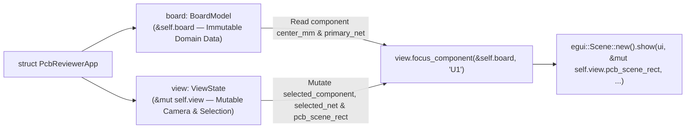

When you are debugging a real hardware board, you almost always have **two synchronised views** open side by side: a **Schematic View** showing logical symbols and a **PCB Layout View** showing physical footprints. Click `U1` in the schematic, and you want the PCB viewport to immediately highlight `U1`'s electrical net _and_ pan the PCB camera straight to `U1`'s physical coordinates.

In [Lesson 0007](./0007-schematic-symbols-and-text-rendering.html), we added reference designators (`U1`, `R12`, `J1`) and verified our UI panels headlessly with `egui_kittest::Harness`. Now, let's build that schematic-to-PCB cross-prober—and solve one of the most classic Rust borrow-checker puzzles you will hit in `egui` along the way.


_Figure 8.1: Splitting immutable domain data (`BoardModel`) from mutable camera state (`ViewState`) allows simultaneous shared + mutable borrows across split viewports._

## 1. Just-in-Time Rust: Disjoint Field Borrowing (`&BoardModel` vs. `&mut ViewState`)

Suppose you iterate over `self.components` to draw a row of schematic symbol buttons, and inside that loop you call a `&mut self` method to recentre the camera:{{sidenote:Which leads to a nice architectural bonus: separating read-only domain data from mutable UI/camera state prepares our code for Act IV (Lesson 0015), where `BoardModel` moves into its own standalone `pcb-doc` crate!}}

```rust
// ❌ COMPILER ERROR: cannot borrow `*self` as mutable because `self.components` is borrowed as immutable!
for comp in &self.components {
    if ui.button(&comp.ref_des).clicked() {
        self.focus_on_component(&comp.ref_des); // Borrows all of `&mut self`!
    }
}
```

If you have written Rust for more than ten minutes, you have probably met that exact error (`E0502`).

Turns out, Rust's borrow checker is smarter than it looks at first glance: it tracks borrows at the **individual struct field level**. When we group our read-only board data into `pub board: BoardModel` and our mutable UI/camera state into `pub view: ViewState`, `rustc` can see that `&self.board` and `&mut self.view` are completely disjoint in memory!

## 2. Anatomy of Lesson 0008's Additions: Block by Block

Let's walk through the new and updated code in `apps/0008-split-viewports-and-egui-scene/src/main.rs` block by block, then assemble the full cross-probing implementation in context.

### Block 1: Extending `ComponentSymbol` with `primary_net` & Defining `BoardModel`

```rust
#[derive(Clone, Debug, PartialEq)]
pub struct ComponentSymbol {
    pub ref_des: String,
    pub value: String,
    pub package_name: String,
    pub center_mm: Pos2,
    pub body_size_mm: Vec2,
    pub primary_net: NetId,
}

/// Immutable board domain data (`&self.board`) separated from `ViewState` (`&mut self.view`)
/// so UI panels can iterate over components while mutating camera and selection state.
pub struct BoardModel {
    pub traces: Vec<TraceSegment>,
    pub pads: Vec<SmdPad>,
    pub components: Vec<ComponentSymbol>,
}

impl Default for BoardModel {
    fn default() -> Self {
        Self {
            traces: sample_traces(),
            pads: sample_pads(),
            components: sample_components(),
        }
    }
}

impl BoardModel {
    pub fn find_component(&self, ref_des: &str) -> Option<&ComponentSymbol> {
        self.components.iter().find(|c| c.ref_des == ref_des)
    }
}
```

- **`pub primary_net: NetId`**: Links each `ComponentSymbol` (`U1`, `R12`, `J1`) to its primary electrical net (`NetId(1)` for `U1`/`J1`, `NetId(2)` for `R12`) so clicking a schematic symbol can highlight its traces and pads on the PCB.
- **`pub struct BoardModel`**: Houses the read-only domain vectors (`traces`, `pads`, `components`) in their own struct so borrowing `&self.board` never conflicts with mutating `self.view`.
- **`pub fn find_component(&self, ref_des: &str) -> Option<&ComponentSymbol>`**: Iterates over `self.components` with `.iter().find(|c| c.ref_des == ref_des)` and returns an optional borrowed reference `Option<&ComponentSymbol>` tied to the lifetime of `&self`—no `ComponentSymbol` cloning required.

### Block 2: `ViewState` & Split-Borrow Camera Focusing (`focus_component`)

```rust
/// Mutable camera, layer visibility, and cross-probe selection state (`&mut self.view`).
pub struct ViewState {
    pub show_top_copper: bool,
    pub show_bottom_copper: bool,
    pub show_silkscreen: bool,
    pub show_ratsnest: bool,
    pub viewport: BoardViewport,
    pub pcb_scene_rect: Rect,
    pub selected_component: Option<String>,
    pub hovered_net: Option<NetId>,
    pub selected_net: Option<NetId>,
}

impl Default for ViewState {
    fn default() -> Self {
        let mut view = Self {
            show_top_copper: false,
            show_bottom_copper: false,
            show_silkscreen: false,
            show_ratsnest: false,
            viewport: BoardViewport::default(),
            pcb_scene_rect: Rect::from_min_max(pos2(0.0, 0.0), pos2(100.0, 70.0)),
            selected_component: None,
            hovered_net: None,
            selected_net: None,
        };
        view.reset_layers();
        view
    }
}

impl ViewState {
    // ... [reset_layers, isolate_top_copper, show_all_layers, is_layer_visible, active_net] ...

    pub fn reset_viewport(&mut self) {
        self.viewport = BoardViewport::default();
        self.pcb_scene_rect = Rect::from_min_max(pos2(0.0, 0.0), pos2(100.0, 70.0));
    }

    /// Cross-probes a component from the Schematic Symbol Bar into the PCB camera.
    /// Demonstrates split borrowing: `board` is borrowed immutably (`&BoardModel`)
    /// while `self` (`&mut ViewState`) is mutated in place.
    pub fn focus_component(&mut self, board: &BoardModel, ref_des: &str) -> bool {
        if let Some(comp) = board.find_component(ref_des) {
            self.selected_component = Some(comp.ref_des.clone());
            self.selected_net = Some(comp.primary_net);
            self.pcb_scene_rect = Rect::from_center_size(comp.center_mm, vec2(40.0, 30.0));
            true
        } else {
            false
        }
    }
}
```

- **`pub pcb_scene_rect: Rect` & `pub selected_component: Option<String>`**: `pcb_scene_rect` tracks the 2D camera rectangle managed by `egui::Scene` (initialised to the full `100×70 mm` board bounds), while `selected_component` remembers which schematic `RefDes` is currently cross-probed.
- **`pub fn focus_component(&mut self, board: &BoardModel, ref_des: &str) -> bool`**: Takes `&mut self` (`&mut ViewState`) alongside a shared `&BoardModel` reference and a `&str` slice. Because `BoardModel` and `ViewState` are separate fields on `PcbReviewerApp`, callers can pass `&self.board` while mutating `self.view`!
- **`Rect::from_center_size(comp.center_mm, vec2(40.0, 30.0))`**: Recentres `self.pcb_scene_rect` directly over `comp.center_mm` with a `40×30` camera window, sets `selected_net = Some(comp.primary_net)`, and returns `true` when found (or `false` for an unknown `ref_des`).

### Block 3: Multi-Panel Workspace (`Panel::top` & `egui::Scene`)

Alongside our custom `TSTransform` canvas from Lesson 0004, `egui` also ships a built-in pan-and-zoom container called [`egui::Scene`](https://docs.rs/egui/latest/egui/containers/scene/struct.Scene.html). You pass `&mut scene_rect` into `Scene::new().show(...)`, and `Scene` automatically updates that `Rect` whenever the user drags or scrolls—or whenever our schematic cross-probe overwrites `pcb_scene_rect` to jump the camera straight to a component:

```rust
#[derive(Default)]
pub struct PcbReviewerApp {
    pub board: BoardModel,
    pub view: ViewState,
}

impl PcbReviewerApp {
    // ...
    pub fn render_schematic_bar(&mut self, ui: &mut egui::Ui) {
        ui.horizontal(|ui| {
            ui.label("Schematic Symbols (Cross-Probe):");
            for comp in &self.board.components {
                let label = format!("Probe {} ({})", comp.ref_des, comp.value);
                if ui.button(label).clicked() {
                    self.view.focus_component(&self.board, &comp.ref_des);
                }
            }
            if let Some(focused) = &self.view.selected_component {
                ui.label(format!("Focused Footprint: {focused}"));
            }
        });
    }

    fn render_canvas(&mut self, ui: &mut egui::Ui) {
        let mut scene_rect = self.view.pcb_scene_rect;
        egui::Scene::new()
            .zoom_range(0.5..=8.0)
            .show(ui, &mut scene_rect, |ui| {
                let (response, painter) =
                    ui.allocate_painter(vec2(720.0, 520.0), Sense::click_and_drag());

                if response.dragged() {
                    self.view.viewport.pan_by(response.drag_delta());
                }

                if let Some(hover_pos) = response.hover_pos() {
                    let world_mm = self.view.viewport.screen_to_world(hover_pos);
                    self.view.hovered_net = self.hit_test_net_at_mm(world_mm);
                    if response.clicked() {
                        self.view.selected_net = self.view.hovered_net;
                    }
                } else {
                    self.view.hovered_net = None;
                }

                self.paint_board(&painter, response.rect);
            });
        self.view.pcb_scene_rect = scene_rect;
    }
}

impl eframe::App for PcbReviewerApp {
    fn ui(&mut self, ui: &mut egui::Ui, _frame: &mut eframe::Frame) {
        egui::Panel::top("schematic_cross_probe_bar").show(ui, |ui| {
            self.render_schematic_bar(ui);
        });

        egui::Panel::left("layer_panel").show(ui, |ui| {
            self.render_side_panel(ui);
        });

        egui::CentralPanel::default().show(ui, |ui| {
            self.render_canvas(ui);
        });
    }
}
```

- **`#[derive(Default)] pub struct PcbReviewerApp`**: Now that both `BoardModel` and `ViewState` implement `Default` with our desired startup values, `PcbReviewerApp` can use `#[derive(Default)]` cleanly.
- **Disjoint Borrow Inside `for comp in &self.board.components`**: The `for` loop holds an immutable borrow of `self.board.components` (`&self.board`), and inside the loop body `self.view.focus_component(&self.board, &comp.ref_des)` mutably borrows `self.view` while sharing `&self.board`. Zero temporary `.clone()` allocations needed!
- **Copying `let mut scene_rect = self.view.pcb_scene_rect`**: Because `Rect` is `Copy`, copying `self.view.pcb_scene_rect` into a local stack variable `scene_rect` before calling `egui::Scene::new().zoom_range(0.5..=8.0).show(ui, &mut scene_rect, |ui| { ... })` avoids holding a mutable borrow on `self.view.pcb_scene_rect` while the inner closure also accesses `self` (`self.hit_test_net_at_mm(...)` and `self.paint_board(...)`). After `Scene::show` finishes, we write `self.view.pcb_scene_rect = scene_rect;` back.
- **`egui::Panel::top("schematic_cross_probe_bar")`**: Claims the top horizontal strip of the window _before_ `Panel::left` and `CentralPanel` divide up the remaining vertical space.

### Block 4: Unit & Headless Cross-Probe Verification (`#[cfg(test)]`)

```rust
#[test]
fn focus_component_centers_scene_rect_and_returns_false_for_unknown_ref_des() {
    let board = BoardModel::default();
    let mut view = ViewState::default();

    assert!(view.focus_component(&board, "R12"));
    assert_eq!(view.selected_component.as_deref(), Some("R12"));
    assert_eq!(view.selected_net, Some(NetId(2)));
    assert_eq!(
        view.pcb_scene_rect,
        Rect::from_center_size(pos2(52.0, 35.0), vec2(40.0, 30.0))
    );

    assert!(!view.focus_component(&board, "U999"));
}

#[test]
fn clicking_schematic_probe_button_updates_pcb_camera_rect_and_net() {
    let mut harness = Harness::new_eframe(|_cc| PcbReviewerApp::default());

    harness.get_by_label("Probe R12 (10k)").click();
    harness.run();

    assert_eq!(
        harness.state().view.selected_component.as_deref(),
        Some("R12")
    );
    assert_eq!(harness.state().view.selected_net, Some(NetId(2)));
    assert_eq!(
        harness.state().view.pcb_scene_rect.center(),
        pos2(52.0, 35.0)
    );
    assert!(harness.query_by_label("Focused Footprint: R12").is_some());

    harness.get_by_label("Clear Selection").click();
    harness.run();
    assert_eq!(harness.state().view.selected_net, None);
    assert_eq!(harness.state().view.selected_component, None);
}
```

- **`view.selected_component.as_deref()`**: Converts `Option<&String>` into `Option<&str>` so we can compare it directly against `Some("R12")` without allocating a temporary `String`.
- **Testing Both `true` and `false` Arms of `focus_component`**: Asserting both `assert!(view.focus_component(&board, "R12"))` and `assert!(!view.focus_component(&board, "U999"))` ensures `cargo-mutants` catches any mutation that replaces the return value with a constant `true` or `false`.
- **End-to-End Cross-Probe via `harness.get_by_label("Probe R12 (10k)").click()`**: Clicks the top schematic bar button headlessly, steps a frame with `harness.run()`, and verifies that `selected_component`, `selected_net`, `pcb_scene_rect.center()`, and the `"Focused Footprint: R12"` status label all update in lockstep.

### Complete Lesson 0008 Listing (In Context)

Here is how `BoardModel`, `ViewState`, `PcbReviewerApp`, and our cross-probing UI fit together in `apps/0008-split-viewports-and-egui-scene/src/main.rs`:

```rust
// ... [Imports, MIN_ZOOM, MAX_ZOOM, main(), NetId, PcbLayer, TraceSegment, SmdPad unchanged] ...

#[derive(Clone, Debug, PartialEq)]
pub struct ComponentSymbol {
    pub ref_des: String,
    pub value: String,
    pub package_name: String,
    pub center_mm: Pos2,
    pub body_size_mm: Vec2,
    pub primary_net: NetId,
}

impl ComponentSymbol {
    pub fn inspector_label(&self) -> String {
        format!("{}: {} ({})", self.ref_des, self.value, self.package_name)
    }
}

// ... [BoardViewport, sample_traces(), sample_pads(), sample_components() with primary_net] ...

/// Immutable board domain data (`&self.board`) separated from `ViewState` (`&mut self.view`)
/// so UI panels can iterate over components while mutating camera and selection state.
pub struct BoardModel {
    pub traces: Vec<TraceSegment>,
    pub pads: Vec<SmdPad>,
    pub components: Vec<ComponentSymbol>,
}

impl Default for BoardModel {
    fn default() -> Self {
        Self {
            traces: sample_traces(),
            pads: sample_pads(),
            components: sample_components(),
        }
    }
}

impl BoardModel {
    pub fn find_component(&self, ref_des: &str) -> Option<&ComponentSymbol> {
        self.components.iter().find(|c| c.ref_des == ref_des)
    }
}

/// Mutable camera, layer visibility, and cross-probe selection state (`&mut self.view`).
pub struct ViewState {
    pub show_top_copper: bool,
    pub show_bottom_copper: bool,
    pub show_silkscreen: bool,
    pub show_ratsnest: bool,
    pub viewport: BoardViewport,
    pub pcb_scene_rect: Rect,
    pub selected_component: Option<String>,
    pub hovered_net: Option<NetId>,
    pub selected_net: Option<NetId>,
}

impl Default for ViewState {
    fn default() -> Self {
        let mut view = Self {
            show_top_copper: false,
            show_bottom_copper: false,
            show_silkscreen: false,
            show_ratsnest: false,
            viewport: BoardViewport::default(),
            pcb_scene_rect: Rect::from_min_max(pos2(0.0, 0.0), pos2(100.0, 70.0)),
            selected_component: None,
            hovered_net: None,
            selected_net: None,
        };
        view.reset_layers();
        view
    }
}

impl ViewState {
    pub fn reset_layers(&mut self) {
        self.show_top_copper = true;
        self.show_bottom_copper = true;
        self.show_silkscreen = true;
        self.show_ratsnest = false;
    }

    pub fn isolate_top_copper(&mut self) {
        self.show_top_copper = true;
        self.show_bottom_copper = false;
        self.show_silkscreen = false;
        self.show_ratsnest = false;
    }

    pub fn show_all_layers(&mut self) {
        self.show_top_copper = true;
        self.show_bottom_copper = true;
        self.show_silkscreen = true;
        self.show_ratsnest = true;
    }

    pub fn reset_viewport(&mut self) {
        self.viewport = BoardViewport::default();
        self.pcb_scene_rect = Rect::from_min_max(pos2(0.0, 0.0), pos2(100.0, 70.0));
    }

    pub fn is_layer_visible(&self, layer: PcbLayer) -> bool {
        match layer {
            PcbLayer::BottomCopper => self.show_bottom_copper,
            PcbLayer::TopCopper => self.show_top_copper,
            PcbLayer::Silkscreen => self.show_silkscreen,
            PcbLayer::Ratsnest => self.show_ratsnest,
        }
    }

    pub fn active_net(&self) -> Option<NetId> {
        self.selected_net.or(self.hovered_net)
    }

    /// Cross-probes a component from the Schematic Symbol Bar into the PCB camera.
    /// Demonstrates split borrowing: `board` is borrowed immutably (`&BoardModel`)
    /// while `self` (`&mut ViewState`) is mutated in place.
    pub fn focus_component(&mut self, board: &BoardModel, ref_des: &str) -> bool {
        if let Some(comp) = board.find_component(ref_des) {
            self.selected_component = Some(comp.ref_des.clone());
            self.selected_net = Some(comp.primary_net);
            self.pcb_scene_rect = Rect::from_center_size(comp.center_mm, vec2(40.0, 30.0));
            true
        } else {
            false
        }
    }
}

#[derive(Default)]
pub struct PcbReviewerApp {
    pub board: BoardModel,
    pub view: ViewState,
}

impl PcbReviewerApp {
    // ... [visible_traces_in_z_order, hit_test_net_at_mm, paint_board] ...

    pub fn render_schematic_bar(&mut self, ui: &mut egui::Ui) {
        ui.horizontal(|ui| {
            ui.label("Schematic Symbols (Cross-Probe):");
            for comp in &self.board.components {
                let label = format!("Probe {} ({})", comp.ref_des, comp.value);
                if ui.button(label).clicked() {
                    self.view.focus_component(&self.board, &comp.ref_des);
                }
            }
            if let Some(focused) = &self.view.selected_component {
                ui.label(format!("Focused Footprint: {focused}"));
            }
        });
    }

    pub fn render_side_panel(&mut self, ui: &mut egui::Ui) {
        // ... [Layer checkboxes and RefDes list reading self.board & self.view] ...
        ui.separator();
        ui.heading("Net Inspector");
        if let Some(net) = self.view.active_net() {
            ui.label(format!("Active Net: {} ({})", net.code(), net.signal_name()));
            if ui.button("Clear Selection").clicked() {
                self.view.selected_net = None;
                self.view.selected_component = None;
            }
        } else {
            ui.label("Hover or click a pad to cross-probe its net.");
        }
    }

    fn render_canvas(&mut self, ui: &mut egui::Ui) {
        let mut scene_rect = self.view.pcb_scene_rect;
        egui::Scene::new()
            .zoom_range(0.5..=8.0)
            .show(ui, &mut scene_rect, |ui| {
                let (response, painter) =
                    ui.allocate_painter(vec2(720.0, 520.0), Sense::click_and_drag());

                if response.dragged() {
                    self.view.viewport.pan_by(response.drag_delta());
                }

                if let Some(hover_pos) = response.hover_pos() {
                    let world_mm = self.view.viewport.screen_to_world(hover_pos);
                    self.view.hovered_net = self.hit_test_net_at_mm(world_mm);
                    if response.clicked() {
                        self.view.selected_net = self.view.hovered_net;
                    }
                } else {
                    self.view.hovered_net = None;
                }

                self.paint_board(&painter, response.rect);
            });
        self.view.pcb_scene_rect = scene_rect;
    }
}

impl eframe::App for PcbReviewerApp {
    fn ui(&mut self, ui: &mut egui::Ui, _frame: &mut eframe::Frame) {
        egui::Panel::top("schematic_cross_probe_bar").show(ui, |ui| {
            self.render_schematic_bar(ui);
        });

        egui::Panel::left("layer_panel").show(ui, |ui| {
            self.render_side_panel(ui);
        });

        egui::CentralPanel::default().show(ui, |ui| {
            self.render_canvas(ui);
        });
    }
}
```

{{widget:dual-scene-sim}}

:::exercise title="Interactive Lab 2: Complete the Split-Borrow Cross-Probe Call" badge="Borrow Checker • Panel::top • Rect::from_center_size"
Fill in the three blanks below so that (1) `focus_component` borrows `board` immutably, (2) centres `self.pcb_scene_rect` around `comp.center_mm`, and (3) the top schematic bar passes `&self.board` while mutating `self.view`:

```rust
impl ViewState {
    pub fn focus_component(&mut self, board: {{blank:&BoardModel|Borrow `BoardModel` immutably with `&BoardModel`.|/* 1: shared ref */|140px}}, ref_des: &str) -> bool {
        if let Some(comp) = board.find_component(ref_des) {
            self.selected_component = Some(comp.ref_des.clone());
            self.selected_net = Some(comp.primary_net);
            self.pcb_scene_rect = Rect::{{blank:from_center_size|Construct the camera `Rect` from a centre point and size vector (`from_center_size`).|/* 2: center + size */|175px}}(comp.center_mm, vec2(40.0, 30.0));
            true
        } else {
            false
        }
    }
}

// Inside Panel::top("schematic_bar"):
for comp in &self.board.components {
    let label = format!("Probe {} ({})", comp.ref_des, comp.value);
    if ui.button(label).clicked() {
        self.view.focus_component({{blank:&self.board|Pass an immutable borrow of `self.board` (`&self.board`) while `self.view` is borrowed mutably.|/* 3: board ref */|130px}}, &comp.ref_des);
    }
}
```
:::prompts
hint: **Hints:** (1) `&BoardModel`. (2) `from_center_size`. (3) `&self.board`.
success: **Nailed it!** Splitting `&self.board` and `&mut self.view` lets you iterate over components while mutating the PCB camera rectangle in place.
:::
:::

:::verify title="Interactive Lab 3: Verifying Cross-Probe Camera Synchronisation in `egui_kittest`" badge="cargo test + cargo mutants" tier="Tier 6: Cross-Probe & Scene Sync" caught="40 Caught (11 Unviable)" missed="0 Missed"
In `apps/0008-split-viewports-and-egui-scene`, our headless `egui_kittest` test clicks `"Probe R12 (10k)"` in the top schematic bar and asserts that `harness.state().view.pcb_scene_rect.center()` jumps to `pos2(52.0, 35.0)` and `selected_net` updates to `Some(NetId(2))`. If `cargo mutants` deletes the button handler or replaces `focus_component` with `true` or `false`, the test fails immediately!

```rust
#[test]
fn clicking_schematic_probe_button_updates_pcb_camera_rect_and_net() {
    let mut harness = Harness::new_eframe(|_cc| PcbReviewerApp::default());

    harness.get_by_label("Probe R12 (10k)").click();
    harness.run();

    assert_eq!(
        harness.state().view.selected_component.as_deref(),
        Some("R12")
    );
    assert_eq!(harness.state().view.selected_net, Some(NetId(2)));
    assert_eq!(
        harness.state().view.pcb_scene_rect.center(),
        pos2(52.0, 35.0)
    );
}
```

- [ ] **1. Run `cargo test` in `apps/0008-split-viewports-and-egui-scene`:** Confirm all 16 unit + headless `egui_kittest` tests pass.
- [ ] **2. Run `cargo mutants --in-place`:** Verify that all 40 viable mutants (including `BoardModel::find_component` and `ViewState::focus_component`) are **Caught** with **0 Missed**.
:::

:::quiz title="Retrieval Practice: Disjoint Struct Borrows & `egui::Scene`"
Q: Why does splitting `PcbReviewerApp` into `board: BoardModel` and `view: ViewState` satisfy Rust's borrow checker?
- [ ] Mutable methods clone vectors every repaint
- [ ] Shared references mutate fields inside draw
- [x] Disjoint fields allow split borrows cleanly
- [ ] Closures bypass lifetime rules during frame
why: Rust's borrow checker tracks borrows per struct field, so an immutable borrow of `self.board` can coexist with a mutable borrow of `self.view`.
hint: Think about how `rustc` analyses borrows of two separate fields (`self.board` vs. `self.view`) on the same struct.

Q: How does `egui::Scene::new().show(ui, &mut self.view.pcb_scene_rect, ...)` persist pan and zoom across frames?
- [x] It mutates the passed scene_rect reference
- [ ] It stores camera matrices inside pipelines
- [ ] It clears viewport bounds before rendering
- [ ] It blocks pointer events inside containers
why: `egui::Scene` takes `&mut Rect` (`scene_rect`) and mutates that rectangle in-place whenever the user pans/zooms, or reads it when your code recentres the camera.
hint: Look at the `&mut self.view.pcb_scene_rect` parameter passed into `Scene::show`.

Q: What two view updates does `focus_component` perform when an engineer clicks a schematic symbol?
- [ ] Disabling copper layers while panning views
- [x] Highlighting nets while centring the board
- [ ] Allocating new painters while locking state
- [ ] Rebuilding font atlases while sorting trace
why: `focus_component` sets `selected_net` (highlighting connected pads and traces) and updates `pcb_scene_rect` around `comp.center_mm` (centring the camera).
hint: Check which fields on `ViewState` are updated inside `focus_component`.
:::

## Recommended Primary Source

:::callout
**Read (5 mins):** [`egui::Scene` Official API Docs](https://docs.rs/egui/latest/egui/containers/scene/struct.Scene.html) and [The Rustonomicon — "Splitting Borrows"](https://doc.rust-lang.org/nomicon/borrow-splitting.html).
:::

:::teacher-prompt
**Up Next (Lesson 0009):** What happens when a real board has 2,000 components instead of 3? Head to [**Lesson 0009: Searchable Netlist, Virtualised BOM & Iterator Adapters**](./0009-searchable-netlist-and-bom-inspector.html) to build a filterable, virtualised BOM table using `TextEdit::singleline` and `ScrollArea::show_rows`!
:::
