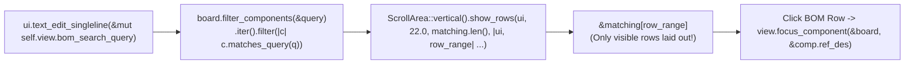

A row of three buttons in a toolbar works fine for a tiny demo board. Try doing that on a synth voice card with 400 passives and ICs, though, and your toolbar will run right off the side of your monitor.

In [Lesson 0008](./0008-split-viewports-and-egui-scene.html), we wired schematic-to-PCB cross-probing across split viewports. Now, let's build a proper **Bill of Materials (BOM) & Netlist Inspector** where typing `"u1"`, `"10k"`, or `"spi_clk"` filters the component list in real time and clicking any matching row cross-probes that footprint on the canvas.


_Figure 9.1: `TextEdit::singleline` mutates the query string in place, `.filter()` selects matching components, and `show_rows` virtualises layout to only the visible slice `&matching[row_range]`._

## 1. Just-in-Time Rust: Iterator Adapters (`.filter()`) & Range Slices (`&[T]`)

To filter components case-insensitively across their reference designator (`U1`), value (`LDO_3V3`), package (`SOT-23`), or connected net name (`VCC_3V3`), we normalise the query with `.trim().to_ascii_lowercase()` and chain Rust's zero-cost iterator adapters ([Rust Book §13.2](https://doc.rust-lang.org/book/ch13-02-iterators.html)).{{sidenote:Why slice via `&matching[row_range]`? A Rust slice `&matching[row_range]` (`Range<usize>`) is a bounds-checked window into the contiguous vector that lets us iterate over just the visible viewport rows without allocating a second vector.}}

## 2. Anatomy of Lesson 0009's Additions: Block by Block

Let's inspect the new and modified code in `apps/0009-searchable-netlist-and-bom-inspector/src/main.rs` block by block, then put the full BOM & Netlist Inspector together in context.

### Block 1: Case-Insensitive Matching (`matches_query`) & `filter_components`

```rust
impl ComponentSymbol {
    pub fn inspector_label(&self) -> String {
        format!("{}: {} ({})", self.ref_des, self.value, self.package_name)
    }

    /// Case-insensitively matches `query` against `ref_des`, `value`, `package_name`,
    /// or `primary_net.signal_name()`. An empty or whitespace-only query matches all components.
    pub fn matches_query(&self, query: &str) -> bool {
        let needle = query.trim().to_ascii_lowercase();
        if needle.is_empty() {
            return true;
        }
        self.ref_des.to_ascii_lowercase().contains(&needle)
            || self.value.to_ascii_lowercase().contains(&needle)
            || self.package_name.to_ascii_lowercase().contains(&needle)
            || self
                .primary_net
                .signal_name()
                .to_ascii_lowercase()
                .contains(&needle)
    }
}

impl BoardModel {
    pub fn find_component(&self, ref_des: &str) -> Option<&ComponentSymbol> {
        self.components.iter().find(|c| c.ref_des == ref_des)
    }

    pub fn filter_components(&self, query: &str) -> Vec<ComponentSymbol> {
        self.components
            .iter()
            .filter(|c| c.matches_query(query))
            .cloned()
            .collect()
    }
}
```

- **`query.trim().to_ascii_lowercase()`**: `.trim()` returns a borrowed `&str` stripped of leading/trailing whitespace, and `.to_ascii_lowercase()` allocates an owned lowercase `String` (`needle`). If `needle.is_empty()`, we short-circuit and return `true` so an empty search box shows the full BOM.
- **Four-Way Disjunction (`||`)**: Checks whether `needle` is a substring (`.contains(&needle)`) of the lowercased `ref_des`, `value`, `package_name`, or `primary_net.signal_name()`. Because `||` short-circuits in Rust, later branches only run if earlier ones return `false`.
- **`.iter().filter(|c| c.matches_query(query)).cloned().collect()`**: Creates an iterator of `&ComponentSymbol`, keeps only elements satisfying `matches_query`, clones the matching symbols via `.cloned()`, and collects them into a `Vec<ComponentSymbol>`.

### Block 2: Storing `bom_search_query` & `clear_bom_query` on `ViewState`

```rust
pub struct ViewState {
    pub show_top_copper: bool,
    pub show_bottom_copper: bool,
    pub show_silkscreen: bool,
    pub show_ratsnest: bool,
    pub viewport: BoardViewport,
    pub pcb_scene_rect: Rect,
    pub selected_component: Option<String>,
    pub hovered_net: Option<NetId>,
    pub selected_net: Option<NetId>,
    pub bom_search_query: String,
}

impl Default for ViewState {
    fn default() -> Self {
        let mut view = Self {
            // ...
            bom_search_query: String::new(),
        };
        view.reset_layers();
        view
    }
}

impl ViewState {
    // ...
    pub fn clear_bom_query(&mut self) {
        self.bom_search_query.clear();
    }
}
```

- **`pub bom_search_query: String`**: Because `egui::Ui::text_edit_singleline` mutates a buffer in place on each keystroke, the search string must be an owned, growable `String` living inside `ViewState` (initialised via `String::new()`).
- **`pub fn clear_bom_query(&mut self)`**: Calls `self.bom_search_query.clear()`, which truncates the string's length to `0` in-place while reusing its existing heap capacity.

### Block 3: Virtualised BOM Table (`text_edit_singleline`, `ScrollArea::show_rows` & `Grid`)

Now, even in an immediate-mode GUI, laying out 10,000 offscreen table rows on every 60 Hz frame is a great way to warm up your laptop fan for no reason.

Turns out, [`ScrollArea::show_rows`](https://docs.rs/egui/latest/egui/containers/scroll_area/struct.ScrollArea.html#method.show_rows) makes virtualised scrolling almost ridiculously simple: it calculates the exact `row_range: Range<usize>` currently visible inside the scroll viewport based on `row_height_sans_spacing` and calls your closure for _only those visible rows_:{{sidenote:Notice how we chain `.labelled_by(bom_label.id)` onto `ui.text_edit_singleline(...)`. In `egui_kittest 0.37`, `Harness::run()` automatically audits AccessKit nodes and panics if any interactive `TextInput` lacks an accessible name!}}

```rust
ui.separator();
ui.heading("BOM & Netlist Inspector");
ui.horizontal(|ui| {
    let bom_label = ui.label("Filter BOM:");
    ui.text_edit_singleline(&mut self.view.bom_search_query)
        .labelled_by(bom_label.id);
    if ui.button("Clear Filter").clicked() {
        self.view.clear_bom_query();
    }
});

if self.view.show_silkscreen {
    let matching = self.board.filter_components(&self.view.bom_search_query);
    ui.label(format!("Matching Components: {}", matching.len()));
    egui::ScrollArea::vertical()
        .max_height(180.0)
        .show_rows(ui, 22.0, matching.len(), |ui, row_range| {
            egui::Grid::new("bom_inspector_grid")
                .striped(true)
                .show(ui, |ui| {
                    for comp in &matching[row_range] {
                        ui.label(comp.primary_net.signal_name());
                        if ui.button(comp.inspector_label()).clicked() {
                            self.view.focus_component(&self.board, &comp.ref_des);
                        }
                        ui.end_row();
                    }
                });
        });
} else {
    ui.label("Enable Silkscreen to inspect component RefDes.");
}
```

- **`ui.text_edit_singleline(&mut self.view.bom_search_query).labelled_by(bom_label.id)`**: Binds the single-line text box directly to `&mut self.view.bom_search_query` and links its AccessKit accessibility node to `bom_label.id` (`"Filter BOM:"`).
- **`ScrollArea::vertical().max_height(180.0).show_rows(ui, 22.0, matching.len(), |ui, row_range| { ... })`**: Caps the scroll container height at `180.0` logical points and passes `row_height_sans_spacing = 22.0` and `total_rows = matching.len()`. `egui` computes `row_range: std::ops::Range<usize>` for the currently visible rows.
- **`egui::Grid::new("bom_inspector_grid").striped(true)`**: Renders a two-column striped table (`signal_name()` in column 1, a clickable `inspector_label()` cross-probe button in column 2), advancing to the next row via `ui.end_row()`.
- **`for comp in &matching[row_range]`**: Indexes `matching` with `row_range` (`Range<usize>`) to borrow a slice `&[ComponentSymbol]` of only the visible rows, then cross-probes into `self.view.focus_component(&self.board, &comp.ref_des)` when clicked.

### Block 4: Mutation-Proof Filter & Headless BOM Tests (`#[cfg(test)]`)

```rust
#[test]
fn matches_query_checks_ref_des_value_package_and_net_case_insensitively() {
    let board = BoardModel::default();

    assert_eq!(board.filter_components("   ").len(), 3);

    let by_ref = board.filter_components("r12");
    assert_eq!(by_ref.len(), 1);
    assert_eq!(by_ref[0].ref_des, "R12");

    let by_val = board.filter_components("ldo_3v3");
    assert_eq!(by_val.len(), 1);
    assert_eq!(by_val[0].ref_des, "U1");

    let by_pkg = board.filter_components("header");
    assert_eq!(by_pkg.len(), 1);
    assert_eq!(by_pkg[0].ref_des, "J1");

    let by_net = board.filter_components("spi_clk");
    assert_eq!(by_net.len(), 1);
    assert_eq!(by_net[0].ref_des, "R12");

    assert!(board.filter_components("zz_missing").is_empty());
}

#[test]
fn clicking_schematic_probe_and_bom_filter_buttons_synchronizes_view() {
    let mut harness = Harness::new_eframe(|_cc| PcbReviewerApp::default());

    harness.get_by_label("Probe R12 (10k)").click();
    harness.run();
    assert_eq!(
        harness.state().view.selected_component.as_deref(),
        Some("R12")
    );

    harness.state_mut().view.bom_search_query = "j1".to_owned();
    harness.run();
    assert!(harness.query_by_label("Matching Components: 1").is_some());
    assert!(harness.query_by_label("U1: LDO_3V3 (SOT-23)").is_none());

    harness.get_by_label("J1: CONN_2P (Header)").click();
    harness.run();
    assert_eq!(
        harness.state().view.selected_component.as_deref(),
        Some("J1")
    );

    harness.get_by_label("Clear Filter").click();
    harness.run();
    assert_eq!(harness.state().view.bom_search_query, "");
    assert!(harness.query_by_label("Matching Components: 3").is_some());

    harness.get_by_label("Clear Selection").click();
    harness.run();
    assert_eq!(harness.state().view.selected_net, None);
    assert_eq!(harness.state().view.selected_component, None);
}
```

- **Isolating Every `||` Branch in `matches_query`**: Testing `"r12"` (matches only `ref_des`), `"ldo_3v3"` (matches only `value`), `"header"` (matches only `package_name`), and `"spi_clk"` (matches only `primary_net.signal_name()`) guarantees that if `cargo-mutants` flips any `||` into `&&` or negates `needle.is_empty()`, at least one assertion fails.
- **Driving BOM Filtering & Row Cross-Probing in `egui_kittest`**: Setting `harness.state_mut().view.bom_search_query = "j1".to_owned()` and calling `harness.run()` verifies that `"Matching Components: 1"` appears, `"U1: LDO_3V3 (SOT-23)"` is filtered out of the virtualised `ScrollArea`, clicking the remaining `"J1: CONN_2P (Header)"` row focuses `"J1"`, and clicking `"Clear Filter"` restores all 3 rows.

### Complete Lesson 0009 Listing (In Context)

Here is how `matches_query`, `filter_components`, `ViewState`, and the virtualised `ScrollArea::show_rows` BOM inspector fit together in `apps/0009-searchable-netlist-and-bom-inspector/src/main.rs`:

```rust
// ... [Imports, MIN_ZOOM, MAX_ZOOM, main(), NetId, PcbLayer, TraceSegment, SmdPad unchanged] ...

#[derive(Clone, Debug, PartialEq)]
pub struct ComponentSymbol {
    pub ref_des: String,
    pub value: String,
    pub package_name: String,
    pub center_mm: Pos2,
    pub body_size_mm: Vec2,
    pub primary_net: NetId,
}

impl ComponentSymbol {
    pub fn inspector_label(&self) -> String {
        format!("{}: {} ({})", self.ref_des, self.value, self.package_name)
    }

    /// Case-insensitively matches `query` against `ref_des`, `value`, `package_name`,
    /// or `primary_net.signal_name()`. An empty or whitespace-only query matches all components.
    pub fn matches_query(&self, query: &str) -> bool {
        let needle = query.trim().to_ascii_lowercase();
        if needle.is_empty() {
            return true;
        }
        self.ref_des.to_ascii_lowercase().contains(&needle)
            || self.value.to_ascii_lowercase().contains(&needle)
            || self.package_name.to_ascii_lowercase().contains(&needle)
            || self
                .primary_net
                .signal_name()
                .to_ascii_lowercase()
                .contains(&needle)
    }
}

// ... [BoardViewport, sample_traces(), sample_pads(), sample_components()] ...

pub struct BoardModel {
    pub traces: Vec<TraceSegment>,
    pub pads: Vec<SmdPad>,
    pub components: Vec<ComponentSymbol>,
}

impl Default for BoardModel {
    fn default() -> Self {
        Self {
            traces: sample_traces(),
            pads: sample_pads(),
            components: sample_components(),
        }
    }
}

impl BoardModel {
    pub fn find_component(&self, ref_des: &str) -> Option<&ComponentSymbol> {
        self.components.iter().find(|c| c.ref_des == ref_des)
    }

    pub fn filter_components(&self, query: &str) -> Vec<ComponentSymbol> {
        self.components
            .iter()
            .filter(|c| c.matches_query(query))
            .cloned()
            .collect()
    }
}

pub struct ViewState {
    pub show_top_copper: bool,
    pub show_bottom_copper: bool,
    pub show_silkscreen: bool,
    pub show_ratsnest: bool,
    pub viewport: BoardViewport,
    pub pcb_scene_rect: Rect,
    pub selected_component: Option<String>,
    pub hovered_net: Option<NetId>,
    pub selected_net: Option<NetId>,
    pub bom_search_query: String,
}

impl Default for ViewState {
    fn default() -> Self {
        let mut view = Self {
            show_top_copper: false,
            show_bottom_copper: false,
            show_silkscreen: false,
            show_ratsnest: false,
            viewport: BoardViewport::default(),
            pcb_scene_rect: Rect::from_min_max(pos2(0.0, 0.0), pos2(100.0, 70.0)),
            selected_component: None,
            hovered_net: None,
            selected_net: None,
            bom_search_query: String::new(),
        };
        view.reset_layers();
        view
    }
}

impl ViewState {
    // ... [reset_layers, isolate_top_copper, show_all_layers, reset_viewport,
    //      is_layer_visible, active_net, focus_component] ...

    pub fn clear_bom_query(&mut self) {
        self.bom_search_query.clear();
    }
}

#[derive(Default)]
pub struct PcbReviewerApp {
    pub board: BoardModel,
    pub view: ViewState,
}

impl PcbReviewerApp {
    // ... [visible_traces_in_z_order, hit_test_net_at_mm, render_schematic_bar, render_canvas, paint_board] ...

    pub fn render_side_panel(&mut self, ui: &mut egui::Ui) {
        ui.heading("PCB Layers");
        ui.checkbox(&mut self.view.show_top_copper, "Top Copper (F.Cu)");
        ui.checkbox(&mut self.view.show_bottom_copper, "Bottom Copper (B.Cu)");
        ui.checkbox(&mut self.view.show_silkscreen, "Silkscreen (F.SilkS)");
        ui.checkbox(&mut self.view.show_ratsnest, "Ratsnest (Unrouted)");

        ui.separator();
        if ui.button("Isolate Top Copper").clicked() {
            self.view.isolate_top_copper();
        }
        if ui.button("Show All Layers").clicked() {
            self.view.show_all_layers();
        }

        ui.separator();
        ui.heading("BOM & Netlist Inspector");
        ui.horizontal(|ui| {
            let bom_label = ui.label("Filter BOM:");
            ui.text_edit_singleline(&mut self.view.bom_search_query)
                .labelled_by(bom_label.id);
            if ui.button("Clear Filter").clicked() {
                self.view.clear_bom_query();
            }
        });

        if self.view.show_silkscreen {
            let matching = self.board.filter_components(&self.view.bom_search_query);
            ui.label(format!("Matching Components: {}", matching.len()));
            egui::ScrollArea::vertical()
                .max_height(180.0)
                .show_rows(ui, 22.0, matching.len(), |ui, row_range| {
                    egui::Grid::new("bom_inspector_grid")
                        .striped(true)
                        .show(ui, |ui| {
                            for comp in &matching[row_range] {
                                ui.label(comp.primary_net.signal_name());
                                if ui.button(comp.inspector_label()).clicked() {
                                    self.view.focus_component(&self.board, &comp.ref_des);
                                }
                                ui.end_row();
                            }
                        });
                });
        } else {
            ui.label("Enable Silkscreen to inspect component RefDes.");
        }

        ui.separator();
        ui.heading("Net Inspector");
        if let Some(net) = self.view.active_net() {
            ui.label(format!("Active Net: {} ({})", net.code(), net.signal_name()));
            if ui.button("Clear Selection").clicked() {
                self.view.selected_net = None;
                self.view.selected_component = None;
            }
        } else {
            ui.label("Hover or click a pad to cross-probe its net.");
        }
    }
}
```

{{widget:bom-scroll-sim}}

:::exercise title="Interactive Lab 2: Complete the BOM Filter & Virtualised Scroll Loop" badge=".filter() • text_edit_singleline • show_rows"
Fill in the three blanks below to (1) filter components matching the query, (2) bind the search input to `&mut self.view.bom_search_query`, and (3) virtualise row rendering with `show_rows`:

```rust
pub fn filter_components(&self, query: &str) -> Vec<ComponentSymbol> {
    self.components
        .iter()
        .{{blank:filter|Use the iterator adapter that keeps only elements satisfying a predicate (`filter`).|/* 1: adapter */|110px}}(|c| c.matches_query(query))
        .cloned()
        .collect()
}

// Inside render_side_panel():
let bom_label = ui.label("Filter BOM:");
ui.{{blank:text_edit_singleline|Call the `Ui` convenience method for a single-line text box (`text_edit_singleline`).|/* 2: singleline edit */|185px}}(&mut self.view.bom_search_query)
    .labelled_by(bom_label.id);

let matching = self.board.filter_components(&self.view.bom_search_query);
egui::ScrollArea::vertical()
    .max_height(180.0)
    .{{blank:show_rows|Call the `ScrollArea` method that virtualises fixed-height rows (`show_rows`).|/* 3: virtual */|120px}}(ui, 22.0, matching.len(), |ui, row_range| {
        for comp in &matching[row_range] {
            if ui.button(comp.inspector_label()).clicked() {
                self.view.focus_component(&self.board, &comp.ref_des);
            }
        }
    });
```
:::prompts
hint: **Hints:** (1) `filter`. (2) `text_edit_singleline`. (3) `show_rows`.
success: **Excellent!** Your BOM inspector filters components with `.filter()`, edits the query in place with `ui.text_edit_singleline(...)`, and virtualises layout via `show_rows(...)`.
:::
:::

:::verify title="Interactive Lab 3: Catching `!` and `||` → `&&` Filter Mutants" badge="cargo test + cargo mutants" tier="Tier 2 + 6: BOM Filter & UI" caught="47 Caught (12 Unviable)" missed="0 Missed"
In `ComponentSymbol::matches_query`, four `||` branches test `ref_des`, `value`, `package_name`, and `primary_net.signal_name()`. When `cargo mutants` flips any single `||` into `&&`, a test that only searches for `"U1"` will miss the mutations on the other three branches! By asserting queries that match _exclusively_ each field (`"r12"`, `"ldo_3v3"`, `"header"`, `"spi_clk"`, plus an empty query and a non-matching query `"zz_missing"`), our test suite catches every single boolean mutant.

```rust
#[test]
fn matches_query_checks_ref_des_value_package_and_net_case_insensitively() {
    let board = BoardModel::default();

    // 1. Empty or whitespace query matches all 3 components
    assert_eq!(board.filter_components("   ").len(), 3);

    // 2. Match exclusively by ref_des ("r12"), value ("ldo"), package ("header"), or net ("spi_clk")
    assert_eq!(board.filter_components("r12").len(), 1);
    assert_eq!(board.filter_components("ldo_3v3").len(), 1);
    assert_eq!(board.filter_components("header").len(), 1);
    assert_eq!(board.filter_components("spi_clk").len(), 1);

    // 3. Non-matching query returns empty Vec
    assert!(board.filter_components("zz_missing").is_empty());
}
```

- [ ] **1. Run `cargo test` in `apps/0009-searchable-netlist-and-bom-inspector`:** Confirm all 17 unit + headless `egui_kittest` tests pass.
- [ ] **2. Run `cargo mutants --in-place`:** Verify that all 47 viable mutants (including every `||` → `&&` and `!` mutation in `matches_query`) are **Caught** with **0 Missed**.
:::

:::quiz title="Retrieval Practice: Virtualised Scrolling, Iterators & Filter Mutants"
Q: How does `ScrollArea::vertical().show_rows(ui, row_height, total_rows, ...)` stay fast on large BOMs?
- [ ] Caching every row inside background thread
- [x] Creating widgets only inside visible range
- [ ] Sorting every symbol string inside shaders
- [ ] Skipping font layout during pointer motion
why: `show_rows` calculates the visible `Range<usize>` from the current scroll offset and viewport height, invoking your closure only for rows currently on screen.
hint: Look at the `row_range: Range<usize>` argument passed into the `show_rows` closure.

Q: How does `ui.text_edit_singleline(&mut self.view.bom_search_query)` update the filter as you type?
- [ ] Spawning worker threads for keystroke event
- [ ] Replacing the struct after pressing buttons
- [ ] Writing ascii bytes directly inside buffers
- [x] Mutating borrowed query buffers every frame
why: `text_edit_singleline` takes `&mut String` and mutates your query buffer directly during the frame whenever keystrokes arrive.
hint: Notice the `&mut self.view.bom_search_query` mutable borrow passed to `text_edit_singleline`.

Q: Why must our unit test assert queries matching ONLY `ref_des`, ONLY `value`, ONLY `package`, and ONLY `net`?
- [x] Catching disjunctions mutated into && arms
- [ ] Preventing compiler inlining on slice iter
- [ ] Forcing heap allocations during empty runs
- [ ] Sorting component slices before text edits
why: When `cargo mutants` flips any `||` into `&&` inside `matches_query`, only a test where one clause is `true` and the others are `false` will fail and catch the mutant.
hint: Think about what happens to `A || B || C || D` when `cargo mutants` mutates one `||` into `&&`.
:::

## Recommended Primary Source

:::callout
**Read (5 mins):** [`egui::ScrollArea::show_rows` Official API Docs](https://docs.rs/egui/latest/egui/containers/scroll_area/struct.ScrollArea.html#method.show_rows) and [The Rust Programming Language — §13.2 "Processing a Series of Items with Iterators"](https://doc.rust-lang.org/book/ch13-02-iterators.html).
:::

:::teacher-prompt
**Up Next (Lesson 0010 — Act II Finale):** Ready to add CAD keyboard shortcuts (`F`, `M`, `Esc`) and an interactive point-to-point distance ruler? Continue to [**Lesson 0010: Keyboard Shortcuts, Data-Carrying Enums & Point-to-Point CAD Ruler**](./0010-keyboard-shortcuts-and-point-to-point-ruler.html)!
:::
