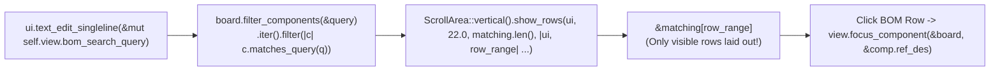

A row of three buttons in a toolbar works fine for a tiny demo board. Try doing that on a synth voice card with 400 passives and ICs, though, and your toolbar will run right off the side of your monitor.

In [Lesson 0008](./0008-split-viewports-and-egui-scene.html), we wired schematic-to-PCB cross-probing across split viewports. Now, let's build a proper **Bill of Materials (BOM) & Netlist Inspector** where typing `"u1"`, `"10k"`, or `"spi_clk"` filters the component list in real time and clicking any matching row cross-probes that footprint on the canvas.


_Figure 9.1: `TextEdit::singleline` mutates the query string in place, `.filter()` selects matching components, and `show_rows` virtualises layout to only the visible slice `&matching[row_range]`._

## 1. Just-in-Time Rust: Iterator Adapters (`.filter()`, `.enumerate()`) & Slices (`&[T]`)

To filter components case-insensitively across their reference designator (`U1`), value (`LDO_3V3`), package (`SOT-23`), or connected net name (`VCC_3V3`), we normalise the query with `.trim().to_ascii_lowercase()` and chain Rust's zero-cost iterator adapters ([Rust Book §13.2](https://doc.rust-lang.org/book/ch13-02-iterators.html)):{{sidenote:Why slice via `&matching[row_range]`? A Rust slice `&matching[row_range]` (`Range<usize>`) is a bounds-checked window into the contiguous vector that lets us iterate over just the visible viewport rows with `.enumerate()`.}}

```rust
impl ComponentSymbol {
    pub fn matches_query(&self, query: &str) -> bool {
        let needle = query.trim().to_ascii_lowercase();
        if needle.is_empty() {
            return true;
        }
        self.ref_des.to_ascii_lowercase().contains(&needle)
            || self.value.to_ascii_lowercase().contains(&needle)
            || self.package_name.to_ascii_lowercase().contains(&needle)
            || self
                .primary_net
                .signal_name()
                .to_ascii_lowercase()
                .contains(&needle)
    }
}

impl BoardModel {
    pub fn filter_components(&self, query: &str) -> Vec<ComponentSymbol> {
        self.components
            .iter()
            .filter(|c| c.matches_query(query))
            .cloned()
            .collect()
    }
}
```

## 2. Virtualised Scrolling with `ScrollArea::show_rows` & `Grid`

Now, even in an immediate-mode GUI, laying out 10,000 offscreen table rows on every 60 Hz frame is a great way to warm up your laptop fan for no reason.

Turns out, [`ScrollArea::show_rows`](https://docs.rs/egui/latest/egui/containers/scroll_area/struct.ScrollArea.html#method.show_rows) makes virtualised scrolling almost ridiculously simple: it calculates the exact `row_range: Range<usize>` currently visible inside the scroll viewport based on `row_height_sans_spacing` and calls your closure for _only those visible rows_:

```rust
ui.horizontal(|ui| {
    ui.label("Filter BOM:");
    ui.text_edit_singleline(&mut self.view.bom_search_query);
    if ui.button("Clear Filter").clicked() {
        self.view.clear_bom_query();
    }
});

let matching = self.board.filter_components(&self.view.bom_search_query);
egui::ScrollArea::vertical()
    .max_height(180.0)
    .show_rows(ui, 22.0, matching.len(), |ui, row_range| {
        egui::Grid::new("bom_inspector_grid")
            .striped(true)
            .show(ui, |ui| {
                for (offset, comp) in matching[row_range.clone()].iter().enumerate() {
                    let row_idx = row_range.start + offset;
                    ui.label(format!("#{}", row_idx + 1));
                    if ui.button(comp.inspector_label()).clicked() {
                        self.view.focus_component(&self.board, &comp.ref_des);
                    }
                    ui.end_row();
                }
            });
    });
```

{{widget:bom-scroll-sim}}

:::exercise title="Interactive Lab 2: Complete the BOM Filter & Virtualised Scroll Loop" badge=".filter() • text_edit_singleline • show_rows"
Fill in the three blanks below to (1) filter components matching the query, (2) bind the search input to `&mut self.view.bom_search_query`, and (3) virtualise row rendering with `show_rows`:

```rust
pub fn filter_components(&self, query: &str) -> Vec<ComponentSymbol> {
    self.components
        .iter()
        .{{blank:filter|Use the iterator adapter that keeps only elements satisfying a predicate (`filter`).|/* 1: adapter */|110px}}(|c| c.matches_query(query))
        .cloned()
        .collect()
}

// Inside render_side_panel():
ui.{{blank:text_edit_singleline|Call the `Ui` convenience method for a single-line text box (`text_edit_singleline`).|/* 2: singleline edit */|185px}}(&mut self.view.bom_search_query);

let matching = self.board.filter_components(&self.view.bom_search_query);
egui::ScrollArea::vertical()
    .max_height(180.0)
    .{{blank:show_rows|Call the `ScrollArea` method that virtualises fixed-height rows (`show_rows`).|/* 3: virtual */|120px}}(ui, 22.0, matching.len(), |ui, row_range| {
        for comp in &matching[row_range] {
            if ui.button(comp.inspector_label()).clicked() {
                self.view.focus_component(&self.board, &comp.ref_des);
            }
        }
    });
```
:::prompts
hint: **Hints:** (1) `filter`. (2) `text_edit_singleline`. (3) `show_rows`.
success: **Excellent!** Your BOM inspector filters components with `.filter()`, edits the query in place with `ui.text_edit_singleline(...)`, and virtualises layout via `show_rows(...)`.
:::
:::

:::verify title="Interactive Lab 3: Catching `!` and `||` → `&&` Filter Mutants" badge="cargo test + cargo mutants" tier="Tier 2 + 6: BOM Filter & UI" caught="47 Caught (12 Unviable)" missed="0 Missed"
In `ComponentSymbol::matches_query`, four `||` branches test `ref_des`, `value`, `package_name`, and `primary_net.signal_name()`. When `cargo mutants` flips any single `||` into `&&`, a test that only searches for `"U1"` will miss the mutations on the other three branches! By asserting queries that match _exclusively_ each field (`"r12"`, `"ldo_3v3"`, `"header"`, `"spi_clk"`, plus an empty query and a non-matching query `"zz_missing"`), our test suite catches every single boolean mutant.

```rust
#[test]
fn matches_query_checks_ref_des_value_package_and_net_case_insensitively() {
    let board = BoardModel::default();

    // 1. Empty or whitespace query matches all 3 components
    assert_eq!(board.filter_components("   ").len(), 3);

    // 2. Match exclusively by ref_des ("r12"), value ("ldo"), package ("header"), or net ("spi_clk")
    assert_eq!(board.filter_components("r12").len(), 1);
    assert_eq!(board.filter_components("ldo_3v3").len(), 1);
    assert_eq!(board.filter_components("header").len(), 1);
    assert_eq!(board.filter_components("spi_clk").len(), 1);

    // 3. Non-matching query returns empty Vec
    assert!(board.filter_components("zz_missing").is_empty());
}
```

- [ ] **1. Run `cargo test` in `apps/0009-searchable-netlist-and-bom-inspector`:** Confirm all 17 unit + headless `egui_kittest` tests pass.
- [ ] **2. Run `cargo mutants --in-place`:** Verify that all 47 viable mutants (including every `||` → `&&` and `!` mutation in `matches_query`) are **Caught** with **0 Missed**.
:::

:::quiz title="Retrieval Practice: Virtualised Scrolling, Iterators & Filter Mutants"
Q: How does `ScrollArea::vertical().show_rows(ui, row_height, total_rows, ...)` stay fast on large BOMs?
- [ ] Caching every row inside background thread
- [x] Creating widgets only inside visible range
- [ ] Sorting every symbol string inside shaders
- [ ] Skipping font layout during pointer motion
why: `show_rows` calculates the visible `Range<usize>` from the current scroll offset and viewport height, invoking your closure only for rows currently on screen.
hint: Look at the `row_range: Range<usize>` argument passed into the `show_rows` closure.

Q: How does `ui.text_edit_singleline(&mut self.view.bom_search_query)` update the filter as you type?
- [ ] Spawning worker threads for keystroke event
- [ ] Replacing the struct after pressing buttons
- [ ] Writing ascii bytes directly inside buffers
- [x] Mutating borrowed query buffers every frame
why: `text_edit_singleline` takes `&mut String` and mutates your query buffer directly during the frame whenever keystrokes arrive.
hint: Notice the `&mut self.view.bom_search_query` mutable borrow passed to `text_edit_singleline`.

Q: Why must our unit test assert queries matching ONLY `ref_des`, ONLY `value`, ONLY `package`, and ONLY `net`?
- [x] Catching disjunctions mutated into && arms
- [ ] Preventing compiler inlining on slice iter
- [ ] Forcing heap allocations during empty runs
- [ ] Sorting component slices before text edits
why: When `cargo mutants` flips any `||` into `&&` inside `matches_query`, only a test where one clause is `true` and the others are `false` will fail and catch the mutant.
hint: Think about what happens to `A || B || C || D` when `cargo mutants` mutates one `||` into `&&`.
:::

## Recommended Primary Source

:::callout
**Read (5 mins):** [`egui::ScrollArea::show_rows` Official API Docs](https://docs.rs/egui/latest/egui/containers/scroll_area/struct.ScrollArea.html#method.show_rows) and [The Rust Programming Language — §13.2 "Processing a Series of Items with Iterators"](https://doc.rust-lang.org/book/ch13-02-iterators.html).
:::

:::teacher-prompt
**Up Next (Lesson 0010 — Act II Finale):** Ready to add CAD keyboard shortcuts (`F`, `M`, `Esc`) and an interactive point-to-point distance ruler? Continue to [**Lesson 0010: Keyboard Shortcuts, Data-Carrying Enums & Point-to-Point CAD Ruler**](./0010-keyboard-shortcuts-and-point-to-point-ruler.html)!
:::
