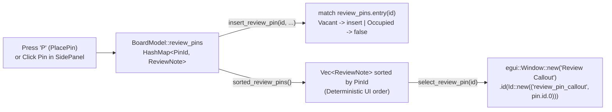

A board viewer lets you inspect traces and measure pad pitches on your own. A **Design Review System** lets your team drop numbered callout pins directly onto a questionable thermal relief or connector footprint—and jump straight to each pin's physical `(x, y)` coordinate during a schematic/layout sign-off meeting.

In [Lesson 0009](./0009-keyboard-shortcuts-and-point-to-point-ruler.html), we finished **Act II** with CAD keyboard shortcuts and a point-to-point measurement ruler. Now, we kick off **Act III (Design Review Workflows)** by storing anchored engineering review notes in a `HashMap<PinId, ReviewNote>`, sorting them deterministically for immediate-mode rendering, and opening an interactive floating callout overlay (`egui::Window`) with a collision-free widget identity (`egui::Id::new`).


_Figure 10.1: `HashMap<PinId, ReviewNote>` provides $O(1)$ lookup by `PinId`, `HashMap::entry` prevents overwriting existing notes, `sorted_review_pins()` guarantees deterministic frame layout order, and `egui::Window` renders the floating callout._

## 1. Just-in-Time Rust: `HashMap<PinId, ReviewNote>`, `Hash` + `Eq` & the `Entry` API

Why store review notes in [`std::collections::HashMap<PinId, ReviewNote>`](https://doc.rust-lang.org/std/collections/struct.HashMap.html) instead of a plain `Vec<ReviewNote>`? When `ViewState` holds `selected_pin: Option<PinId>`, we want direct lookup by `PinId` even if pins are later deleted, synced out of order, or imported from a database ([Rust Book §8.3](https://doc.rust-lang.org/book/ch08-03-hash-maps.html)).

To use our tuple struct `PinId(pub u32)` as a `HashMap` key, it derives `PartialEq`, `Eq`, and `Hash` (plus `PartialOrd` and `Ord` so we can sort pins by ID). And instead of calling `self.review_pins.insert(id, note)`—which would silently overwrite an existing note if a duplicate `PinId` arrived—we use [`HashMap::entry`](https://doc.rust-lang.org/std/collections/struct.HashMap.html#method.entry):{{sidenote:Why does `sorted_review_pins()` sort the `HashMap` values before we render buttons in `SidePanel`? Rust's `HashMap` uses a randomly seeded SipHash function per process to prevent hash-flooding attacks, so iterating over `review_pins.values()` directly would shuffle your UI buttons on every launch!}}

```rust
use std::collections::{HashMap, hash_map::Entry};

#[derive(Clone, Copy, Debug, PartialEq, Eq, PartialOrd, Ord, Hash)]
pub struct PinId(pub u32);

#[derive(Clone, Debug, PartialEq)]
pub struct ReviewNote {
    pub id: PinId,
    pub position_mm: Pos2,
    pub author: String,
    pub comment: String,
}

impl BoardModel {
    pub fn insert_review_pin(
        &mut self,
        id: PinId,
        position_mm: Pos2,
        author: &str,
        comment: &str,
    ) -> bool {
        match self.review_pins.entry(id) {
            Entry::Vacant(slot) => {
                slot.insert(ReviewNote {
                    id,
                    position_mm,
                    author: author.to_owned(),
                    comment: comment.to_owned(),
                });
                true
            }
            Entry::Occupied(_) => false,
        }
    }

    pub fn sorted_review_pins(&self) -> Vec<ReviewNote> {
        let mut list: Vec<ReviewNote> = self.review_pins.values().cloned().collect();
        list.sort_by_key(|p| p.id);
        list
    }
}
```

## 2. Floating Callout Overlays with `egui::Window` and `egui::Id::new`

When the engineer clicks a review pin in the `SidePanel` (or drops a new pin on the canvas in `PlacePin` mode via hotkey `P`), `self.view.select_review_pin(&self.board, pin.id)` sets `self.view.selected_pin = Some(pin.id)` and centres the PCB viewport on `pin.position_mm`.

To display the floating callout overlay on top of the canvas, we use [`egui::Window`](https://docs.rs/egui/latest/egui/containers/struct.Window.html) keyed by a deterministic [`egui::Id::new(("review_pin_callout", pin.id.0))`](https://docs.rs/egui/latest/egui/struct.Id.html#method.new):

```rust
pub fn render_active_pin_callout(&mut self, ctx: &egui::Context) {
    let Some(pin_id) = self.view.selected_pin else {
        return;
    };
    let Some(pin) = self.board.review_pins.get(&pin_id).cloned() else {
        return;
    };

    egui::Window::new("Review Callout")
        .id(egui::Id::new(("review_pin_callout", pin.id.0)))
        .collapsible(false)
        .resizable(false)
        .show(ctx, |ui| {
            ui.label(pin.summary_line());
            ui.label(pin.coordinates_label());
            if ui.button("Close Callout").clicked() {
                self.view.selected_pin = None;
            }
        });
}
```

{{widget:review-pins-sim}}

:::exercise id="ex-0010" title="Interactive Lab 2: Guard `HashMap` Pin Insertion & Key the Callout Window" badge="HashMap::entry • sort_by_key • egui::Id::new"
Fill in the three blanks below to (1) inspect the `HashMap` slot with `.entry(id)`, (2) sort the collected `Vec<ReviewNote>` deterministically by `p.id`, and (3) construct a unique `egui::Id` tuple for the floating `egui::Window`:

```rust
impl BoardModel {
    pub fn insert_review_pin(
        &mut self,
        id: PinId,
        position_mm: Pos2,
        author: &str,
        comment: &str,
    ) -> bool {
        match self.review_pins.{{blank:entry(id)|Call `entry(id)` on `self.review_pins` to get an `Entry::Vacant` or `Entry::Occupied` handle.|/* 1: entry */|110px}} {
            Entry::Vacant(slot) => {
                slot.insert(ReviewNote {
                    id,
                    position_mm,
                    author: author.to_owned(),
                    comment: comment.to_owned(),
                });
                true
            }
            Entry::Occupied(_) => false,
        }
    }

    pub fn sorted_review_pins(&self) -> Vec<ReviewNote> {
        let mut list: Vec<ReviewNote> = self.review_pins.values().cloned().collect();
        list.{{blank:sort_by_key|Use `sort_by_key` to order the vector deterministically by `p.id`.|/* 2: sort */|120px}}(|p| p.id);
        list
    }
}

// Inside render_active_pin_callout():
egui::Window::new("Review Callout")
    .id(egui::{{blank:Id::new|Call `Id::new` to hash the `("review_pin_callout", pin.id.0)` tuple into a deterministic widget ID.|/* 3: Id::new */|105px}}(("review_pin_callout", pin.id.0)))
```
:::prompts
hint: **Hints:** (1) `entry(id)`. (2) `sort_by_key`. (3) `Id::new`.
success: **Spot on!** `entry(id)` prevents silent overwrites, `sort_by_key(|p| p.id)` keeps UI rendering deterministic, and `egui::Id::new(...)` gives each pin's callout window a stable identity.
:::
:::

:::verify id="verify-0010" title="Interactive Lab 3: Verifying `HashMap::entry` & Floating `egui::Window` Callouts" badge="cargo test + cargo mutants" tier="Tier 2 + 6: Pin Store & Callout Window" caught="72 Caught (16 Unviable)" missed="0 Missed"
In `apps/0010-review-pins-and-sticky-note-callouts`, we test both `Entry::Occupied` duplicate rejection (`insert_review_pin(PinId(1), ...)` returning `false` without clobbering `@alice`'s note) and the full `egui::Window` callout lifecycle inside `egui_kittest::Harness`:

```rust
#[test]
fn review_pin_entry_api_prevents_overwrites_and_sorts_deterministically() {
    let mut board = BoardModel::default();
    assert_eq!(board.review_pins.len(), 2);

    // Attempting to insert an existing PinId(1) must return false and preserve Alice's note
    assert!(!board.insert_review_pin(
        PinId(1),
        pos2(99.0, 99.0),
        "intruder",
        "Overwritten comment"
    ));
    assert_eq!(board.review_pins[&PinId(1)].author, "alice");

    let p3 = board.add_review_pin_at(pos2(52.0, 35.0), "carol", "Check R12 value");
    let p4 = board.add_review_pin_at(pos2(40.0, 18.0), "dave", "Add test point");
    assert_eq!(p3, PinId(3));
    assert_eq!(p4, PinId(4));

    let sorted_ids: Vec<PinId> = board.sorted_review_pins().iter().map(|n| n.id).collect();
    assert_eq!(sorted_ids, vec![PinId(1), PinId(2), PinId(3), PinId(4)]);
}
```

- [ ] **1. Run `cargo test` in `apps/0010-review-pins-and-sticky-note-callouts`:** Confirm all 21 unit + headless `egui_kittest` tests pass.
- [ ] **2. Run `cargo mutants --in-place`:** Confirm every viable mutant across `insert_review_pin`, `add_review_pin_at`, `sorted_review_pins`, `select_review_pin`, and `render_active_pin_callout` is **Caught** with **0 Missed**.
:::

:::quiz id="quiz-0010" title="Retrieval Practice: `HashMap`, `Entry` API & `egui::Window`"
Q: Why must `PinId` derive both `Eq` and `Hash` before it can serve as a `HashMap<PinId, ReviewNote>` key?
- [ ] Hash maps require floating point coordinates
- [x] Keys need bucket hashing and equality
- [ ] Enums forbid storing unsigned integer fields
- [ ] Windows allocate heap strings during frame
why: `HashMap` hashes the key (`Hash`) to locate a bucket and compares keys for exact equality (`Eq`) to resolve collisions.
hint: Think about how a hash table finds a bucket and checks if two keys are identical.

Q: Why do we use `self.review_pins.entry(id)` (`Entry::Vacant` vs. `Entry::Occupied`) in `insert_review_pin` instead of `HashMap::insert`?
- [x] Avoiding silent overwrites of existing notes
- [ ] Sorting map values automatically during insert
- [ ] Bypassing borrow checks across multiple frames
- [ ] Rendering floating windows without unique identifiers
why: `HashMap::insert` unconditionally overwrites any existing value for that key, whereas matching `Entry::Vacant` vs. `Entry::Occupied` lets us reject duplicate IDs cleanly.
hint: Consider what happens to `@alice`'s review note if `PinId(1)` is inserted a second time.

Q: Why does `sorted_review_pins()` sort collected `ReviewNote` items by `PinId` before rendering buttons in the `SidePanel`?
- [ ] Immediate panels forbid iterating over vectors
- [ ] Floating windows require descending coordinate order
- [x] HashMap iteration order varies across runs
- [ ] Callout labels truncate unsorted string slices
why: Rust's `HashMap` randomises its hash seed per process; sorting by `PinId` ensures deterministic widget ordering every frame and in every test run.
hint: Recall how `std::collections::HashMap` orders its elements during iteration.
:::

## Recommended Primary Source

:::callout
**Read (5 mins):** [The Rust Programming Language — §8.3 "Storing Keys with Associated Values in Hash Maps"](https://doc.rust-lang.org/book/ch08-03-hash-maps.html) and [`egui::Window` Official API Docs](https://docs.rs/egui/latest/egui/containers/struct.Window.html).
:::

:::teacher-prompt
**Next Up ([Lesson 0011: Review Status Triage, Severity Filtering & Sign-Off Rules](./0011-review-status-workflow-and-popups.html)):** Now that engineers can anchor review pins to the board, how do we track whether each issue is `Open`, `Resolved`, or `Verified`—and filter by severity (`Info`, `Warning`, `Critical`)? Ask any questions about `HashMap` or `egui::Window`, or head to Lesson 0011!
:::
