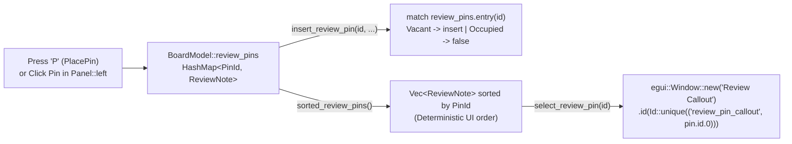

A board viewer lets you inspect traces and measure pad pitches on your own. A **Design Review System** lets your team drop numbered callout pins directly onto a questionable thermal relief or connector footprint—and jump straight to each pin's physical `(x, y)` coordinate during a schematic/layout sign-off meeting.

In [Lesson 0010](./0010-keyboard-shortcuts-and-point-to-point-ruler.html), we finished **Act II** with CAD keyboard shortcuts and a point-to-point measurement ruler. Now, we kick off **Act III (Design Review Workflows)** by storing anchored engineering review notes in a `HashMap<PinId, ReviewNote>`, sorting them deterministically for immediate-mode rendering, and opening an interactive floating callout overlay (`egui::Window`) with a collision-free widget identity (`egui::Id::unique`).


_Figure 11.1: `HashMap<PinId, ReviewNote>` provides $O(1)$ lookup by `PinId`, `HashMap::entry` prevents overwriting existing notes, `sorted_review_pins()` guarantees deterministic frame layout order, and `egui::Window` renders the floating callout._

## 1. Just-in-Time Rust: `HashMap<PinId, ReviewNote>`, `Hash` + `Eq` & the `Entry` API

Why store review notes in [`std::collections::HashMap<PinId, ReviewNote>`](https://doc.rust-lang.org/std/collections/struct.HashMap.html) instead of a plain `Vec<ReviewNote>`? When `ViewState` holds `selected_pin: Option<PinId>`, we want direct lookup by `PinId` even if pins are later deleted, synced out of order, or imported from a database ([Rust Book §8.3](https://doc.rust-lang.org/book/ch08-03-hash-maps.html)).

To use our tuple struct `PinId(pub u32)` as a `HashMap` key, it derives `PartialEq`, `Eq`, and `Hash` (plus `PartialOrd` and `Ord` so we can sort pins by ID). And instead of calling `self.review_pins.insert(id, note)`—which would silently overwrite an existing note if a duplicate `PinId` arrived—we use [`HashMap::entry`](https://doc.rust-lang.org/std/collections/struct.HashMap.html#method.entry).{{sidenote:Why does `sorted_review_pins()` sort the `HashMap` values before we render buttons in `Panel::left`? Rust's `HashMap` uses a randomly seeded SipHash function per process to prevent hash-flooding attacks, so iterating over `review_pins.values()` directly would shuffle your UI buttons on every launch!}}

## 2. Floating Callout Overlays with `egui::Window` and `egui::Id::unique`

When the engineer clicks a review pin in `Panel::left` (or drops a new pin on the canvas in `PlacePin` mode via hotkey `P`), `self.view.select_review_pin(&self.board, pin.id)` sets `self.view.selected_pin = Some(pin.id)` and centres the PCB viewport on `pin.position_mm`.

To display the floating callout overlay on top of the canvas, we use [`egui::Window`](https://docs.rs/egui/latest/egui/containers/struct.Window.html) keyed by a deterministic [`egui::Id::unique(("review_pin_callout", pin.id.0))`](https://docs.rs/egui/latest/egui/struct.Id.html#method.unique) and invoke `self.render_active_pin_callout(ui.ctx())` at the end of `eframe::App::ui` after `CentralPanel` has painted the board.

## 3. Code Walkthrough: Block by Block

Let's examine the new types, `HashMap` methods, UI callout window, and tests added to `apps/0011-review-pins-and-sticky-note-callouts/src/main.rs` block by block before assembling the full listing in context.

### Block 1: `PinId`, `ReviewNote` & Extending `ActiveTool`

```rust
use std::collections::{HashMap, hash_map::Entry};

/// Unique identifier for an engineering review pin anchored to the board.
#[derive(Clone, Copy, Debug, PartialEq, Eq, PartialOrd, Ord, Hash)]
pub struct PinId(pub u32);

/// Engineering review note anchored to a physical `(x, y)` coordinate in mm.
#[derive(Clone, Debug, PartialEq)]
pub struct ReviewNote {
    pub id: PinId,
    pub position_mm: Pos2,
    pub author: String,
    pub comment: String,
}

impl ReviewNote {
    pub fn summary_line(&self) -> String {
        format!("Pin #{}: {} (@{})", self.id.0, self.comment, self.author)
    }

    pub fn coordinates_label(&self) -> String {
        format!(
            "Anchor: ({:.1}, {:.1}) mm",
            self.position_mm.x, self.position_mm.y
        )
    }
}

/// Data-carrying enum modeling the active CAD interaction tool.
#[derive(Clone, Copy, Debug, PartialEq)]
pub enum ActiveTool {
    Select,
    Measure {
        start_mm: Option<Pos2>,
        end_mm: Option<Pos2>,
    },
    PlacePin,
}
```

- **`use std::collections::{HashMap, hash_map::Entry};`**: Imports Rust's standard hash table along with its `Entry` enum (`Entry::Vacant` and `Entry::Occupied`) for in-place slot inspection.
- **`#[derive(..., Eq, PartialOrd, Ord, Hash)] pub struct PinId(pub u32)`**: Wrapping `u32` in a newtype prevents mixing up `NetId` and `PinId`. Deriving `Hash` + `Eq` satisfies `HashMap`'s key trait bounds, while `PartialOrd` + `Ord` allows `.sort_by_key(|p| p.id)`.
- **`ReviewNote::summary_line` and `coordinates_label`**: Pure formatting helpers that borrow `&self` and return owned `String`s for both the left-panel pin list and the floating callout window.
- **`ActiveTool::PlacePin`**: Adds a third tool variant activated by pressing `Key::P` so clicking the PCB canvas drops a new review pin at `world_mm`.

### Block 2: `BoardModel` Pin Storage, `HashMap::entry` & Deterministic Sorting

```rust
fn sample_review_pins() -> HashMap<PinId, ReviewNote> {
    let mut pins = HashMap::new();
    pins.insert(
        PinId(1),
        ReviewNote {
            id: PinId(1),
            position_mm: pos2(20.0, 27.0),
            author: "alice".to_owned(),
            comment: "Check U1 thermal relief".to_owned(),
        },
    );
    pins.insert(
        PinId(2),
        ReviewNote {
            id: PinId(2),
            position_mm: pos2(68.0, 35.0),
            author: "bob".to_owned(),
            comment: "Verify J1 polarity mark".to_owned(),
        },
    );
    pins
}

pub struct BoardModel {
    pub traces: Vec<TraceSegment>,
    pub pads: Vec<SmdPad>,
    pub components: Vec<ComponentSymbol>,
    pub review_pins: HashMap<PinId, ReviewNote>,
    pub next_pin_id: u32,
}

impl BoardModel {
    /// Inserts a review pin using `HashMap::entry` so an existing `PinId` is never overwritten.
    pub fn insert_review_pin(
        &mut self,
        id: PinId,
        position_mm: Pos2,
        author: &str,
        comment: &str,
    ) -> bool {
        match self.review_pins.entry(id) {
            Entry::Vacant(slot) => {
                slot.insert(ReviewNote {
                    id,
                    position_mm,
                    author: author.to_owned(),
                    comment: comment.to_owned(),
                });
                true
            }
            Entry::Occupied(_) => false,
        }
    }

    /// Allocates the next monotonic `PinId` and stores a new review note at `position_mm`.
    pub fn add_review_pin_at(&mut self, position_mm: Pos2, author: &str, comment: &str) -> PinId {
        let id = PinId(self.next_pin_id);
        self.next_pin_id += 1;
        self.insert_review_pin(id, position_mm, author, comment);
        id
    }

    /// Returns all review pins sorted deterministically by `PinId` for stable UI layout.
    pub fn sorted_review_pins(&self) -> Vec<ReviewNote> {
        let mut list: Vec<ReviewNote> = self.review_pins.values().cloned().collect();
        list.sort_by_key(|p| p.id);
        list
    }
}
```

- **`review_pins: HashMap<PinId, ReviewNote>` and `next_pin_id: u32`**: Seeded with `PinId(1)` (`@alice`) and `PinId(2)` (`@bob`), starting `next_pin_id` at `3`.
- **`match self.review_pins.entry(id)`**: Hashes `id` once and returns an `Entry` handle into the map's bucket. If the bucket is `Entry::Vacant(slot)`, `slot.insert(...)` writes the `ReviewNote` without hashing `id` a second time and returns `true`; if `Entry::Occupied(_)`, we leave the existing note untouched and return `false`.
- **`add_review_pin_at(&mut self, ...)`**: Claims `PinId(self.next_pin_id)`, increments the counter, delegates to `self.insert_review_pin(...)`, and returns the newly allocated `PinId`.
- **`sorted_review_pins(&self) -> Vec<ReviewNote>`**: Collects cloned `ReviewNote` values from `self.review_pins.values()` and sorts them by `p.id` (`Ord`) so both `Panel::left` and `paint_board` iterate in a guaranteed ascending order every frame.

### Block 3: `ViewState` Pin Selection, `Key::P` & Floating `egui::Window` Callout

```rust
impl ViewState {
    pub fn activate_pin_tool(&mut self) {
        self.active_tool = ActiveTool::PlacePin;
    }

    pub fn cancel_tool_and_selection(&mut self) {
        self.active_tool = ActiveTool::Select;
        self.selected_net = None;
        self.selected_component = None;
        self.selected_pin = None;
    }

    pub fn select_review_pin(&mut self, board: &BoardModel, id: PinId) -> bool {
        if let Some(note) = board.review_pins.get(&id) {
            self.selected_pin = Some(id);
            self.pcb_scene_rect = Rect::from_center_size(note.position_mm, vec2(40.0, 30.0));
            true
        } else {
            false
        }
    }
}

impl PcbReviewerApp {
    pub fn render_active_pin_callout(&mut self, ctx: &egui::Context) {
        let Some(pin_id) = self.view.selected_pin else {
            return;
        };
        let Some(pin) = self.board.review_pins.get(&pin_id).cloned() else {
            return;
        };

        egui::Window::new("Review Callout")
            .id(egui::Id::unique(("review_pin_callout", pin.id.0)))
            .collapsible(false)
            .resizable(false)
            .show(ctx, |ui| {
                ui.label(pin.summary_line());
                ui.label(pin.coordinates_label());
                if ui.button("Close Callout").clicked() {
                    self.view.selected_pin = None;
                }
            });
    }
}
```

- **`select_review_pin(&mut self, board: &BoardModel, id: PinId) -> bool`**: Performs an $O(1)$ lookup via `board.review_pins.get(&id)`. When found, it sets `self.selected_pin = Some(id)`, centres `self.pcb_scene_rect` around `note.position_mm`, and returns `true`.
- **`let Some(pin_id) = self.view.selected_pin else { return; };`**: Rust's `let ... else` statement unwraps `Option<PinId>` up front and returns early when no pin is selected, avoiding deeply nested `if let` blocks.
- **`self.board.review_pins.get(&pin_id).cloned()`**: Clones the active `ReviewNote` before entering the `egui::Window::show` closure so the closure can mutate `self.view.selected_pin = None` without holding an immutable borrow on `self.board`.
- **`.id(egui::Id::unique(("review_pin_callout", pin.id.0)))`**: Hashes the string literal `"review_pin_callout"` together with `pin.id.0` (`u32`) to give each pin's callout window a distinct, collision-free `egui::Id`.

### Block 4: Unit & Headless `egui_kittest` Tests (`#[cfg(test)] mod tests`)

```rust
    #[test]
    fn review_pin_entry_api_prevents_overwrites_and_sorts_deterministically() {
        let mut board = BoardModel::default();
        assert_eq!(board.review_pins.len(), 2);

        // Attempting to insert an existing PinId(1) must return false and preserve Alice's note
        assert!(!board.insert_review_pin(
            PinId(1),
            pos2(99.0, 99.0),
            "intruder",
            "Overwritten comment"
        ));
        assert_eq!(board.review_pins[&PinId(1)].author, "alice");

        // Allocating new monotonic pins increments next_pin_id
        let p3 = board.add_review_pin_at(pos2(52.0, 35.0), "carol", "Check R12 value");
        let p4 = board.add_review_pin_at(pos2(40.0, 18.0), "dave", "Add test point");
        assert_eq!(p3, PinId(3));
        assert_eq!(p4, PinId(4));
        assert_eq!(board.next_pin_id, 5);

        let sorted_ids: Vec<PinId> = board.sorted_review_pins().iter().map(|n| n.id).collect();
        assert_eq!(sorted_ids, vec![PinId(1), PinId(2), PinId(3), PinId(4)]);
    }

    #[test]
    fn select_review_pin_focuses_camera_and_rejects_unknown_id() {
        let board = BoardModel::default();
        let mut view = ViewState::default();

        assert!(view.select_review_pin(&board, PinId(2)));
        assert_eq!(view.selected_pin, Some(PinId(2)));
        assert_eq!(
            view.pcb_scene_rect,
            Rect::from_center_size(pos2(68.0, 35.0), vec2(40.0, 30.0))
        );

        assert!(!view.select_review_pin(&board, PinId(999)));
    }
```

- **Testing `Entry::Occupied` vs. `Entry::Vacant`**: Asserting `!board.insert_review_pin(PinId(1), ...)` and `board.review_pins[&PinId(1)].author == "alice"` proves that `Entry::Occupied(_)` rejects duplicate IDs without clobbering existing data.
- **Testing `select_review_pin` and `egui::Window` Callouts**: `select_review_pin_focuses_camera_and_rejects_unknown_id` verifies both `Some` and `None` branches of `board.review_pins.get(&id)`, while `headless_hotkeys_and_pin_callout_window_lifecycle` (shown in the complete listing below) drives `Key::P`, clicks `"Pin #1: Check U1 thermal relief (@alice)"`, asserts the floating `"Anchor: (20.0, 27.0) mm"` label appears, and clicks `"Close Callout"`.

### Complete Lesson 0011 Review Pin & Callout Listing

Here is how all of Lesson 0011's additions—`PinId`, `ReviewNote`, `BoardModel` pin methods, `ViewState` selection, `PcbReviewerApp` UI/canvas/window methods, `eframe::App::ui`, and tests—fit together inside `apps/0011-review-pins-and-sticky-note-callouts/src/main.rs`:

```rust
use std::collections::{HashMap, hash_map::Entry};

use eframe::egui::{
    self, Align2, Color32, FontId, Pos2, Rect, Sense, Stroke, StrokeKind, Vec2, emath::TSTransform,
    pos2, vec2,
};

// ... NetId, PcbLayer, TraceSegment, SmdPad, ComponentSymbol ...

/// Unique identifier for an engineering review pin anchored to the board.
#[derive(Clone, Copy, Debug, PartialEq, Eq, PartialOrd, Ord, Hash)]
pub struct PinId(pub u32);

/// Engineering review note anchored to a physical `(x, y)` coordinate in mm.
#[derive(Clone, Debug, PartialEq)]
pub struct ReviewNote {
    pub id: PinId,
    pub position_mm: Pos2,
    pub author: String,
    pub comment: String,
}

impl ReviewNote {
    pub fn summary_line(&self) -> String {
        format!("Pin #{}: {} (@{})", self.id.0, self.comment, self.author)
    }

    pub fn coordinates_label(&self) -> String {
        format!(
            "Anchor: ({:.1}, {:.1}) mm",
            self.position_mm.x, self.position_mm.y
        )
    }
}

/// Data-carrying enum modeling the active CAD interaction tool.
#[derive(Clone, Copy, Debug, PartialEq)]
pub enum ActiveTool {
    Select,
    Measure {
        start_mm: Option<Pos2>,
        end_mm: Option<Pos2>,
    },
    PlacePin,
}

fn sample_review_pins() -> HashMap<PinId, ReviewNote> {
    let mut pins = HashMap::new();
    pins.insert(
        PinId(1),
        ReviewNote {
            id: PinId(1),
            position_mm: pos2(20.0, 27.0),
            author: "alice".to_owned(),
            comment: "Check U1 thermal relief".to_owned(),
        },
    );
    pins.insert(
        PinId(2),
        ReviewNote {
            id: PinId(2),
            position_mm: pos2(68.0, 35.0),
            author: "bob".to_owned(),
            comment: "Verify J1 polarity mark".to_owned(),
        },
    );
    pins
}

pub struct BoardModel {
    pub traces: Vec<TraceSegment>,
    pub pads: Vec<SmdPad>,
    pub components: Vec<ComponentSymbol>,
    pub review_pins: HashMap<PinId, ReviewNote>,
    pub next_pin_id: u32,
}

impl Default for BoardModel {
    fn default() -> Self {
        Self {
            traces: sample_traces(),
            pads: sample_pads(),
            components: sample_components(),
            review_pins: sample_review_pins(),
            next_pin_id: 3,
        }
    }
}

impl BoardModel {
    // ... find_component(), filter_components() ...

    /// Inserts a review pin using `HashMap::entry` so an existing `PinId` is never overwritten.
    pub fn insert_review_pin(
        &mut self,
        id: PinId,
        position_mm: Pos2,
        author: &str,
        comment: &str,
    ) -> bool {
        match self.review_pins.entry(id) {
            Entry::Vacant(slot) => {
                slot.insert(ReviewNote {
                    id,
                    position_mm,
                    author: author.to_owned(),
                    comment: comment.to_owned(),
                });
                true
            }
            Entry::Occupied(_) => false,
        }
    }

    /// Allocates the next monotonic `PinId` and stores a new review note at `position_mm`.
    pub fn add_review_pin_at(&mut self, position_mm: Pos2, author: &str, comment: &str) -> PinId {
        let id = PinId(self.next_pin_id);
        self.next_pin_id += 1;
        self.insert_review_pin(id, position_mm, author, comment);
        id
    }

    /// Returns all review pins sorted deterministically by `PinId` for stable UI layout.
    pub fn sorted_review_pins(&self) -> Vec<ReviewNote> {
        let mut list: Vec<ReviewNote> = self.review_pins.values().cloned().collect();
        list.sort_by_key(|p| p.id);
        list
    }
}

pub struct ViewState {
    pub show_top_copper: bool,
    pub show_bottom_copper: bool,
    pub show_silkscreen: bool,
    pub show_ratsnest: bool,
    pub viewport: BoardViewport,
    pub pcb_scene_rect: Rect,
    pub selected_component: Option<String>,
    pub hovered_net: Option<NetId>,
    pub selected_net: Option<NetId>,
    pub bom_search_query: String,
    pub active_tool: ActiveTool,
    pub selected_pin: Option<PinId>,
}

impl ViewState {
    // ... reset_layers(), isolate_top_copper(), show_all_layers(), fit_board_in_viewport(), activate_measure_tool() ...

    pub fn activate_pin_tool(&mut self) {
        self.active_tool = ActiveTool::PlacePin;
    }

    pub fn cancel_tool_and_selection(&mut self) {
        self.active_tool = ActiveTool::Select;
        self.selected_net = None;
        self.selected_component = None;
        self.selected_pin = None;
    }

    pub fn select_review_pin(&mut self, board: &BoardModel, id: PinId) -> bool {
        if let Some(note) = board.review_pins.get(&id) {
            self.selected_pin = Some(id);
            self.pcb_scene_rect = Rect::from_center_size(note.position_mm, vec2(40.0, 30.0));
            true
        } else {
            false
        }
    }
}

impl PcbReviewerApp {
    pub fn handle_hotkeys(&mut self, ctx: &egui::Context) {
        let pressed_f = ctx.input_mut(|i| i.consume_key(egui::Modifiers::NONE, egui::Key::F));
        let pressed_m = ctx.input_mut(|i| i.consume_key(egui::Modifiers::NONE, egui::Key::M));
        let pressed_p = ctx.input_mut(|i| i.consume_key(egui::Modifiers::NONE, egui::Key::P));
        let pressed_esc =
            ctx.input_mut(|i| i.consume_key(egui::Modifiers::NONE, egui::Key::Escape));

        if pressed_f {
            self.view.fit_board_in_viewport();
        }
        if pressed_m {
            self.view.activate_measure_tool();
        }
        if pressed_p {
            self.view.activate_pin_tool();
        }
        if pressed_esc {
            self.view.cancel_tool_and_selection();
        }
    }

    pub fn render_side_panel(&mut self, ui: &mut egui::Ui) {
        // ... PCB Layers & BOM Inspector ...

        ui.separator();
        ui.heading("Review Pins");
        let pins = self.board.sorted_review_pins();
        ui.label(format!("Review Pins: {}", pins.len()));
        for pin in &pins {
            if ui.button(pin.summary_line()).clicked() {
                self.view.select_review_pin(&self.board, pin.id);
            }
        }

        // ... Net Inspector ...
    }

    pub fn render_active_pin_callout(&mut self, ctx: &egui::Context) {
        let Some(pin_id) = self.view.selected_pin else {
            return;
        };
        let Some(pin) = self.board.review_pins.get(&pin_id).cloned() else {
            return;
        };

        egui::Window::new("Review Callout")
            .id(egui::Id::unique(("review_pin_callout", pin.id.0)))
            .collapsible(false)
            .resizable(false)
            .show(ctx, |ui| {
                ui.label(pin.summary_line());
                ui.label(pin.coordinates_label());
                if ui.button("Close Callout").clicked() {
                    self.view.selected_pin = None;
                }
            });
    }

    fn render_canvas(&mut self, ui: &mut egui::Ui) {
        let mut scene_rect = self.view.pcb_scene_rect;
        egui::Scene::new()
            .zoom_range(0.5..=8.0)
            .show(ui, &mut scene_rect, |ui| {
                let (response, painter) =
                    ui.allocate_painter(vec2(720.0, 520.0), Sense::click_and_drag());

                if response.dragged() {
                    self.view.viewport.pan_by(response.drag_delta());
                }

                if let Some(hover_pos) = response.hover_pos() {
                    let world_mm = self.view.viewport.screen_to_world(hover_pos);
                    self.view.hovered_net = self.hit_test_net_at_mm(world_mm);
                    if response.clicked() {
                        match &mut self.view.active_tool {
                            ActiveTool::Select => {
                                self.view.selected_net = self.view.hovered_net;
                            }
                            ActiveTool::Measure { start_mm, end_mm } => {
                                if start_mm.is_none() {
                                    *start_mm = Some(world_mm);
                                } else {
                                    *end_mm = Some(world_mm);
                                }
                            }
                            ActiveTool::PlacePin => {
                                let new_id = self.board.add_review_pin_at(
                                    world_mm,
                                    "reviewer",
                                    "Inspect clearance",
                                );
                                self.view.selected_pin = Some(new_id);
                                self.view.active_tool = ActiveTool::Select;
                            }
                        }
                    }
                } else {
                    self.view.hovered_net = None;
                }

                self.paint_board(&painter, response.rect);
            });
        self.view.pcb_scene_rect = scene_rect;
    }

    fn paint_board(&self, painter: &egui::Painter, canvas_rect: Rect) {
        // ... board outline, traces, pads, silkscreen ...

        for pin in self.board.sorted_review_pins() {
            let screen_pt = self.view.viewport.world_to_screen(pin.position_mm);
            let is_selected = self.view.selected_pin == Some(pin.id);
            let fill = if is_selected {
                Color32::from_rgb(255, 230, 100)
            } else {
                Color32::from_rgb(255, 139, 107)
            };
            painter.circle_filled(screen_pt, 6.0_f32, fill);
            painter.text(
                screen_pt + vec2(8.0, -6.0),
                Align2::LEFT_BOTTOM,
                format!("#{}", pin.id.0),
                FontId::monospace(11.0),
                fill,
            );
        }

        // ... ruler overlay ...
    }
}

impl eframe::App for PcbReviewerApp {
    fn ui(&mut self, ui: &mut egui::Ui, _frame: &mut eframe::Frame) {
        self.handle_hotkeys(ui.ctx());

        egui::Panel::top("schematic_cross_probe_bar").show(ui, |ui| {
            self.render_schematic_bar(ui);
        });

        egui::Panel::left("layer_panel").show(ui, |ui| {
            self.render_side_panel(ui);
        });

        egui::CentralPanel::default().show(ui, |ui| {
            self.render_canvas(ui);
        });

        self.render_active_pin_callout(ui.ctx());
    }
}

#[cfg(test)]
mod tests {
    use super::*;
    use egui_kittest::{Harness, kittest::Queryable};

    // ... Lesson 0001-0010 unit tests ...

    #[test]
    fn review_pin_entry_api_prevents_overwrites_and_sorts_deterministically() {
        let mut board = BoardModel::default();
        assert_eq!(board.review_pins.len(), 2);

        // Attempting to insert an existing PinId(1) must return false and preserve Alice's note
        assert!(!board.insert_review_pin(
            PinId(1),
            pos2(99.0, 99.0),
            "intruder",
            "Overwritten comment"
        ));
        assert_eq!(board.review_pins[&PinId(1)].author, "alice");

        // Allocating new monotonic pins increments next_pin_id
        let p3 = board.add_review_pin_at(pos2(52.0, 35.0), "carol", "Check R12 value");
        let p4 = board.add_review_pin_at(pos2(40.0, 18.0), "dave", "Add test point");
        assert_eq!(p3, PinId(3));
        assert_eq!(p4, PinId(4));
        assert_eq!(board.next_pin_id, 5);

        let sorted_ids: Vec<PinId> = board.sorted_review_pins().iter().map(|n| n.id).collect();
        assert_eq!(sorted_ids, vec![PinId(1), PinId(2), PinId(3), PinId(4)]);
    }

    #[test]
    fn select_review_pin_focuses_camera_and_rejects_unknown_id() {
        let board = BoardModel::default();
        let mut view = ViewState::default();

        assert!(view.select_review_pin(&board, PinId(2)));
        assert_eq!(view.selected_pin, Some(PinId(2)));
        assert_eq!(
            view.pcb_scene_rect,
            Rect::from_center_size(pos2(68.0, 35.0), vec2(40.0, 30.0))
        );

        assert!(!view.select_review_pin(&board, PinId(999)));
    }

    #[test]
    fn headless_hotkeys_and_pin_callout_window_lifecycle() {
        let mut harness = Harness::new_eframe(|_cc| PcbReviewerApp::default());
        assert!(harness.query_by_label("Active Tool: Select").is_some());
        assert!(harness.query_by_label("Review Pins: 2").is_some());

        // Press 'P' -> activates PlacePin tool
        harness.key_press(egui::Key::P);
        harness.run();
        assert_eq!(harness.state().view.active_tool, ActiveTool::PlacePin);
        assert!(harness.query_by_label("Active Tool: Place Pin (P)").is_some());

        // Click a review pin button in the Panel -> opens the floating callout Window
        harness
            .get_by_label("Pin #1: Check U1 thermal relief (@alice)")
            .click();
        harness.run();
        assert_eq!(harness.state().view.selected_pin, Some(PinId(1)));
        assert!(harness.query_by_label("Anchor: (20.0, 27.0) mm").is_some());

        // Close the floating callout window
        harness.get_by_label("Close Callout").click();
        harness.run();
        assert_eq!(harness.state().view.selected_pin, None);
        assert!(harness.query_by_label("Anchor: (20.0, 27.0) mm").is_none());
    }
}
```

{{widget:review-pins-sim}}

:::exercise id="ex-0011" title="Interactive Lab 2: Guard `HashMap` Pin Insertion & Key the Callout Window" badge="HashMap::entry • sort_by_key • egui::Id::unique"
Fill in the three blanks below to (1) inspect the `HashMap` slot with `.entry(id)`, (2) sort the collected `Vec<ReviewNote>` deterministically by `p.id`, and (3) construct a unique `egui::Id` tuple for the floating `egui::Window`:

```rust
impl BoardModel {
    pub fn insert_review_pin(
        &mut self,
        id: PinId,
        position_mm: Pos2,
        author: &str,
        comment: &str,
    ) -> bool {
        match self.review_pins.{{blank:entry(id)|Call `entry(id)` on `self.review_pins` to get an `Entry::Vacant` or `Entry::Occupied` handle.|/* 1: entry */|110px}} {
            Entry::Vacant(slot) => {
                slot.insert(ReviewNote {
                    id,
                    position_mm,
                    author: author.to_owned(),
                    comment: comment.to_owned(),
                });
                true
            }
            Entry::Occupied(_) => false,
        }
    }

    pub fn sorted_review_pins(&self) -> Vec<ReviewNote> {
        let mut list: Vec<ReviewNote> = self.review_pins.values().cloned().collect();
        list.{{blank:sort_by_key|Use `sort_by_key` to order the vector deterministically by `p.id`.|/* 2: sort */|120px}}(|p| p.id);
        list
    }
}

// Inside render_active_pin_callout():
egui::Window::new("Review Callout")
    .id(egui::{{blank:Id::unique;;Id::new|Call `Id::unique` to hash the `("review_pin_callout", pin.id.0)` tuple into a deterministic widget ID.|/* 3: Id::unique */|115px}}(("review_pin_callout", pin.id.0)))
```
:::prompts
hint: **Hints:** (1) `entry(id)`. (2) `sort_by_key`. (3) `Id::unique`.
success: **Spot on!** `entry(id)` prevents silent overwrites, `sort_by_key(|p| p.id)` keeps UI rendering deterministic, and `egui::Id::unique(...)` gives each pin's callout window a stable identity.
:::
:::

:::verify id="verify-0011" title="Interactive Lab 3: Verifying `HashMap::entry` & Floating `egui::Window` Callouts" badge="cargo test + cargo mutants" tier="Tier 2 + 6: Pin Store & Callout Window" caught="72 Caught (16 Unviable)" missed="0 Missed"
In `apps/0011-review-pins-and-sticky-note-callouts`, we test both `Entry::Occupied` duplicate rejection (`insert_review_pin(PinId(1), ...)` returning `false` without clobbering `@alice`'s note) and the full `egui::Window` callout lifecycle inside `egui_kittest::Harness`:

```rust
#[test]
fn review_pin_entry_api_prevents_overwrites_and_sorts_deterministically() {
    let mut board = BoardModel::default();
    assert_eq!(board.review_pins.len(), 2);

    // Attempting to insert an existing PinId(1) must return false and preserve Alice's note
    assert!(!board.insert_review_pin(
        PinId(1),
        pos2(99.0, 99.0),
        "intruder",
        "Overwritten comment"
    ));
    assert_eq!(board.review_pins[&PinId(1)].author, "alice");

    let p3 = board.add_review_pin_at(pos2(52.0, 35.0), "carol", "Check R12 value");
    let p4 = board.add_review_pin_at(pos2(40.0, 18.0), "dave", "Add test point");
    assert_eq!(p3, PinId(3));
    assert_eq!(p4, PinId(4));

    let sorted_ids: Vec<PinId> = board.sorted_review_pins().iter().map(|n| n.id).collect();
    assert_eq!(sorted_ids, vec![PinId(1), PinId(2), PinId(3), PinId(4)]);
}
```

- [ ] **1. Run `cargo test` in `apps/0011-review-pins-and-sticky-note-callouts`:** Confirm all 21 unit + headless `egui_kittest` tests pass.
- [ ] **2. Run `cargo mutants --in-place`:** Confirm every viable mutant across `insert_review_pin`, `add_review_pin_at`, `sorted_review_pins`, `select_review_pin`, and `render_active_pin_callout` is **Caught** with **0 Missed**.
:::

:::quiz id="quiz-0011" title="Retrieval Practice: `HashMap`, `Entry` API & `egui::Window`"
Q: Why must `PinId` derive both `Eq` and `Hash` before it can serve as a `HashMap<PinId, ReviewNote>` key?
- [ ] Hash maps require floating point coordinates
- [x] Keys need bucket hashing and equality
- [ ] Enums forbid storing unsigned integer fields
- [ ] Windows allocate heap strings during frame
why: `HashMap` hashes the key (`Hash`) to locate a bucket and compares keys for exact equality (`Eq`) to resolve collisions.
hint: Think about how a hash table finds a bucket and checks if two keys are identical.

Q: Why do we use `self.review_pins.entry(id)` (`Entry::Vacant` vs. `Entry::Occupied`) in `insert_review_pin` instead of `HashMap::insert`?
- [x] Avoiding silent overwrites of existing notes
- [ ] Sorting map values automatically during insert
- [ ] Bypassing borrow checks across multiple frames
- [ ] Rendering floating windows without unique identifiers
why: `HashMap::insert` unconditionally overwrites any existing value for that key, whereas matching `Entry::Vacant` vs. `Entry::Occupied` lets us reject duplicate IDs cleanly.
hint: Consider what happens to `@alice`'s review note if `PinId(1)` is inserted a second time.

Q: Why does `sorted_review_pins()` sort collected `ReviewNote` items by `PinId` before rendering buttons in `Panel::left`?
- [ ] Immediate panels forbid iterating over vectors
- [ ] Floating windows require descending coordinate order
- [x] HashMap iteration order varies across runs
- [ ] Callout labels truncate unsorted string slices
why: Rust's `HashMap` randomises its hash seed per process; sorting by `PinId` ensures deterministic widget ordering every frame and in every test run.
hint: Recall how `std::collections::HashMap` orders its elements during iteration.
:::

## Recommended Primary Source

:::callout
**Read (5 mins):** [The Rust Programming Language — §8.3 "Storing Keys with Associated Values in Hash Maps"](https://doc.rust-lang.org/book/ch08-03-hash-maps.html) and [`egui::Window` Official API Docs](https://docs.rs/egui/latest/egui/containers/struct.Window.html).
:::

:::teacher-prompt
**Next Up ([Lesson 0012: Review Status Triage, Severity Filtering & Sign-Off Rules](./0012-review-status-workflow-and-popups.html)):** Now that engineers can anchor review pins to the board, how do we track whether each issue is `Open`, `Resolved`, or `Verified`—and filter by severity (`Info`, `Warning`, `Critical`)? Ask any questions about `HashMap` or `egui::Window`, or head to Lesson 0012!
:::
