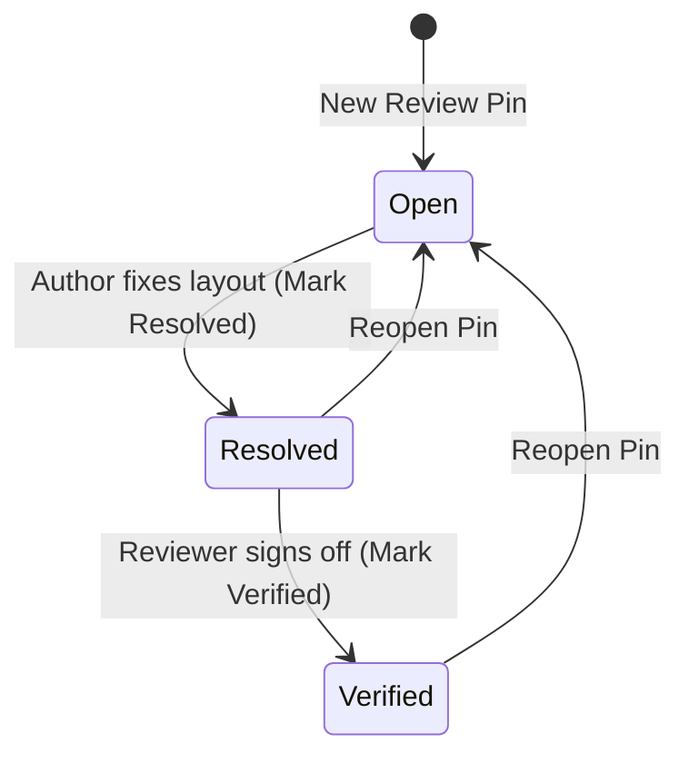

Dropping twenty sticky notes onto a PCB layout is easy. Surviving the pre-tapeout sign-off meeting without losing track of which bugs were fixed—and which fixes were actually checked by a second engineer—is where hardware teams get burned.

In [Lesson 0010](./0010-review-pins-and-sticky-note-callouts.html), we stored anchored review pins in a `HashMap<PinId, ReviewNote>` and displayed them in a floating `egui::Window`. Now, let's give each pin a `PinSeverity` (`Info`, `Warning`, `Critical`) and a `ReviewStatus` workflow (`Open` → `Resolved` → `Verified`) with two rules: an `Open` pin cannot jump straight to `Verified` without first being `Resolved`, and engineers can filter the board by minimum severity and open-only status.


_Figure 11.1: Engineering sign-off state machine enforced by `ReviewStatus::can_transition_to`: an `Open` issue must pass through `Resolved` before it can be marked `Verified`._

## 1. Just-in-Time Rust: Static Enum Slices (`&'static [Self]`) & Transition Guards

When rendering selector buttons or dropdowns in `egui` for every variant of an enum, you don't want to allocate a `Vec` on the heap every frame. Instead, we can define an associated constant `pub const ALL: &'static [Self]` directly on the enum (`PinSeverity::ALL` and `ReviewStatus::ALL`) backed by static read-only binary memory:{{sidenote:Why use `matches!((self, next), ...)` inside `can_transition_to`? Matching on the 2-tuple `(self, next)` lets us list the exact legal state-transition edges in one declarative expression and reject every other pair with `false`.}}

```rust
#[derive(Clone, Copy, Debug, PartialEq, Eq, PartialOrd, Ord)]
pub enum PinSeverity {
    Info,
    Warning,
    Critical,
}

impl PinSeverity {
    pub const ALL: &'static [PinSeverity] = &[
        PinSeverity::Info,
        PinSeverity::Warning,
        PinSeverity::Critical,
    ];

    pub fn rank(self) -> u8 {
        match self {
            PinSeverity::Info => 0,
            PinSeverity::Warning => 1,
            PinSeverity::Critical => 2,
        }
    }
}

#[derive(Clone, Copy, Debug, PartialEq, Eq)]
pub enum ReviewStatus {
    Open,
    Resolved,
    Verified,
}

impl ReviewStatus {
    pub fn can_transition_to(self, next: ReviewStatus) -> bool {
        matches!(
            (self, next),
            (ReviewStatus::Open, ReviewStatus::Resolved)
                | (ReviewStatus::Resolved, ReviewStatus::Verified)
                | (ReviewStatus::Resolved, ReviewStatus::Open)
                | (ReviewStatus::Verified, ReviewStatus::Open)
        )
    }
}
```

## 2. Multi-Criteria Triage Filtering & `ui.selectable_value`

In `SidePanel`, we iterate over `PinSeverity::ALL` and call [`ui.selectable_value(&mut self.view.min_pin_severity, sev, sev.label())`](https://docs.rs/egui/latest/egui/struct.Ui.html#method.selectable_value) to render a three-way severity selector pill bar, paired with an `"Open Pins Only"` checkbox (`self.view.filter_only_open_pins`).

Then `BoardModel::filter_review_pins` combines both criteria:

```rust
pub fn filter_review_pins(
    &self,
    min_severity: PinSeverity,
    only_open: bool,
) -> Vec<ReviewNote> {
    self.sorted_review_pins()
        .into_iter()
        .filter(|pin| {
            pin.severity.rank() >= min_severity.rank()
                && (!only_open || pin.status == ReviewStatus::Open)
        })
        .collect()
}
```

{{widget:review-triage-sim}}

:::exercise id="ex-0011" title="Interactive Lab 2: Complete the Sign-Off Guard & Multi-Criteria Filter" badge="matches! • selectable_value • Boolean Filter"
Fill in the three blanks below to (1) allow transitioning from `ReviewStatus::Resolved` to `ReviewStatus::Verified`, (2) require `pin.severity.rank() >= min_severity.rank()`, and (3) bind each severity pill in `PinSeverity::ALL` with `ui.selectable_value`:

```rust
impl ReviewStatus {
    pub fn can_transition_to(self, next: ReviewStatus) -> bool {
        matches!(
            (self, next),
            (ReviewStatus::Open, ReviewStatus::Resolved)
                | (ReviewStatus::Resolved, {{blank:ReviewStatus::Verified|Specify `ReviewStatus::Verified` so a resolved pin can be verified.|/* 1: Verified */|185px}})
                | (ReviewStatus::Resolved, ReviewStatus::Open)
                | (ReviewStatus::Verified, ReviewStatus::Open)
        )
    }
}

// Inside BoardModel::filter_review_pins():
pin.severity.rank() {{blank:>= min_severity.rank()|Use `>= min_severity.rank()` so pins at or above the selected severity pass.|/* 2: >= rank */|185px}}
    && (!only_open || pin.status == ReviewStatus::Open)

// Inside PcbReviewerApp::render_side_panel():
for &sev in PinSeverity::ALL {
    ui.{{blank:selectable_value|Call `selectable_value` on `ui` to mutate `self.view.min_pin_severity` when clicked.|/* 3: selectable */|150px}}(&mut self.view.min_pin_severity, sev, sev.label());
}
```
:::prompts
hint: **Hints:** (1) `ReviewStatus::Verified`. (2) `>= min_severity.rank()`. (3) `selectable_value`.
success: **Nicely done!** Your review workflow enforces `Open -> Resolved -> Verified` and filters pins by both severity rank and open status.
:::
:::

:::verify id="verify-0011" title="Interactive Lab 3: Catching Transition & Filter Combinator Mutants" badge="cargo test + cargo mutants" tier="Tier 2 + 6: Workflow State Machine" caught="88 Caught (17 Unviable)" missed="0 Missed"
Notice the boolean expression inside `filter_review_pins`: `pin.severity.rank() >= min_severity.rank() && (!only_open || pin.status == ReviewStatus::Open)`. `cargo mutants` will try replacing `>=` with `>`, `&&` with `||`, `||` with `&&`, and deleting `!`. By testing all $3 \times 3$ transition pairs and filtering across `Info`, `Warning`, `Critical`, and `only_open = true/false`, every single mutant is caught!

```rust
#[test]
fn severity_ranks_status_transitions_and_filtering_enforce_signoff_rules() {
    // Exhaustively verify all 3x3 transition pairs
    assert!(!ReviewStatus::Open.can_transition_to(ReviewStatus::Open));
    assert!(ReviewStatus::Open.can_transition_to(ReviewStatus::Resolved));
    assert!(!ReviewStatus::Open.can_transition_to(ReviewStatus::Verified));

    assert!(ReviewStatus::Resolved.can_transition_to(ReviewStatus::Open));
    assert!(!ReviewStatus::Resolved.can_transition_to(ReviewStatus::Resolved));
    assert!(ReviewStatus::Resolved.can_transition_to(ReviewStatus::Verified));

    let mut board = BoardModel::default();
    board.add_review_pin_at(pos2(52.0, 35.0), "carol", "Silkscreen note", PinSeverity::Info);

    // Pin #1 is Open — cannot jump straight to Verified!
    assert!(!board.transition_pin_status(PinId(1), ReviewStatus::Verified));
    assert!(board.transition_pin_status(PinId(1), ReviewStatus::Resolved));
    assert!(board.transition_pin_status(PinId(1), ReviewStatus::Verified));
}
```

- [ ] **1. Run `cargo test` in `apps/0011-review-status-workflow-and-popups`:** Confirm all 22 unit + headless `egui_kittest` tests pass.
- [ ] **2. Run `cargo mutants --in-place`:** Verify that all viable mutants across `PinSeverity`, `ReviewStatus`, `transition_pin_status`, and `filter_review_pins` are **Caught** with **0 Missed**.
:::

:::quiz id="quiz-0011" title="Retrieval Practice: Sign-Off State Machines, Static Slices & Filter Mutants"
Q: Why does `ReviewStatus::can_transition_to` reject transitioning directly from `ReviewStatus::Open` to `ReviewStatus::Verified`?
- [ ] Enums forbid matching tuple pair patterns
- [x] Open issues require resolution before verification
- [ ] Mutants ignore boolean methods returning false
- [ ] Selectable values mutate static slice arrays
why: Hardware design review discipline requires an `Open` finding to be `Resolved` first before a reviewer can sign off as `Verified`.
hint: Trace the allowed arrows in Figure 11.1 from `Open` to `Verified`.

Q: Why does `PinSeverity::ALL` return a static slice `&'static [PinSeverity]` for building severity filter controls?
- [x] Iterating variants without heap allocation overhead
- [ ] Mutating enum variants at runtime dynamically
- [ ] Converting integer ranks into floating points
- [ ] Closing active callout windows after clicks
why: `&'static [PinSeverity]` lives in read-only binary memory, letting `render_side_panel` iterate over all variants every frame with zero heap allocations.
hint: Think about where `&'static [...]` is stored compared to a heap-allocated `Vec`.

Q: Why must our unit test check both `only_open = false` and `only_open = true` when testing `filter_review_pins`?
- [ ] Preventing compiler warnings on unused imports
- [ ] Resetting camera transforms after every frame
- [x] Catching boolean combinator mutations in filters
- [ ] Allocating fresh hash maps during tests
why: Exercising both branches of `!only_open || pin.status == ReviewStatus::Open` ensures `cargo mutants` catches mutations that flip `!`, `||`, or `==`.
hint: Consider what happens if `cargo mutants` deletes `!` in `!only_open`.
:::

## Recommended Primary Source

:::callout
**Read (5 mins):** [`egui::Ui::selectable_value` Official API Docs](https://docs.rs/egui/latest/egui/struct.Ui.html#method.selectable_value) and [The Rust Programming Language — §18.3 "Pattern Syntax"](https://doc.rust-lang.org/book/ch18-03-pattern-syntax.html).
:::

:::teacher-prompt
**Next Up ([Lesson 0012: DRC Clearance Violation Halos, Bounding-Box Reduction & Minimap Clamping](./0012-drc-violation-overlay-and-minimap.html)):** Human review pins catch design intent issues, while automated Design Rule Checks (DRC) catch copper clearance violations. Next, we will compute pad-to-pad clearance gaps, render red DRC error halos on the canvas, and clamp a bird's-eye minimap camera rectangle!
:::
