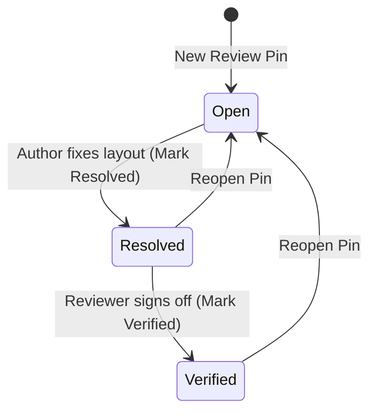

Dropping twenty sticky notes onto a PCB layout is easy. Surviving the pre-tapeout sign-off meeting without losing track of which bugs were fixed—and which fixes were actually checked by a second engineer—is where hardware teams get burned.

In [Lesson 0011](./0011-review-pins-and-sticky-note-callouts.html), we stored anchored review pins in a `HashMap<PinId, ReviewNote>` and displayed them in a floating `egui::Window`. Now, let's give each pin a `PinSeverity` (`Info`, `Warning`, `Critical`) and a `ReviewStatus` workflow (`Open` → `Resolved` → `Verified`) with two rules: an `Open` pin cannot jump straight to `Verified` without first being `Resolved`, and engineers can filter the board by minimum severity and open-only status.


_Figure 12.1: Engineering sign-off state machine enforced by `ReviewStatus::can_transition_to`: an `Open` issue must pass through `Resolved` before it can be marked `Verified`._

## 1. Just-in-Time Rust: Static Enum Slices (`&'static [Self]`) & Transition Guards

When rendering selector buttons or dropdowns in `egui` for every variant of an enum, you don't want to allocate a `Vec` on the heap every frame. Instead, we can define an associated constant `pub const ALL: &'static [Self]` directly on the enum (`PinSeverity::ALL` and `ReviewStatus::ALL`) backed by static read-only binary memory.{{sidenote:Why use `matches!((self, next), ...)` inside `can_transition_to`? Matching on the 2-tuple `(self, next)` lets us list the exact legal state-transition edges in one declarative expression and reject every other pair with `false`.}}

## 2. Multi-Criteria Triage Filtering & `ui.selectable_value`

In `Panel::left`, we iterate over `PinSeverity::ALL` and call [`ui.selectable_value(&mut self.view.min_pin_severity, sev, sev.label())`](https://docs.rs/egui/latest/egui/struct.Ui.html#method.selectable_value) to render a three-way severity selector pill bar, paired with an `"Open Pins Only"` checkbox (`self.view.filter_only_open_pins`).

Then `BoardModel::filter_review_pins` combines both criteria so both the left-panel list and the 2D canvas only display review pins matching the active triage filter.

## 3. Code Walkthrough: Block by Block

Let's unpack the new `PinSeverity` and `ReviewStatus` enums, `BoardModel` transition/filter methods, `ui.selectable_value` pill bar, and tests in `apps/0012-review-status-workflow-and-popups/src/main.rs` block by block before viewing the complete listing in context.

### Block 1: `PinSeverity`, `ReviewStatus` & Sign-Off Transition Rules

```rust
/// Severity level assigned to an engineering review pin.
#[derive(Clone, Copy, Debug, PartialEq, Eq, PartialOrd, Ord)]
pub enum PinSeverity {
    Info,
    Warning,
    Critical,
}

impl PinSeverity {
    pub const ALL: &'static [PinSeverity] = &[
        PinSeverity::Info,
        PinSeverity::Warning,
        PinSeverity::Critical,
    ];

    pub fn label(self) -> &'static str {
        match self {
            PinSeverity::Info => "Info",
            PinSeverity::Warning => "Warning",
            PinSeverity::Critical => "Critical",
        }
    }

    pub fn rank(self) -> u8 {
        match self {
            PinSeverity::Info => 0,
            PinSeverity::Warning => 1,
            PinSeverity::Critical => 2,
        }
    }
}

/// Engineering review lifecycle state machine:
/// `Open` -> `Resolved` -> `Verified` (with ability to reopen to `Open`).
#[derive(Clone, Copy, Debug, PartialEq, Eq)]
pub enum ReviewStatus {
    Open,
    Resolved,
    Verified,
}

impl ReviewStatus {
    pub const ALL: &'static [ReviewStatus] = &[
        ReviewStatus::Open,
        ReviewStatus::Resolved,
        ReviewStatus::Verified,
    ];

    pub fn label(self) -> &'static str {
        match self {
            ReviewStatus::Open => "Open",
            ReviewStatus::Resolved => "Resolved",
            ReviewStatus::Verified => "Verified",
        }
    }

    /// Enforces sign-off discipline: an `Open` pin cannot jump straight to `Verified`
    /// without first being `Resolved`.
    pub fn can_transition_to(self, next: ReviewStatus) -> bool {
        matches!(
            (self, next),
            (ReviewStatus::Open, ReviewStatus::Resolved)
                | (ReviewStatus::Resolved, ReviewStatus::Verified)
                | (ReviewStatus::Resolved, ReviewStatus::Open)
                | (ReviewStatus::Verified, ReviewStatus::Open)
        )
    }
}
```

- **`pub const ALL: &'static [PinSeverity]`**: An associated constant holding a reference to a static array slice (`&'static [...]`) baked into the compiled binary's read-only data segment—zero heap allocations per frame.
- **`rank(self) -> u8`**: Maps `Info -> 0`, `Warning -> 1`, and `Critical -> 2` explicitly so severity threshold comparisons (`pin.severity.rank() >= min_severity.rank()`) are self-documenting and mutation-tested.
- **`matches!((self, next), ...)`**: Rust's `matches!` macro evaluates to `true` if the tuple `(self, next)` matches any of the four pipe-separated `(from, to)` patterns, and `false` for all other combinations (such as `(ReviewStatus::Open, ReviewStatus::Verified)` or self-transitions).

### Block 2: Updating `ReviewNote` & Adding `transition_pin_status` and `filter_review_pins`

```rust
#[derive(Clone, Debug, PartialEq)]
pub struct ReviewNote {
    pub id: PinId,
    pub position_mm: Pos2,
    pub author: String,
    pub comment: String,
    pub severity: PinSeverity,
    pub status: ReviewStatus,
}

impl ReviewNote {
    pub fn summary_line(&self) -> String {
        format!(
            "Pin #{} [{} | {}]: {} (@{})",
            self.id.0,
            self.severity.label(),
            self.status.label(),
            self.comment,
            self.author
        )
    }
}

impl BoardModel {
    pub fn transition_pin_status(&mut self, id: PinId, next: ReviewStatus) -> bool {
        let Some(pin) = self.review_pins.get_mut(&id) else {
            return false;
        };
        if pin.status.can_transition_to(next) {
            pin.status = next;
            true
        } else {
            false
        }
    }

    pub fn filter_review_pins(
        &self,
        min_severity: PinSeverity,
        only_open: bool,
    ) -> Vec<ReviewNote> {
        self.sorted_review_pins()
            .into_iter()
            .filter(|pin| {
                pin.severity.rank() >= min_severity.rank()
                    && (!only_open || pin.status == ReviewStatus::Open)
            })
            .collect()
    }
}
```

- **`self.review_pins.get_mut(&id)`**: Unlike `.get(&id)` (which returns an immutable `&ReviewNote`), `.get_mut(&id)` returns `Option<&mut ReviewNote>` so `transition_pin_status` can update `pin.status = next` in place inside the `HashMap` bucket when `pin.status.can_transition_to(next)` succeeds.
- **`!only_open || pin.status == ReviewStatus::Open`**: Logical implication expressed with boolean operators: when `only_open` is `false`, `!only_open` short-circuits to `true` so all statuses pass; when `only_open` is `true`, only pins in `ReviewStatus::Open` pass.

### Block 3: Triage Filter Controls (`ui.selectable_value`) & Callout Transition Buttons

```rust
    pub fn render_side_panel(&mut self, ui: &mut egui::Ui) {
        // ... PCB Layers & BOM Inspector ...

        ui.separator();
        ui.heading("Review Pins & Triage");
        ui.checkbox(&mut self.view.filter_only_open_pins, "Open Pins Only");
        ui.horizontal(|ui| {
            ui.label("Min Severity:");
            for &sev in PinSeverity::ALL {
                ui.selectable_value(&mut self.view.min_pin_severity, sev, sev.label());
            }
        });

        let pins = self
            .board
            .filter_review_pins(self.view.min_pin_severity, self.view.filter_only_open_pins);
        ui.label(format!("Review Pins: {}", pins.len()));
        for pin in &pins {
            if ui.button(pin.summary_line()).clicked() {
                self.view.select_review_pin(&self.board, pin.id);
            }
        }
    }

    pub fn render_active_pin_callout(&mut self, ctx: &egui::Context) {
        let Some(pin_id) = self.view.selected_pin else {
            return;
        };
        let Some(pin) = self.board.review_pins.get(&pin_id).cloned() else {
            return;
        };

        egui::Window::new("Review Callout")
            .id(egui::Id::unique(("review_pin_callout", pin.id.0)))
            .collapsible(false)
            .resizable(false)
            .show(ctx, |ui| {
                ui.label(pin.summary_line());
                ui.label(pin.coordinates_label());
                ui.horizontal(|ui| {
                    if ui.button("Mark Resolved").clicked() {
                        self.board
                            .transition_pin_status(pin.id, ReviewStatus::Resolved);
                    }
                    if ui.button("Mark Verified").clicked() {
                        self.board
                            .transition_pin_status(pin.id, ReviewStatus::Verified);
                    }
                    if ui.button("Reopen Pin").clicked() {
                        self.board.transition_pin_status(pin.id, ReviewStatus::Open);
                    }
                });
                if ui.button("Close Callout").clicked() {
                    self.view.selected_pin = None;
                }
            });
    }
```

- **`for &sev in PinSeverity::ALL`**: Pattern-matching `&sev` dereferences each `&PinSeverity` element from the static slice into a `Copy` `PinSeverity` value.
- **`ui.selectable_value(&mut self.view.min_pin_severity, sev, sev.label())`**: Compares `self.view.min_pin_severity == sev` (via `PartialEq`) to highlight the active pill, and overwrites `self.view.min_pin_severity = sev` when clicked.
- **Callout State-Machine Buttons**: Clicking `"Mark Resolved"`, `"Mark Verified"`, or `"Reopen Pin"` inside the floating `egui::Window` calls `self.board.transition_pin_status(pin.id, ...)`, which enforces `can_transition_to`.

### Block 4: Exhaustive State-Transition & Filter Combinator Tests (`#[cfg(test)] mod tests`)

```rust
    #[test]
    fn severity_ranks_status_transitions_and_filtering_enforce_signoff_rules() {
        assert_eq!(PinSeverity::Info.label(), "Info");
        assert_eq!(PinSeverity::Warning.label(), "Warning");
        assert_eq!(PinSeverity::Critical.label(), "Critical");
        assert_eq!(PinSeverity::Info.rank(), 0);
        assert_eq!(PinSeverity::Warning.rank(), 1);
        assert_eq!(PinSeverity::Critical.rank(), 2);

        // Exhaustively check all 3x3 transition pairs
        assert!(!ReviewStatus::Open.can_transition_to(ReviewStatus::Open));
        assert!(ReviewStatus::Open.can_transition_to(ReviewStatus::Resolved));
        assert!(!ReviewStatus::Open.can_transition_to(ReviewStatus::Verified));

        assert!(ReviewStatus::Resolved.can_transition_to(ReviewStatus::Open));
        assert!(!ReviewStatus::Resolved.can_transition_to(ReviewStatus::Resolved));
        assert!(ReviewStatus::Resolved.can_transition_to(ReviewStatus::Verified));

        assert!(ReviewStatus::Verified.can_transition_to(ReviewStatus::Open));
        assert!(!ReviewStatus::Verified.can_transition_to(ReviewStatus::Resolved));
        assert!(!ReviewStatus::Verified.can_transition_to(ReviewStatus::Verified));

        let mut board = BoardModel::default();
        board.add_review_pin_at(
            pos2(52.0, 35.0),
            "carol",
            "Silkscreen note",
            PinSeverity::Info,
        );

        // Pin #1 is Open — cannot jump straight to Verified!
        assert!(!board.transition_pin_status(PinId(1), ReviewStatus::Verified));
        assert_eq!(board.review_pins[&PinId(1)].status, ReviewStatus::Open);

        // Filter combinations: Info (all 3), Warning (Pin 1 & 2), Critical (Pin 1)
        assert_eq!(board.filter_review_pins(PinSeverity::Info, false).len(), 3);
        assert_eq!(
            board.filter_review_pins(PinSeverity::Warning, false).len(),
            2
        );
        assert_eq!(
            board.filter_review_pins(PinSeverity::Critical, false).len(),
            1
        );

        // Only open pins (Pin 1 is Open, Pin 2 is Resolved, Pin 3 is Open)
        let open_warnings = board.filter_review_pins(PinSeverity::Warning, true);
        assert_eq!(open_warnings.len(), 1);
        assert_eq!(open_warnings[0].id, PinId(1));
    }
```

- **3×3 Transition Matrix**: Testing all nine `(from, to)` pairs guarantees that deleting or altering any arm inside `matches!((self, next), ...)` immediately breaks the unit test.
- **Filter Combinator Coverage**: Testing `min_severity` across `Info`, `Warning`, and `Critical` with both `only_open = false` and `only_open = true` kills every relational (`>=` $\to$ `>`, `==` $\to$ `!=`) and logical (`&&` $\to$ `||`, `!` deletion) mutant in `filter_review_pins`.

### Complete Lesson 0012 Status Triage & Severity Filtering Listing

Here is the complete assembled triage state machine, `BoardModel` filter logic, `Panel::left` selector pills, floating `egui::Window` sign-off controls, and tests in context from `apps/0012-review-status-workflow-and-popups/src/main.rs`:

```rust
/// Severity level assigned to an engineering review pin.
#[derive(Clone, Copy, Debug, PartialEq, Eq, PartialOrd, Ord)]
pub enum PinSeverity {
    Info,
    Warning,
    Critical,
}

impl PinSeverity {
    pub const ALL: &'static [PinSeverity] = &[
        PinSeverity::Info,
        PinSeverity::Warning,
        PinSeverity::Critical,
    ];

    pub fn label(self) -> &'static str {
        match self {
            PinSeverity::Info => "Info",
            PinSeverity::Warning => "Warning",
            PinSeverity::Critical => "Critical",
        }
    }

    pub fn rank(self) -> u8 {
        match self {
            PinSeverity::Info => 0,
            PinSeverity::Warning => 1,
            PinSeverity::Critical => 2,
        }
    }
}

/// Engineering review lifecycle state machine:
/// `Open` -> `Resolved` -> `Verified` (with ability to reopen to `Open`).
#[derive(Clone, Copy, Debug, PartialEq, Eq)]
pub enum ReviewStatus {
    Open,
    Resolved,
    Verified,
}

impl ReviewStatus {
    pub const ALL: &'static [ReviewStatus] = &[
        ReviewStatus::Open,
        ReviewStatus::Resolved,
        ReviewStatus::Verified,
    ];

    pub fn label(self) -> &'static str {
        match self {
            ReviewStatus::Open => "Open",
            ReviewStatus::Resolved => "Resolved",
            ReviewStatus::Verified => "Verified",
        }
    }

    /// Enforces sign-off discipline: an `Open` pin cannot jump straight to `Verified`
    /// without first being `Resolved`.
    pub fn can_transition_to(self, next: ReviewStatus) -> bool {
        matches!(
            (self, next),
            (ReviewStatus::Open, ReviewStatus::Resolved)
                | (ReviewStatus::Resolved, ReviewStatus::Verified)
                | (ReviewStatus::Resolved, ReviewStatus::Open)
                | (ReviewStatus::Verified, ReviewStatus::Open)
        )
    }
}

/// Engineering review note anchored to a physical `(x, y)` coordinate in mm.
#[derive(Clone, Debug, PartialEq)]
pub struct ReviewNote {
    pub id: PinId,
    pub position_mm: Pos2,
    pub author: String,
    pub comment: String,
    pub severity: PinSeverity,
    pub status: ReviewStatus,
}

impl ReviewNote {
    pub fn summary_line(&self) -> String {
        format!(
            "Pin #{} [{} | {}]: {} (@{})",
            self.id.0,
            self.severity.label(),
            self.status.label(),
            self.comment,
            self.author
        )
    }

    pub fn coordinates_label(&self) -> String {
        format!(
            "Anchor: ({:.1}, {:.1}) mm",
            self.position_mm.x, self.position_mm.y
        )
    }
}

fn sample_review_pins() -> HashMap<PinId, ReviewNote> {
    let mut pins = HashMap::new();
    pins.insert(
        PinId(1),
        ReviewNote {
            id: PinId(1),
            position_mm: pos2(20.0, 27.0),
            author: "alice".to_owned(),
            comment: "Check U1 thermal relief".to_owned(),
            severity: PinSeverity::Critical,
            status: ReviewStatus::Open,
        },
    );
    pins.insert(
        PinId(2),
        ReviewNote {
            id: PinId(2),
            position_mm: pos2(68.0, 35.0),
            author: "bob".to_owned(),
            comment: "Verify J1 polarity mark".to_owned(),
            severity: PinSeverity::Warning,
            status: ReviewStatus::Resolved,
        },
    );
    pins
}

impl BoardModel {
    pub fn insert_review_pin(
        &mut self,
        id: PinId,
        position_mm: Pos2,
        author: &str,
        comment: &str,
        severity: PinSeverity,
    ) -> bool {
        match self.review_pins.entry(id) {
            Entry::Vacant(slot) => {
                slot.insert(ReviewNote {
                    id,
                    position_mm,
                    author: author.to_owned(),
                    comment: comment.to_owned(),
                    severity,
                    status: ReviewStatus::Open,
                });
                true
            }
            Entry::Occupied(_) => false,
        }
    }

    pub fn add_review_pin_at(
        &mut self,
        position_mm: Pos2,
        author: &str,
        comment: &str,
        severity: PinSeverity,
    ) -> PinId {
        let id = PinId(self.next_pin_id);
        self.next_pin_id += 1;
        self.insert_review_pin(id, position_mm, author, comment, severity);
        id
    }

    pub fn sorted_review_pins(&self) -> Vec<ReviewNote> {
        let mut list: Vec<ReviewNote> = self.review_pins.values().cloned().collect();
        list.sort_by_key(|p| p.id);
        list
    }

    pub fn transition_pin_status(&mut self, id: PinId, next: ReviewStatus) -> bool {
        let Some(pin) = self.review_pins.get_mut(&id) else {
            return false;
        };
        if pin.status.can_transition_to(next) {
            pin.status = next;
            true
        } else {
            false
        }
    }

    pub fn filter_review_pins(
        &self,
        min_severity: PinSeverity,
        only_open: bool,
    ) -> Vec<ReviewNote> {
        self.sorted_review_pins()
            .into_iter()
            .filter(|pin| {
                pin.severity.rank() >= min_severity.rank()
                    && (!only_open || pin.status == ReviewStatus::Open)
            })
            .collect()
    }
}

pub struct ViewState {
    // ... layer booleans, viewport, selection fields ...
    pub selected_pin: Option<PinId>,
    pub min_pin_severity: PinSeverity,
    pub filter_only_open_pins: bool,
}

impl PcbReviewerApp {
    pub fn render_side_panel(&mut self, ui: &mut egui::Ui) {
        // ... PCB Layers & BOM Inspector ...

        ui.separator();
        ui.heading("Review Pins & Triage");
        ui.checkbox(&mut self.view.filter_only_open_pins, "Open Pins Only");
        ui.horizontal(|ui| {
            ui.label("Min Severity:");
            for &sev in PinSeverity::ALL {
                ui.selectable_value(&mut self.view.min_pin_severity, sev, sev.label());
            }
        });

        let pins = self
            .board
            .filter_review_pins(self.view.min_pin_severity, self.view.filter_only_open_pins);
        ui.label(format!("Review Pins: {}", pins.len()));
        for pin in &pins {
            if ui.button(pin.summary_line()).clicked() {
                self.view.select_review_pin(&self.board, pin.id);
            }
        }

        // ... Net Inspector ...
    }

    pub fn render_active_pin_callout(&mut self, ctx: &egui::Context) {
        let Some(pin_id) = self.view.selected_pin else {
            return;
        };
        let Some(pin) = self.board.review_pins.get(&pin_id).cloned() else {
            return;
        };

        egui::Window::new("Review Callout")
            .id(egui::Id::unique(("review_pin_callout", pin.id.0)))
            .collapsible(false)
            .resizable(false)
            .show(ctx, |ui| {
                ui.label(pin.summary_line());
                ui.label(pin.coordinates_label());
                ui.horizontal(|ui| {
                    if ui.button("Mark Resolved").clicked() {
                        self.board
                            .transition_pin_status(pin.id, ReviewStatus::Resolved);
                    }
                    if ui.button("Mark Verified").clicked() {
                        self.board
                            .transition_pin_status(pin.id, ReviewStatus::Verified);
                    }
                    if ui.button("Reopen Pin").clicked() {
                        self.board.transition_pin_status(pin.id, ReviewStatus::Open);
                    }
                });
                if ui.button("Close Callout").clicked() {
                    self.view.selected_pin = None;
                }
            });
    }
}

#[cfg(test)]
mod tests {
    use super::*;
    use egui_kittest::{Harness, kittest::Queryable};

    // ... Lesson 0001-0011 unit tests ...

    #[test]
    fn severity_ranks_status_transitions_and_filtering_enforce_signoff_rules() {
        assert_eq!(PinSeverity::Info.label(), "Info");
        assert_eq!(PinSeverity::Warning.label(), "Warning");
        assert_eq!(PinSeverity::Critical.label(), "Critical");
        assert_eq!(PinSeverity::Info.rank(), 0);
        assert_eq!(PinSeverity::Warning.rank(), 1);
        assert_eq!(PinSeverity::Critical.rank(), 2);

        assert_eq!(
            ReviewStatus::ALL,
            &[
                ReviewStatus::Open,
                ReviewStatus::Resolved,
                ReviewStatus::Verified
            ]
        );
        assert_eq!(ReviewStatus::Open.label(), "Open");
        assert_eq!(ReviewStatus::Resolved.label(), "Resolved");
        assert_eq!(ReviewStatus::Verified.label(), "Verified");

        // Exhaustively check all 3x3 transition pairs
        assert!(!ReviewStatus::Open.can_transition_to(ReviewStatus::Open));
        assert!(ReviewStatus::Open.can_transition_to(ReviewStatus::Resolved));
        assert!(!ReviewStatus::Open.can_transition_to(ReviewStatus::Verified));

        assert!(ReviewStatus::Resolved.can_transition_to(ReviewStatus::Open));
        assert!(!ReviewStatus::Resolved.can_transition_to(ReviewStatus::Resolved));
        assert!(ReviewStatus::Resolved.can_transition_to(ReviewStatus::Verified));

        assert!(ReviewStatus::Verified.can_transition_to(ReviewStatus::Open));
        assert!(!ReviewStatus::Verified.can_transition_to(ReviewStatus::Resolved));
        assert!(!ReviewStatus::Verified.can_transition_to(ReviewStatus::Verified));

        let mut board = BoardModel::default();
        board.add_review_pin_at(
            pos2(52.0, 35.0),
            "carol",
            "Silkscreen note",
            PinSeverity::Info,
        );

        // Pin #1 is Open — cannot jump straight to Verified!
        assert!(!board.transition_pin_status(PinId(1), ReviewStatus::Verified));
        assert_eq!(board.review_pins[&PinId(1)].status, ReviewStatus::Open);

        // Pin #1 Open -> Resolved -> Verified -> Open
        assert!(board.transition_pin_status(PinId(1), ReviewStatus::Resolved));
        assert_eq!(board.review_pins[&PinId(1)].status, ReviewStatus::Resolved);
        assert!(board.transition_pin_status(PinId(1), ReviewStatus::Verified));
        assert_eq!(board.review_pins[&PinId(1)].status, ReviewStatus::Verified);
        assert!(board.transition_pin_status(PinId(1), ReviewStatus::Open));
        assert_eq!(board.review_pins[&PinId(1)].status, ReviewStatus::Open);

        // Unknown PinId returns false
        assert!(!board.transition_pin_status(PinId(999), ReviewStatus::Resolved));

        // Filter combinations: Info (all 3), Warning (Pin 1 & 2), Critical (Pin 1)
        assert_eq!(board.filter_review_pins(PinSeverity::Info, false).len(), 3);
        assert_eq!(
            board.filter_review_pins(PinSeverity::Warning, false).len(),
            2
        );
        assert_eq!(
            board.filter_review_pins(PinSeverity::Critical, false).len(),
            1
        );

        // Only open pins (Pin 1 is Open, Pin 2 is Resolved, Pin 3 is Open)
        let open_warnings = board.filter_review_pins(PinSeverity::Warning, true);
        assert_eq!(open_warnings.len(), 1);
        assert_eq!(open_warnings[0].id, PinId(1));
    }

    #[test]
    fn headless_triage_workflow_and_pin_callout_transitions() {
        let mut harness = Harness::new_eframe(|_cc| PcbReviewerApp::default());
        assert!(harness.query_by_label("Review Pins: 2").is_some());

        // Filter to Critical only -> only Pin #1 remains
        harness.get_by_label("Critical").click();
        harness.run();
        assert_eq!(harness.state().view.min_pin_severity, PinSeverity::Critical);
        assert!(harness.query_by_label("Review Pins: 1").is_some());

        // Reset to Info, enable Open Pins Only -> only Pin #1 (Open) remains
        harness.get_by_label("Info").click();
        harness.get_by_label("Open Pins Only").click();
        harness.run();
        assert!(harness.state().view.filter_only_open_pins);
        assert!(harness.query_by_label("Review Pins: 1").is_some());

        // Uncheck Open Pins Only and open Pin #1 callout
        harness.get_by_label("Open Pins Only").click();
        harness
            .get_by_label("Pin #1 [Critical | Open]: Check U1 thermal relief (@alice)")
            .click();
        harness.run();
        assert_eq!(harness.state().view.selected_pin, Some(PinId(1)));
        assert!(harness.query_by_label("Anchor: (20.0, 27.0) mm").is_some());

        // Transition Open -> Resolved -> Verified -> Reopen inside the callout window
        harness.get_by_label("Mark Resolved").click();
        harness.run();
        assert_eq!(
            harness.state().board.review_pins[&PinId(1)].status,
            ReviewStatus::Resolved
        );

        harness.get_by_label("Mark Verified").click();
        harness.run();
        assert_eq!(
            harness.state().board.review_pins[&PinId(1)].status,
            ReviewStatus::Verified
        );

        harness.get_by_label("Reopen Pin").click();
        harness.run();
        assert_eq!(
            harness.state().board.review_pins[&PinId(1)].status,
            ReviewStatus::Open
        );
    }
}
```

{{widget:review-triage-sim}}

:::exercise id="ex-0012" title="Interactive Lab 2: Complete the Sign-Off Guard & Multi-Criteria Filter" badge="matches! • selectable_value • Boolean Filter"
Fill in the three blanks below to (1) allow transitioning from `ReviewStatus::Resolved` to `ReviewStatus::Verified`, (2) require `pin.severity.rank() >= min_severity.rank()`, and (3) bind each severity pill in `PinSeverity::ALL` with `ui.selectable_value`:

```rust
impl ReviewStatus {
    pub fn can_transition_to(self, next: ReviewStatus) -> bool {
        matches!(
            (self, next),
            (ReviewStatus::Open, ReviewStatus::Resolved)
                | (ReviewStatus::Resolved, {{blank:ReviewStatus::Verified|Specify `ReviewStatus::Verified` so a resolved pin can be verified.|/* 1: Verified */|185px}})
                | (ReviewStatus::Resolved, ReviewStatus::Open)
                | (ReviewStatus::Verified, ReviewStatus::Open)
        )
    }
}

// Inside BoardModel::filter_review_pins():
pin.severity.rank() {{blank:>= min_severity.rank()|Use `>= min_severity.rank()` so pins at or above the selected severity pass.|/* 2: >= rank */|185px}}
    && (!only_open || pin.status == ReviewStatus::Open)

// Inside PcbReviewerApp::render_side_panel():
for &sev in PinSeverity::ALL {
    ui.{{blank:selectable_value|Call `selectable_value` on `ui` to mutate `self.view.min_pin_severity` when clicked.|/* 3: selectable */|150px}}(&mut self.view.min_pin_severity, sev, sev.label());
}
```
:::prompts
hint: **Hints:** (1) `ReviewStatus::Verified`. (2) `>= min_severity.rank()`. (3) `selectable_value`.
success: **Nicely done!** Your review workflow enforces `Open -> Resolved -> Verified` and filters pins by both severity rank and open status.
:::
:::

:::verify id="verify-0012" title="Interactive Lab 3: Catching Transition & Filter Combinator Mutants" badge="cargo test + cargo mutants" tier="Tier 2 + 6: Workflow State Machine" caught="88 Caught (17 Unviable)" missed="0 Missed"
Notice the boolean expression inside `filter_review_pins`: `pin.severity.rank() >= min_severity.rank() && (!only_open || pin.status == ReviewStatus::Open)`. `cargo mutants` will try replacing `>=` with `>`, `&&` with `||`, `||` with `&&`, and deleting `!`. By testing all $3 \times 3$ transition pairs and filtering across `Info`, `Warning`, `Critical`, and `only_open = true/false`, every single mutant is caught!

```rust
#[test]
fn severity_ranks_status_transitions_and_filtering_enforce_signoff_rules() {
    // Exhaustively verify all 3x3 transition pairs
    assert!(!ReviewStatus::Open.can_transition_to(ReviewStatus::Open));
    assert!(ReviewStatus::Open.can_transition_to(ReviewStatus::Resolved));
    assert!(!ReviewStatus::Open.can_transition_to(ReviewStatus::Verified));

    assert!(ReviewStatus::Resolved.can_transition_to(ReviewStatus::Open));
    assert!(!ReviewStatus::Resolved.can_transition_to(ReviewStatus::Resolved));
    assert!(ReviewStatus::Resolved.can_transition_to(ReviewStatus::Verified));

    let mut board = BoardModel::default();
    board.add_review_pin_at(pos2(52.0, 35.0), "carol", "Silkscreen note", PinSeverity::Info);

    // Pin #1 is Open — cannot jump straight to Verified!
    assert!(!board.transition_pin_status(PinId(1), ReviewStatus::Verified));
    assert!(board.transition_pin_status(PinId(1), ReviewStatus::Resolved));
    assert!(board.transition_pin_status(PinId(1), ReviewStatus::Verified));
}
```

- [ ] **1. Run `cargo test` in `apps/0012-review-status-workflow-and-popups`:** Confirm all 22 unit + headless `egui_kittest` tests pass.
- [ ] **2. Run `cargo mutants --in-place`:** Verify that all viable mutants across `PinSeverity`, `ReviewStatus`, `transition_pin_status`, and `filter_review_pins` are **Caught** with **0 Missed**.
:::

:::quiz id="quiz-0012" title="Retrieval Practice: Sign-Off State Machines, Static Slices & Filter Mutants"
Q: Why does `ReviewStatus::can_transition_to` reject transitioning directly from `ReviewStatus::Open` to `ReviewStatus::Verified`?
- [ ] Enums forbid matching tuple pair patterns
- [x] Open issues require resolution before verification
- [ ] Mutants ignore boolean methods returning false
- [ ] Selectable values mutate static slice arrays
why: Hardware design review discipline requires an `Open` finding to be `Resolved` first before a reviewer can sign off as `Verified`.
hint: Trace the allowed arrows in Figure 12.1 from `Open` to `Verified`.

Q: Why does `PinSeverity::ALL` return a static slice `&'static [PinSeverity]` for building severity filter controls?
- [x] Iterating variants without heap allocation overhead
- [ ] Mutating enum variants at runtime dynamically
- [ ] Converting integer ranks into floating points
- [ ] Closing active callout windows after clicks
why: `&'static [PinSeverity]` lives in read-only binary memory, letting `render_side_panel` iterate over all variants every frame with zero heap allocations.
hint: Think about where `&'static [...]` is stored compared to a heap-allocated `Vec`.

Q: Why must our unit test check both `only_open = false` and `only_open = true` when testing `filter_review_pins`?
- [ ] Preventing compiler warnings on unused imports
- [ ] Resetting camera transforms after every frame
- [x] Catching boolean combinator mutations in filters
- [ ] Allocating fresh hash maps during tests
why: Exercising both branches of `!only_open || pin.status == ReviewStatus::Open` ensures `cargo mutants` catches mutations that flip `!`, `||`, or `==`.
hint: Consider what happens if `cargo mutants` deletes `!` in `!only_open`.
:::

## Recommended Primary Source

:::callout
**Read (5 mins):** [`egui::Ui::selectable_value` Official API Docs](https://docs.rs/egui/latest/egui/struct.Ui.html#method.selectable_value) and [The Rust Programming Language — §18.3 "Pattern Syntax"](https://doc.rust-lang.org/book/ch18-03-pattern-syntax.html).
:::

:::teacher-prompt
**Next Up ([Lesson 0013: DRC Clearance Violation Halos, Bounding-Box Reduction & Minimap Clamping](./0013-drc-violation-overlay-and-minimap.html)):** Human review pins catch design intent issues, while automated Design Rule Checks (DRC) catch copper clearance violations. Next, we will compute pad-to-pad clearance gaps, render red DRC error halos on the canvas, and clamp a bird's-eye minimap camera rectangle!
:::
