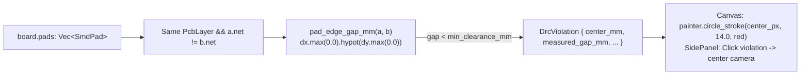

Even experienced PCB designers occasionally nudge a high-voltage pad or trace a fraction of a millimetre too close to an adjacent net. A **Design Rule Check (DRC)** overlay flags every pair of same-layer, different-net copper primitives whose edge-to-edge gap falls below `min_clearance_mm`—and lets you click any violation in the inspector to jump the camera straight to the offending copper.

In [Lesson 0012](./0012-review-status-workflow-and-popups.html), we added review status triage and severity filtering. Now, let's build an automated pad-to-pad DRC clearance detector (`pad_edge_gap_mm` and `detect_pad_clearance_violations`), compute the board's pad bounding box with `Iterator::reduce(Rect::union)`, and clamp the active camera rectangle (`clamped_minimap_camera_rect`) so a bird's-eye minimap indicator never spills outside the physical board edges.


_Figure 13.1: Same-layer pads on distinct nets are checked against `min_clearance_mm`, emitting `DrcViolation` markers rendered as red halos on the canvas and clickable jump buttons in the `SidePanel`._

## 1. Just-in-Time Rust: Bounding-Box Reduction (`Iterator::reduce`) & `f32::clamp`

To compute the edge-to-edge Euclidean distance between two axis-aligned rectangular pads `a` and `b`, we subtract their half-widths `(a.size_mm.x + b.size_mm.x) * 0.5` from the centre-to-centre distance `(a.center_mm.x - b.center_mm.x).abs()` along each axis, clamp negative values (which represent axis overlap) to `0.0` via `.max(0.0)`, and take the hypotenuse with `.hypot(...)`:{{sidenote:Notice how `pads_bounding_box_mm` uses `.map(SmdPad::bounds_mm).reduce(Rect::union)`: `Iterator::reduce` folds the iterator using the first pad's `Rect` as the initial accumulator and returns `None` if the board has zero pads.}}

```rust
pub fn pad_edge_gap_mm(a: &SmdPad, b: &SmdPad) -> f32 {
    let dx = (a.center_mm.x - b.center_mm.x).abs() - (a.size_mm.x + b.size_mm.x) * 0.5;
    let dy = (a.center_mm.y - b.center_mm.y).abs() - (a.size_mm.y + b.size_mm.y) * 0.5;
    dx.max(0.0).hypot(dy.max(0.0))
}

impl BoardModel {
    pub fn pads_bounding_box_mm(&self) -> Option<Rect> {
        self.pads
            .iter()
            .map(SmdPad::bounds_mm)
            .reduce(Rect::union)
    }
}
```

## 2. Detecting DRC Clearance Violations & Clamping the Minimap Camera

When iterating over pad pairs in `detect_pad_clearance_violations`, we maintain a `seen: Vec<&SmdPad>` slice of previously visited pads. That way, each unordered pair `(a, b)` is tested once without index arithmetic (`idx + 1`), and whenever `a.layer == b.layer && a.net != b.net` with `gap < min_clearance_mm`, we record a `DrcViolation` at the midpoint between the two pads.

Meanwhile, when the engineer pans the `egui::Scene` camera near or beyond the board edge `(0, 0)..(100, 70) mm`, `ViewState::clamped_minimap_camera_rect` uses [`f32::clamp`](https://doc.rust-lang.org/std/primitive.f32.html#method.clamp) to keep the minimap's camera box inside `board_bounds_mm`:

```rust
pub fn clamped_minimap_camera_rect(&self, board_bounds_mm: Rect) -> Rect {
    let min_x = self
        .pcb_scene_rect
        .min
        .x
        .clamp(board_bounds_mm.min.x, board_bounds_mm.max.x);
    let min_y = self
        .pcb_scene_rect
        .min
        .y
        .clamp(board_bounds_mm.min.y, board_bounds_mm.max.y);
    let max_x = self
        .pcb_scene_rect
        .max
        .x
        .clamp(min_x, board_bounds_mm.max.x);
    let max_y = self
        .pcb_scene_rect
        .max
        .y
        .clamp(min_y, board_bounds_mm.max.y);
    Rect::from_min_max(pos2(min_x, min_y), pos2(max_x, max_y))
}
```

{{widget:drc-minimap-sim}}

:::exercise id="ex-0013" title="Interactive Lab 2: Complete the Pad Edge Gap, Bounding-Box Reduce & Minimap Clamp" badge="hypot • Iterator::reduce • f32::clamp"
Fill in the three blanks below to (1) clamp negative axis overlaps to `0.0` before calling `.hypot(...)`, (2) fold pad rectangles with `Iterator::reduce(Rect::union)`, and (3) clamp `min_x` within `board_bounds_mm`:

```rust
pub fn pad_edge_gap_mm(a: &SmdPad, b: &SmdPad) -> f32 {
    let dx = (a.center_mm.x - b.center_mm.x).abs() - (a.size_mm.x + b.size_mm.x) * 0.5;
    let dy = (a.center_mm.y - b.center_mm.y).abs() - (a.size_mm.y + b.size_mm.y) * 0.5;
    dx.{{blank:max(0.0)|Clamp negative `dx` overlap to `0.0` using `max(0.0)`.|/* 1: max(0.0) */|105px}}.hypot(dy.max(0.0))
}

impl BoardModel {
    pub fn pads_bounding_box_mm(&self) -> Option<Rect> {
        self.pads
            .iter()
            .map(SmdPad::bounds_mm)
            .{{blank:reduce(Rect::union)|Fold the iterator of `Rect`s into `Option<Rect>` using `reduce(Rect::union)`.|/* 2: reduce */|165px}}
    }
}

// Inside ViewState::clamped_minimap_camera_rect():
let min_x = self
    .pcb_scene_rect
    .min
    .x
    .{{blank:clamp|Use `clamp` to bound `min.x` between `board_bounds_mm.min.x` and `board_bounds_mm.max.x`.|/* 3: clamp */|95px}}(board_bounds_mm.min.x, board_bounds_mm.max.x);
```
:::prompts
hint: **Hints:** (1) `max(0.0)`. (2) `reduce(Rect::union)`. (3) `clamp`.
success: **Great work!** Your DRC geometry engine computes exact edge-to-edge pad gaps, unions pad bounding boxes, and clamps minimap camera coordinates.
:::
:::

:::verify id="verify-0013" title="Interactive Lab 3: Catching `<` vs. `<=` DRC Boundary Mutants" badge="cargo test + cargo mutants" tier="Tier 2 + 6: DRC Geometry & Minimap" caught="125 Caught (20 Unviable)" missed="0 Missed"
If a test only checks `detect_pad_clearance_violations(8.0)` when the actual gap is `7.6 mm`, `cargo mutants` can mutate `if gap < min_clearance_mm` into `if gap <= min_clearance_mm` and the test will still pass! Asserting `board.detect_pad_clearance_violations(7.6).is_empty()` at the exact boundary kills the `<` $\to$ `<=` mutant immediately:

```rust
#[test]
fn drc_clearance_bounding_box_and_minimap_clamping_are_exact() {
    let mut board = BoardModel::default();
    assert_eq!(
        board.pads_bounding_box_mm(),
        Some(Rect::from_min_max(pos2(18.0, 20.8), pos2(22.0, 49.2)))
    );

    // Exact boundary check (gap == 7.6 mm): catches `<` mutated to `<=`!
    assert!(board.detect_pad_clearance_violations(7.6).is_empty());

    let violations = board.detect_pad_clearance_violations(8.0);
    assert_eq!(violations.len(), 1);
    assert_eq!(violations[0].center_mm, pos2(20.0, 27.0));
}
```

- [ ] **1. Run `cargo test` in `apps/0013-drc-violation-overlay-and-minimap`:** Confirm all 23 unit + headless `egui_kittest` tests pass.
- [ ] **2. Run `cargo mutants --in-place`:** Verify that all viable mutants across `pad_edge_gap_mm`, `detect_pad_clearance_violations`, `pads_bounding_box_mm`, and `clamped_minimap_camera_rect` are **Caught** with **0 Missed**.
:::

:::quiz id="quiz-0013" title="Retrieval Practice: DRC Clearance Math, `Iterator::reduce` & `f32::clamp`"
Q: Why does `pad_edge_gap_mm` clamp `dx` and `dy` with `.max(0.0)` before calling `.hypot(...)`?
- [x] Negative axis overlap means zero gap
- [ ] Hypotenuse panics on positive float inputs
- [ ] Copper layers ignore vertical pad spacing
- [ ] Screen transforms invert negative world coordinates
why: When two pads overlap along the X axis (`dx < 0`), their horizontal separation is `0.0 mm` and the edge gap is purely vertical (`dy`).
hint: Think about two pads aligned vertically at `x = 20.0 mm`: what is `|20 - 20| - 4.0`?

Q: How does `pads_bounding_box_mm` compute the union `Rect` across all pads on the board?
- [ ] Sorting pad coordinates by layer rank
- [x] Reducing pad rectangles with Rect union
- [ ] Multiplying viewport scale by board width
- [ ] Filtering hidden silkscreen labels each frame
why: `.map(SmdPad::bounds_mm).reduce(Rect::union)` folds every pad's `Rect` into a single bounding rectangle (or `None` if `pads` is empty).
hint: Look at the iterator method chained after `.map(SmdPad::bounds_mm)`.

Q: Why should a DRC test assert `detect_pad_clearance_violations(7.6).is_empty()` at the exact `7.6 mm` measured pad gap?
- [ ] Skipping floating point math during tests
- [ ] Forcing headless harnesses to open windows
- [x] Catching strict inequality boundary operator mutants
- [ ] Clearing review pins from hash maps
why: Testing `min_clearance_mm == 7.6` ensures that mutating `gap < min_clearance_mm` into `gap <= min_clearance_mm` causes the test to fail.
hint: What happens at `gap == 7.6` if `<` is mutated into `<=`?
:::

## Recommended Primary Source

:::callout
**Read (5 mins):** [`std::iter::Iterator::reduce` Official Docs](https://doc.rust-lang.org/std/iter/trait.Iterator.html#method.reduce) and [`egui::Rect::union` API Docs](https://docs.rs/egui/latest/egui/struct.Rect.html#method.union).
:::

:::teacher-prompt
**Next Up ([Lesson 0014: Custom `egui::Widget` Layer Swatches, Struct Lifetimes (`'a`) & `Harness::new_ui_state`](./0014-custom-layer-swatch-widget-and-design-tokens.html)):** To wrap up **Act III**, we will extract our first reusable custom `egui::Widget`—a PCB `LayerSwatch<'a>` combining a colour swatch, visibility checkbox, and opacity slider—and test it in isolation with `egui_kittest::Harness::new_ui_state`!
:::
