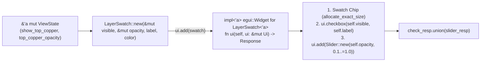

When inspecting a dense four-layer or six-layer board, toggling `TopCopper` completely off is often too blunt: you want to dim `TopCopper` to `50%` opacity so you can trace `BottomCopper` routing underneath it while still seeing the top-side pads in context.

In [Lesson 0013](./0013-drc-violation-overlay-and-minimap.html), we added DRC clearance halos and minimap clamping. Now, we close out **Act III** by replacing our four repetitive `ui.checkbox` calls with a custom, reusable [`egui::Widget`](https://docs.rs/egui/latest/egui/trait.Widget.html) called `LayerSwatch<'a>` that packages a painted colour chip, a visibility checkbox, and a per-layer opacity slider into a single `ui.add(LayerSwatch::new(...))` call—and we verify the widget in isolation using `egui_kittest::Harness::new_ui_state`.


_Figure 14.1: `LayerSwatch<'a>` temporarily borrows `visible: &'a mut bool` and `opacity: &'a mut f32` for the duration of the `ui.add(...)` call, consumes itself in `Widget::ui(self, ui)`, and returns the combined `egui::Response`._

## 1. Just-in-Time Rust: Struct Lifetimes (`'a`) & Implementing `egui::Widget`

Look at how `egui`'s built-in widgets work when you write `ui.add(egui::Slider::new(&mut self.opacity, 0.1..=1.0))`: `Slider::new` constructs a lightweight builder struct that holds a mutable reference `&'a mut f32` into your state, and `ui.add(...)` immediately consumes that struct by calling `egui::Widget::ui(self, ui)`.

Whenever a Rust `struct` stores references (`&'a mut bool`, `&'a mut f32`, `&'a str`), its declaration must name a generic **lifetime parameter** `<'a>` ([Rust Book §10.3](https://doc.rust-lang.org/book/ch10-03-lifetime-syntax.html)). That `'a` tells the compiler a simple safety rule: a `LayerSwatch<'a>` instance can never outlive the `ViewState` fields it borrows:{{sidenote:Because `LayerSwatch<'a>` is created inline inside `ui.add(LayerSwatch::new(...))` and consumed before the statement even ends, the borrow `'a` lasts for just a few microseconds during the current frame!}}

```rust
pub struct LayerSwatch<'a> {
    pub visible: &'a mut bool,
    pub opacity: &'a mut f32,
    pub label: &'a str,
    pub swatch_color: Color32,
}

impl<'a> LayerSwatch<'a> {
    pub fn new(
        visible: &'a mut bool,
        opacity: &'a mut f32,
        label: &'a str,
        swatch_color: Color32,
    ) -> Self {
        Self {
            visible,
            opacity,
            label,
            swatch_color,
        }
    }
}

impl<'a> egui::Widget for LayerSwatch<'a> {
    fn ui(self, ui: &mut egui::Ui) -> egui::Response {
        let badge = opacity_badge(*self.opacity);
        ui.horizontal(|ui| {
            let (swatch_rect, _) = ui.allocate_exact_size(vec2(12.0, 12.0), Sense::hover());
            ui.painter()
                .rect_filled(swatch_rect, 2.0_f32, self.swatch_color);
            let check_resp = ui.checkbox(self.visible, self.label);
            let slider_resp = ui.add(
                egui::Slider::new(self.opacity, 0.1..=1.0)
                    .show_value(false)
                    .text(badge),
            );
            check_resp.union(slider_resp)
        })
        .inner
    }
}
```

## 2. Per-Layer Alpha Blending & Standalone Widget Harnesses (`Harness::new_ui_state`)

To apply each layer's opacity slider to the 2D canvas, `PcbLayer::color_with_opacity(self, opacity: f32)` clamps `opacity` to `0.1..=1.0`, scales `255.0` to compute the 8-bit alpha channel, and constructs `Color32::from_rgba_unmultiplied(r, g, b, alpha)`.

Even better, because `LayerSwatch<'a>` implements `egui::Widget`, we don't have to boot the entire `PcbReviewerApp` just to unit-test it! We can mount `LayerSwatch` directly inside [`egui_kittest::Harness::new_ui_state`](https://docs.rs/egui_kittest/latest/egui_kittest/struct.Harness.html#method.new_ui_state) against a tiny two-field test fixture.

{{widget:layer-swatch-sim}}

:::exercise id="ex-0014" title="Interactive Lab 2: Implement `egui::Widget` for `LayerSwatch<'a>`" badge="Lifetime 'a • egui::Widget • Response::union"
Fill in the three blanks below to (1) declare the `'a` lifetime on `impl<'a> egui::Widget for LayerSwatch<'a>`, (2) write the `fn ui(self, ui: &mut egui::Ui) -> egui::Response` signature, and (3) combine the checkbox and slider responses with `.union(slider_resp)`:

```rust
impl<'a> {{blank:egui::Widget||Widget|Implement the `egui::Widget` trait for `LayerSwatch<'a>`.|/* 1: trait */|130px}} for LayerSwatch<'a> {
    fn {{blank:ui(self, ui: &mut egui::Ui)|Define `ui(self, ui: &mut egui::Ui)` taking ownership of `self`.|/* 2: fn ui(...) */|230px}} -> egui::Response {
        let badge = opacity_badge(*self.opacity);
        ui.horizontal(|ui| {
            let (swatch_rect, _) = ui.allocate_exact_size(vec2(12.0, 12.0), Sense::hover());
            ui.painter()
                .rect_filled(swatch_rect, 2.0_f32, self.swatch_color);
            let check_resp = ui.checkbox(self.visible, self.label);
            let slider_resp = ui.add(
                egui::Slider::new(self.opacity, 0.1..=1.0)
                    .show_value(false)
                    .text(badge),
            );
            check_resp.{{blank:union(slider_resp)|Combine `check_resp` and `slider_resp` using `union(slider_resp)`.|/* 3: union */|165px}}
        })
        .inner
    }
}
```
:::prompts
hint: **Hints:** (1) `egui::Widget`. (2) `ui(self, ui: &mut egui::Ui)`. (3) `union(slider_resp)`.
success: **Bravo!** You have implemented `egui::Widget` on a lifetime-parameterised builder struct and merged child widget `Response`s with `.union(...)`.
:::
:::

:::verify id="verify-0014" title="Interactive Lab 3: Testing `LayerSwatch<'a>` in Isolation with `Harness::new_ui_state`" badge="cargo test + cargo mutants" tier="Tier 2 + 6: Custom Widget & Opacity" caught="134 Caught (21 Unviable)" missed="0 Missed"
In `apps/0014-custom-layer-swatch-widget-and-design-tokens`, we test `LayerSwatch::new` both in isolation via `Harness::new_ui_state` and inside the full `PcbReviewerApp` `SidePanel`:

```rust
#[test]
fn standalone_layer_swatch_widget_toggles_visibility_in_harness_new_ui() {
    struct SwatchFixture {
        visible: bool,
        opacity: f32,
    }

    let mut harness = Harness::new_ui_state(
        |ui, state: &mut SwatchFixture| {
            ui.add(LayerSwatch::new(
                &mut state.visible,
                &mut state.opacity,
                "Top Copper (F.Cu)",
                PcbLayer::TopCopper.color(),
            ));
        },
        SwatchFixture {
            visible: true,
            opacity: 0.75,
        },
    );

    assert!(harness.query_by_label("Top Copper (F.Cu)").is_some());
    assert!(harness.query_by_label("75%").is_some());

    harness.get_by_label("Top Copper (F.Cu)").click();
    harness.run();
    assert!(!harness.state().visible);
}
```

- [ ] **1. Run `cargo test` in `apps/0014-custom-layer-swatch-widget-and-design-tokens`:** Confirm all 24 unit + headless `egui_kittest` tests pass.
- [ ] **2. Run `cargo mutants --in-place`:** Verify that all viable mutants across Act I, Act II, and Act III (`0001`–`0014) are **Caught** with **0 Missed**.
:::

:::quiz id="quiz-0014" title="Retrieval Practice: Struct Lifetimes (`'a`), `egui::Widget` & `Harness::new_ui_state`"
Q: What does the `'a` lifetime parameter in `pub struct LayerSwatch<'a>` express to the Rust compiler?
- [x] Widget cannot outlive borrowed state fields
- [ ] Struct fields allocate permanent static memory
- [ ] Opacity sliders copy booleans onto heap
- [ ] Closures outlive the root application window
why: The `'a` lifetime parameter ties the `LayerSwatch<'a>` instance to the lifetime of the `visible`, `opacity`, and `label` references it borrows.
hint: Think about what happens if a struct holding `&'a mut bool` lived longer than the boolean it points to.

Q: What method signature is required to implement the `egui::Widget` trait for `LayerSwatch<'a>`?
- [ ] fn update borrowing mutable self reference
- [x] fn ui consuming self returning Response
- [ ] fn paint taking immutable painter reference
- [ ] fn default returning boxed trait object
why: `egui::Widget` defines a single method `fn ui(self, ui: &mut egui::Ui) -> egui::Response` that consumes the widget builder and returns its `Response`.
hint: Check how `ui.add(widget)` invokes `egui::Widget`.

Q: How does `Harness::new_ui_state` differ from `Harness::new_eframe` when testing a custom `egui::Widget`?
- [ ] Compiling shaders for web assembly targets
- [ ] Spawning native threads for background parsing
- [x] Mounting standalone widgets against minimal state
- [ ] Disabling mutation checks on widget traits
why: `Harness::new_ui_state` mounts a single `|ui, state|` closure directly without needing a full `eframe::App` shell.
hint: Look at the `SwatchFixture` struct passed into `Harness::new_ui_state` in Lab 3.
:::

## Recommended Primary Source

:::callout
**Read (5 mins):** [`egui::Widget` Trait Official API Docs](https://docs.rs/egui/latest/egui/trait.Widget.html) and [The Rust Programming Language — §10.3 "Validating References with Lifetimes"](https://doc.rust-lang.org/book/ch10-03-lifetime-syntax.html).
:::

:::teacher-prompt
**Act III Complete!** You have turned the Schematic & PCB Viewer into an interactive engineering Design Review System with anchored `HashMap` review pins, floating `egui::Window` callouts, `Open` → `Resolved` → `Verified` triage state machines, DRC copper clearance halos, clamped minimap camera bounds, and a custom `LayerSwatch<'a>` widget implementing `egui::Widget`—all verified with 0 missed mutants. Continue to [Lesson 0015: Multi-Crate Workspace — Separating `pcb-doc` (`L1`) from `pcb-reviewer` (`L6`)](./0015-multi-crate-workspace-doc-vs-ui-egui.html) to begin **Act IV (`0015`–`0018`): Scaling Up — Engine-First Architecture & Persistence**!
:::
