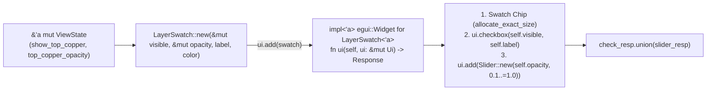

When inspecting a dense four-layer or six-layer board, toggling `TopCopper` completely off is often too blunt: you want to dim `TopCopper` to `50%` opacity so you can trace `BottomCopper` routing underneath it while still seeing the top-side pads in context.

In [Lesson 0013](./0013-drc-violation-overlay-and-minimap.html), we added DRC clearance halos and minimap clamping. Now, we close out **Act III** by replacing our four repetitive `ui.checkbox` calls with a custom, reusable [`egui::Widget`](https://docs.rs/egui/latest/egui/trait.Widget.html) called `LayerSwatch<'a>` that packages a painted colour chip, a visibility checkbox, and a per-layer opacity slider into a single `ui.add(LayerSwatch::new(...))` call—and we verify the widget in isolation using `egui_kittest::Harness::new_ui_state`.


_Figure 14.1: `LayerSwatch<'a>` temporarily borrows `visible: &'a mut bool` and `opacity: &'a mut f32` for the duration of the `ui.add(...)` call, consumes itself in `Widget::ui(self, ui)`, and returns the combined `egui::Response`._

## 1. Just-in-Time Rust: Struct Lifetimes (`'a`) & Implementing `egui::Widget`

Look at how `egui`'s built-in widgets work when you write `ui.add(egui::Slider::new(&mut self.opacity, 0.1..=1.0))`: `Slider::new` constructs a lightweight builder struct that holds a mutable reference `&'a mut f32` into your state, and `ui.add(...)` immediately consumes that struct by calling `egui::Widget::ui(self, ui)`.

Whenever a Rust `struct` stores references (`&'a mut bool`, `&'a mut f32`, `&'a str`), its declaration must name a generic **lifetime parameter** `<'a>` ([Rust Book §10.3](https://doc.rust-lang.org/book/ch10-03-lifetime-syntax.html)). That `'a` tells the compiler a simple safety rule: a `LayerSwatch<'a>` instance can never outlive the `ViewState` fields it borrows.{{sidenote:Because `LayerSwatch<'a>` is created inline inside `ui.add(LayerSwatch::new(...))` and consumed before the statement even ends, the borrow `'a` lasts for just a few microseconds during the current frame!}}

## 2. Per-Layer Alpha Blending & Standalone Widget Harnesses (`Harness::new_ui_state`)

To apply each layer's opacity slider to the 2D canvas, `PcbLayer::color_with_opacity(self, opacity: f32)` clamps `opacity` to `0.1..=1.0`, scales `255.0` to compute the 8-bit alpha channel, and constructs `Color32::from_rgba_unmultiplied(r, g, b, alpha)`.

Even better, because `LayerSwatch<'a>` implements `egui::Widget`, we don't have to boot the entire `PcbReviewerApp` just to unit-test it! We can mount `LayerSwatch` directly inside [`egui_kittest::Harness::new_ui_state`](https://docs.rs/egui_kittest/latest/egui_kittest/struct.Harness.html#method.new_ui_state) against a tiny two-field test fixture.

## 3. Code Walkthrough: Block by Block

Let's examine the new `color_with_opacity` and `opacity_badge` helpers, the `LayerSwatch<'a>` struct and `egui::Widget` implementation, `ViewState` opacity fields, and `Harness::new_ui_state` widget tests in `apps/0014-custom-layer-swatch-widget-and-design-tokens/src/main.rs` block by block before seeing the complete listing in context.

### Block 1: `PcbLayer::color_with_opacity` & `opacity_badge` Design Token Helpers

```rust
impl PcbLayer {
    // ... z_rank(self) & color(self) ...

    /// Scales the layer's base RGB color by `opacity` (clamped to `0.1..=1.0`).
    pub fn color_with_opacity(self, opacity: f32) -> Color32 {
        let base = self.color();
        let alpha = (opacity.clamp(0.1, 1.0) * 255.0).round() as u8;
        Color32::from_rgba_unmultiplied(base.r(), base.g(), base.b(), alpha)
    }
}

/// Formats a normalized `0.1..=1.0` opacity factor as a percentage badge (e.g. `"75%"`).
pub fn opacity_badge(opacity: f32) -> String {
    format!("{:.0}%", opacity.clamp(0.1, 1.0) * 100.0)
}
```

- **`opacity.clamp(0.1, 1.0)`**: Prevents an enabled layer from becoming completely invisible (`0.0` alpha) when dimmed; completely hiding a layer is the job of its visibility checkbox.
- **`(opacity.clamp(0.1, 1.0) * 255.0).round() as u8`**: Converts the normalized `0.1..=1.0` float into an 8-bit alpha channel (`26..=255`).
- **`Color32::from_rgba_unmultiplied(base.r(), base.g(), base.b(), alpha)`**: Preserves the layer's RGB channels while applying the computed alpha byte for semi-transparent trace, pad, and silkscreen rendering.
- **`opacity_badge(opacity: f32) -> String`**: Formats the clamped opacity as an integer percentage badge (`"10%"` to `"100%"`) displayed next to the slider.

### Block 2: `LayerSwatch<'a>` Builder & `impl<'a> egui::Widget for LayerSwatch<'a>`

```rust
/// Reusable custom `egui::Widget` combining a color swatch, a visibility checkbox,
/// and a per-layer opacity slider borrowing state with lifetime `'a`.
pub struct LayerSwatch<'a> {
    pub visible: &'a mut bool,
    pub opacity: &'a mut f32,
    pub label: &'a str,
    pub swatch_color: Color32,
}

impl<'a> LayerSwatch<'a> {
    pub fn new(
        visible: &'a mut bool,
        opacity: &'a mut f32,
        label: &'a str,
        swatch_color: Color32,
    ) -> Self {
        Self {
            visible,
            opacity,
            label,
            swatch_color,
        }
    }
}

impl<'a> egui::Widget for LayerSwatch<'a> {
    fn ui(self, ui: &mut egui::Ui) -> egui::Response {
        let badge = opacity_badge(*self.opacity);
        ui.horizontal(|ui| {
            let (swatch_rect, _) = ui.allocate_exact_size(vec2(12.0, 12.0), Sense::hover());
            ui.painter()
                .rect_filled(swatch_rect, 2.0_f32, self.swatch_color);
            let check_resp = ui.checkbox(self.visible, self.label);
            let slider_resp = ui.add(
                egui::Slider::new(self.opacity, 0.1..=1.0)
                    .show_value(false)
                    .text(badge),
            );
            check_resp.union(slider_resp)
        })
        .inner
    }
}
```

- **`pub struct LayerSwatch<'a>`**: Holds two mutable borrows (`visible: &'a mut bool`, `opacity: &'a mut f32`), one shared string slice (`label: &'a str`), and a `Copy` `Color32` token.
- **`fn ui(self, ui: &mut egui::Ui) -> egui::Response`**: Takes `self` **by value**, consuming the temporary `LayerSwatch<'a>` struct when passed to `ui.add(LayerSwatch::new(...))`.
- **`ui.allocate_exact_size(vec2(12.0, 12.0), Sense::hover())`**: Reserves a `12×12` logical-point square in the horizontal layout and paints the rounded `2.0_f32` colour swatch chip with `ui.painter().rect_filled(...)`.
- **`check_resp.union(slider_resp)` and `.inner`**: Merges the `egui::Response` of the checkbox and the slider (so callers of `ui.add(...)` can check `.changed()` or `.hovered()` on the composite widget) and unwraps `.inner` from `ui.horizontal(...)`'s `InnerResponse<Response>`.

### Block 3: `ViewState` Layer Opacities, `effective_layer_color` & `ui.add(LayerSwatch::new(...))`

```rust
pub struct ViewState {
    pub show_top_copper: bool,
    pub show_bottom_copper: bool,
    pub show_silkscreen: bool,
    pub show_ratsnest: bool,
    pub top_copper_opacity: f32,
    pub bottom_copper_opacity: f32,
    pub silkscreen_opacity: f32,
    pub ratsnest_opacity: f32,
    // ... viewport, selection, triage, DRC fields ...
}

impl ViewState {
    pub fn reset_layers(&mut self) {
        self.show_top_copper = true;
        self.show_bottom_copper = true;
        self.show_silkscreen = true;
        self.show_ratsnest = false;
        self.top_copper_opacity = 1.0;
        self.bottom_copper_opacity = 1.0;
        self.silkscreen_opacity = 1.0;
        self.ratsnest_opacity = 1.0;
    }

    pub fn layer_opacity(&self, layer: PcbLayer) -> f32 {
        match layer {
            PcbLayer::BottomCopper => self.bottom_copper_opacity,
            PcbLayer::TopCopper => self.top_copper_opacity,
            PcbLayer::Silkscreen => self.silkscreen_opacity,
            PcbLayer::Ratsnest => self.ratsnest_opacity,
        }
    }

    pub fn effective_layer_color(&self, layer: PcbLayer) -> Color32 {
        layer.color_with_opacity(self.layer_opacity(layer))
    }
}

// Inside PcbReviewerApp::render_side_panel():
        ui.heading("PCB Layers");
        ui.add(LayerSwatch::new(
            &mut self.view.show_top_copper,
            &mut self.view.top_copper_opacity,
            "Top Copper (F.Cu)",
            PcbLayer::TopCopper.color(),
        ));
        ui.add(LayerSwatch::new(
            &mut self.view.show_bottom_copper,
            &mut self.view.bottom_copper_opacity,
            "Bottom Copper (B.Cu)",
            PcbLayer::BottomCopper.color(),
        ));
        ui.add(LayerSwatch::new(
            &mut self.view.show_silkscreen,
            &mut self.view.silkscreen_opacity,
            "Silkscreen (F.SilkS)",
            PcbLayer::Silkscreen.color(),
        ));
        ui.add(LayerSwatch::new(
            &mut self.view.show_ratsnest,
            &mut self.view.ratsnest_opacity,
            "Ratsnest (Unrouted)",
            PcbLayer::Ratsnest.color(),
        ));
```

- **Disjoint Field Splitting (`&mut self.view.show_top_copper`, `&mut self.view.top_copper_opacity`)**: Rust's borrow checker tracks struct fields individually, so borrowing two distinct fields of `self.view` mutably at the same time inside `LayerSwatch::new(...)` is 100% legal!
- **`self.view.effective_layer_color(layer)`**: Combines `self.layer_opacity(layer)` with `layer.color_with_opacity(...)` so `paint_board` renders traces, pads, and silkscreen text with their per-layer alpha.

### Block 4: Standalone Widget Testing with `Harness::new_ui_state` (`#[cfg(test)] mod tests`)

```rust
    #[test]
    fn standalone_layer_swatch_widget_toggles_visibility_in_harness_new_ui() {
        struct SwatchFixture {
            visible: bool,
            opacity: f32,
        }

        let mut harness = Harness::new_ui_state(
            |ui, state: &mut SwatchFixture| {
                ui.add(LayerSwatch::new(
                    &mut state.visible,
                    &mut state.opacity,
                    "Top Copper (F.Cu)",
                    PcbLayer::TopCopper.color(),
                ));
            },
            SwatchFixture {
                visible: true,
                opacity: 0.75,
            },
        );

        assert!(harness.query_by_label("Top Copper (F.Cu)").is_some());
        assert!(harness.query_by_label("75%").is_some());

        harness.get_by_label("Top Copper (F.Cu)").click();
        harness.run();
        assert!(!harness.state().visible);
    }
```

- **`Harness::new_ui_state(|ui, state: &mut SwatchFixture| { ... }, initial_state)`**: Mounts a standalone `&mut egui::Ui` closure and a minimal `SwatchFixture` state struct without needing `eframe::App`, `Panel`s, or `BoardModel`.
- **Verifying Both Child Widgets**: Asserting `query_by_label("Top Copper (F.Cu)").is_some()` and `query_by_label("75%").is_some()` confirms that both the checkbox and the opacity slider badge render inside `LayerSwatch::ui`, and clicking the checkbox mutates `harness.state().visible` to `false`.

### Complete Lesson 0014 `LayerSwatch<'a>` & Alpha-Blending Listing

Here is the complete assembled `PcbLayer::color_with_opacity`, `LayerSwatch<'a>` widget implementation, `ViewState` opacity wiring, `Panel::left` and `paint_board` updates, and tests in context from `apps/0014-custom-layer-swatch-widget-and-design-tokens/src/main.rs`:

```rust
#[derive(Clone, Copy, Debug, PartialEq, Eq)]
pub enum PcbLayer {
    BottomCopper,
    TopCopper,
    Silkscreen,
    Ratsnest,
}

impl PcbLayer {
    pub fn z_rank(self) -> u8 {
        match self {
            PcbLayer::BottomCopper => 0,
            PcbLayer::TopCopper => 1,
            PcbLayer::Silkscreen => 2,
            PcbLayer::Ratsnest => 3,
        }
    }

    pub fn color(self) -> Color32 {
        match self {
            PcbLayer::BottomCopper => Color32::from_rgb(59, 142, 234),
            PcbLayer::TopCopper => Color32::from_rgb(224, 82, 67),
            PcbLayer::Silkscreen => Color32::from_rgb(240, 230, 140),
            PcbLayer::Ratsnest => Color32::from_rgb(111, 247, 255),
        }
    }

    /// Scales the layer's base RGB color by `opacity` (clamped to `0.1..=1.0`).
    pub fn color_with_opacity(self, opacity: f32) -> Color32 {
        let base = self.color();
        let alpha = (opacity.clamp(0.1, 1.0) * 255.0).round() as u8;
        Color32::from_rgba_unmultiplied(base.r(), base.g(), base.b(), alpha)
    }
}

/// Formats a normalized `0.1..=1.0` opacity factor as a percentage badge (e.g. `"75%"`).
pub fn opacity_badge(opacity: f32) -> String {
    format!("{:.0}%", opacity.clamp(0.1, 1.0) * 100.0)
}

/// Reusable custom `egui::Widget` combining a color swatch, a visibility checkbox,
/// and a per-layer opacity slider borrowing state with lifetime `'a`.
pub struct LayerSwatch<'a> {
    pub visible: &'a mut bool,
    pub opacity: &'a mut f32,
    pub label: &'a str,
    pub swatch_color: Color32,
}

impl<'a> LayerSwatch<'a> {
    pub fn new(
        visible: &'a mut bool,
        opacity: &'a mut f32,
        label: &'a str,
        swatch_color: Color32,
    ) -> Self {
        Self {
            visible,
            opacity,
            label,
            swatch_color,
        }
    }
}

impl<'a> egui::Widget for LayerSwatch<'a> {
    fn ui(self, ui: &mut egui::Ui) -> egui::Response {
        let badge = opacity_badge(*self.opacity);
        ui.horizontal(|ui| {
            let (swatch_rect, _) = ui.allocate_exact_size(vec2(12.0, 12.0), Sense::hover());
            ui.painter()
                .rect_filled(swatch_rect, 2.0_f32, self.swatch_color);
            let check_resp = ui.checkbox(self.visible, self.label);
            let slider_resp = ui.add(
                egui::Slider::new(self.opacity, 0.1..=1.0)
                    .show_value(false)
                    .text(badge),
            );
            check_resp.union(slider_resp)
        })
        .inner
    }
}

pub struct ViewState {
    pub show_top_copper: bool,
    pub show_bottom_copper: bool,
    pub show_silkscreen: bool,
    pub show_ratsnest: bool,
    pub top_copper_opacity: f32,
    pub bottom_copper_opacity: f32,
    pub silkscreen_opacity: f32,
    pub ratsnest_opacity: f32,
    // ... viewport, selection, triage, DRC fields ...
}

impl Default for ViewState {
    fn default() -> Self {
        let mut view = Self {
            show_top_copper: false,
            show_bottom_copper: false,
            show_silkscreen: false,
            show_ratsnest: false,
            top_copper_opacity: 0.0,
            bottom_copper_opacity: 0.0,
            silkscreen_opacity: 0.0,
            ratsnest_opacity: 0.0,
            viewport: BoardViewport::default(),
            pcb_scene_rect: Rect::from_min_max(pos2(0.0, 0.0), pos2(100.0, 70.0)),
            selected_component: None,
            hovered_net: None,
            selected_net: None,
            bom_search_query: String::new(),
            active_tool: ActiveTool::Select,
            selected_pin: None,
            min_pin_severity: PinSeverity::Info,
            filter_only_open_pins: false,
            min_clearance_mm: 8.0,
            show_drc_overlay: true,
        };
        view.reset_layers();
        view
    }
}

impl ViewState {
    pub fn reset_layers(&mut self) {
        self.show_top_copper = true;
        self.show_bottom_copper = true;
        self.show_silkscreen = true;
        self.show_ratsnest = false;
        self.top_copper_opacity = 1.0;
        self.bottom_copper_opacity = 1.0;
        self.silkscreen_opacity = 1.0;
        self.ratsnest_opacity = 1.0;
    }

    pub fn layer_opacity(&self, layer: PcbLayer) -> f32 {
        match layer {
            PcbLayer::BottomCopper => self.bottom_copper_opacity,
            PcbLayer::TopCopper => self.top_copper_opacity,
            PcbLayer::Silkscreen => self.silkscreen_opacity,
            PcbLayer::Ratsnest => self.ratsnest_opacity,
        }
    }

    pub fn effective_layer_color(&self, layer: PcbLayer) -> Color32 {
        layer.color_with_opacity(self.layer_opacity(layer))
    }

    // ... isolate_top_copper, show_all_layers, viewport, tool, pin & DRC methods ...
}

impl PcbReviewerApp {
    pub fn render_side_panel(&mut self, ui: &mut egui::Ui) {
        ui.heading("PCB Layers");
        ui.add(LayerSwatch::new(
            &mut self.view.show_top_copper,
            &mut self.view.top_copper_opacity,
            "Top Copper (F.Cu)",
            PcbLayer::TopCopper.color(),
        ));
        ui.add(LayerSwatch::new(
            &mut self.view.show_bottom_copper,
            &mut self.view.bottom_copper_opacity,
            "Bottom Copper (B.Cu)",
            PcbLayer::BottomCopper.color(),
        ));
        ui.add(LayerSwatch::new(
            &mut self.view.show_silkscreen,
            &mut self.view.silkscreen_opacity,
            "Silkscreen (F.SilkS)",
            PcbLayer::Silkscreen.color(),
        ));
        ui.add(LayerSwatch::new(
            &mut self.view.show_ratsnest,
            &mut self.view.ratsnest_opacity,
            "Ratsnest (Unrouted)",
            PcbLayer::Ratsnest.color(),
        ));

        // ... Isolate/Show All, BOM Inspector, Review Pins & Triage, DRC & Minimap, Net Inspector ...
    }

    fn paint_board(&self, painter: &egui::Painter, canvas_rect: Rect) {
        // ... board outline ...

        for seg in &self.visible_traces_in_z_order() {
            let p0 = self.view.viewport.world_to_screen(seg.start);
            let p1 = self.view.viewport.world_to_screen(seg.end);
            let is_highlighted = active.is_some() && seg.net == active;
            let color = if is_highlighted {
                Color32::from_rgb(255, 230, 100)
            } else {
                self.view.effective_layer_color(seg.layer)
            };
            let stroke_px = (seg.width_mm * scale).max(1.5) * if is_highlighted { 1.4 } else { 1.0 };
            painter.line_segment([p0, p1], Stroke::new(stroke_px, color));
        }

        for pad in &self.board.pads {
            if !self.view.is_layer_visible(pad.layer) {
                continue;
            }
            let bounds = pad.bounds_mm();
            let screen_rect = Rect::from_min_max(
                self.view.viewport.world_to_screen(bounds.min),
                self.view.viewport.world_to_screen(bounds.max),
            );
            let is_highlighted = active == Some(pad.net);
            let fill = if is_highlighted {
                Color32::from_rgb(255, 230, 100)
            } else {
                self.view.effective_layer_color(pad.layer)
            };
            painter.rect_filled(screen_rect, 0.3 * scale, fill);
        }

        if self.view.show_silkscreen {
            let silk_color = self.view.effective_layer_color(PcbLayer::Silkscreen);
            // ... paint silkscreen component bodies & RefDes labels ...
        }

        // ... DRC halos, review pins & ruler overlay ...
    }
}

#[cfg(test)]
mod tests {
    use super::*;
    use egui_kittest::{Harness, kittest::Queryable};

    #[test]
    fn pcb_layer_ranks_colors_and_opacities_are_distinct() {
        assert_eq!(PcbLayer::BottomCopper.z_rank(), 0);
        assert_eq!(PcbLayer::TopCopper.z_rank(), 1);
        assert_eq!(PcbLayer::Silkscreen.z_rank(), 2);
        assert_eq!(PcbLayer::Ratsnest.z_rank(), 3);

        assert_eq!(
            PcbLayer::TopCopper.color_with_opacity(0.0),
            Color32::from_rgba_unmultiplied(224, 82, 67, 26)
        );
        assert_eq!(
            PcbLayer::TopCopper.color_with_opacity(0.5),
            Color32::from_rgba_unmultiplied(224, 82, 67, 128)
        );
        assert_eq!(
            PcbLayer::TopCopper.color_with_opacity(2.0),
            Color32::from_rgba_unmultiplied(224, 82, 67, 255)
        );

        assert_eq!(opacity_badge(0.0), "10%");
        assert_eq!(opacity_badge(0.75), "75%");
        assert_eq!(opacity_badge(1.5), "100%");

        let mut view = ViewState::default();
        view.bottom_copper_opacity = 0.4;
        view.top_copper_opacity = 0.5;
        view.silkscreen_opacity = 0.6;
        view.ratsnest_opacity = 0.8;

        assert_eq!(view.layer_opacity(PcbLayer::BottomCopper), 0.4);
        assert_eq!(view.layer_opacity(PcbLayer::TopCopper), 0.5);
        assert_eq!(view.layer_opacity(PcbLayer::Silkscreen), 0.6);
        assert_eq!(view.layer_opacity(PcbLayer::Ratsnest), 0.8);
        assert_eq!(
            view.effective_layer_color(PcbLayer::TopCopper),
            Color32::from_rgba_unmultiplied(224, 82, 67, 128)
        );
    }

    #[test]
    fn standalone_layer_swatch_widget_toggles_visibility_in_harness_new_ui() {
        struct SwatchFixture {
            visible: bool,
            opacity: f32,
        }

        let mut harness = Harness::new_ui_state(
            |ui, state: &mut SwatchFixture| {
                ui.add(LayerSwatch::new(
                    &mut state.visible,
                    &mut state.opacity,
                    "Top Copper (F.Cu)",
                    PcbLayer::TopCopper.color(),
                ));
            },
            SwatchFixture {
                visible: true,
                opacity: 0.75,
            },
        );

        assert!(harness.query_by_label("Top Copper (F.Cu)").is_some());
        assert!(harness.query_by_label("75%").is_some());

        harness.get_by_label("Top Copper (F.Cu)").click();
        harness.run();
        assert!(!harness.state().visible);
    }
}
```

{{widget:layer-swatch-sim}}

:::exercise id="ex-0014" title="Interactive Lab 2: Implement `egui::Widget` for `LayerSwatch<'a>`" badge="Lifetime 'a • egui::Widget • Response::union"
Fill in the three blanks below to (1) declare the `'a` lifetime on `impl<'a> egui::Widget for LayerSwatch<'a>`, (2) write the `fn ui(self, ui: &mut egui::Ui) -> egui::Response` signature, and (3) combine the checkbox and slider responses with `.union(slider_resp)`:

```rust
impl<'a> {{blank:egui::Widget||Widget|Implement the `egui::Widget` trait for `LayerSwatch<'a>`.|/* 1: trait */|130px}} for LayerSwatch<'a> {
    fn {{blank:ui(self, ui: &mut egui::Ui)|Define `ui(self, ui: &mut egui::Ui)` taking ownership of `self`.|/* 2: fn ui(...) */|230px}} -> egui::Response {
        let badge = opacity_badge(*self.opacity);
        ui.horizontal(|ui| {
            let (swatch_rect, _) = ui.allocate_exact_size(vec2(12.0, 12.0), Sense::hover());
            ui.painter()
                .rect_filled(swatch_rect, 2.0_f32, self.swatch_color);
            let check_resp = ui.checkbox(self.visible, self.label);
            let slider_resp = ui.add(
                egui::Slider::new(self.opacity, 0.1..=1.0)
                    .show_value(false)
                    .text(badge),
            );
            check_resp.{{blank:union(slider_resp)|Combine `check_resp` and `slider_resp` using `union(slider_resp)`.|/* 3: union */|165px}}
        })
        .inner
    }
}
```
:::prompts
hint: **Hints:** (1) `egui::Widget`. (2) `ui(self, ui: &mut egui::Ui)`. (3) `union(slider_resp)`.
success: **Bravo!** You have implemented `egui::Widget` on a lifetime-parameterised builder struct and merged child widget `Response`s with `.union(...)`.
:::
:::

:::verify id="verify-0014" title="Interactive Lab 3: Testing `LayerSwatch<'a>` in Isolation with `Harness::new_ui_state`" badge="cargo test + cargo mutants" tier="Tier 2 + 6: Custom Widget & Opacity" caught="134 Caught (21 Unviable)" missed="0 Missed"
In `apps/0014-custom-layer-swatch-widget-and-design-tokens`, we test `LayerSwatch::new` both in isolation via `Harness::new_ui_state` and inside the full `PcbReviewerApp` `Panel::left`:

```rust
#[test]
fn standalone_layer_swatch_widget_toggles_visibility_in_harness_new_ui() {
    struct SwatchFixture {
        visible: bool,
        opacity: f32,
    }

    let mut harness = Harness::new_ui_state(
        |ui, state: &mut SwatchFixture| {
            ui.add(LayerSwatch::new(
                &mut state.visible,
                &mut state.opacity,
                "Top Copper (F.Cu)",
                PcbLayer::TopCopper.color(),
            ));
        },
        SwatchFixture {
            visible: true,
            opacity: 0.75,
        },
    );

    assert!(harness.query_by_label("Top Copper (F.Cu)").is_some());
    assert!(harness.query_by_label("75%").is_some());

    harness.get_by_label("Top Copper (F.Cu)").click();
    harness.run();
    assert!(!harness.state().visible);
}
```

- [ ] **1. Run `cargo test` in `apps/0014-custom-layer-swatch-widget-and-design-tokens`:** Confirm all 24 unit + headless `egui_kittest` tests pass.
- [ ] **2. Run `cargo mutants --in-place`:** Verify that all viable mutants across Act I, Act II, and Act III (`0001`–`0014) are **Caught** with **0 Missed**.
:::

:::quiz id="quiz-0014" title="Retrieval Practice: Struct Lifetimes (`'a`), `egui::Widget` & `Harness::new_ui_state`"
Q: What does the `'a` lifetime parameter in `pub struct LayerSwatch<'a>` express to the Rust compiler?
- [x] Widget cannot outlive borrowed state fields
- [ ] Struct fields allocate permanent static memory
- [ ] Opacity sliders copy booleans onto heap
- [ ] Closures outlive the root application window
why: The `'a` lifetime parameter ties the `LayerSwatch<'a>` instance to the lifetime of the `visible`, `opacity`, and `label` references it borrows.
hint: Think about what happens if a struct holding `&'a mut bool` lived longer than the boolean it points to.

Q: What method signature is required to implement the `egui::Widget` trait for `LayerSwatch<'a>`?
- [ ] fn update borrowing mutable self reference
- [x] fn ui consuming self returning Response
- [ ] fn paint taking immutable painter reference
- [ ] fn default returning boxed trait object
why: `egui::Widget` defines a single method `fn ui(self, ui: &mut egui::Ui) -> egui::Response` that consumes the widget builder and returns its `Response`.
hint: Check how `ui.add(widget)` invokes `egui::Widget`.

Q: How does `Harness::new_ui_state` differ from `Harness::new_eframe` when testing a custom `egui::Widget`?
- [ ] Compiling shaders for web assembly targets
- [ ] Spawning native threads for background parsing
- [x] Mounting standalone widgets against minimal state
- [ ] Disabling mutation checks on widget traits
why: `Harness::new_ui_state` mounts a single `|ui, state|` closure directly without needing a full `eframe::App` shell.
hint: Look at the `SwatchFixture` struct passed into `Harness::new_ui_state` in Lab 3.
:::

## Recommended Primary Source

:::callout
**Read (5 mins):** [`egui::Widget` Trait Official API Docs](https://docs.rs/egui/latest/egui/trait.Widget.html) and [The Rust Programming Language — §10.3 "Validating References with Lifetimes"](https://doc.rust-lang.org/book/ch10-03-lifetime-syntax.html).
:::

:::teacher-prompt
**Act III Complete!** You have turned the Schematic & PCB Viewer into an interactive engineering Design Review System with anchored `HashMap` review pins, floating `egui::Window` callouts, `Open` → `Resolved` → `Verified` triage state machines, DRC copper clearance halos, clamped minimap camera bounds, and a custom `LayerSwatch<'a>` widget implementing `egui::Widget`—all verified with 0 missed mutants. Continue to [Lesson 0015: Multi-Crate Workspace — Separating `pcb-doc` (`L1`) from `pcb-reviewer` (`L6`)](./0015-multi-crate-workspace-doc-vs-ui-egui.html) to begin **Act IV (`0015`–`0018`): Scaling Up — Engine-First Architecture & Persistence**!
:::
