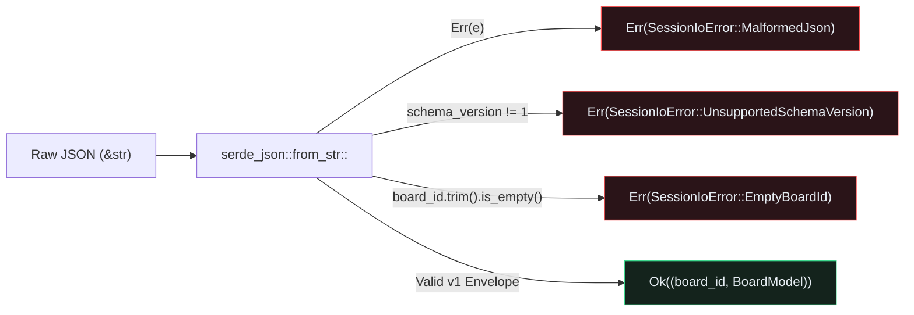

## Versioned Envelope Persistence and Exhaustive Destructuring

A hardware design review tool is only useful if engineers can save their review pins (`ReviewNote` status, severity, author, and millimetre coordinates) to a file, share it in a pull request, and reload it without losing state.{{sidenote: **Why Wrap `BoardModel` in `ReviewSessionEnvelope`?** Serializing a raw `BoardModel` directly leaves no metadata to detect format changes later. Wrapping it in `ReviewSessionEnvelope { schema_version: 1, board_id, board }` lets `from_session_json` reject incompatible schema versions with a clear, typed error before touching application state.}}

Because `pcb-doc` (`L1`) owns all domain types, adding persistence requires zero changes to our `egui` rendering code:

1. **Enable `emath`'s `"serde"` feature**: In `crates/pcb-doc/Cargo.toml`, `emath = { version = "0.33", features = ["serde"] }` enables `Serialize` and `Deserialize` on `Pos2`, `Vec2`, and `Rect`.
2. **Define a typed `SessionIoError` with `thiserror`**: Instead of returning opaque strings or panicking on corrupt files, `SessionIoError` models three explicit failure modes: `EmptyBoardId`, `UnsupportedSchemaVersion { found, expected }`, and `MalformedJson(String)`.
3. **Destructure `ReviewSessionEnvelope` exhaustively**: In `BoardModel::from_session_json`, we unpack `let ReviewSessionEnvelope { schema_version, board_id, board } = ...` *without* `..` so adding any new envelope field in the future triggers a compiler error until validation is wired.



## Non-Destructive Error Recovery in `egui::SidePanel::right`

When a user attempts to load a corrupt or incompatible JSON file in `PcbReviewerApp::import_session_from_json(&mut self, raw: &str)`, the UI must **never** overwrite `self.board` with partial data or crash.{{sidenote: **Why `SidePanel::right("session_panel")`?** Placing session persistence, snapshot controls, and error banners in a dedicated right-hand inspector panel keeps the left layer/BOM panel (`SidePanel::left`) and top cross-probe bar (`TopBottomPanel::top`) within their vertical and horizontal layout budgets inside `800x600` viewports.}} On `Err(err)`, `import_session_from_json` leaves `self.board` untouched, stores `Some(err.to_string())` in `self.view.last_io_error`, and renders a dismissible `"I/O Error: ..."` banner inside `SidePanel::right("session_panel")`.

```rust caption="Typed SessionIoError and exhaustive envelope validation in crates/pcb-doc/src/lib.rs"
pub const CURRENT_SCHEMA_VERSION: u32 = 1;

#[derive(Clone, Debug, Error, PartialEq, Eq)]
pub enum SessionIoError {
    #[error("board_id must not be empty")]
    EmptyBoardId,
    #[error("unsupported schema_version {found} (expected {expected})")]
    UnsupportedSchemaVersion { found: u32, expected: u32 },
    #[error("malformed session JSON: {0}")]
    MalformedJson(String),
}

impl BoardModel {
    pub fn from_session_json(raw: &str) -> Result<(String, Self), SessionIoError> {
        let ReviewSessionEnvelope {
            schema_version,
            board_id,
            board,
        } = serde_json::from_str::<ReviewSessionEnvelope>(raw)
            .map_err(|e| SessionIoError::MalformedJson(e.to_string()))?;

        if schema_version != CURRENT_SCHEMA_VERSION {
            return Err(SessionIoError::UnsupportedSchemaVersion {
                found: schema_version,
                expected: CURRENT_SCHEMA_VERSION,
            });
        }
        let trimmed = board_id.trim();
        if trimmed.is_empty() {
            return Err(SessionIoError::EmptyBoardId);
        }
        Ok((trimmed.to_owned(), board))
    }
}
```

{{widget:serde-session-sim}}

:::exercise id="ex0015" title="Interactive Lab 2: Validate `ReviewSessionEnvelope` and Surface `last_io_error`" badge="Skill Practice • serde & thiserror"
Complete `BoardModel::from_session_json` and `PcbReviewerApp::import_session_from_json` so invalid schema versions or malformed JSON return typed errors and populate `self.view.last_io_error` without overwriting `self.board`.

```rust
pub fn from_session_json(raw: &str) -> Result<(String, Self), SessionIoError> {
    let ReviewSessionEnvelope {
        schema_version,
        board_id,
        board,
    } = serde_json::{{blank:from_str::<ReviewSessionEnvelope>(raw);;from_str(raw)|Deserialize ReviewSessionEnvelope from the raw JSON &str|from_str(...)|295px}}
        .map_err(|e| SessionIoError::MalformedJson(e.to_string()))?;

    if schema_version != {{blank:CURRENT_SCHEMA_VERSION|Compare schema_version against CURRENT_SCHEMA_VERSION|CURRENT_SCHEMA_VERSION|215px}} {
        return Err(SessionIoError::UnsupportedSchemaVersion {
            found: schema_version,
            expected: CURRENT_SCHEMA_VERSION,
        });
    }
    Ok((board_id.trim().to_owned(), board))
}

pub fn import_session_from_json(&mut self, raw: &str) -> bool {
    match BoardModel::from_session_json(raw) {
        Ok((board_id, board)) => {
            self.view.active_board_id = board_id;
            self.board = board;
            self.view.last_io_error = {{blank:None|Clear last_io_error on a successful import|None|85px}};
            true
        }
        Err(err) => {
            self.view.last_io_error = Some(err.to_string());
            false
        }
    }
}
```

:::prompts
hint: Call `serde_json::from_str::<ReviewSessionEnvelope>(raw)` (or `from_str(raw)`), compare against `CURRENT_SCHEMA_VERSION`, and set `self.view.last_io_error = None` when loading succeeds.
success: Nice work! Corrupt or incompatible JSON files are caught at the boundary and reported in the UI without panicking or corrupting `self.board`.
:::
:::

:::verify id="verify-0015" title="Lab 3: Session JSON Round-Trip & Error Recovery Gate (`0015`)" badge="cargo test --workspace + cargo mutants" tier="Tier 2 + Tier 3 + Tier 4" caught="155 / 155 (100%)" missed="0 Missed"
Verify that valid sessions round-trip losslessly (`loaded_board == original`) and that every error branch (`EmptyBoardId`, `UnsupportedSchemaVersion`, `MalformedJson`) and UI button (`"Export JSON"`, `"Reload JSON"`, `"Test Corrupt JSON"`, `"Dismiss Error"`) is mutation-covered:

```bash caption="Run workspace tests and verify serde persistence mutants"
cargo test --manifest-path ./apps/0015-loading-board-and-review-files-serde/Cargo.toml --workspace
cargo mutants --manifest-path ./apps/0015-loading-board-and-review-files-serde/Cargo.toml --workspace --in-place -F "to_session_json|from_session_json|export_session_snapshot|import_session_from_json|dismiss_io_error|render_session_panel"
```

- [ ] `cargo test --manifest-path ./apps/0015-loading-board-and-review-files-serde/Cargo.toml --workspace` passes all **12 tests** (**6** in `pcb-doc` and **6** in `pcb-reviewer`).
- [ ] `session_json_round_trip_and_typed_validation_errors_are_lossless` verifies exact equality after `to_session_json` → `from_session_json` and asserts all three `SessionIoError` variants.
- [ ] `cargo mutants` catches all **11 new persistence & UI mutants** (`5/5` in `pcb-doc`, `6/6` in `pcb-reviewer`), bringing the workspace total to **155 / 155 viable mutants caught (0 missed)**.
:::

:::quiz id="quiz-0015"
Q: How do we enable `serde::Serialize` and `serde::Deserialize` on `emath::Pos2` and `emath::Vec2` in `pcb-doc`?
- [ ] By writing custom unsafe transmute implementations inside the binary crate
- [x] By enabling the `serde` Cargo feature on the `emath` dependency
- [ ] By converting every millimetre coordinate into a formatted string first
- [ ] By linking the `egui_glow` desktop shader compiler into `crates/pcb-doc` directly
why: `emath = { version = "0.33", features = ["serde"] }` provides upstream `Serialize` and `Deserialize` implementations for `Pos2`, `Vec2`, `Rect`, and `TSTransform`.
hint: Check `[dependencies]` in `apps/0015-loading-board-and-review-files-serde/crates/pcb-doc/Cargo.toml`.

Q: Why does `BoardModel::from_session_json` destructure `ReviewSessionEnvelope` without `..`?
- [ ] To allow `serde_json` to skip syntax checks on truncated strings
- [x] To trigger compiler errors whenever new envelope fields are added
- [ ] To prevent `thiserror` from formatting display messages on any errors
- [ ] To automatically compress JSON strings into binary Zstandard archive blobs
why: Exhaustive struct destructuring (`let ReviewSessionEnvelope { schema_version, board_id, board } = ...`) guarantees at compile time that no newly added envelope field is silently ignored during deserialization.
hint: Look at lines 486–490 of `crates/pcb-doc/src/lib.rs`.

Q: What happens in `PcbReviewerApp::import_session_from_json` when `BoardModel::from_session_json` returns `Err(err)`?
- [ ] The application panics immediately and closes the native desktop window
- [ ] The existing board is cleared to an empty default state
- [x] The active board remains untouched and `last_io_error` stores the message
- [ ] The schema version constant is overwritten to match the input
why: Non-destructive error handling preserves `self.board` and `self.view.active_board_id` when an import fails, surfacing `Some(err.to_string())` in `self.view.last_io_error` so the user can inspect and dismiss the banner.
hint: Trace the `Err(err)` arm in `PcbReviewerApp::import_session_from_json`.
:::

## Recommended Primary Source

:::callout
**Read (5 mins):** [Serde Official Documentation — "Using Derive"](https://serde.rs/derive.html) and [`thiserror` Crate Documentation](https://docs.rs/thiserror/latest/thiserror/).
:::

:::teacher-prompt
Next up: [Lesson 0016: Copy-on-Write Document Snapshots with `Arc<Vec<T>>` and `Arc::make_mut`](./0016-copy-on-write-arc-document-snapshots.html), where we upgrade `BoardModel` so taking a snapshot of 10,000+ pads and traces costs only four `O(1)` atomic reference-count increments!
:::
