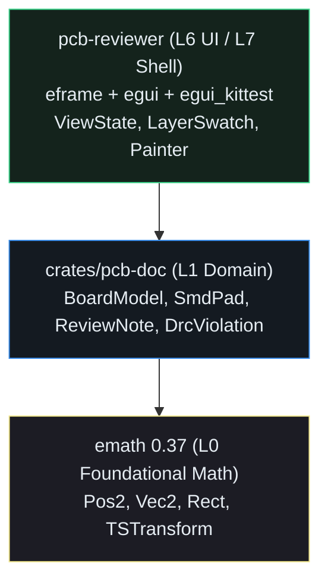

## Why Engine-First `egui` Apps Split Domain State into `L1` Crates

In Lessons `0001` through `0014`, our `BoardModel` (`traces`, `pads`, `components`, `review_pins`, and DRC clearance math) lived in the same `src/main.rs` binary crate as `ViewState` and `PcbReviewerApp`. That kept early lessons compact, but every single edit to a pure domain function—like `pad_edge_gap_mm` or `ReviewStatus::can_transition_to`—forced `rustc` and `cargo-mutants` to re-link the entire `eframe` + `egui` + windowing stack.{{sidenote: **Strict L0–L7 Layering:** Production `egui` CAD and graphics workspaces organize crates into a strict directed acyclic graph (DAG): `L0` foundational math (`emath`), `L1` pure document model (`pcb-doc`), `L2`–`L5` file formats and command engines, `L6` reusable `egui` widgets/panels, and `L7` native/Wasm shell binaries.}}

By refactoring `./apps/0015-multi-crate-workspace-doc-vs-ui-egui` into a Cargo `[workspace]` with two crates:

1. **`crates/pcb-doc` (`L1` Domain Crate)**: Depends *only* on `emath = "0.37"` for `Pos2`, `Vec2`, and `Rect`. It contains zero `egui`, `eframe`, `winit`, or `Color32` types. For layer colors, `PcbLayer::rgb(self) -> (u8, u8, u8)` returns a UI-agnostic RGB tuple that `pcb-reviewer` bridges into `egui::Color32`.
2. **`pcb-reviewer` (`L6`/`L7` UI Crate)**: Depends on `pcb-doc = { path = "crates/pcb-doc" }`, `eframe = "0.37"`, and `egui_kittest = "0.37"`. It owns `ViewState`, `BoardViewport`, `LayerSwatch<'a>`, and the `eframe::App` shell.

Scaffold the library crate and wire its dependencies with `cargo new --lib` and `cargo add`:

```console
cargo new --lib crates/pcb-doc
cargo add --package pcb-doc emath
cargo add --path crates/pcb-doc
```

Here are the resulting `crates/pcb-doc/Cargo.toml` and root workspace `Cargo.toml`:

```toml caption="crates/pcb-doc/Cargo.toml"
[package]
name = "pcb-doc"
version = "0.1.0"
edition = "2024"

[lints]
workspace = true

[dependencies]
emath = "0.37"
```

```toml caption="Cargo.toml (Root Workspace & UI Crate)"
[workspace]
resolver = "3"
members = ["crates/pcb-doc"]

[workspace.lints.rust]
unsafe_code = "forbid"

[workspace.lints.clippy]
unwrap_used = "deny"
expect_used = "deny"
panic = "deny"
todo = "deny"
unimplemented = "deny"

[package]
name = "pcb-reviewer"
version = "0.1.0"
edition = "2024"

[lints]
workspace = true

[dependencies]
eframe = "0.37"
pcb-doc = { path = "crates/pcb-doc" }

[dev-dependencies]
egui_kittest = { version = "0.37", features = ["eframe"] }

# Optimize dependencies (like egui/eframe) even in debug builds so our
# 2D PCB canvas renders at 60 FPS while keeping our own code fast to compile.
[profile.dev.package."*"]
opt-level = 2
```



## Enforcing Layer Boundaries and Panic-Free Domain Code: Block by Block

A multi-crate workspace only stays clean if upward dependency leaks are caught automatically.{{sidenote: **Tier 1 Static & Manifest Gates:** Checking `include_str!("../Cargo.toml")` inside a unit test—or running an `xtask` workspace auditor—prevents an accidental `cargo add egui` inside `crates/pcb-doc` from silently coupling domain logic to UI rendering.}} Let's walk through the new workspace boundary code across `crates/pcb-doc/src/lib.rs` and `src/main.rs` one block at a time, then view the assembled listing in context.

### Block 1: Crate-Level Safety Lints, `emath` Re-Exports & Tier 1 Manifest Gate (`crates/pcb-doc/src/lib.rs`)

```rust
#![forbid(unsafe_code)]
#![deny(
    clippy::unwrap_used,
    clippy::expect_used,
    clippy::panic,
    clippy::unimplemented,
    clippy::todo,
    clippy::unreachable
)]

use std::collections::{HashMap, hash_map::Entry};

pub use emath::{Pos2, Rect, TSTransform, Vec2, pos2, vec2};

/// Layer L1 (`pcb-doc`) must never depend on UI or windowing crates (`L6+`).
pub const FORBIDDEN_UI_DEPS_BELOW_L6: &[&str] =
    &["egui", "eframe", "winit", "egui_kittest", "rfd"];

/// Verifies that an `L1` domain crate's `Cargo.toml` does not depend on any `L6+` UI crate.
pub fn validate_l1_manifest_no_ui_deps(cargo_toml: &str) -> Result<(), &'static str> {
    for &forbidden in FORBIDDEN_UI_DEPS_BELOW_L6 {
        let key_eq = format!("{forbidden} =");
        let key_dot = format!("dependencies.{forbidden}");
        if cargo_toml.contains(&key_eq) || cargo_toml.contains(&key_dot) {
            return Err(forbidden);
        }
    }
    Ok(())
}
```

- **`#![forbid(unsafe_code)]` & `#![deny(clippy::unwrap_used, ...)]`**: Inner attributes (`#![...]`) apply to the entire `pcb-doc` crate. Forbidding `unsafe` and denying `.unwrap()`, `.expect()`, `panic!()`, `todo!()`, `unimplemented!()`, and `unreachable!()` guarantees at compile time that no domain query can crash the host application.
- **`pub use emath::{Pos2, Rect, TSTransform, Vec2, pos2, vec2};`**: Re-exports the foundational `L0` 2D geometry primitives directly from `pcb_doc` so downstream crates (`pcb-reviewer`) can import both domain structs and coordinate types from a single boundary.
- **`FORBIDDEN_UI_DEPS_BELOW_L6: &[&str]`**: A compile-time slice of static string slices listing every `L6`/`L7` UI or windowing crate that must never appear in an `L1` manifest.
- **`validate_l1_manifest_no_ui_deps(cargo_toml: &str) -> Result<(), &'static str>`**: Iterates over `FORBIDDEN_UI_DEPS_BELOW_L6` (using pattern `&forbidden` to copy each `&'static str` out of the slice reference) and checks both inline (`egui = ...`) and table (`[dependencies.egui]`) TOML forms, returning `Err(forbidden)` immediately if a violation is detected.

### Block 2: UI-Agnostic Layer RGB Tokens & `pub(crate)` Sample Builders (`crates/pcb-doc/src/lib.rs`)

```rust
#[derive(Clone, Copy, Debug, PartialEq, Eq)]
pub enum PcbLayer {
    BottomCopper,
    TopCopper,
    Silkscreen,
    Ratsnest,
}

impl PcbLayer {
    pub fn z_rank(self) -> u8 {
        match self {
            PcbLayer::BottomCopper => 0,
            PcbLayer::TopCopper => 1,
            PcbLayer::Silkscreen => 2,
            PcbLayer::Ratsnest => 3,
        }
    }

    /// UI-agnostic RGB triple `(r, g, b)` for each layer in `L1` domain state.
    pub fn rgb(self) -> (u8, u8, u8) {
        match self {
            PcbLayer::BottomCopper => (59, 142, 234),
            PcbLayer::TopCopper => (224, 82, 67),
            PcbLayer::Silkscreen => (240, 230, 140),
            PcbLayer::Ratsnest => (111, 247, 255),
        }
    }
}

pub(crate) fn sample_traces() -> Vec<TraceSegment> {
    // ... builds the default 6 copper, silkscreen, and ratsnest segments ...
}
```

- **`PcbLayer::rgb(self) -> (u8, u8, u8)`**: Replaces the old `egui::Color32` return type in `L1` with a pure Rust 3-tuple of `u8` channels `(r, g, b)`. This preserves deterministic color metadata inside `pcb-doc` without depending on `egui`/`ecolor`.
- **`pub(crate) fn sample_traces()` (and `sample_pads`, `sample_components`, `sample_review_pins`)**: Restricts the internal sample fixture builders to `crates/pcb-doc` using `pub(crate)` visibility so external callers construct boards cleanly through `BoardModel::default()`.

### Block 3: Bridging `pcb-doc` (`L1`) into `pcb-reviewer` (`L6` / `L7`) (`src/main.rs`)

```rust
use eframe::egui::{self, Align2, Color32, FontId, Sense, Stroke, StrokeKind};
pub use pcb_doc::{
    BoardModel, ComponentSymbol, DrcViolation, FORBIDDEN_UI_DEPS_BELOW_L6, NetId, PcbLayer, PinId,
    PinSeverity, Pos2, Rect, ReviewNote, ReviewStatus, RulerMeasurement, SmdPad, TSTransform,
    TraceSegment, Vec2, pad_edge_gap_mm, pos2, validate_l1_manifest_no_ui_deps, vec2,
};

/// Converts the UI-agnostic `L1` `PcbLayer::rgb()` tuple into an `egui::Color32` in `L6`.
pub fn layer_color(layer: PcbLayer) -> Color32 {
    let (r, g, b) = layer.rgb();
    Color32::from_rgb(r, g, b)
}

/// Scales the layer's base RGB color by `opacity` (clamped to `0.1..=1.0`).
pub fn layer_color_with_opacity(layer: PcbLayer, opacity: f32) -> Color32 {
    let (r, g, b) = layer.rgb();
    let alpha = (opacity.clamp(0.1, 1.0) * 255.0).round() as u8;
    Color32::from_rgba_unmultiplied(r, g, b, alpha)
}
```

- **`pub use pcb_doc::{ ... };`**: Imports the pure domain model (`BoardModel`, `SmdPad`, `ReviewNote`, `DrcViolation`, etc.) from `crates/pcb-doc` into the `pcb-reviewer` binary crate.
- **`layer_color(layer: PcbLayer) -> Color32`**: Unpacks `let (r, g, b) = layer.rgb();` from `L1` and converts it into an `egui::Color32` via `Color32::from_rgb(r, g, b)` right at the `L6` UI boundary.
- **`layer_color_with_opacity(layer: PcbLayer, opacity: f32) -> Color32`**: Combines `layer.rgb()` with a clamped alpha byte `(opacity.clamp(0.1, 1.0) * 255.0).round() as u8` using `Color32::from_rgba_unmultiplied(r, g, b, alpha)`.
- **Top Schematic Bar Badge (`render_schematic_bar`)**: Appends `ui.separator();` and `ui.label("Architecture: pcb-doc (L1) -> pcb-reviewer (L6)");` to `render_schematic_bar` so the workspace architecture is visible in the top bar and verifiable via `egui_kittest`.

### Block 4: Tier 1 Manifest Gate & Cross-Crate Bridge Tests (`crates/pcb-doc/src/lib.rs` & `src/main.rs`)

```rust
// In crates/pcb-doc/src/lib.rs:
#[cfg(test)]
#[allow(clippy::unwrap_used, clippy::expect_used, clippy::panic)]
mod tests {
    use super::*;

    #[test]
    fn l1_manifest_gate_rejects_ui_dependencies_and_accepts_pcb_doc_manifest() {
        let actual_manifest = include_str!("../Cargo.toml");
        assert_eq!(validate_l1_manifest_no_ui_deps(actual_manifest), Ok(()));

        assert_eq!(
            validate_l1_manifest_no_ui_deps("[dependencies]\neframe = \"0.37\""),
            Err("eframe")
        );
        assert_eq!(
            validate_l1_manifest_no_ui_deps("[dependencies.egui]\nversion = \"0.37\""),
            Err("egui")
        );
    }

    #[test]
    fn net_id_and_layer_metadata_are_deterministic() {
        assert_eq!(PcbLayer::BottomCopper.rgb(), (59, 142, 234));
        assert_eq!(PcbLayer::TopCopper.rgb(), (224, 82, 67));
        assert_eq!(PcbLayer::Silkscreen.rgb(), (240, 230, 140));
        assert_eq!(PcbLayer::Ratsnest.rgb(), (111, 247, 255));
    }
}
```

- **`#[cfg(test)] #[allow(clippy::unwrap_used, clippy::expect_used, clippy::panic)]`**: Scopes test-assertion ergonomics (`assert_eq!`, `.unwrap()`) strictly to the `#[cfg(test)]` module while keeping production code above it 100% panic-free.
- **`include_str!("../Cargo.toml")`**: Embeds `crates/pcb-doc/Cargo.toml` as a `&'static str` at compile time so `validate_l1_manifest_no_ui_deps(actual_manifest)` verifies the real `L1` manifest on every `cargo test` run, alongside synthetic `[dependencies]\neframe = "0.37"` and `[dependencies.egui]` negative tests.

### Complete Layer Boundary & UI Bridge Listing (`crates/pcb-doc/src/lib.rs` & `src/main.rs`)

Putting the `L1` domain boundary in `crates/pcb-doc/src/lib.rs` and the `L6` UI bridge in `src/main.rs` together in context:

```rust caption="Assembled L1 boundary in crates/pcb-doc/src/lib.rs and L6 color bridge in src/main.rs"
// === crates/pcb-doc/src/lib.rs (L1 Pure Domain Crate) ===
#![forbid(unsafe_code)]
#![deny(
    clippy::unwrap_used,
    clippy::expect_used,
    clippy::panic,
    clippy::unimplemented,
    clippy::todo,
    clippy::unreachable
)]

use std::collections::{HashMap, hash_map::Entry};

pub use emath::{Pos2, Rect, TSTransform, Vec2, pos2, vec2};

/// Layer L1 (`pcb-doc`) must never depend on UI or windowing crates (`L6+`).
pub const FORBIDDEN_UI_DEPS_BELOW_L6: &[&str] =
    &["egui", "eframe", "winit", "egui_kittest", "rfd"];

/// Verifies that an `L1` domain crate's `Cargo.toml` does not depend on any `L6+` UI crate.
pub fn validate_l1_manifest_no_ui_deps(cargo_toml: &str) -> Result<(), &'static str> {
    for &forbidden in FORBIDDEN_UI_DEPS_BELOW_L6 {
        let key_eq = format!("{forbidden} =");
        let key_dot = format!("dependencies.{forbidden}");
        if cargo_toml.contains(&key_eq) || cargo_toml.contains(&key_dot) {
            return Err(forbidden);
        }
    }
    Ok(())
}

#[derive(Clone, Copy, Debug, PartialEq, Eq)]
pub enum PcbLayer {
    BottomCopper,
    TopCopper,
    Silkscreen,
    Ratsnest,
}

impl PcbLayer {
    pub fn z_rank(self) -> u8 {
        match self {
            PcbLayer::BottomCopper => 0,
            PcbLayer::TopCopper => 1,
            PcbLayer::Silkscreen => 2,
            PcbLayer::Ratsnest => 3,
        }
    }

    /// UI-agnostic RGB triple `(r, g, b)` for each layer in `L1` domain state.
    pub fn rgb(self) -> (u8, u8, u8) {
        match self {
            PcbLayer::BottomCopper => (59, 142, 234),
            PcbLayer::TopCopper => (224, 82, 67),
            PcbLayer::Silkscreen => (240, 230, 140),
            PcbLayer::Ratsnest => (111, 247, 255),
        }
    }
}

// ... NetId, PinId, PinSeverity, ReviewStatus, ReviewNote, DrcViolation,
//     TraceSegment, SmdPad, ComponentSymbol, RulerMeasurement, and BoardModel ...

// === src/main.rs (L6 UI / L7 eframe Shell Crate) ===
use eframe::egui::{self, Align2, Color32, FontId, Sense, Stroke, StrokeKind};
pub use pcb_doc::{
    BoardModel, ComponentSymbol, DrcViolation, FORBIDDEN_UI_DEPS_BELOW_L6, NetId, PcbLayer, PinId,
    PinSeverity, Pos2, Rect, ReviewNote, ReviewStatus, RulerMeasurement, SmdPad, TSTransform,
    TraceSegment, Vec2, pad_edge_gap_mm, pos2, validate_l1_manifest_no_ui_deps, vec2,
};

/// Converts the UI-agnostic `L1` `PcbLayer::rgb()` tuple into an `egui::Color32` in `L6`.
pub fn layer_color(layer: PcbLayer) -> Color32 {
    let (r, g, b) = layer.rgb();
    Color32::from_rgb(r, g, b)
}

/// Scales the layer's base RGB color by `opacity` (clamped to `0.1..=1.0`).
pub fn layer_color_with_opacity(layer: PcbLayer, opacity: f32) -> Color32 {
    let (r, g, b) = layer.rgb();
    let alpha = (opacity.clamp(0.1, 1.0) * 255.0).round() as u8;
    Color32::from_rgba_unmultiplied(r, g, b, alpha)
}
```

{{widget:workspace-layers-sim}}

:::exercise id="ex0015" title="Interactive Lab 2: Bridge `pcb-doc` (`L1`) RGB Tokens into `pcb-reviewer` (`L6`)" badge="Skill Practice • Workspace Boundaries"
Complete the `validate_l1_manifest_no_ui_deps` check in `pcb-doc` and the `layer_color` bridge function in `pcb-reviewer` so `PcbLayer::rgb()` is converted into an `egui::Color32` only at the `L6` UI layer.

```rust
pub fn validate_l1_manifest_no_ui_deps(cargo_toml: &str) -> Result<(), &'static str> {
    for &forbidden in FORBIDDEN_UI_DEPS_BELOW_L6 {
        let key_eq = format!("{forbidden} =");
        if cargo_toml.contains(&key_eq) {
            return {{blank:Err(forbidden)|Return Err(forbidden) when a forbidden UI dependency is detected|Err(...)|145px}};
        }
    }
    Ok(())
}

pub fn layer_color(layer: PcbLayer) -> Color32 {
    let (r, g, b) = layer.{{blank:rgb()|Call PcbLayer::rgb() from the L1 pcb-doc crate|rgb()|95px}};
    Color32::{{blank:from_rgb(r, g, b);;from_rgb(r,g,b)|Construct an opaque Color32 from the (r, g, b) tuple|from_rgb(...)|165px}}
}
```

:::prompts
hint: Return `Err(forbidden)` when `cargo_toml` contains a forbidden UI crate, then unpack `layer.rgb()` into `Color32::from_rgb(r, g, b)`.
success: Confirmed! `pcb-doc` stays 100% free of `egui` types while `pcb-reviewer` bridges `(r, g, b)` into `Color32` at the UI boundary.
:::
:::

:::verify id="verify-0015" title="Lab 3: Multi-Crate Workspace & Mutation Gate (`0015`)" badge="cargo test --workspace + cargo mutants" tier="Tier 1 + Tier 2 + Tier 3" caught="144 / 144 (100%)" missed="0 Missed"
Run the full workspace test suite and notice how you can also target `pcb-doc` alone (`-p pcb-doc`) for sub-second domain test and mutation feedback:

```bash caption="Run workspace tests and fast L1 domain mutation checks"
cargo test --manifest-path ./apps/0015-multi-crate-workspace-doc-vs-ui-egui/Cargo.toml --workspace
cargo mutants --manifest-path ./apps/0015-multi-crate-workspace-doc-vs-ui-egui/Cargo.toml -p pcb-doc --in-place
```

- [ ] `cargo test --manifest-path ./apps/0015-multi-crate-workspace-doc-vs-ui-egui/Cargo.toml --workspace` passes all **11 tests** (**5** in `pcb-doc` and **6** in `pcb-reviewer`).
- [ ] `cargo mutants -p pcb-doc` catches all **98 viable domain mutants** (with 9 unviable and **0 missed**) without compiling or linking `eframe`.
- [ ] `cargo mutants -p pcb-reviewer` catches all **46 viable UI mutants** (with 12 unviable and **0 missed**), for a workspace total of **144 / 144 viable mutants caught**.
:::

:::quiz id="quiz-0015"
Q: Why does `crates/pcb-doc` (`L1`) depend on `emath` instead of `egui` or `eframe`?
- [ ] Because `emath` automatically renders GPU triangle meshes without windowing
- [x] Because `emath` provides pure geometry types without UI dependencies
- [ ] Because `eframe` forbids workspaces containing more than one binary
- [ ] Because `egui` cannot serialize floating-point vectors on macOS targets
why: `emath` (`L0`) contains lightweight, UI-agnostic 2D math types (`Pos2`, `Vec2`, `Rect`, `TSTransform`) so `pcb-doc` (`L1`) compiles and tests headlessly in milliseconds without pulling in `egui` or windowing crates.
hint: Check the dependency graph between `L0` (`emath`), `L1` (`pcb-doc`), and `L6`/`L7` (`pcb-reviewer`).

Q: What does the Tier 1 test `l1_manifest_gate_rejects_ui_dependencies_and_accepts_pcb_doc_manifest` verify?
- [ ] That every component footprint lies inside the millimetre bounding box
- [ ] That `egui_kittest` renders every custom layer swatch at full opacity
- [x] That `crates/pcb-doc/Cargo.toml` never declares forbidden `L6+` UI crate dependencies anywhere
- [ ] That `cargo-mutants` skips all private helper functions during CI runs
why: Inspecting `include_str!("../Cargo.toml")` with `validate_l1_manifest_no_ui_deps` guarantees that no developer accidentally adds `egui`, `eframe`, `winit`, or `rfd` to the `L1` domain crate.
hint: Look at `FORBIDDEN_UI_DEPS_BELOW_L6` in `crates/pcb-doc/src/lib.rs`.

Q: Why do we place `#![deny(clippy::unwrap_used, clippy::expect_used, clippy::panic)]` on `pcb-doc`?
- [ ] To allow `unsafe` raw pointer arithmetic inside hot canvas loops
- [x] To guarantee domain queries return typed values instead of panicking
- [ ] To force `rustc` to inline every public method across crates
- [ ] To disable all debug assertions when running `egui_kittest` harness tests
why: Forbidding `.unwrap()`, `.expect()`, and `panic!()` in library code forces domain operations to use `Option` and `Result`, preventing unexpected crashes during interactive CAD sessions.
hint: Review the crate-level lint attributes at the top of `crates/pcb-doc/src/lib.rs`.
:::

## Recommended Primary Source

:::callout
**Read (5 mins):** [The Cargo Book — §3.3 "Workspaces"](https://doc.rust-lang.org/cargo/reference/workspaces.html) and [`emath` Official Crate Docs (`Pos2`, `Vec2`, `Rect`, `TSTransform`)](https://docs.rs/emath/latest/emath/).
:::

:::teacher-prompt
Next up: [Lesson 0016: Loading & Saving Board & Review Session Files (`serde`, `serde_json` & `thiserror`)](./0016-loading-board-and-review-files-serde.html), where we add versioned JSON persistence and panic-free `SessionIoError` banners to `pcb-doc` and `pcb-reviewer`!
:::
