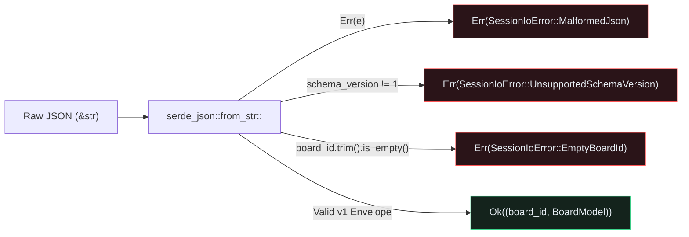

## Versioned Envelope Persistence and Exhaustive Destructuring

A hardware design review tool is only useful if engineers can save their review pins (`ReviewNote` status, severity, author, and millimetre coordinates) to a file, share it in a pull request, and reload it without losing state.{{sidenote: **Why Wrap `BoardModel` in `ReviewSessionEnvelope`?** Serializing a raw `BoardModel` directly leaves no metadata to detect format changes later. Wrapping it in `ReviewSessionEnvelope { schema_version: 1, board_id, board }` lets `from_session_json` reject incompatible schema versions with a clear, typed error before touching application state.}}

Because `pcb-doc` (`L1`) owns all domain types, adding persistence requires zero changes to our `egui` rendering code:

1. **Enable `emath`'s `"serde"` feature**: Running `cargo add --package pcb-doc emath --features serde` updates `crates/pcb-doc/Cargo.toml` so `emath = { version = "0.37", features = ["serde"] }` enables `Serialize` and `Deserialize` on `Pos2`, `Vec2`, and `Rect`.
2. **Define a typed `SessionIoError` with `thiserror`**: Instead of returning opaque strings or panicking on corrupt files, `SessionIoError` models three explicit failure modes: `EmptyBoardId`, `UnsupportedSchemaVersion { found, expected }`, and `MalformedJson(String)`.
3. **Destructure `ReviewSessionEnvelope` exhaustively**: In `BoardModel::from_session_json`, we unpack `let ReviewSessionEnvelope { schema_version, board_id, board } = ...` *without* `..` so adding any new envelope field in the future triggers a compiler error until validation is wired.

Add the persistence and error-handling dependencies to `pcb-doc` with `cargo add`:

```console
cargo add --package pcb-doc emath --features serde
cargo add --package pcb-doc serde --features derive
cargo add --package pcb-doc serde_json thiserror
```

Here is the resulting `crates/pcb-doc/Cargo.toml`:

```toml caption="crates/pcb-doc/Cargo.toml"
[package]
name = "pcb-doc"
version = "0.1.0"
edition = "2024"

[lints]
workspace = true

[dependencies]
emath = { version = "0.37", features = ["serde"] }
serde = { version = "1.0", features = ["derive"] }
serde_json = "1.0"
thiserror = "2.0"
```



## Non-Destructive Session I/O & Error Recovery: Block by Block

When a user attempts to load a corrupt or incompatible JSON file in `PcbReviewerApp::import_session_from_json(&mut self, raw: &str)`, the UI must **never** overwrite `self.board` with partial data or crash.{{sidenote: **Why `Panel::right("session_panel")`?** Placing session persistence, snapshot controls, and error banners in a dedicated right-hand inspector panel keeps the left layer/BOM panel (`Panel::left`) and top cross-probe bar (`Panel::top`) within their vertical and horizontal layout budgets.}} Let's walk through all the new persistence and UI recovery blocks added in Lesson `0016` across `crates/pcb-doc/src/lib.rs` and `src/main.rs`, then inspect the complete assembled listing.

### Block 1: Typed `SessionIoError`, `ReviewSessionEnvelope` & `serde` Derives (`crates/pcb-doc/src/lib.rs`)

```rust
use serde::{Deserialize, Serialize};
use thiserror::Error;

/// Current schema version for serialized PCB review sessions.
pub const CURRENT_SCHEMA_VERSION: u32 = 1;

/// Typed, panic-free persistence errors for PCB & review session files.
#[derive(Clone, Debug, Error, PartialEq, Eq)]
pub enum SessionIoError {
    #[error("board_id must not be empty")]
    EmptyBoardId,
    #[error("unsupported schema_version {found} (expected {expected})")]
    UnsupportedSchemaVersion { found: u32, expected: u32 },
    #[error("malformed session JSON: {0}")]
    MalformedJson(String),
}

/// Versioned envelope wrapping a serialized `BoardModel`.
#[derive(Clone, Debug, PartialEq, Serialize, Deserialize)]
pub struct ReviewSessionEnvelope {
    pub schema_version: u32,
    pub board_id: String,
    pub board: BoardModel,
}
```

- **`use serde::{Deserialize, Serialize};` & Domain Derives**: With `serde = { version = "1.0", features = ["derive"] }` and `emath = { version = "0.37", features = ["serde"] }` enabled in `crates/pcb-doc/Cargo.toml`, we add `Serialize, Deserialize` to `NetId`, `PinId`, `PinSeverity`, `ReviewStatus`, `ReviewNote`, `PcbLayer`, `TraceSegment`, `SmdPad`, `ComponentSymbol`, `BoardModel`, and `ReviewSessionEnvelope`.
- **`#[derive(Clone, Debug, Error, PartialEq, Eq)] pub enum SessionIoError`**: Uses `thiserror::Error` to generate `std::fmt::Display` and `std::error::Error` implementations automatically from `#[error("...")]` format strings:
  - `EmptyBoardId`: Triggered when `board_id.trim()` is empty on export or import.
  - `UnsupportedSchemaVersion { found, expected }`: Interpolates named struct-variant fields (`{found}` and `{expected}`) into the error message when `schema_version != CURRENT_SCHEMA_VERSION`.
  - `MalformedJson(String)`: Interpolates tuple field `{0}` when `serde_json` encounters syntax or type errors.
- **`ReviewSessionEnvelope`**: Wraps `board: BoardModel` alongside `schema_version: u32` and `board_id: String` so every saved JSON payload carries self-describing header metadata.

### Block 2: Exporting & Validating Session JSON (`to_session_json` & `from_session_json` in `crates/pcb-doc/src/lib.rs`)

```rust
impl BoardModel {
    /// Serializes the board and review pins into a versioned JSON session string.
    pub fn to_session_json(&self, board_id: &str) -> Result<String, SessionIoError> {
        let trimmed = board_id.trim();
        if trimmed.is_empty() {
            return Err(SessionIoError::EmptyBoardId);
        }
        let envelope = ReviewSessionEnvelope {
            schema_version: CURRENT_SCHEMA_VERSION,
            board_id: trimmed.to_owned(),
            board: self.clone(),
        };
        serde_json::to_string_pretty(&envelope)
            .map_err(|e| SessionIoError::MalformedJson(e.to_string()))
    }

    /// Deserializes and validates a versioned JSON session string without panicking.
    pub fn from_session_json(raw: &str) -> Result<(String, Self), SessionIoError> {
        let ReviewSessionEnvelope {
            schema_version,
            board_id,
            board,
        } = serde_json::from_str::<ReviewSessionEnvelope>(raw)
            .map_err(|e| SessionIoError::MalformedJson(e.to_string()))?;

        if schema_version != CURRENT_SCHEMA_VERSION {
            return Err(SessionIoError::UnsupportedSchemaVersion {
                found: schema_version,
                expected: CURRENT_SCHEMA_VERSION,
            });
        }
        let trimmed = board_id.trim();
        if trimmed.is_empty() {
            return Err(SessionIoError::EmptyBoardId);
        }
        Ok((trimmed.to_owned(), board))
    }
}
```

- **`to_session_json(&self, board_id: &str) -> Result<String, SessionIoError>`**: Trims leading/trailing whitespace from `board_id`, rejects blank IDs with `Err(SessionIoError::EmptyBoardId)`, wraps `self.clone()` in a `ReviewSessionEnvelope` at `CURRENT_SCHEMA_VERSION`, and formats human-readable JSON via `serde_json::to_string_pretty(&envelope)`.
- **Exhaustive Struct Destructuring (`let ReviewSessionEnvelope { schema_version, board_id, board } = ...`)**: Unpacks all three fields without a `..` wildcard. If a future schema revision adds a field to `ReviewSessionEnvelope`, `rustc` refuses to compile `from_session_json` until that new field is explicitly handled.
- **Error Mapping (`map_err` + `?`)**: Converts any `serde_json::Error` into `SessionIoError::MalformedJson(e.to_string())` and propagates it via the `?` operator before validating `schema_version` and `board_id.trim()`.

### Block 3: Session State, Non-Destructive Import & `Panel::right` Error Banner (`src/main.rs`)

```rust
// Added to ViewState (initialized to "pwr-stage-rev-b" and None in ViewState::default()):
pub struct ViewState {
    // ... existing layer, viewport, BOM, pin, and DRC fields ...
    pub active_board_id: String,
    pub last_io_error: Option<String>,
}

impl ViewState {
    pub fn dismiss_io_error(&mut self) {
        self.last_io_error = None;
    }
}

#[derive(Default)]
pub struct PcbReviewerApp {
    pub board: BoardModel,
    pub view: ViewState,
    pub saved_session_json: String,
}

impl PcbReviewerApp {
    /// Serializes `self.board` into `self.saved_session_json`, recording any error in `view.last_io_error`.
    pub fn export_session_snapshot(&mut self) -> bool {
        match self.board.to_session_json(&self.view.active_board_id) {
            Ok(json) => {
                self.saved_session_json = json;
                self.view.last_io_error = None;
                true
            }
            Err(err) => {
                self.view.last_io_error = Some(err.to_string());
                false
            }
        }
    }

    /// Loads `raw` JSON into `self.board`, or surfaces a clean error banner without panicking.
    pub fn import_session_from_json(&mut self, raw: &str) -> bool {
        match BoardModel::from_session_json(raw) {
            Ok((board_id, board)) => {
                self.view.active_board_id = board_id;
                self.board = board;
                self.view.last_io_error = None;
                true
            }
            Err(err) => {
                self.view.last_io_error = Some(err.to_string());
                false
            }
        }
    }

    pub fn render_session_panel(&mut self, ui: &mut egui::Ui) {
        ui.heading("Session Persistence (JSON)");
        ui.label(format!("Board ID: {}", self.view.active_board_id));
        if ui.button("Export JSON").clicked() {
            self.export_session_snapshot();
        }
        if ui.button("Reload JSON").clicked() {
            let raw = self.saved_session_json.clone();
            self.import_session_from_json(&raw);
        }
        if ui.button("Test Corrupt JSON").clicked() {
            self.import_session_from_json("{corrupt");
        }
        if let Some(err) = self.view.last_io_error.clone() {
            ui.label(format!("I/O Error: {err}"));
            if ui.button("Dismiss Error").clicked() {
                self.view.dismiss_io_error();
            }
        }
    }
}
```

- **`export_session_snapshot(&mut self) -> bool` & `import_session_from_json(&mut self, raw: &str) -> bool`**: Bridge `BoardModel`'s `Result<..., SessionIoError>` methods into UI state transitions. On `Ok(...)`, they update `saved_session_json` or `(active_board_id, board)` and clear `self.view.last_io_error = None`. On `Err(err)`, they leave `self.board` untouched and store `Some(err.to_string())` in `self.view.last_io_error`.
- **Borrowing Around `&mut self` in `"Reload JSON"`**: Inside `render_session_panel`, `let raw = self.saved_session_json.clone();` clones the saved JSON string before calling `self.import_session_from_json(&raw)` so we don't hold an immutable borrow of `self.saved_session_json` across a `&mut self` method call.
- **Mounting `egui::Panel::right("session_panel")` in `eframe::App::ui`**: Inside `impl eframe::App for PcbReviewerApp`, we add `egui::Panel::right("session_panel").show(ui, |ui| { self.render_session_panel(ui); });` before `CentralPanel::default()` so `egui` docks the session inspector on the right edge of the viewport.

### Block 4: Round-Trip Persistence & Error Banner Tests (`crates/pcb-doc/src/lib.rs` & `src/main.rs`)

```rust
// In crates/pcb-doc/src/lib.rs (#[cfg(test)] mod tests):
#[test]
fn session_json_round_trip_and_typed_validation_errors_are_lossless() {
    let mut original = BoardModel::default();
    original.add_review_pin_at(
        pos2(52.0, 35.0),
        "carol",
        "Verify R12 footprint",
        PinSeverity::Warning,
    );

    assert_eq!(
        original.to_session_json("   "),
        Err(SessionIoError::EmptyBoardId)
    );

    let json = original
        .to_session_json("  pwr-stage-rev-b  ")
        .expect("valid board should serialize");
    let (loaded_id, loaded_board) =
        BoardModel::from_session_json(&json).expect("valid JSON should deserialize");
    assert_eq!(loaded_id, "pwr-stage-rev-b");
    assert_eq!(loaded_board, original);

    let bad_version = json.replace("\"schema_version\": 1", "\"schema_version\": 99");
    assert_eq!(
        BoardModel::from_session_json(&bad_version),
        Err(SessionIoError::UnsupportedSchemaVersion {
            found: 99,
            expected: CURRENT_SCHEMA_VERSION,
        })
    );

    let empty_board_id =
        json.replace("\"board_id\": \"pwr-stage-rev-b\"", "\"board_id\": \"   \"");
    assert_eq!(
        BoardModel::from_session_json(&empty_board_id),
        Err(SessionIoError::EmptyBoardId)
    );

    let err = BoardModel::from_session_json("{ truncated json").unwrap_err();
    assert!(matches!(err, SessionIoError::MalformedJson(_)));
    assert!(err.to_string().contains("malformed session JSON"));
}

// In src/main.rs (egui_kittest workflow inside standalone_layer_swatch_and_headless_ui_workflows_pass):
harness.get_by_label("Export JSON").click();
harness.run();
assert!(!harness.state().saved_session_json.is_empty());

harness.state_mut().board.review_pins.clear();
harness.run();
assert!(harness.query_by_label("Review Pins: 0").is_some());

harness.get_by_label("Reload JSON").click();
harness.run();
assert!(harness.query_by_label("Review Pins: 2").is_some());

harness.get_by_label("Test Corrupt JSON").click();
harness.run();
assert!(harness.state().view.last_io_error.is_some());

harness.get_by_label("Dismiss Error").click();
harness.run();
assert!(harness.state().view.last_io_error.is_none());
```

- **`session_json_round_trip_and_typed_validation_errors_are_lossless`**: Exercises every persistence branch in `pcb-doc`: whitespace-only `board_id` rejection on export, full `BoardModel` + `ReviewNote` round-trip equality (`assert_eq!(loaded_board, original)`), `UnsupportedSchemaVersion { found: 99, expected: 1 }`, `EmptyBoardId` on import, and `MalformedJson` display formatting.
- **Headless `egui_kittest` Persistence Flow**: Clicks `"Export JSON"`, wipes `review_pins` in memory (`Review Pins: 0`), clicks `"Reload JSON"` to prove the 2 pins are restored in the UI, triggers `"Test Corrupt JSON"` to verify the error banner appears without panicking, and clicks `"Dismiss Error"` to clear `last_io_error`.

### Complete Lesson 0016 Session Persistence Listing (`crates/pcb-doc/src/lib.rs` & `src/main.rs`)

Here are all the new and updated Lesson `0016` sections across `crates/pcb-doc/src/lib.rs` and `src/main.rs` assembled in full context:

```rust caption="Complete Lesson 0016 persistence additions in crates/pcb-doc/src/lib.rs and src/main.rs"
// === crates/pcb-doc/src/lib.rs ===
use serde::{Deserialize, Serialize};
use thiserror::Error;

/// Current schema version for serialized PCB review sessions.
pub const CURRENT_SCHEMA_VERSION: u32 = 1;

/// Typed, panic-free persistence errors for PCB & review session files.
#[derive(Clone, Debug, Error, PartialEq, Eq)]
pub enum SessionIoError {
    #[error("board_id must not be empty")]
    EmptyBoardId,
    #[error("unsupported schema_version {found} (expected {expected})")]
    UnsupportedSchemaVersion { found: u32, expected: u32 },
    #[error("malformed session JSON: {0}")]
    MalformedJson(String),
}

/// Versioned envelope wrapping a serialized `BoardModel`.
#[derive(Clone, Debug, PartialEq, Serialize, Deserialize)]
pub struct ReviewSessionEnvelope {
    pub schema_version: u32,
    pub board_id: String,
    pub board: BoardModel,
}

#[derive(Clone, Debug, PartialEq, Serialize, Deserialize)]
pub struct BoardModel {
    pub traces: Vec<TraceSegment>,
    pub pads: Vec<SmdPad>,
    pub components: Vec<ComponentSymbol>,
    pub review_pins: HashMap<PinId, ReviewNote>,
    pub next_pin_id: u32,
}

impl BoardModel {
    /// Serializes the board and review pins into a versioned JSON session string.
    pub fn to_session_json(&self, board_id: &str) -> Result<String, SessionIoError> {
        let trimmed = board_id.trim();
        if trimmed.is_empty() {
            return Err(SessionIoError::EmptyBoardId);
        }
        let envelope = ReviewSessionEnvelope {
            schema_version: CURRENT_SCHEMA_VERSION,
            board_id: trimmed.to_owned(),
            board: self.clone(),
        };
        serde_json::to_string_pretty(&envelope)
            .map_err(|e| SessionIoError::MalformedJson(e.to_string()))
    }

    /// Deserializes and validates a versioned JSON session string without panicking.
    pub fn from_session_json(raw: &str) -> Result<(String, Self), SessionIoError> {
        let ReviewSessionEnvelope {
            schema_version,
            board_id,
            board,
        } = serde_json::from_str::<ReviewSessionEnvelope>(raw)
            .map_err(|e| SessionIoError::MalformedJson(e.to_string()))?;

        if schema_version != CURRENT_SCHEMA_VERSION {
            return Err(SessionIoError::UnsupportedSchemaVersion {
                found: schema_version,
                expected: CURRENT_SCHEMA_VERSION,
            });
        }
        let trimmed = board_id.trim();
        if trimmed.is_empty() {
            return Err(SessionIoError::EmptyBoardId);
        }
        Ok((trimmed.to_owned(), board))
    }
}

// === src/main.rs ===
pub use pcb_doc::{
    BoardModel, CURRENT_SCHEMA_VERSION, ComponentSymbol, DrcViolation,
    FORBIDDEN_UI_DEPS_BELOW_L6, NetId, PcbLayer, PinId, PinSeverity, Pos2, Rect, ReviewNote,
    ReviewSessionEnvelope, ReviewStatus, RulerMeasurement, SessionIoError, SmdPad, TSTransform,
    TraceSegment, Vec2, pad_edge_gap_mm, pos2, validate_l1_manifest_no_ui_deps, vec2,
};

impl ViewState {
    pub fn dismiss_io_error(&mut self) {
        self.last_io_error = None;
    }
}

#[derive(Default)]
pub struct PcbReviewerApp {
    pub board: BoardModel,
    pub view: ViewState,
    pub saved_session_json: String,
}

impl PcbReviewerApp {
    /// Serializes `self.board` into `self.saved_session_json`, recording any error in `view.last_io_error`.
    pub fn export_session_snapshot(&mut self) -> bool {
        match self.board.to_session_json(&self.view.active_board_id) {
            Ok(json) => {
                self.saved_session_json = json;
                self.view.last_io_error = None;
                true
            }
            Err(err) => {
                self.view.last_io_error = Some(err.to_string());
                false
            }
        }
    }

    /// Loads `raw` JSON into `self.board`, or surfaces a clean error banner without panicking.
    pub fn import_session_from_json(&mut self, raw: &str) -> bool {
        match BoardModel::from_session_json(raw) {
            Ok((board_id, board)) => {
                self.view.active_board_id = board_id;
                self.board = board;
                self.view.last_io_error = None;
                true
            }
            Err(err) => {
                self.view.last_io_error = Some(err.to_string());
                false
            }
        }
    }

    pub fn render_session_panel(&mut self, ui: &mut egui::Ui) {
        ui.heading("Session Persistence (JSON)");
        ui.label(format!("Board ID: {}", self.view.active_board_id));
        if ui.button("Export JSON").clicked() {
            self.export_session_snapshot();
        }
        if ui.button("Reload JSON").clicked() {
            let raw = self.saved_session_json.clone();
            self.import_session_from_json(&raw);
        }
        if ui.button("Test Corrupt JSON").clicked() {
            self.import_session_from_json("{corrupt");
        }
        if let Some(err) = self.view.last_io_error.clone() {
            ui.label(format!("I/O Error: {err}"));
            if ui.button("Dismiss Error").clicked() {
                self.view.dismiss_io_error();
            }
        }
    }
}

impl eframe::App for PcbReviewerApp {
    fn ui(&mut self, ui: &mut egui::Ui, _frame: &mut eframe::Frame) {
        self.handle_hotkeys(ui.ctx());

        egui::Panel::top("schematic_cross_probe_bar").show(ui, |ui| {
            self.render_schematic_bar(ui);
        });

        egui::Panel::left("layer_panel").show(ui, |ui| {
            self.render_side_panel(ui);
        });

        egui::Panel::right("session_panel").show(ui, |ui| {
            self.render_session_panel(ui);
        });

        egui::CentralPanel::default().show(ui, |ui| {
            self.render_canvas(ui);
        });

        self.render_active_pin_callout(ui.ctx());
    }
}
```

{{widget:serde-session-sim}}

:::exercise id="ex0016" title="Interactive Lab 2: Validate `ReviewSessionEnvelope` and Surface `last_io_error`" badge="Skill Practice • serde & thiserror"
Complete `BoardModel::from_session_json` and `PcbReviewerApp::import_session_from_json` so invalid schema versions or malformed JSON return typed errors and populate `self.view.last_io_error` without overwriting `self.board`.

```rust
pub fn from_session_json(raw: &str) -> Result<(String, Self), SessionIoError> {
    let ReviewSessionEnvelope {
        schema_version,
        board_id,
        board,
    } = serde_json::{{blank:from_str::<ReviewSessionEnvelope>(raw);;from_str(raw)|Deserialize ReviewSessionEnvelope from the raw JSON &str|from_str(...)|295px}}
        .map_err(|e| SessionIoError::MalformedJson(e.to_string()))?;

    if schema_version != {{blank:CURRENT_SCHEMA_VERSION|Compare schema_version against CURRENT_SCHEMA_VERSION|CURRENT_SCHEMA_VERSION|215px}} {
        return Err(SessionIoError::UnsupportedSchemaVersion {
            found: schema_version,
            expected: CURRENT_SCHEMA_VERSION,
        });
    }
    Ok((board_id.trim().to_owned(), board))
}

pub fn import_session_from_json(&mut self, raw: &str) -> bool {
    match BoardModel::from_session_json(raw) {
        Ok((board_id, board)) => {
            self.view.active_board_id = board_id;
            self.board = board;
            self.view.last_io_error = {{blank:None|Clear last_io_error on a successful import|None|85px}};
            true
        }
        Err(err) => {
            self.view.last_io_error = Some(err.to_string());
            false
        }
    }
}
```

:::prompts
hint: Call `serde_json::from_str::<ReviewSessionEnvelope>(raw)` (or `from_str(raw)`), compare against `CURRENT_SCHEMA_VERSION`, and set `self.view.last_io_error = None` when loading succeeds.
success: Nice work! Corrupt or incompatible JSON files are caught at the boundary and reported in the UI without panicking or corrupting `self.board`.
:::
:::

:::verify id="verify-0016" title="Lab 3: Session JSON Round-Trip & Error Recovery Gate (`0016`)" badge="cargo test --workspace + cargo mutants" tier="Tier 2 + Tier 3 + Tier 4" caught="155 / 155 (100%)" missed="0 Missed"
Verify that valid sessions round-trip losslessly (`loaded_board == original`) and that every error branch (`EmptyBoardId`, `UnsupportedSchemaVersion`, `MalformedJson`) and UI button (`"Export JSON"`, `"Reload JSON"`, `"Test Corrupt JSON"`, `"Dismiss Error"`) is mutation-covered:

```bash caption="Run workspace tests and verify serde persistence mutants"
cargo test --manifest-path ./apps/0016-loading-board-and-review-files-serde/Cargo.toml --workspace
cargo mutants --manifest-path ./apps/0016-loading-board-and-review-files-serde/Cargo.toml --workspace --in-place -F "to_session_json|from_session_json|export_session_snapshot|import_session_from_json|dismiss_io_error|render_session_panel"
```

- [ ] `cargo test --manifest-path ./apps/0016-loading-board-and-review-files-serde/Cargo.toml --workspace` passes all **12 tests** (**6** in `pcb-doc` and **6** in `pcb-reviewer`).
- [ ] `session_json_round_trip_and_typed_validation_errors_are_lossless` verifies exact equality after `to_session_json` → `from_session_json` and asserts all three `SessionIoError` variants.
- [ ] `cargo mutants` catches all **11 new persistence & UI mutants** (`5/5` in `pcb-doc`, `6/6` in `pcb-reviewer`), bringing the workspace total to **155 / 155 viable mutants caught (0 missed)**.
:::

:::quiz id="quiz-0016"
Q: How do we enable `serde::Serialize` and `serde::Deserialize` on `emath::Pos2` and `emath::Vec2` in `pcb-doc`?
- [ ] By writing custom unsafe transmute implementations inside the binary crate
- [x] By enabling the `serde` Cargo feature on the `emath` dependency
- [ ] By converting every millimetre coordinate into a formatted string first
- [ ] By linking the `egui_glow` desktop shader compiler into `crates/pcb-doc` directly
why: `emath = { version = "0.37", features = ["serde"] }` provides upstream `Serialize` and `Deserialize` implementations for `Pos2`, `Vec2`, `Rect`, and `TSTransform`.
hint: Check `[dependencies]` in `apps/0016-loading-board-and-review-files-serde/crates/pcb-doc/Cargo.toml`.

Q: Why does `BoardModel::from_session_json` destructure `ReviewSessionEnvelope` without `..`?
- [ ] To allow `serde_json` to skip syntax checks on truncated strings
- [x] To trigger compiler errors whenever new envelope fields are added
- [ ] To prevent `thiserror` from formatting display messages on any errors
- [ ] To automatically compress JSON strings into binary Zstandard archive blobs
why: Exhaustive struct destructuring (`let ReviewSessionEnvelope { schema_version, board_id, board } = ...`) guarantees at compile time that no newly added envelope field is silently ignored during deserialization.
hint: Look at lines 486–490 of `crates/pcb-doc/src/lib.rs`.

Q: What happens in `PcbReviewerApp::import_session_from_json` when `BoardModel::from_session_json` returns `Err(err)`?
- [ ] The application panics immediately and closes the native desktop window
- [ ] The existing board is cleared to an empty default state
- [x] The active board remains untouched and `last_io_error` stores the message
- [ ] The schema version constant is overwritten to match the input
why: Non-destructive error handling preserves `self.board` and `self.view.active_board_id` when an import fails, surfacing `Some(err.to_string())` in `self.view.last_io_error` so the user can inspect and dismiss the banner.
hint: Trace the `Err(err)` arm in `PcbReviewerApp::import_session_from_json`.
:::

## Recommended Primary Source

:::callout
**Read (5 mins):** [Serde Official Documentation — "Using Derive"](https://serde.rs/derive.html) and [`thiserror` Crate Documentation](https://docs.rs/thiserror/latest/thiserror/).
:::

:::teacher-prompt
Next up: [Lesson 0017: Copy-on-Write Document Snapshots with `Arc<Vec<T>>` and `Arc::make_mut`](./0017-copy-on-write-arc-document-snapshots.html), where we upgrade `BoardModel` so taking a snapshot of 10,000+ pads and traces costs only four `O(1)` atomic reference-count increments!
:::
