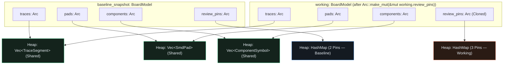

## Why `O(N)` Deep Clones Break 60 FPS Immediate-Mode CAD Apps

Suppose a production PCB layout holds 50,000 `TraceSegment`s, 20,000 `SmdPad`s, and 2,000 `ComponentSymbol`s, while an engineer adds or edits a single `ReviewNote` pin. If `BoardModel` stores plain `Vec<T>` and `HashMap<K, V>` fields, calling `let snapshot = self.board.clone()` before an edit allocates and copies *every* trace, pad, and component on the heap (`O(N)` memory and CPU time).{{sidenote: **Structural Sharing (`Arc` Copy-on-Write):** By wrapping each collection in `Arc<...>` (`Arc<Vec<TraceSegment>>`, `Arc<Vec<SmdPad>>`, `Arc<Vec<ComponentSymbol>>`, `Arc<HashMap<PinId, ReviewNote>>`), `BoardModel::clone()` copies only four 8-byte pointers and increments four atomic reference counts (`O(1)`).}}

When we need to mutate a collection—such as inserting or updating a review pin—we call `Arc::make_mut(&mut self.review_pins)`:

- **If `strong_count == 1`** (no snapshot shares this buffer): `Arc::make_mut` returns a `&mut HashMap<PinId, ReviewNote>` in-place with **zero allocation**.
- **If `strong_count > 1`** (a snapshot or undo entry shares this buffer): `Arc::make_mut` clones *only* `review_pins` into a new `Arc` allocation and mutates the new copy, while `traces`, `pads`, and `components` remain 100% pointer-shared (`Arc::ptr_eq == true`) with the snapshot!



## Serializing `Arc<T>` with `serde`'s `"rc"` Feature & Property Testing with `proptest`

To keep `BoardModel`'s `#[derive(Serialize, Deserialize)]` working seamlessly across `Arc<...>` fields, we enable `serde`'s `"rc"` feature and add `proptest` under `[dev-dependencies]` using `cargo add`:{{sidenote: **Tier 2 Property-Based Testing (`proptest`):** Unit tests check fixed examples; `proptest!` generates hundreds of randomized `(x, y, comment)` inputs and shrinks any failure to its minimal counterexample.}}

```console
cargo add --package pcb-doc serde --features derive,rc
cargo add --package pcb-doc --dev proptest
```

Here is the resulting `crates/pcb-doc/Cargo.toml`:

```toml caption="crates/pcb-doc/Cargo.toml"
[package]
name = "pcb-doc"
version = "0.1.0"
edition = "2024"

[lints]
workspace = true

[dependencies]
emath = { version = "0.37", features = ["serde"] }
serde = { version = "1.0", features = ["derive", "rc"] }
serde_json = "1.0"
thiserror = "2.0"

[dev-dependencies]
proptest = "1.11"
```

We also add `shared_arc_buffers(&self, other: &Self) -> usize` using `Arc::ptr_eq` so both our `proptest!` suite and the `Panel::right` UI (`"Shared Arc Buffers: 3 / 4"`) can inspect structural sharing directly. Let's walk through all the new Copy-on-Write blocks across `crates/pcb-doc/src/lib.rs` and `src/main.rs`, then view the assembled listing in context.

### Block 1: Wrapping `BoardModel` Collections in `Arc<...>` & Measuring Pointer Sharing (`crates/pcb-doc/src/lib.rs`)

```rust
use std::{
    collections::{HashMap, hash_map::Entry},
    sync::Arc,
};

/// Copy-on-Write (`Arc`) domain model: cloning `BoardModel` copies only four `Arc`
/// pointers (`O(1)`), and mutating a collection via `Arc::make_mut` clones only the
/// touched collection while sharing all untouched buffers across snapshots.
#[derive(Clone, Debug, PartialEq, Serialize, Deserialize)]
pub struct BoardModel {
    pub traces: Arc<Vec<TraceSegment>>,
    pub pads: Arc<Vec<SmdPad>>,
    pub components: Arc<Vec<ComponentSymbol>>,
    pub review_pins: Arc<HashMap<PinId, ReviewNote>>,
    pub next_pin_id: u32,
}

impl Default for BoardModel {
    fn default() -> Self {
        Self {
            traces: Arc::new(sample_traces()),
            pads: Arc::new(sample_pads()),
            components: Arc::new(sample_components()),
            review_pins: Arc::new(sample_review_pins()),
            next_pin_id: 3,
        }
    }
}

impl BoardModel {
    /// Counts how many of the 4 `Arc` collection buffers (`0..=4`) share the exact
    /// same heap allocation (`Arc::ptr_eq`) with `other`.
    pub fn shared_arc_buffers(&self, other: &Self) -> usize {
        usize::from(Arc::ptr_eq(&self.traces, &other.traces))
            + usize::from(Arc::ptr_eq(&self.pads, &other.pads))
            + usize::from(Arc::ptr_eq(&self.components, &other.components))
            + usize::from(Arc::ptr_eq(&self.review_pins, &other.review_pins))
    }
}
```

- **`Arc<Vec<...>>` & `Arc<HashMap<...>>`**: Wrapping each collection in [`std::sync::Arc`](https://doc.rust-lang.org/std/sync/struct.Arc.html) turns `#[derive(Clone)]` on `BoardModel` from an `O(N)` deep heap allocation into four `O(1)` atomic reference-count increments. Because `Arc<T>` implements [`Deref<Target = T>`](https://doc.rust-lang.org/std/ops/trait.Deref.html), read-only callers (`self.pads.iter()`, `self.review_pins.get(&id)`) continue to work transparently!
- **`Arc::ptr_eq(&self.traces, &other.traces)`**: Compares the raw heap data pointers of two `Arc` handles in `O(1)` time without inspecting the elements inside the vector or map.
- **`usize::from(bool)`**: Converts `true` into `1_usize` and `false` into `0_usize` cleanly without `as` casts, summing how many of the four collection buffers (`0..=4`) still point to the exact same heap allocation.

### Block 2: Copy-on-Write Mutations with `Arc::make_mut` (`crates/pcb-doc/src/lib.rs`)

```rust
impl BoardModel {
    /// Appends a copper pad using copy-on-write (`Arc::make_mut`).
    pub fn push_smd_pad(&mut self, pad: SmdPad) {
        Arc::make_mut(&mut self.pads).push(pad);
    }

    /// Clears all review pins using copy-on-write (`Arc::make_mut`).
    pub fn clear_review_pins(&mut self) {
        Arc::make_mut(&mut self.review_pins).clear();
    }

    pub fn insert_review_pin(
        &mut self,
        id: PinId,
        position_mm: Pos2,
        author: &str,
        comment: &str,
        severity: PinSeverity,
    ) -> bool {
        match Arc::make_mut(&mut self.review_pins).entry(id) {
            Entry::Vacant(slot) => {
                slot.insert(ReviewNote {
                    id,
                    position_mm,
                    author: author.to_owned(),
                    comment: comment.to_owned(),
                    severity,
                    status: ReviewStatus::Open,
                });
                true
            }
            Entry::Occupied(_) => false,
        }
    }

    pub fn transition_pin_status(&mut self, id: PinId, next: ReviewStatus) -> bool {
        let Some(pin) = Arc::make_mut(&mut self.review_pins).get_mut(&id) else {
            return false;
        };
        if pin.status.can_transition_to(next) {
            pin.status = next;
            true
        } else {
            false
        }
    }
}
```

- **`Arc::make_mut(&mut self.review_pins)`**: The workhorse of copy-on-write in Rust. Because `Arc<T>` normally provides only shared `&T` access, `Arc::make_mut` checks the strong reference count of the allocation:
  - If `strong_count == 1`, no snapshot shares this buffer, so `Arc::make_mut` hands back `&mut HashMap<PinId, ReviewNote>` in-place with zero heap allocation.
  - If `strong_count > 1` (e.g., `baseline_snapshot` also points to this `HashMap`), `Arc::make_mut` clones `HashMap<PinId, ReviewNote>` into a brand-new `Arc`, decrements the old `Arc`'s count, and returns `&mut` to the new copy—leaving `traces`, `pads`, and `components` 100% shared (`3 / 4`).
- **`push_smd_pad` & `clear_review_pins`**: Dedicated mutation helpers on `BoardModel` that encapsulate `Arc::make_mut(&mut self.pads)` and `Arc::make_mut(&mut self.review_pins)`.

### Block 3: `O(1)` Baseline Snapshots & Telemetry UI in `PcbReviewerApp` (`src/main.rs`)

```rust
pub struct PcbReviewerApp {
    pub board: BoardModel,
    pub baseline_snapshot: BoardModel,
    pub view: ViewState,
    pub saved_session_json: String,
}

impl Default for PcbReviewerApp {
    fn default() -> Self {
        let board = BoardModel::default();
        let baseline_snapshot = board.clone();
        Self {
            board,
            baseline_snapshot,
            view: ViewState::default(),
            saved_session_json: String::new(),
        }
    }
}

impl PcbReviewerApp {
    /// Records an `O(1)` copy-on-write snapshot by cloning the 4 `Arc` pointers in `self.board`.
    pub fn take_baseline_snapshot(&mut self) {
        self.baseline_snapshot = self.board.clone();
    }

    /// Restores `self.board` from `self.baseline_snapshot` in `O(1)` pointer copies.
    pub fn restore_baseline_snapshot(&mut self) {
        self.board = self.baseline_snapshot.clone();
    }

    /// Returns how many of the 4 `Arc` buffers (`0..=4`) are pointer-shared with `baseline_snapshot`.
    pub fn shared_buffers_with_baseline(&self) -> usize {
        self.board.shared_arc_buffers(&self.baseline_snapshot)
    }

    pub fn render_session_panel(&mut self, ui: &mut egui::Ui) {
        ui.heading("CoW Snapshots (Arc)");
        ui.label(format!(
            "Shared Arc Buffers: {} / 4",
            self.shared_buffers_with_baseline()
        ));
        if ui.button("Take Snapshot").clicked() {
            self.take_baseline_snapshot();
        }
        if ui.button("Restore Snapshot").clicked() {
            self.restore_baseline_snapshot();
        }

        ui.separator();
        ui.heading("Session Persistence (JSON)");
        // ... existing Board ID, Export JSON, Reload JSON, Test Corrupt JSON, and I/O Error banner ...
    }
}
```

- **Custom `impl Default for PcbReviewerApp`**: Replaces `#[derive(Default)]` so `baseline_snapshot` is initialized via `let baseline_snapshot = board.clone();`. If we used `#[derive(Default)]`, Rust would call `BoardModel::default()` *twice*, allocating two separate sets of `Arc` buffers (`0 / 4` shared) instead of sharing the initial allocations (`4 / 4` shared)!
- **`take_baseline_snapshot` & `restore_baseline_snapshot`**: Both operations execute in `O(1)` time by cloning only the four `Arc` pointers inside `BoardModel`.
- **Live `"Shared Arc Buffers: {} / 4"` Readout**: Displays `self.shared_buffers_with_baseline()` inside `Panel::right("session_panel")` so the user can watch the count drop from `4 / 4` to `3 / 4` when a review pin is edited, and jump back to `4 / 4` when clicking `"Take Snapshot"` or `"Restore Snapshot"`.

### Block 4: Pointer-Sharing Unit Tests, `proptest!` Suite & `egui_kittest` Verification (`crates/pcb-doc/src/lib.rs` & `src/main.rs`)

```rust
// In crates/pcb-doc/src/lib.rs (#[cfg(test)] mod tests):
use proptest::prelude::*;

#[test]
fn shared_arc_buffers_tracks_copy_on_write_pointer_sharing_across_all_four_collections() {
    let baseline = BoardModel::default();
    let mut working = baseline.clone();
    assert_eq!(working.shared_arc_buffers(&baseline), 4);

    working.clear_review_pins();
    assert!(working.review_pins.is_empty());
    assert_eq!(baseline.review_pins.len(), 2);
    assert_eq!(working.shared_arc_buffers(&baseline), 3);

    working.push_smd_pad(SmdPad {
        center_mm: pos2(10.0, 10.0),
        size_mm: vec2(2.0, 2.0),
        layer: PcbLayer::TopCopper,
        net: NetId(1),
    });
    assert_eq!(working.pads.len(), 4);
    assert_eq!(baseline.pads.len(), 3);
    assert_eq!(working.shared_arc_buffers(&baseline), 2);

    Arc::make_mut(&mut working.components).pop();
    assert_eq!(working.shared_arc_buffers(&baseline), 1);

    Arc::make_mut(&mut working.traces).pop();
    assert_eq!(working.shared_arc_buffers(&baseline), 0);
}

proptest! {
    #[test]
    fn prop_cow_pin_mutation_preserves_baseline_snapshot_and_shares_untouched_arcs(
        x in 5.0_f32..95.0_f32,
        y in 5.0_f32..65.0_f32,
        comment in "[a-zA-Z0-9 _-]{1,24}",
    ) {
        let baseline = BoardModel::default();
        let mut working = baseline.clone();
        prop_assert_eq!(working.shared_arc_buffers(&baseline), 4);

        let added_id = working.add_review_pin_at(
            pos2(x, y),
            "proptest",
            &comment,
            PinSeverity::Warning,
        );

        prop_assert_eq!(baseline.review_pins.len(), 2);
        prop_assert!(!baseline.review_pins.contains_key(&added_id));
        prop_assert_eq!(working.review_pins.len(), 3);
        prop_assert_eq!(&working.review_pins[&added_id].comment, &comment);

        prop_assert!(Arc::ptr_eq(&baseline.traces, &working.traces));
        prop_assert!(Arc::ptr_eq(&baseline.pads, &working.pads));
        prop_assert!(Arc::ptr_eq(&baseline.components, &working.components));
        prop_assert!(!Arc::ptr_eq(&baseline.review_pins, &working.review_pins));
        prop_assert_eq!(working.shared_arc_buffers(&baseline), 3);
    }
}
```

- **Deterministic `4 -> 3 -> 2 -> 1 -> 0` Sharing Progression**: `shared_arc_buffers_tracks_copy_on_write_pointer_sharing_across_all_four_collections` mutates `review_pins`, `pads`, `components`, and `traces` one by one, proving that each `Arc::make_mut` detaches only its own collection while `baseline` retains its original elements.
- **`proptest! { ... }`**: Generates randomized floating-point coordinates (`x in 5.0_f32..95.0_f32`, `y in 5.0_f32..65.0_f32`) and regex-matched comment strings (`"[a-zA-Z0-9 _-]{1,24}"`), using `prop_assert!` and `prop_assert_eq!` to verify that adding any review pin leaves `baseline` untouched and keeps `traces`, `pads`, and `components` pointer-equal (`Arc::ptr_eq`).

### Complete Lesson 0017 Copy-on-Write Snapshot Listing (`crates/pcb-doc/src/lib.rs` & `src/main.rs`)

Here are all the new and updated Lesson `0017` sections across `crates/pcb-doc/src/lib.rs` and `src/main.rs` in full context:

```rust caption="Complete Lesson 0017 Copy-on-Write additions in crates/pcb-doc/src/lib.rs and src/main.rs"
// === crates/pcb-doc/src/lib.rs ===
use std::{
    collections::{HashMap, hash_map::Entry},
    sync::Arc,
};

/// Copy-on-Write (`Arc`) domain model: cloning `BoardModel` copies only four `Arc`
/// pointers (`O(1)`), and mutating a collection via `Arc::make_mut` clones only the
/// touched collection while sharing all untouched buffers across snapshots.
#[derive(Clone, Debug, PartialEq, Serialize, Deserialize)]
pub struct BoardModel {
    pub traces: Arc<Vec<TraceSegment>>,
    pub pads: Arc<Vec<SmdPad>>,
    pub components: Arc<Vec<ComponentSymbol>>,
    pub review_pins: Arc<HashMap<PinId, ReviewNote>>,
    pub next_pin_id: u32,
}

impl Default for BoardModel {
    fn default() -> Self {
        Self {
            traces: Arc::new(sample_traces()),
            pads: Arc::new(sample_pads()),
            components: Arc::new(sample_components()),
            review_pins: Arc::new(sample_review_pins()),
            next_pin_id: 3,
        }
    }
}

impl BoardModel {
    /// Counts how many of the 4 `Arc` collection buffers (`0..=4`) share the exact
    /// same heap allocation (`Arc::ptr_eq`) with `other`.
    pub fn shared_arc_buffers(&self, other: &Self) -> usize {
        usize::from(Arc::ptr_eq(&self.traces, &other.traces))
            + usize::from(Arc::ptr_eq(&self.pads, &other.pads))
            + usize::from(Arc::ptr_eq(&self.components, &other.components))
            + usize::from(Arc::ptr_eq(&self.review_pins, &other.review_pins))
    }

    /// Appends a copper pad using copy-on-write (`Arc::make_mut`).
    pub fn push_smd_pad(&mut self, pad: SmdPad) {
        Arc::make_mut(&mut self.pads).push(pad);
    }

    /// Clears all review pins using copy-on-write (`Arc::make_mut`).
    pub fn clear_review_pins(&mut self) {
        Arc::make_mut(&mut self.review_pins).clear();
    }

    pub fn insert_review_pin(
        &mut self,
        id: PinId,
        position_mm: Pos2,
        author: &str,
        comment: &str,
        severity: PinSeverity,
    ) -> bool {
        match Arc::make_mut(&mut self.review_pins).entry(id) {
            Entry::Vacant(slot) => {
                slot.insert(ReviewNote {
                    id,
                    position_mm,
                    author: author.to_owned(),
                    comment: comment.to_owned(),
                    severity,
                    status: ReviewStatus::Open,
                });
                true
            }
            Entry::Occupied(_) => false,
        }
    }

    pub fn transition_pin_status(&mut self, id: PinId, next: ReviewStatus) -> bool {
        let Some(pin) = Arc::make_mut(&mut self.review_pins).get_mut(&id) else {
            return false;
        };
        if pin.status.can_transition_to(next) {
            pin.status = next;
            true
        } else {
            false
        }
    }
}

// === src/main.rs ===
pub struct PcbReviewerApp {
    pub board: BoardModel,
    pub baseline_snapshot: BoardModel,
    pub view: ViewState,
    pub saved_session_json: String,
}

impl Default for PcbReviewerApp {
    fn default() -> Self {
        let board = BoardModel::default();
        let baseline_snapshot = board.clone();
        Self {
            board,
            baseline_snapshot,
            view: ViewState::default(),
            saved_session_json: String::new(),
        }
    }
}

impl PcbReviewerApp {
    /// Records an `O(1)` copy-on-write snapshot by cloning the 4 `Arc` pointers in `self.board`.
    pub fn take_baseline_snapshot(&mut self) {
        self.baseline_snapshot = self.board.clone();
    }

    /// Restores `self.board` from `self.baseline_snapshot` in `O(1)` pointer copies.
    pub fn restore_baseline_snapshot(&mut self) {
        self.board = self.baseline_snapshot.clone();
    }

    /// Returns how many of the 4 `Arc` buffers (`0..=4`) are pointer-shared with `baseline_snapshot`.
    pub fn shared_buffers_with_baseline(&self) -> usize {
        self.board.shared_arc_buffers(&self.baseline_snapshot)
    }

    pub fn render_session_panel(&mut self, ui: &mut egui::Ui) {
        ui.heading("CoW Snapshots (Arc)");
        ui.label(format!(
            "Shared Arc Buffers: {} / 4",
            self.shared_buffers_with_baseline()
        ));
        if ui.button("Take Snapshot").clicked() {
            self.take_baseline_snapshot();
        }
        if ui.button("Restore Snapshot").clicked() {
            self.restore_baseline_snapshot();
        }

        ui.separator();
        ui.heading("Session Persistence (JSON)");
        ui.label(format!("Board ID: {}", self.view.active_board_id));
        if ui.button("Export JSON").clicked() {
            self.export_session_snapshot();
        }
        if ui.button("Reload JSON").clicked() {
            let raw = self.saved_session_json.clone();
            self.import_session_from_json(&raw);
        }
        if ui.button("Test Corrupt JSON").clicked() {
            self.import_session_from_json("{corrupt");
        }
        if let Some(err) = self.view.last_io_error.clone() {
            ui.label(format!("I/O Error: {err}"));
            if ui.button("Dismiss Error").clicked() {
                self.view.dismiss_io_error();
            }
        }
    }
}
```

{{widget:cow-arc-sim}}

:::exercise id="ex0017" title="Interactive Lab 2: Mutate `Arc` Buffers with `Arc::make_mut` & Measure Sharing with `Arc::ptr_eq`" badge="Skill Practice • Copy-on-Write Arc"
Complete `shared_arc_buffers`, `clear_review_pins`, and `transition_pin_status` on `BoardModel` so mutations clone only the touched `Arc` buffer when shared.

```rust
pub fn shared_arc_buffers(&self, other: &Self) -> usize {
    usize::from(Arc::{{blank:ptr_eq(&self.traces, &other.traces);;ptr_eq(&self.traces,&other.traces)|Compare heap pointers of self.traces and other.traces with Arc::ptr_eq|ptr_eq(...)|295px}})
        + usize::from(Arc::ptr_eq(&self.pads, &other.pads))
        + usize::from(Arc::ptr_eq(&self.components, &other.components))
        + usize::from(Arc::ptr_eq(&self.review_pins, &other.review_pins))
}

pub fn clear_review_pins(&mut self) {
    Arc::{{blank:make_mut(&mut self.review_pins)|Obtain a mutable reference to review_pins via copy-on-write|make_mut(...)|255px}}.clear();
}

pub fn transition_pin_status(&mut self, id: PinId, next: ReviewStatus) -> bool {
    let Some(pin) = Arc::{{blank:make_mut(&mut self.review_pins)|Use Arc::make_mut to mutate only the review_pins map|make_mut(...)|255px}}.get_mut(&id) else {
        return false;
    };
    if pin.status.can_transition_to(next) {
        pin.status = next;
        true
    } else {
        false
    }
}
```

:::prompts
hint: Use `Arc::ptr_eq(&self.traces, &other.traces)` to check pointer identity and `Arc::make_mut(&mut self.review_pins)` for copy-on-write mutation.
success: Spot on! `Arc::make_mut` clones `review_pins` only when `strong_count > 1`, keeping `traces`, `pads`, and `components` pointer-shared (`3 / 4`).
:::
:::

:::verify id="verify-0017" title="Lab 3: Copy-on-Write `proptest` & Mutation Gate (`0017`)" badge="cargo test --workspace + proptest + cargo mutants" tier="Tier 2 (proptest) + Tier 3" caught="169 / 169 (100%)" missed="0 Missed"
Run the workspace tests (including `prop_cow_pin_mutation_preserves_baseline_snapshot_and_shares_untouched_arcs`) and the mutation suite for the new CoW methods:

```bash caption="Run proptest and cargo-mutants on 0016 Copy-on-Write functions"
cargo test --manifest-path ./apps/0017-copy-on-write-arc-document-snapshots/Cargo.toml --workspace
cargo mutants --manifest-path ./apps/0017-copy-on-write-arc-document-snapshots/Cargo.toml --workspace --in-place -F "shared_arc_buffers|push_smd_pad|clear_review_pins|take_baseline_snapshot|restore_baseline_snapshot|shared_buffers_with_baseline|render_session_panel"
```

- [ ] `cargo test --manifest-path ./apps/0017-copy-on-write-arc-document-snapshots/Cargo.toml --workspace` passes all **14 tests** (**8** in `pcb-doc` including `proptest`, and **6** in `pcb-reviewer`).
- [ ] `shared_arc_buffers_tracks_copy_on_write_pointer_sharing_across_all_four_collections` verifies the exact `4 → 3 → 2 → 1 → 0` pointer-sharing progression as each `Arc` collection is mutated.
- [ ] `cargo mutants` catches all **15 new CoW & snapshot UI mutants** (`15 / 15 caught`), bringing the workspace total to **169 / 169 viable mutants caught (0 missed)**.
:::

:::quiz id="quiz-0017"
Q: What does `Arc::make_mut(&mut self.review_pins)` do when `self.review_pins` has a strong reference count of `2`?
- [ ] It panics immediately because shared `Arc` pointers are permanently immutable
- [ ] It blocks the thread until the baseline snapshot is dropped
- [x] It clones the inner `HashMap` into a fresh `Arc` allocation
- [ ] It deep-clones all four data collections inside `BoardModel` simultaneously now
why: When `strong_count > 1`, `Arc::make_mut` clones the inner value (`HashMap<PinId, ReviewNote>`) into a new unique `Arc` (`strong_count == 1`), detaching it from the shared allocation while leaving all other `Arc` fields untouched.
hint: Trace what happens to `working.review_pins` vs. `working.traces` in the interactive simulator above.

Q: What does `Arc::ptr_eq(&baseline.traces, &working.traces)` check?
- [ ] Whether every `TraceSegment` has the same copper width in millimetres
- [x] Whether both `Arc` handles point to the same heap allocation
- [ ] Whether the two vectors have equal capacities after a re-allocation
- [ ] Whether `serde_json` serialized both trace vectors into identical JSON strings
why: `Arc::ptr_eq` compares the raw data pointers in `O(1)` time without iterating over the elements, proving that no deep clone occurred.
hint: Check how `BoardModel::shared_arc_buffers` is implemented in `crates/pcb-doc/src/lib.rs`.

Q: Which Cargo feature on `serde` enables `#[derive(Serialize, Deserialize)]` for structs containing `Arc<T>`?
- [ ] The `alloc` feature flag inside `eframe`
- [x] The `rc` feature flag inside `serde`
- [ ] The `unstable` feature flag inside `emath`
- [ ] The `sync` feature flag inside `thiserror`
why: Enabling `features = ["derive", "rc"]` on `serde` provides `Serialize` and `Deserialize` implementations for `std::rc::Rc<T>` and `std::sync::Arc<T>`.
hint: Inspect `apps/0017-copy-on-write-arc-document-snapshots/crates/pcb-doc/Cargo.toml`.
:::

## Recommended Primary Source

:::callout
**Read (5 mins):** [`std::sync::Arc::make_mut` Official Rust Standard Library Docs](https://doc.rust-lang.org/std/sync/struct.Arc.html#method.make_mut) and [Proptest Book — "Getting Started"](https://proptest-rs.github.io/proptest/proptest/getting-started.html).
:::

:::teacher-prompt
Next up: [Lesson 0018: Undo/Redo History (`VecDeque`) & Continuous Slider Drag Coalescing](./0018-undo-redo-history-and-slider-coalescing.html), where we build `BoardHistory` on top of our `O(1)` `Arc` snapshots and coalesce 60-FPS slider drags into a single undo step!
:::
