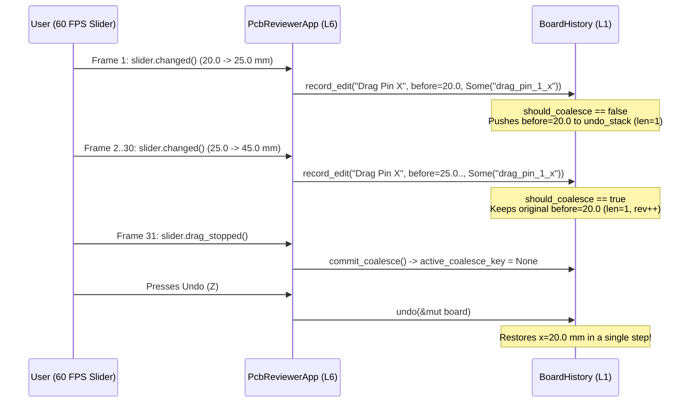

## Why Immediate-Mode Sliders Flood Naive Undo Stacks

Because `BoardModel::clone()` is now an `O(1)` copy of four `Arc` pointers (Lesson `0017`), we can store complete document snapshots inside a bounded `BoardHistory` (`undo_stack: VecDeque<HistoryEntry>`, `redo_stack: Vec<HistoryEntry>`).{{sidenote: **Why `VecDeque<HistoryEntry>`?** When `undo_stack.len() >= max_entries` (e.g., 32 steps), a `VecDeque` ring buffer evicts the oldest snapshot from the front via `pop_front()` in `O(1)` time without shifting all remaining elements.}}

However, immediate-mode UIs introduce a classic UX trap: when a user drags an `egui::Slider` (such as adjusting a review pin's X coordinate from `20.0 mm` to `45.0 mm`), `slider_resp.changed()` fires on **every 60-FPS frame** while the pointer is moving. If every frame pushed a new `HistoryEntry`, a half-second drag would push 30 intermediate snapshots onto `undo_stack`—forcing the user to press `Z` 30 times just to undo one drag!

We solve this with **`coalesce_key: Option<&str>`**:

1. **First Frame of a Drag (`active_coalesce_key != Some("drag_pin_1_x")`)**: `record_edit("Drag Pin X", before, Some("drag_pin_1_x"))` pushes the pre-drag `before` snapshot (`x = 20.0 mm`) onto `undo_stack` and records `active_coalesce_key = Some("drag_pin_1_x".to_owned())`.
2. **Subsequent Frames of the Same Drag (`active_coalesce_key == Some("drag_pin_1_x")`)**: `should_coalesce` is `true`! `record_edit` *keeps* the original `x = 20.0 mm` entry at the top of `undo_stack` without pushing intermediate frames, while still clearing `redo_stack` and incrementing `revision`.
3. **Pointer Release (`slider_resp.drag_stopped()`)**: Calling `commit_coalesce()` resets `active_coalesce_key = None`, so the *next* drag gesture starts a fresh undo entry.



## `O(1)` Undo/Redo Swaps & Slider Coalescing: Block by Block

When the user clicks **Undo (Z)** or presses `Key::Z`, `BoardHistory::undo(&mut self, current: &mut BoardModel)` pops the most recent `HistoryEntry` from the back of `undo_stack`, swaps `entry.doc` into `*current` using `std::mem::replace(current, entry.doc)`, and pushes the replaced state onto `redo_stack`.{{sidenote: **Zero-Clone State Swap:** `std::mem::replace(current, entry.doc)` moves the saved `BoardModel` into `*current` and returns the outgoing `BoardModel` for `redo_stack` without even incrementing `Arc` reference counts!}} Let's walk through all the new undo/redo and slider-coalescing blocks across `crates/pcb-doc/src/lib.rs` and `src/main.rs`, then view the assembled listing in context.

### Block 1: Bounded `BoardHistory` Ring Buffer (`VecDeque<HistoryEntry>`) & Telemetry Accessors (`crates/pcb-doc/src/lib.rs`)

```rust
use std::{
    collections::{HashMap, VecDeque, hash_map::Entry},
    sync::Arc,
};

/// Default maximum undo history entries retained in the ring buffer.
pub const DEFAULT_MAX_HISTORY: usize = 32;

/// A single copy-on-write snapshot entry stored in `BoardHistory`.
#[derive(Clone, Debug, PartialEq)]
pub struct HistoryEntry {
    pub label: String,
    pub doc: BoardModel,
}

/// Bounded copy-on-write undo/redo history with continuous slider drag coalescing.
#[derive(Clone, Debug)]
pub struct BoardHistory {
    undo_stack: VecDeque<HistoryEntry>,
    redo_stack: Vec<HistoryEntry>,
    max_entries: usize,
    active_coalesce_key: Option<String>,
    revision: u64,
}

impl Default for BoardHistory {
    fn default() -> Self {
        Self::new(DEFAULT_MAX_HISTORY)
    }
}

impl BoardHistory {
    pub fn new(max_entries: usize) -> Self {
        Self {
            undo_stack: VecDeque::new(),
            redo_stack: Vec::new(),
            max_entries: max_entries.max(1),
            active_coalesce_key: None,
            revision: 0,
        }
    }

    pub fn undo_len(&self) -> usize {
        self.undo_stack.len()
    }

    pub fn redo_len(&self) -> usize {
        self.redo_stack.len()
    }

    pub fn can_undo(&self) -> bool {
        !self.undo_stack.is_empty()
    }

    pub fn can_redo(&self) -> bool {
        !self.redo_stack.is_empty()
    }

    pub fn revision(&self) -> u64 {
        self.revision
    }
}
```

- **`HistoryEntry { label, doc }`**: Pairs a human-readable action label (such as `"Update Pin Status"` or `"Drag Pin X"`) with a pre-mutation `BoardModel` snapshot (`O(1)` `Arc` handles).
- **Private `BoardHistory` Fields + Public Accessors**: Keeping `undo_stack`, `redo_stack`, `max_entries`, `active_coalesce_key`, and `revision` private ensures callers cannot push onto `undo_stack` without clearing `redo_stack` or enforcing the ring-buffer bound.
- **`max_entries: max_entries.max(1)`**: Clamps the capacity floor to `1` inside `BoardHistory::new` so a caller passing `0` never creates a degenerate history buffer that immediately evicts every edit.

### Block 2: Coalesced Edit Recording (`record_edit` & `commit_coalesce`), `O(1)` Undo/Redo (`std::mem::replace`) & `move_review_pin_x` (`crates/pcb-doc/src/lib.rs`)

```rust
impl BoardHistory {
    /// Commits any in-flight continuous drag gesture so the next edit starts a fresh undo entry.
    pub fn commit_coalesce(&mut self) {
        self.active_coalesce_key = None;
    }

    /// Records a pre-mutation `before` snapshot, coalescing consecutive edits that share the same
    /// `Some(coalesce_key)` into a single undo entry while incrementing `revision` on every frame.
    pub fn record_edit(&mut self, label: &str, before: BoardModel, coalesce_key: Option<&str>) {
        let should_coalesce =
            self.active_coalesce_key.as_deref() == coalesce_key && coalesce_key.is_some();

        if !should_coalesce {
            if self.undo_stack.len() >= self.max_entries {
                self.undo_stack.pop_front();
            }
            self.undo_stack.push_back(HistoryEntry {
                label: label.to_owned(),
                doc: before,
            });
        }

        self.redo_stack.clear();
        self.active_coalesce_key = coalesce_key.map(str::to_owned);
        self.revision += 1;
    }

    /// Undoes the most recent edit in `O(1)` `Arc` pointer swaps, pushing the current state onto `redo_stack`.
    pub fn undo(&mut self, current: &mut BoardModel) -> Option<String> {
        let entry = self.undo_stack.pop_back()?;
        self.active_coalesce_key = None;
        let label = entry.label.clone();
        let prev = std::mem::replace(current, entry.doc);
        self.redo_stack.push(HistoryEntry {
            label: entry.label,
            doc: prev,
        });
        self.revision += 1;
        Some(label)
    }

    /// Redoes the most recently undone edit in `O(1)` `Arc` pointer swaps.
    pub fn redo(&mut self, current: &mut BoardModel) -> Option<String> {
        let entry = self.redo_stack.pop()?;
        self.active_coalesce_key = None;
        let label = entry.label.clone();
        let prev = std::mem::replace(current, entry.doc);
        if self.undo_stack.len() >= self.max_entries {
            self.undo_stack.pop_front();
        }
        self.undo_stack.push_back(HistoryEntry {
            label: entry.label,
            doc: prev,
        });
        self.revision += 1;
        Some(label)
    }
}

impl BoardModel {
    /// Updates a single review pin's X coordinate in millimetres using copy-on-write (`Arc::make_mut`).
    pub fn move_review_pin_x(&mut self, id: PinId, new_x_mm: f32) -> bool {
        let Some(pin) = Arc::make_mut(&mut self.review_pins).get_mut(&id) else {
            return false;
        };
        pin.position_mm.x = new_x_mm;
        true
    }
}
```

- **`self.active_coalesce_key.as_deref() == coalesce_key && coalesce_key.is_some()`**: [`Option::as_deref`](https://doc.rust-lang.org/std/option/enum.Option.html#method.as_deref) borrows `Option<String>` as `Option<&str>` without allocating. Checking `coalesce_key.is_some()` ensures discrete edits (`None`) never coalesce with one another, whereas consecutive slider frames passing `Some("drag_pin_1_x")` keep the original pre-drag `before` snapshot on `undo_stack`.
- **Bounded Ring-Buffer Eviction (`pop_front` + `push_back`)**: When `self.undo_stack.len() >= self.max_entries`, `self.undo_stack.pop_front()` drops the oldest `HistoryEntry` in `O(1)` time before `push_back` appends the newest snapshot.
- **`std::mem::replace(current, entry.doc)` in `undo` and `redo`**: Moves `entry.doc` directly into `*current` and returns the displaced `BoardModel` (`prev`) to push onto the opposite stack. Both `undo` and `redo` also reset `self.active_coalesce_key = None` and increment `self.revision`.

### Block 3: Discrete vs. Coalesced UI Edits, `Z`/`Y` Hotkeys & `egui::Slider` `drag_stopped()` (`src/main.rs`)

```rust
pub struct PcbReviewerApp {
    pub board: BoardModel,
    pub baseline_snapshot: BoardModel,
    pub history: BoardHistory,
    pub view: ViewState,
    pub saved_session_json: String,
}

impl PcbReviewerApp {
    /// Discrete undoable edit: transitions a review pin status and records a non-coalesced undo step.
    pub fn apply_pin_status_edit(&mut self, id: PinId, next: ReviewStatus) -> bool {
        let before = self.board.clone();
        if self.board.transition_pin_status(id, next) {
            self.history.record_edit("Update Pin Status", before, None);
            true
        } else {
            false
        }
    }

    /// Discrete undoable edit: adds a review pin and records a non-coalesced undo step.
    pub fn add_review_pin_edit(&mut self, world_mm: Pos2) -> PinId {
        let before = self.board.clone();
        let new_id = self.board.add_review_pin_at(
            world_mm,
            "reviewer",
            "Inspect clearance",
            PinSeverity::Warning,
        );
        self.history.record_edit("Place Review Pin", before, None);
        new_id
    }

    /// Coalesced continuous edit: moves a review pin's X coordinate and merges consecutive slider frames
    /// sharing `drag_pin_<id>_x` into a single undo entry.
    pub fn drag_review_pin_x(&mut self, id: PinId, new_x_mm: f32) -> bool {
        let before = self.board.clone();
        if self.board.move_review_pin_x(id, new_x_mm) {
            let key = format!("drag_pin_{}_x", id.0);
            self.history.record_edit("Drag Pin X", before, Some(&key));
            true
        } else {
            false
        }
    }

    /// Commits any active continuous slider drag so subsequent drags start a fresh undo step.
    pub fn commit_drag_gesture(&mut self) {
        self.history.commit_coalesce();
    }

    pub fn undo_board_edit(&mut self) -> Option<String> {
        self.history.undo(&mut self.board)
    }

    pub fn redo_board_edit(&mut self) -> Option<String> {
        self.history.redo(&mut self.board)
    }
}
```

And inside `render_session_panel` and `render_active_pin_callout` in `src/main.rs`:

```rust
// Inside render_session_panel(&mut self, ui: &mut egui::Ui):
ui.heading("Undo / Redo History");
ui.label(format!(
    "History: {} Undo | {} Redo (Rev {})",
    self.history.undo_len(),
    self.history.redo_len(),
    self.history.revision()
));
ui.horizontal(|ui| {
    if ui
        .add_enabled(self.history.can_undo(), egui::Button::new("Undo (Z)"))
        .clicked()
    {
        self.undo_board_edit();
    }
    if ui
        .add_enabled(self.history.can_redo(), egui::Button::new("Redo (Y)"))
        .clicked()
    {
        self.redo_board_edit();
    }
});

// Inside render_active_pin_callout(&mut self, ctx: &egui::Context):
let mut x_mm = pin.position_mm.x;
let slider_resp = ui.add(egui::Slider::new(&mut x_mm, 5.0..=95.0).text("Pin X (mm)"));
if slider_resp.changed() {
    self.drag_review_pin_x(pin.id, x_mm);
}
if slider_resp.drag_stopped() {
    self.commit_drag_gesture();
}
```

- **Pre-Mutation `let before = self.board.clone();`**: Every undoable action takes an `O(1)` `Arc` snapshot *before* mutating `self.board`, recording the snapshot only if the domain mutation succeeds (`if self.board.transition_pin_status(...)` / `if self.board.move_review_pin_x(...)`).
- **`ui.add_enabled(self.history.can_undo(), egui::Button::new("Undo (Z)"))`**: Disables and grays out the Undo/Redo buttons automatically when the corresponding stack is empty, while `handle_hotkeys` also consumes `egui::Key::Z` and `egui::Key::Y`.
- **`slider_resp.changed()` + `slider_resp.drag_stopped()`**: While the user drags the `"Pin X (mm)"` slider inside the Review Callout window, `slider_resp.changed()` calls `self.drag_review_pin_x(pin.id, x_mm)` with `Some("drag_pin_<id>_x")`. On the frame the user releases the mouse button, `slider_resp.drag_stopped()` returns `true` and calls `self.commit_drag_gesture()`.

### Block 4: Ring-Buffer Eviction Tests, Coalesced Drag `proptest!` & `egui_kittest` Undo/Redo (`crates/pcb-doc/src/lib.rs` & `src/main.rs`)

```rust
// In crates/pcb-doc/src/lib.rs (#[cfg(test)] mod tests):
proptest! {
    #[test]
    fn prop_coalesced_drag_restores_exact_initial_state_in_single_undo(
        drag_steps in prop::collection::vec(10.0_f32..90.0_f32, 2..12),
    ) {
        let initial = BoardModel::default();
        let mut working = initial.clone();
        let mut history = BoardHistory::default();

        for x in &drag_steps {
            let before = working.clone();
            working.move_review_pin_x(PinId(1), *x);
            history.record_edit("Drag Pin #1 X", before, Some("drag_pin_1_x"));
        }
        history.commit_coalesce();

        prop_assert_eq!(history.undo_len(), 1);
        let final_dragged = working.clone();
        let undone_label = history.undo(&mut working);
        prop_assert_eq!(undone_label.as_deref(), Some("Drag Pin #1 X"));
        prop_assert_eq!(&working, &initial);
        prop_assert_eq!(working.shared_arc_buffers(&initial), 4);

        let redone_label = history.redo(&mut working);
        prop_assert_eq!(redone_label.as_deref(), Some("Drag Pin #1 X"));
        prop_assert_eq!(&working, &final_dragged);
    }
}
```

- **`prop::collection::vec(10.0_f32..90.0_f32, 2..12)`**: Generates randomized multi-frame slider trajectories of 2 to 11 drag steps.
- **Single-Step Undo & Pointer Identity Verification**: Asserts that regardless of how many drag frames fired, `history.undo_len() == 1`, a single `history.undo(&mut working)` restores `&working == &initial` with all 4 `Arc` buffers pointer-shared (`working.shared_arc_buffers(&initial) == 4`), and `history.redo(&mut working)` restores `&final_dragged`.

### Complete Lesson 0018 Undo/Redo & Coalescing Listing (`crates/pcb-doc/src/lib.rs` & `src/main.rs`)

Here are all the new and updated Lesson `0018` sections across `crates/pcb-doc/src/lib.rs` and `src/main.rs` in full context:

```rust caption="Complete Lesson 0018 Undo/Redo and Slider Coalescing additions in crates/pcb-doc/src/lib.rs and src/main.rs"
// === crates/pcb-doc/src/lib.rs ===
use std::{
    collections::{HashMap, VecDeque, hash_map::Entry},
    sync::Arc,
};

/// Default maximum undo history entries retained in the ring buffer.
pub const DEFAULT_MAX_HISTORY: usize = 32;

/// A single copy-on-write snapshot entry stored in `BoardHistory`.
#[derive(Clone, Debug, PartialEq)]
pub struct HistoryEntry {
    pub label: String,
    pub doc: BoardModel,
}

/// Bounded copy-on-write undo/redo history with continuous slider drag coalescing.
#[derive(Clone, Debug)]
pub struct BoardHistory {
    undo_stack: VecDeque<HistoryEntry>,
    redo_stack: Vec<HistoryEntry>,
    max_entries: usize,
    active_coalesce_key: Option<String>,
    revision: u64,
}

impl Default for BoardHistory {
    fn default() -> Self {
        Self::new(DEFAULT_MAX_HISTORY)
    }
}

impl BoardHistory {
    pub fn new(max_entries: usize) -> Self {
        Self {
            undo_stack: VecDeque::new(),
            redo_stack: Vec::new(),
            max_entries: max_entries.max(1),
            active_coalesce_key: None,
            revision: 0,
        }
    }

    pub fn undo_len(&self) -> usize {
        self.undo_stack.len()
    }

    pub fn redo_len(&self) -> usize {
        self.redo_stack.len()
    }

    pub fn can_undo(&self) -> bool {
        !self.undo_stack.is_empty()
    }

    pub fn can_redo(&self) -> bool {
        !self.redo_stack.is_empty()
    }

    pub fn revision(&self) -> u64 {
        self.revision
    }

    /// Commits any in-flight continuous drag gesture so the next edit starts a fresh undo entry.
    pub fn commit_coalesce(&mut self) {
        self.active_coalesce_key = None;
    }

    /// Records a pre-mutation `before` snapshot, coalescing consecutive edits that share the same
    /// `Some(coalesce_key)` into a single undo entry while incrementing `revision` on every frame.
    pub fn record_edit(&mut self, label: &str, before: BoardModel, coalesce_key: Option<&str>) {
        let should_coalesce =
            self.active_coalesce_key.as_deref() == coalesce_key && coalesce_key.is_some();

        if !should_coalesce {
            if self.undo_stack.len() >= self.max_entries {
                self.undo_stack.pop_front();
            }
            self.undo_stack.push_back(HistoryEntry {
                label: label.to_owned(),
                doc: before,
            });
        }

        self.redo_stack.clear();
        self.active_coalesce_key = coalesce_key.map(str::to_owned);
        self.revision += 1;
    }

    /// Undoes the most recent edit in `O(1)` `Arc` pointer swaps, pushing the current state onto `redo_stack`.
    pub fn undo(&mut self, current: &mut BoardModel) -> Option<String> {
        let entry = self.undo_stack.pop_back()?;
        self.active_coalesce_key = None;
        let label = entry.label.clone();
        let prev = std::mem::replace(current, entry.doc);
        self.redo_stack.push(HistoryEntry {
            label: entry.label,
            doc: prev,
        });
        self.revision += 1;
        Some(label)
    }

    /// Redoes the most recently undone edit in `O(1)` `Arc` pointer swaps.
    pub fn redo(&mut self, current: &mut BoardModel) -> Option<String> {
        let entry = self.redo_stack.pop()?;
        self.active_coalesce_key = None;
        let label = entry.label.clone();
        let prev = std::mem::replace(current, entry.doc);
        if self.undo_stack.len() >= self.max_entries {
            self.undo_stack.pop_front();
        }
        self.undo_stack.push_back(HistoryEntry {
            label: entry.label,
            doc: prev,
        });
        self.revision += 1;
        Some(label)
    }
}

impl BoardModel {
    /// Updates a single review pin's X coordinate in millimetres using copy-on-write (`Arc::make_mut`).
    pub fn move_review_pin_x(&mut self, id: PinId, new_x_mm: f32) -> bool {
        let Some(pin) = Arc::make_mut(&mut self.review_pins).get_mut(&id) else {
            return false;
        };
        pin.position_mm.x = new_x_mm;
        true
    }
}

// === src/main.rs ===
pub struct PcbReviewerApp {
    pub board: BoardModel,
    pub baseline_snapshot: BoardModel,
    pub history: BoardHistory,
    pub view: ViewState,
    pub saved_session_json: String,
}

impl Default for PcbReviewerApp {
    fn default() -> Self {
        let board = BoardModel::default();
        let baseline_snapshot = board.clone();
        Self {
            board,
            baseline_snapshot,
            history: BoardHistory::default(),
            view: ViewState::default(),
            saved_session_json: String::new(),
        }
    }
}

impl PcbReviewerApp {
    /// Discrete undoable edit: transitions a review pin status and records a non-coalesced undo step.
    pub fn apply_pin_status_edit(&mut self, id: PinId, next: ReviewStatus) -> bool {
        let before = self.board.clone();
        if self.board.transition_pin_status(id, next) {
            self.history.record_edit("Update Pin Status", before, None);
            true
        } else {
            false
        }
    }

    /// Discrete undoable edit: adds a review pin and records a non-coalesced undo step.
    pub fn add_review_pin_edit(&mut self, world_mm: Pos2) -> PinId {
        let before = self.board.clone();
        let new_id = self.board.add_review_pin_at(
            world_mm,
            "reviewer",
            "Inspect clearance",
            PinSeverity::Warning,
        );
        self.history.record_edit("Place Review Pin", before, None);
        new_id
    }

    /// Coalesced continuous edit: moves a review pin's X coordinate and merges consecutive slider frames
    /// sharing `drag_pin_<id>_x` into a single undo entry.
    pub fn drag_review_pin_x(&mut self, id: PinId, new_x_mm: f32) -> bool {
        let before = self.board.clone();
        if self.board.move_review_pin_x(id, new_x_mm) {
            let key = format!("drag_pin_{}_x", id.0);
            self.history.record_edit("Drag Pin X", before, Some(&key));
            true
        } else {
            false
        }
    }

    /// Commits any active continuous slider drag so subsequent drags start a fresh undo step.
    pub fn commit_drag_gesture(&mut self) {
        self.history.commit_coalesce();
    }

    /// Undoes the most recent edit on `self.board`.
    pub fn undo_board_edit(&mut self) -> Option<String> {
        self.history.undo(&mut self.board)
    }

    /// Redoes the most recently undone edit on `self.board`.
    pub fn redo_board_edit(&mut self) -> Option<String> {
        self.history.redo(&mut self.board)
    }

    pub fn render_active_pin_callout(&mut self, ctx: &egui::Context) {
        let Some(pin_id) = self.view.selected_pin else {
            return;
        };
        let Some(pin) = self.board.review_pins.get(&pin_id).cloned() else {
            return;
        };

        egui::Window::new("Review Callout")
            .id(egui::Id::unique(("review_pin_callout", pin.id.0)))
            .collapsible(false)
            .resizable(false)
            .show(ctx, |ui| {
                ui.label(pin.summary_line());
                ui.label(pin.coordinates_label());
                let mut x_mm = pin.position_mm.x;
                let slider_resp =
                    ui.add(egui::Slider::new(&mut x_mm, 5.0..=95.0).text("Pin X (mm)"));
                if slider_resp.changed() {
                    self.drag_review_pin_x(pin.id, x_mm);
                }
                if slider_resp.drag_stopped() {
                    self.commit_drag_gesture();
                }
                ui.horizontal(|ui| {
                    if ui.button("Mark Resolved").clicked() {
                        self.apply_pin_status_edit(pin.id, ReviewStatus::Resolved);
                    }
                    if ui.button("Mark Verified").clicked() {
                        self.apply_pin_status_edit(pin.id, ReviewStatus::Verified);
                    }
                    if ui.button("Reopen Pin").clicked() {
                        self.apply_pin_status_edit(pin.id, ReviewStatus::Open);
                    }
                });
                if ui.button("Close Callout").clicked() {
                    self.view.selected_pin = None;
                }
            });
    }
}
```

{{widget:undo-coalesce-sim}}

:::exercise id="ex0018" title="Interactive Lab 2: Coalesce `egui::Slider` Drags & Swap Snapshots on Undo" badge="Skill Practice • Undo/Redo & Coalescing"
Complete `BoardHistory::record_edit`, `BoardHistory::undo`, and the `egui::Slider` response handling inside `render_active_pin_callout`.

```rust
pub fn record_edit(&mut self, label: &str, before: BoardModel, coalesce_key: Option<&str>) {
    let should_coalesce =
        self.active_coalesce_key.as_deref() == coalesce_key && coalesce_key.{{blank:is_some()|Coalesce only when coalesce_key is Some(...)|is_some()|115px}};

    if !should_coalesce {
        if self.undo_stack.len() >= self.max_entries {
            self.undo_stack.pop_front();
        }
        self.undo_stack.push_back(HistoryEntry {
            label: label.to_owned(),
            doc: before,
        });
    }
    self.redo_stack.clear();
    self.active_coalesce_key = coalesce_key.map(str::to_owned);
    self.revision += 1;
}

pub fn undo(&mut self, current: &mut BoardModel) -> Option<String> {
    let entry = self.undo_stack.pop_back()?;
    self.active_coalesce_key = None;
    let label = entry.label.clone();
    let prev = std::mem::{{blank:replace(current, entry.doc);;replace(current,entry.doc)|Swap entry.doc into current and return the outgoing BoardModel|replace(...)|245px}};
    self.redo_stack.push(HistoryEntry { label: entry.label, doc: prev });
    self.revision += 1;
    Some(label)
}

// Inside render_active_pin_callout:
let slider_resp = ui.add(egui::Slider::new(&mut x_mm, 5.0..=95.0).text("Pin X (mm)"));
if slider_resp.changed() {
    self.drag_review_pin_x(pin.id, x_mm);
}
if slider_resp.{{blank:drag_stopped()|Commit the coalesce gesture when the slider drag finishes|drag_stopped()|145px}} {
    self.commit_drag_gesture();
}
```

:::prompts
hint: Check `coalesce_key.is_some()` in `record_edit`, swap `*current` with `std::mem::replace(current, entry.doc)` in `undo`, and call `self.commit_drag_gesture()` when `slider_resp.drag_stopped()` is true.
success: Excellent! Continuous 60-FPS slider drags coalesce into a single undo entry and swap back in O(1) time via `std::mem::replace`.
:::
:::

:::verify id="verify-0018" title="Lab 3: Undo/Redo Coalescing `proptest` & Mutation Gate (`0018`)" badge="cargo test --workspace + proptest + cargo mutants" tier="Tier 2 (proptest) + Tier 3" caught="217 / 217 (100%)" missed="0 Missed"
Run the full workspace test suite (including `prop_coalesced_drag_restores_exact_initial_state_in_single_undo`) and the mutation suite for `BoardHistory` and the `pcb-reviewer` undo/redo controls:

```bash caption="Run proptest and cargo-mutants on 0017 Undo/Redo & Coalescing"
cargo test --manifest-path ./apps/0018-undo-redo-history-and-slider-coalescing/Cargo.toml --workspace
cargo mutants --manifest-path ./apps/0018-undo-redo-history-and-slider-coalescing/Cargo.toml --workspace --in-place -F "BoardHistory|move_review_pin_x|apply_pin_status_edit|add_review_pin_edit|drag_review_pin_x|commit_drag_gesture|undo_board_edit|redo_board_edit|handle_hotkeys|render_session_panel|render_active_pin_callout"
```

- [ ] `cargo test --manifest-path ./apps/0018-undo-redo-history-and-slider-coalescing/Cargo.toml --workspace` passes all **16 tests** (**10** in `pcb-doc` and **6** in `pcb-reviewer`).
- [ ] `prop_coalesced_drag_restores_exact_initial_state_in_single_undo` verifies across randomized drag sequences (`2..12` steps) that a coalesced drag produces `undo_len() == 1` and restores all 4 `Arc` pointers (`shared_arc_buffers == 4`) in one undo.
- [ ] `cargo mutants` catches all **48 viable new `BoardHistory` & UI mutants** (`1 unviable, 0 missed`), bringing the workspace total to **217 / 217 viable mutants caught (0 missed)**.
:::

:::quiz id="quiz-0018"
Q: Why does `BoardHistory::record_edit` check `self.active_coalesce_key.as_deref() == coalesce_key && coalesce_key.is_some()`?
- [ ] To merge consecutive discrete button clicks that pass `None` values
- [x] To merge consecutive slider drag frames sharing the same key
- [ ] To prevent `redo_stack` from clearing when a new edit occurs
- [ ] To sort all undo entries alphabetically by their label string
why: Requiring both `self.active_coalesce_key.as_deref() == coalesce_key` and `coalesce_key.is_some()` ensures that continuous frames with matching `Some("drag_pin_1_x")` coalesce into one undo entry, while discrete edits passing `None` always push a new entry.
hint: Consider what would happen if two discrete edits both passed `coalesce_key = None` without checking `coalesce_key.is_some()`.

Q: Which `egui::Response` method signals that the user just released a continuous `egui::Slider` drag?
- [ ] `slider_resp.hovered()`
- [ ] `slider_resp.clicked_elsewhere()`
- [x] `slider_resp.drag_stopped()`
- [ ] `slider_resp.request_focus()`
why: `Response::drag_stopped()` returns `true` on the frame the user releases a drag gesture, giving the app a clean boundary to call `commit_coalesce()`.
hint: Check `render_active_pin_callout` in `apps/0018-undo-redo-history-and-slider-coalescing/src/main.rs`.

Q: What happens to `self.redo_stack` inside `BoardHistory::record_edit` whenever the user performs a new edit?
- [ ] It is reversed and appended to the front of `undo_stack`
- [x] It is cleared so stale future branches cannot be reapplied
- [ ] It is serialized to a local disk file using `serde_json::to_string_pretty`
- [ ] It is cloned into `baseline_snapshot` right before incrementing the `revision`
why: In standard undo/redo state machines, performing any new edit after an undo invalidates the old redo timeline, so `self.redo_stack.clear()` discards stale future states.
hint: Look at the final lines of `BoardHistory::record_edit`.
:::

## Recommended Primary Source

:::callout
**Read (5 mins):** [`egui::Response::drag_stopped` Official API Docs](https://docs.rs/egui/latest/egui/struct.Response.html#method.drag_stopped) and [`std::collections::VecDeque` Rust Standard Library Docs](https://doc.rust-lang.org/std/collections/struct.VecDeque.html).
:::

:::teacher-prompt
**Act IV Complete!** You have scaled the Schematic & PCB Design Reviewer into a multi-crate, engine-first workspace (`crates/pcb-doc` at `L1` + `pcb-reviewer` at `L6`/`L7`) with versioned `serde_json` persistence, typed `thiserror` recovery, `O(1)` copy-on-write `Arc` snapshots (`Arc::make_mut` & `Arc::ptr_eq`), bounded `VecDeque` undo/redo history, continuous slider drag coalescing, and `proptest` property suites—verified across **217 / 217 caught mutants (0 missed)**. Ask any questions about Act IV in chat, or let me know when you are ready for **Act V (`0019`–`0021`): Production Hardening — Schema-Driven Command Engine, Adversarial `panic_hunt` Fuzzing, `gpu_lock` Visual Snapshots & Wasm/MCP Targets**!
:::
