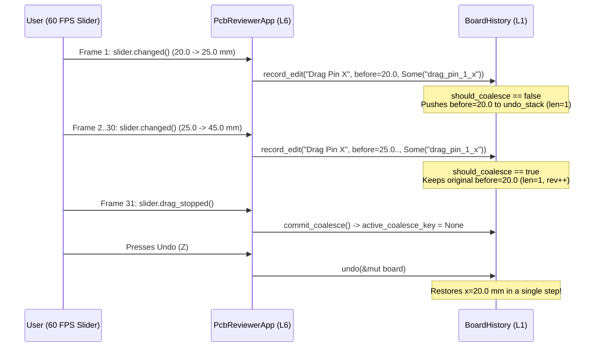

## Why Immediate-Mode Sliders Flood Naive Undo Stacks

Because `BoardModel::clone()` is now an `O(1)` copy of four `Arc` pointers (Lesson `0017`), we can store complete document snapshots inside a bounded `BoardHistory` (`undo_stack: VecDeque<HistoryEntry>`, `redo_stack: Vec<HistoryEntry>`).{{sidenote: **Why `VecDeque<HistoryEntry>`?** When `undo_stack.len() >= max_entries` (e.g., 32 steps), a `VecDeque` ring buffer evicts the oldest snapshot from the front via `pop_front()` in `O(1)` time without shifting all remaining elements.}}

However, immediate-mode UIs introduce a classic UX trap: when a user drags an `egui::Slider` (such as adjusting a review pin's X coordinate from `20.0 mm` to `45.0 mm`), `slider_resp.changed()` fires on **every 60-FPS frame** while the pointer is moving. If every frame pushed a new `HistoryEntry`, a half-second drag would push 30 intermediate snapshots onto `undo_stack`—forcing the user to press `Z` 30 times just to undo one drag!

We solve this with **`coalesce_key: Option<&str>`**:

1. **First Frame of a Drag (`active_coalesce_key != Some("drag_pin_1_x")`)**: `record_edit("Drag Pin X", before, Some("drag_pin_1_x"))` pushes the pre-drag `before` snapshot (`x = 20.0 mm`) onto `undo_stack` and records `active_coalesce_key = Some("drag_pin_1_x".to_owned())`.
2. **Subsequent Frames of the Same Drag (`active_coalesce_key == Some("drag_pin_1_x")`)**: `should_coalesce` is `true`! `record_edit` *keeps* the original `x = 20.0 mm` entry at the top of `undo_stack` without pushing intermediate frames, while still clearing `redo_stack` and incrementing `revision`.
3. **Pointer Release (`slider_resp.drag_stopped()`)**: Calling `commit_coalesce()` resets `active_coalesce_key = None`, so the *next* drag gesture starts a fresh undo entry.



## `O(1)` Undo/Redo Swaps with `std::mem::replace`

When the user clicks **Undo (Z)** or presses `Key::Z`, `BoardHistory::undo(&mut self, current: &mut BoardModel)` pops the most recent `HistoryEntry` from the back of `undo_stack`, swaps `entry.doc` into `*current` using `std::mem::replace(current, entry.doc)`, and pushes the replaced state onto `redo_stack`.{{sidenote: **Zero-Clone State Swap:** `std::mem::replace(current, entry.doc)` moves the saved `BoardModel` into `*current` and returns the outgoing `BoardModel` for `redo_stack` without even incrementing `Arc` reference counts!}}

```rust caption="BoardHistory record_edit, commit_coalesce, and undo in crates/pcb-doc/src/lib.rs"
impl BoardHistory {
    pub fn commit_coalesce(&mut self) {
        self.active_coalesce_key = None;
    }

    pub fn record_edit(&mut self, label: &str, before: BoardModel, coalesce_key: Option<&str>) {
        let should_coalesce =
            self.active_coalesce_key.as_deref() == coalesce_key && coalesce_key.is_some();

        if !should_coalesce {
            if self.undo_stack.len() >= self.max_entries {
                self.undo_stack.pop_front();
            }
            self.undo_stack.push_back(HistoryEntry {
                label: label.to_owned(),
                doc: before,
            });
        }

        self.redo_stack.clear();
        self.active_coalesce_key = coalesce_key.map(str::to_owned);
        self.revision += 1;
    }

    pub fn undo(&mut self, current: &mut BoardModel) -> Option<String> {
        let entry = self.undo_stack.pop_back()?;
        self.active_coalesce_key = None;
        let label = entry.label.clone();
        let prev = std::mem::replace(current, entry.doc);
        self.redo_stack.push(HistoryEntry {
            label: entry.label,
            doc: prev,
        });
        self.revision += 1;
        Some(label)
    }
}
```

{{widget:undo-coalesce-sim}}

:::exercise id="ex0018" title="Interactive Lab 2: Coalesce `egui::Slider` Drags & Swap Snapshots on Undo" badge="Skill Practice • Undo/Redo & Coalescing"
Complete `BoardHistory::record_edit`, `BoardHistory::undo`, and the `egui::Slider` response handling inside `render_active_pin_callout`.

```rust
pub fn record_edit(&mut self, label: &str, before: BoardModel, coalesce_key: Option<&str>) {
    let should_coalesce =
        self.active_coalesce_key.as_deref() == coalesce_key && coalesce_key.{{blank:is_some()|Coalesce only when coalesce_key is Some(...)|is_some()|115px}};

    if !should_coalesce {
        if self.undo_stack.len() >= self.max_entries {
            self.undo_stack.pop_front();
        }
        self.undo_stack.push_back(HistoryEntry {
            label: label.to_owned(),
            doc: before,
        });
    }
    self.redo_stack.clear();
    self.active_coalesce_key = coalesce_key.map(str::to_owned);
    self.revision += 1;
}

pub fn undo(&mut self, current: &mut BoardModel) -> Option<String> {
    let entry = self.undo_stack.pop_back()?;
    self.active_coalesce_key = None;
    let label = entry.label.clone();
    let prev = std::mem::{{blank:replace(current, entry.doc);;replace(current,entry.doc)|Swap entry.doc into current and return the outgoing BoardModel|replace(...)|245px}};
    self.redo_stack.push(HistoryEntry { label: entry.label, doc: prev });
    self.revision += 1;
    Some(label)
}

// Inside render_active_pin_callout:
let slider_resp = ui.add(egui::Slider::new(&mut x_mm, 5.0..=95.0).text("Pin X (mm)"));
if slider_resp.changed() {
    self.drag_review_pin_x(pin.id, x_mm);
}
if slider_resp.{{blank:drag_stopped()|Commit the coalesce gesture when the slider drag finishes|drag_stopped()|145px}} {
    self.commit_drag_gesture();
}
```

:::prompts
hint: Check `coalesce_key.is_some()` in `record_edit`, swap `*current` with `std::mem::replace(current, entry.doc)` in `undo`, and call `self.commit_drag_gesture()` when `slider_resp.drag_stopped()` is true.
success: Excellent! Continuous 60-FPS slider drags coalesce into a single undo entry and swap back in O(1) time via `std::mem::replace`.
:::
:::

:::verify id="verify-0018" title="Lab 3: Undo/Redo Coalescing `proptest` & Mutation Gate (`0018`)" badge="cargo test --workspace + proptest + cargo mutants" tier="Tier 2 (proptest) + Tier 3" caught="217 / 217 (100%)" missed="0 Missed"
Run the full workspace test suite (including `prop_coalesced_drag_restores_exact_initial_state_in_single_undo`) and the mutation suite for `BoardHistory` and the `pcb-reviewer` undo/redo controls:

```bash caption="Run proptest and cargo-mutants on 0017 Undo/Redo & Coalescing"
cargo test --manifest-path ./apps/0018-undo-redo-history-and-slider-coalescing/Cargo.toml --workspace
cargo mutants --manifest-path ./apps/0018-undo-redo-history-and-slider-coalescing/Cargo.toml --workspace --in-place -F "BoardHistory|move_review_pin_x|apply_pin_status_edit|add_review_pin_edit|drag_review_pin_x|commit_drag_gesture|undo_board_edit|redo_board_edit|handle_hotkeys|render_session_panel|render_active_pin_callout"
```

- [ ] `cargo test --manifest-path ./apps/0018-undo-redo-history-and-slider-coalescing/Cargo.toml --workspace` passes all **16 tests** (**10** in `pcb-doc` and **6** in `pcb-reviewer`).
- [ ] `prop_coalesced_drag_restores_exact_initial_state_in_single_undo` verifies across randomized drag sequences (`2..12` steps) that a coalesced drag produces `undo_len() == 1` and restores all 4 `Arc` pointers (`shared_arc_buffers == 4`) in one undo.
- [ ] `cargo mutants` catches all **48 viable new `BoardHistory` & UI mutants** (`1 unviable, 0 missed`), bringing the workspace total to **217 / 217 viable mutants caught (0 missed)**.
:::

:::quiz id="quiz-0018"
Q: Why does `BoardHistory::record_edit` check `self.active_coalesce_key.as_deref() == coalesce_key && coalesce_key.is_some()`?
- [ ] To merge consecutive discrete button clicks that pass `None` values
- [x] To merge consecutive slider drag frames sharing the same key
- [ ] To prevent `redo_stack` from clearing when a new edit occurs
- [ ] To sort all undo entries alphabetically by their label string
why: Requiring both `self.active_coalesce_key.as_deref() == coalesce_key` and `coalesce_key.is_some()` ensures that continuous frames with matching `Some("drag_pin_1_x")` coalesce into one undo entry, while discrete edits passing `None` always push a new entry.
hint: Consider what would happen if two discrete edits both passed `coalesce_key = None` without checking `coalesce_key.is_some()`.

Q: Which `egui::Response` method signals that the user just released a continuous `egui::Slider` drag?
- [ ] `slider_resp.hovered()`
- [ ] `slider_resp.clicked_elsewhere()`
- [x] `slider_resp.drag_stopped()`
- [ ] `slider_resp.request_focus()`
why: `Response::drag_stopped()` returns `true` on the frame the user releases a drag gesture, giving the app a clean boundary to call `commit_coalesce()`.
hint: Check `render_active_pin_callout` in `apps/0018-undo-redo-history-and-slider-coalescing/src/main.rs`.

Q: What happens to `self.redo_stack` inside `BoardHistory::record_edit` whenever the user performs a new edit?
- [ ] It is reversed and appended to the front of `undo_stack`
- [x] It is cleared so stale future branches cannot be reapplied
- [ ] It is serialized to a local disk file using `serde_json::to_string_pretty`
- [ ] It is cloned into `baseline_snapshot` right before incrementing the `revision`
why: In standard undo/redo state machines, performing any new edit after an undo invalidates the old redo timeline, so `self.redo_stack.clear()` discards stale future states.
hint: Look at the final lines of `BoardHistory::record_edit`.
:::

## Recommended Primary Source

:::callout
**Read (5 mins):** [`egui::Response::drag_stopped` Official API Docs](https://docs.rs/egui/latest/egui/struct.Response.html#method.drag_stopped) and [`std::collections::VecDeque` Rust Standard Library Docs](https://doc.rust-lang.org/std/collections/struct.VecDeque.html).
:::

:::teacher-prompt
**Act IV Complete!** You have scaled the Schematic & PCB Design Reviewer into a multi-crate, engine-first workspace (`crates/pcb-doc` at `L1` + `pcb-reviewer` at `L6`/`L7`) with versioned `serde_json` persistence, typed `thiserror` recovery, `O(1)` copy-on-write `Arc` snapshots (`Arc::make_mut` & `Arc::ptr_eq`), bounded `VecDeque` undo/redo history, continuous slider drag coalescing, and `proptest` property suites—verified across **217 / 217 caught mutants (0 missed)**. Ask any questions about Act IV in chat, or let me know when you are ready for **Act V (`0019`–`0021`): Production Hardening — Schema-Driven Command Engine, Adversarial `panic_hunt` Fuzzing, `gpu_lock` Visual Snapshots & Wasm/MCP Targets**!
:::
