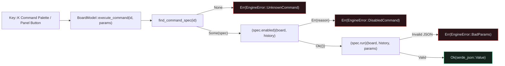

## Why Engine-First `egui` Apps Route Actions Through `CommandSpec`

As an `egui` CAD application grows, scattering state mutations across dozens of `if ui.button(...).clicked()` closures makes it hard to keep menu items, keyboard shortcuts, command palettes, and CLI/automation scripts in sync.{{sidenote: **The Three-Tier Command Taxonomy (`egui-command-engine`):** In an engine-first architecture, state-mutating operations and read-only queries live in a static `CommandSpec` table (`COMMAND_SPECS`), while shell/view toggles (`Key::K` palette modal, viewport pan/zoom) delegate to `BoardModel::execute_command`.}}

By defining a static `COMMAND_SPECS: &[CommandSpec]` registry inside `crates/pcb-doc` (`L1`), every command declares:

1. **Identity & Discoverability (`id`, `label`, `shortcut`, `journal`)**: Canonical dotted IDs (`"review.addPin"`, `"review.clearPins"`, `"history.undo"`, `"session.inspect"`) searchable by `filter_command_specs(query)`.
2. **Informative Precondition Guard (`enabled: EnabledFn`)**: A plain function pointer `fn(&BoardModel, &BoardHistory) -> Result<(), String>` returning *why* a command is unavailable (e.g., `"board has no review pins to clear"` or `"undo stack is empty"`), which surfaces as `EngineError::DisabledCommand`.
3. **Validated Execution (`run: RunFn`)**: A function pointer `fn(&mut BoardModel, &mut BoardHistory, &serde_json::Value) -> Result<serde_json::Value, EngineError>` that validates untrusted JSON parameters (`0.0..=100.0`, non-empty comments) before mutating state or recording an undo entry.



## 2. Anatomy of the `CommandSpec` Engine & Palette: Block by Block

Because `CommandSpec::run` accepts dynamic `&serde_json::Value` payloads (which can originate from a UI dialog, a CLI flag, or an MCP automation client), it must **never** panic when handed `null`, negative coordinates, out-of-bounds numbers, or whitespace-only strings.{{sidenote: **Ratchets Only Move Up (`COMMAND_PARITY_FLOOR`):** Asserting `COMMAND_SPECS.len() >= COMMAND_PARITY_FLOOR` ensures that refactoring command modules never silently drops a registered command from the palette.}}

Rather than reading all 220 lines of command registry, parameter validation, UI windowing, and adversarial fuzzing code at once, let's unpack the new code in `crates/pcb-doc/src/lib.rs` and `src/main.rs` across four logical blocks before viewing the complete listing in context.

### Block 1: Typed Engine Errors, Function Pointers & Precondition Guards (`crates/pcb-doc/src/lib.rs`)

```rust
/// Minimum number of registered `CommandSpec`s enforced by our Tier 6 parity ratchet.
pub const COMMAND_PARITY_FLOOR: usize = 4;

/// Typed, panic-free errors returned by the `CommandSpec` execution engine.
#[derive(Clone, Debug, Error, PartialEq, Eq)]
pub enum EngineError {
    #[error("unknown command `{0}`")]
    UnknownCommand(String),
    #[error("command `{id}` is disabled: {reason}")]
    DisabledCommand { id: String, reason: String },
    #[error("invalid parameters for `{id}`: {reason}")]
    BadParams { id: String, reason: String },
}

pub type EnabledFn = fn(&BoardModel, &BoardHistory) -> Result<(), String>;
pub type RunFn = fn(
    &mut BoardModel,
    &mut BoardHistory,
    &serde_json::Value,
) -> Result<serde_json::Value, EngineError>;

/// Metadata, precondition guard, and execution function pointer for a single engine command.
#[derive(Clone, Copy, Debug)]
pub struct CommandSpec {
    pub id: &'static str,
    pub label: &'static str,
    pub shortcut: Option<&'static str>,
    pub journal: bool,
    pub enabled: EnabledFn,
    pub run: RunFn,
}

fn always_enabled(_board: &BoardModel, _history: &BoardHistory) -> Result<(), String> {
    Ok(())
}

fn has_review_pins(board: &BoardModel, _history: &BoardHistory) -> Result<(), String> {
    if board.review_pins.is_empty() {
        Err("board has no review pins to clear".to_owned())
    } else {
        Ok(())
    }
}

fn can_undo_history(_board: &BoardModel, history: &BoardHistory) -> Result<(), String> {
    if history.can_undo() {
        Ok(())
    } else {
        Err("undo stack is empty".to_owned())
    }
}
```

- **`COMMAND_PARITY_FLOOR: usize = 4`**: A monotonic ratchet constant used by our test suite to guarantee that refactoring never accidentally removes a registered command from the table.
- **`#[derive(Clone, Debug, Error, PartialEq, Eq)] pub enum EngineError`**: Uses `thiserror::Error` to classify every command failure into one of three structured variants—`UnknownCommand`, `DisabledCommand { id, reason }`, or `BadParams { id, reason }`—so `#[deny(clippy::unwrap_used, clippy::panic)]` stays 100% satisfied.
- **`pub type EnabledFn` & `pub type RunFn`**: Plain Rust function pointer types (`fn(...) -> ...`). Because stateless `fn` pointers have a fixed pointer size and capture no environment, `CommandSpec` can derive `Copy` and live in a compile-time `static` slice without `Box<dyn Fn>` heap allocations.
- **`has_review_pins` & `can_undo_history`**: Precondition guards that inspect `&BoardModel` and `&BoardHistory` immutably and return `Err(String)` with a human-readable explanation whenever an action cannot run.

### Block 2: Validated Command Handlers, `COMMAND_SPECS` & `execute_command` (`crates/pcb-doc/src/lib.rs`)

```rust
fn run_add_pin(
    board: &mut BoardModel,
    history: &mut BoardHistory,
    params: &serde_json::Value,
) -> Result<serde_json::Value, EngineError> {
    let x_mm = params
        .get("x_mm")
        .and_then(serde_json::Value::as_f64)
        .ok_or_else(|| EngineError::BadParams {
            id: "review.addPin".to_owned(),
            reason: "missing numeric x_mm".to_owned(),
        })? as f32;
    let y_mm = params
        .get("y_mm")
        .and_then(serde_json::Value::as_f64)
        .ok_or_else(|| EngineError::BadParams {
            id: "review.addPin".to_owned(),
            reason: "missing numeric y_mm".to_owned(),
        })? as f32;
    if !(0.0..=100.0).contains(&x_mm) || !(0.0..=70.0).contains(&y_mm) {
        return Err(EngineError::BadParams {
            id: "review.addPin".to_owned(),
            reason: "coordinates out of board bounds".to_owned(),
        });
    }
    let comment = params
        .get("comment")
        .and_then(serde_json::Value::as_str)
        .map(str::trim)
        .filter(|s| !s.is_empty())
        .ok_or_else(|| EngineError::BadParams {
            id: "review.addPin".to_owned(),
            reason: "comment must not be empty".to_owned(),
        })?;
    let before = board.clone();
    let id = board.add_review_pin_at(pos2(x_mm, y_mm), "cmd", comment, PinSeverity::Warning);
    history.record_edit("Place Review Pin", before, None);
    Ok(serde_json::json!({
        "added_pin_id": id.0,
        "pin_count": board.review_pins.len(),
    }))
}

fn run_clear_pins(
    board: &mut BoardModel,
    history: &mut BoardHistory,
    _params: &serde_json::Value,
) -> Result<serde_json::Value, EngineError> {
    let cleared = board.review_pins.len();
    let before = board.clone();
    board.clear_review_pins();
    history.record_edit("Clear Review Pins", before, None);
    Ok(serde_json::json!({
        "cleared_count": cleared,
        "pin_count": board.review_pins.len(),
    }))
}

fn run_history_undo(
    board: &mut BoardModel,
    history: &mut BoardHistory,
    _params: &serde_json::Value,
) -> Result<serde_json::Value, EngineError> {
    let label = history.undo(board).unwrap_or_default();
    Ok(serde_json::json!({
        "undone_label": label,
        "undo_len": history.undo_len(),
    }))
}

fn run_session_inspect(
    board: &mut BoardModel,
    history: &mut BoardHistory,
    _params: &serde_json::Value,
) -> Result<serde_json::Value, EngineError> {
    Ok(serde_json::json!({
        "pin_count": board.review_pins.len(),
        "pad_count": board.pads.len(),
        "revision": history.revision(),
    }))
}

pub static COMMAND_SPECS: &[CommandSpec] = &[
    CommandSpec {
        id: "review.addPin",
        label: "Place Review Pin",
        shortcut: Some("P"),
        journal: true,
        enabled: always_enabled,
        run: run_add_pin,
    },
    CommandSpec {
        id: "review.clearPins",
        label: "Clear Review Pins",
        shortcut: None,
        journal: true,
        enabled: has_review_pins,
        run: run_clear_pins,
    },
    CommandSpec {
        id: "history.undo",
        label: "Undo Last Edit",
        shortcut: Some("Z"),
        journal: false,
        enabled: can_undo_history,
        run: run_history_undo,
    },
    CommandSpec {
        id: "session.inspect",
        label: "Inspect Session Telemetry",
        shortcut: Some("I"),
        journal: false,
        enabled: always_enabled,
        run: run_session_inspect,
    },
];

pub fn find_command_spec(id: &str) -> Option<&'static CommandSpec> {
    COMMAND_SPECS.iter().find(|spec| spec.id == id)
}

pub fn filter_command_specs(query: &str) -> Vec<&'static CommandSpec> {
    let needle = query.trim().to_ascii_lowercase();
    if needle.is_empty() {
        return COMMAND_SPECS.iter().collect();
    }
    COMMAND_SPECS
        .iter()
        .filter(|spec| {
            spec.id.to_ascii_lowercase().contains(&needle)
                || spec.label.to_ascii_lowercase().contains(&needle)
        })
        .collect()
}

impl BoardModel {
    /// Validates and executes a registered `CommandSpec` by `id` against `self` and `history`.
    pub fn execute_command(
        &mut self,
        history: &mut BoardHistory,
        id: &str,
        params: &serde_json::Value,
    ) -> Result<serde_json::Value, EngineError> {
        let spec =
            find_command_spec(id).ok_or_else(|| EngineError::UnknownCommand(id.to_owned()))?;
        (spec.enabled)(self, history).map_err(|reason| EngineError::DisabledCommand {
            id: spec.id.to_owned(),
            reason,
        })?;
        (spec.run)(self, history, params)
    }
}
```

- **Untrusted JSON Validation (`run_add_pin`)**: Extracts `x_mm` and `y_mm` via `.get(...).and_then(Value::as_f64)`, checks board bounds with `!(0.0..=100.0).contains(&x_mm) || !(0.0..=70.0).contains(&y_mm)`, and trims `comment` with `.map(str::trim).filter(|s| !s.is_empty())` before cloning an `O(1)` `Arc` snapshot (`let before = board.clone();`) and recording an undo entry.
- **`pub static COMMAND_SPECS: &[CommandSpec]`**: A compile-time static slice registering all four engine commands (`"review.addPin"`, `"review.clearPins"`, `"history.undo"`, `"session.inspect"`), their UI labels, optional shortcut badges, journal flags, and `enabled`/`run` function pointers.
- **`find_command_spec` & `filter_command_specs`**: Lookup and case-insensitive substring search helpers over `COMMAND_SPECS` matching both `spec.id` and `spec.label`.
- **`BoardModel::execute_command`**: Resolves `find_command_spec(id)` into `EngineError::UnknownCommand`, invokes `(spec.enabled)(self, history)` (notice the parentheses around `spec.enabled` required in Rust to call a function pointer stored in a struct field!), and finally invokes `(spec.run)(self, history, params)`.

### Block 3: Command Palette State, `Key::K` Shortcut & Floating `egui::Window` (`src/main.rs`)

```rust
// Added fields on `pub struct ViewState`:
pub show_command_palette: bool,
pub command_palette_query: String,
pub last_command_status: String,

// Added method on `impl ViewState`:
pub fn toggle_command_palette(&mut self) {
    self.show_command_palette = !self.show_command_palette;
}

// Added methods on `impl PcbReviewerApp`:
/// Dispatches a registered `CommandSpec` by `id` and updates `self.view.last_command_status`.
pub fn dispatch_ui_command(&mut self, id: &str, params: serde_json::Value) -> bool {
    match self.board.execute_command(&mut self.history, id, &params) {
        Ok(_) => {
            self.view.last_command_status = format!("OK: {id}");
            true
        }
        Err(err) => {
            self.view.last_command_status = format!("ERR: {err}");
            false
        }
    }
}

pub fn render_command_palette_window(&mut self, ctx: &egui::Context) {
    if !self.view.show_command_palette {
        return;
    }
    egui::Window::new("Command Palette")
        .id(egui::Id::unique("command_palette_window"))
        .collapsible(false)
        .resizable(false)
        .show(ctx, |ui| {
            let cmd_label = ui.label("Filter Commands:");
            ui.text_edit_singleline(&mut self.view.command_palette_query)
                .labelled_by(cmd_label.id);
            let matching = filter_command_specs(&self.view.command_palette_query);
            ui.label(format!("Matching Commands: {}", matching.len()));
            if ui.button("Run: Inspect Session").clicked() {
                self.dispatch_ui_command("session.inspect", serde_json::json!({}));
            }
            if ui.button("Run: Clear Review Pins").clicked() {
                self.dispatch_ui_command("review.clearPins", serde_json::json!({}));
            }
            if ui.button("Close Palette").clicked() {
                self.view.show_command_palette = false;
            }
        });
}
```

- **`ViewState` Palette Fields & `toggle_command_palette`**: Stores `show_command_palette` (`false` by default), `command_palette_query`, and `last_command_status` (`"Ready (4 specs)"`), toggled either by pressing `Key::K` in `handle_hotkeys` (`ctx.input_mut(|i| i.consume_key(egui::Modifiers::NONE, egui::Key::K))`) or clicking `"Command Palette (K)"` in `render_session_panel`.
- **`PcbReviewerApp::dispatch_ui_command`**: Bridges `egui` button clicks to `self.board.execute_command(&mut self.history, id, &params)`, formatting either `"OK: {id}"` or `"ERR: {err}"` into `self.view.last_command_status` for immediate status feedback.
- **`render_command_palette_window`**: Renders a floating `egui::Window::new("Command Palette")` with a deterministic `.id(egui::Id::unique("command_palette_window"))`, an accessible search box (`labelled_by(cmd_label.id)`), a live count of `filter_command_specs(&self.view.command_palette_query)`, and quick-dispatch buttons.

### Block 4: Tier 5 `panic_hunt` Fuzzer & Headless Palette Tests (`crates/pcb-doc/src/lib.rs` & `src/main.rs`)

```rust
// In `crates/pcb-doc/src/lib.rs` (`#[cfg(test)] mod tests`):
#[test]
fn command_registry_dispatch_and_panic_hunt_fuzzer_preserve_invariants() {
    assert!(COMMAND_SPECS.len() >= COMMAND_PARITY_FLOOR);
    assert_eq!(filter_command_specs("   ").len(), 4);
    assert_eq!(filter_command_specs("addpin")[0].id, "review.addPin");
    assert_eq!(filter_command_specs("telemetry")[0].id, "session.inspect");
    assert!(filter_command_specs("nonexistent_xyz").is_empty());

    let mut board = BoardModel::default();
    let mut history = BoardHistory::default();

    assert_eq!(
        board.execute_command(&mut history, "unknown.cmd", &serde_json::Value::Null),
        Err(EngineError::UnknownCommand("unknown.cmd".to_owned()))
    );
    assert_eq!(
        board.execute_command(&mut history, "history.undo", &serde_json::Value::Null),
        Err(EngineError::DisabledCommand {
            id: "history.undo".to_owned(),
            reason: "undo stack is empty".to_owned(),
        })
    );

    let inspect_out = board
        .execute_command(&mut history, "session.inspect", &serde_json::json!({}))
        .unwrap();
    assert_eq!(
        inspect_out,
        serde_json::json!({ "pin_count": 2, "pad_count": 3, "revision": 0 })
    );

    // Adversarial validation on review.addPin (Tier 5 panic_hunt)
    for (bad_payload, expected_reason) in [
        (serde_json::json!({ "y_mm": 20.0, "comment": "ok" }), "missing numeric x_mm"),
        (serde_json::json!({ "x_mm": 20.0, "comment": "ok" }), "missing numeric y_mm"),
        (
            serde_json::json!({ "x_mm": -1.0, "y_mm": 20.0, "comment": "ok" }),
            "coordinates out of board bounds",
        ),
        (
            serde_json::json!({ "x_mm": 105.0, "y_mm": 20.0, "comment": "ok" }),
            "coordinates out of board bounds",
        ),
        (
            serde_json::json!({ "x_mm": 20.0, "y_mm": -2.0, "comment": "ok" }),
            "coordinates out of board bounds",
        ),
        (
            serde_json::json!({ "x_mm": 20.0, "y_mm": 75.0, "comment": "ok" }),
            "coordinates out of board bounds",
        ),
        (
            serde_json::json!({ "x_mm": 20.0, "y_mm": 30.0, "comment": "   " }),
            "comment must not be empty",
        ),
    ] {
        assert_eq!(
            board.execute_command(&mut history, "review.addPin", &bad_payload),
            Err(EngineError::BadParams {
                id: "review.addPin".to_owned(),
                reason: expected_reason.to_owned(),
            })
        );
    }

    // Exact boundary checks (0.0, 100.0, 70.0)
    let added = board
        .execute_command(
            &mut history,
            "review.addPin",
            &serde_json::json!({ "x_mm": 0.0, "y_mm": 70.0, "comment": "  Edge check  " }),
        )
        .unwrap();
    assert_eq!(added, serde_json::json!({ "added_pin_id": 3, "pin_count": 3 }));
    assert_eq!(board.review_pins[&PinId(3)].position_mm, pos2(0.0, 70.0));
    assert_eq!(board.review_pins[&PinId(3)].comment, "Edge check");
    assert_eq!(history.undo_len(), 1);

    let added_max = board
        .execute_command(
            &mut history,
            "review.addPin",
            &serde_json::json!({ "x_mm": 100.0, "y_mm": 0.0, "comment": "Corner" }),
        )
        .unwrap();
    assert_eq!(added_max, serde_json::json!({ "added_pin_id": 4, "pin_count": 4 }));

    let undone = board
        .execute_command(&mut history, "history.undo", &serde_json::json!({}))
        .unwrap();
    assert_eq!(
        undone,
        serde_json::json!({ "undone_label": "Place Review Pin", "undo_len": 1 })
    );
    assert_eq!(board.review_pins.len(), 3);

    let cleared = board
        .execute_command(&mut history, "review.clearPins", &serde_json::json!({}))
        .unwrap();
    assert_eq!(
        cleared,
        serde_json::json!({ "cleared_count": 3, "pin_count": 0 })
    );
    assert_eq!(
        board.execute_command(&mut history, "review.clearPins", &serde_json::json!({})),
        Err(EngineError::DisabledCommand {
            id: "review.clearPins".to_owned(),
            reason: "board has no review pins to clear".to_owned(),
        })
    );
}
```

- **Tier 5 `panic_hunt` Table**: Iterates over seven adversarial JSON payloads (missing `x_mm`/`y_mm`, negative and out-of-range coordinates `-1.0`, `105.0`, `-2.0`, `75.0`, and whitespace-only comments) and asserts that every single one returns `Err(EngineError::BadParams)` without panicking.
- **Boundary-Value Mutation Catching (`0.0`, `100.0`, `70.0`)**: Testing pins placed directly on `(0.0, 70.0)` and `(100.0, 0.0)` kills `<` vs. `<=` boundary mutants inside `(0.0..=100.0).contains(&x_mm)` and `(0.0..=70.0).contains(&y_mm)`.
- **Headless `egui_kittest` Palette Workflow (`src/main.rs`)**: Presses `harness.key_press(egui::Key::K)`, queries `"Matching Commands: 4"`, clicks `"Run: Inspect Session"` and `"Run: Clear Review Pins"`, and verifies `"Cmd Engine: OK: review.clearPins"`.

### Complete Lesson 0019 Code Listing (In Context)

Putting all four blocks together, here are the complete updated sections of `crates/pcb-doc/src/lib.rs` and `src/main.rs` in context:

```rust caption="Complete CommandSpec registry and execute_command engine in crates/pcb-doc/src/lib.rs"
/// Minimum number of registered `CommandSpec`s enforced by our Tier 6 parity ratchet.
pub const COMMAND_PARITY_FLOOR: usize = 4;

/// Typed, panic-free errors returned by the `CommandSpec` execution engine.
#[derive(Clone, Debug, Error, PartialEq, Eq)]
pub enum EngineError {
    #[error("unknown command `{0}`")]
    UnknownCommand(String),
    #[error("command `{id}` is disabled: {reason}")]
    DisabledCommand { id: String, reason: String },
    #[error("invalid parameters for `{id}`: {reason}")]
    BadParams { id: String, reason: String },
}

pub type EnabledFn = fn(&BoardModel, &BoardHistory) -> Result<(), String>;
pub type RunFn = fn(
    &mut BoardModel,
    &mut BoardHistory,
    &serde_json::Value,
) -> Result<serde_json::Value, EngineError>;

/// Metadata, precondition guard, and execution function pointer for a single engine command.
#[derive(Clone, Copy, Debug)]
pub struct CommandSpec {
    pub id: &'static str,
    pub label: &'static str,
    pub shortcut: Option<&'static str>,
    pub journal: bool,
    pub enabled: EnabledFn,
    pub run: RunFn,
}

fn always_enabled(_board: &BoardModel, _history: &BoardHistory) -> Result<(), String> {
    Ok(())
}

fn has_review_pins(board: &BoardModel, _history: &BoardHistory) -> Result<(), String> {
    if board.review_pins.is_empty() {
        Err("board has no review pins to clear".to_owned())
    } else {
        Ok(())
    }
}

fn can_undo_history(_board: &BoardModel, history: &BoardHistory) -> Result<(), String> {
    if history.can_undo() {
        Ok(())
    } else {
        Err("undo stack is empty".to_owned())
    }
}

fn run_add_pin(
    board: &mut BoardModel,
    history: &mut BoardHistory,
    params: &serde_json::Value,
) -> Result<serde_json::Value, EngineError> {
    let x_mm = params
        .get("x_mm")
        .and_then(serde_json::Value::as_f64)
        .ok_or_else(|| EngineError::BadParams {
            id: "review.addPin".to_owned(),
            reason: "missing numeric x_mm".to_owned(),
        })? as f32;
    let y_mm = params
        .get("y_mm")
        .and_then(serde_json::Value::as_f64)
        .ok_or_else(|| EngineError::BadParams {
            id: "review.addPin".to_owned(),
            reason: "missing numeric y_mm".to_owned(),
        })? as f32;
    if !(0.0..=100.0).contains(&x_mm) || !(0.0..=70.0).contains(&y_mm) {
        return Err(EngineError::BadParams {
            id: "review.addPin".to_owned(),
            reason: "coordinates out of board bounds".to_owned(),
        });
    }
    let comment = params
        .get("comment")
        .and_then(serde_json::Value::as_str)
        .map(str::trim)
        .filter(|s| !s.is_empty())
        .ok_or_else(|| EngineError::BadParams {
            id: "review.addPin".to_owned(),
            reason: "comment must not be empty".to_owned(),
        })?;
    let before = board.clone();
    let id = board.add_review_pin_at(pos2(x_mm, y_mm), "cmd", comment, PinSeverity::Warning);
    history.record_edit("Place Review Pin", before, None);
    Ok(serde_json::json!({
        "added_pin_id": id.0,
        "pin_count": board.review_pins.len(),
    }))
}

fn run_clear_pins(
    board: &mut BoardModel,
    history: &mut BoardHistory,
    _params: &serde_json::Value,
) -> Result<serde_json::Value, EngineError> {
    let cleared = board.review_pins.len();
    let before = board.clone();
    board.clear_review_pins();
    history.record_edit("Clear Review Pins", before, None);
    Ok(serde_json::json!({
        "cleared_count": cleared,
        "pin_count": board.review_pins.len(),
    }))
}

fn run_history_undo(
    board: &mut BoardModel,
    history: &mut BoardHistory,
    _params: &serde_json::Value,
) -> Result<serde_json::Value, EngineError> {
    let label = history.undo(board).unwrap_or_default();
    Ok(serde_json::json!({
        "undone_label": label,
        "undo_len": history.undo_len(),
    }))
}

fn run_session_inspect(
    board: &mut BoardModel,
    history: &mut BoardHistory,
    _params: &serde_json::Value,
) -> Result<serde_json::Value, EngineError> {
    Ok(serde_json::json!({
        "pin_count": board.review_pins.len(),
        "pad_count": board.pads.len(),
        "revision": history.revision(),
    }))
}

pub static COMMAND_SPECS: &[CommandSpec] = &[
    CommandSpec {
        id: "review.addPin",
        label: "Place Review Pin",
        shortcut: Some("P"),
        journal: true,
        enabled: always_enabled,
        run: run_add_pin,
    },
    CommandSpec {
        id: "review.clearPins",
        label: "Clear Review Pins",
        shortcut: None,
        journal: true,
        enabled: has_review_pins,
        run: run_clear_pins,
    },
    CommandSpec {
        id: "history.undo",
        label: "Undo Last Edit",
        shortcut: Some("Z"),
        journal: false,
        enabled: can_undo_history,
        run: run_history_undo,
    },
    CommandSpec {
        id: "session.inspect",
        label: "Inspect Session Telemetry",
        shortcut: Some("I"),
        journal: false,
        enabled: always_enabled,
        run: run_session_inspect,
    },
];

pub fn find_command_spec(id: &str) -> Option<&'static CommandSpec> {
    COMMAND_SPECS.iter().find(|spec| spec.id == id)
}

pub fn filter_command_specs(query: &str) -> Vec<&'static CommandSpec> {
    let needle = query.trim().to_ascii_lowercase();
    if needle.is_empty() {
        return COMMAND_SPECS.iter().collect();
    }
    COMMAND_SPECS
        .iter()
        .filter(|spec| {
            spec.id.to_ascii_lowercase().contains(&needle)
                || spec.label.to_ascii_lowercase().contains(&needle)
        })
        .collect()
}

impl BoardModel {
    /// Validates and executes a registered `CommandSpec` by `id` against `self` and `history`.
    pub fn execute_command(
        &mut self,
        history: &mut BoardHistory,
        id: &str,
        params: &serde_json::Value,
    ) -> Result<serde_json::Value, EngineError> {
        let spec =
            find_command_spec(id).ok_or_else(|| EngineError::UnknownCommand(id.to_owned()))?;
        (spec.enabled)(self, history).map_err(|reason| EngineError::DisabledCommand {
            id: spec.id.to_owned(),
            reason,
        })?;
        (spec.run)(self, history, params)
    }
}
```

```rust caption="Complete Command Palette UI integration and headless test in src/main.rs"
impl PcbReviewerApp {
    /// Dispatches a registered `CommandSpec` by `id` and updates `self.view.last_command_status`.
    pub fn dispatch_ui_command(&mut self, id: &str, params: serde_json::Value) -> bool {
        match self.board.execute_command(&mut self.history, id, &params) {
            Ok(_) => {
                self.view.last_command_status = format!("OK: {id}");
                true
            }
            Err(err) => {
                self.view.last_command_status = format!("ERR: {err}");
                false
            }
        }
    }

    pub fn render_command_palette_window(&mut self, ctx: &egui::Context) {
        if !self.view.show_command_palette {
            return;
        }
        egui::Window::new("Command Palette")
            .id(egui::Id::unique("command_palette_window"))
            .collapsible(false)
            .resizable(false)
            .show(ctx, |ui| {
                let cmd_label = ui.label("Filter Commands:");
                ui.text_edit_singleline(&mut self.view.command_palette_query)
                    .labelled_by(cmd_label.id);
                let matching = filter_command_specs(&self.view.command_palette_query);
                ui.label(format!("Matching Commands: {}", matching.len()));
                if ui.button("Run: Inspect Session").clicked() {
                    self.dispatch_ui_command("session.inspect", serde_json::json!({}));
                }
                if ui.button("Run: Clear Review Pins").clicked() {
                    self.dispatch_ui_command("review.clearPins", serde_json::json!({}));
                }
                if ui.button("Close Palette").clicked() {
                    self.view.show_command_palette = false;
                }
            });
    }
}

// Inside `standalone_layer_swatch_and_headless_ui_workflows_pass` (`src/main.rs`):
harness.key_press(egui::Key::K);
harness.run();
assert!(harness.state().view.show_command_palette);
assert!(harness.query_by_label("Matching Commands: 4").is_some());

harness.get_by_label("Run: Inspect Session").click();
harness.run();
assert!(
    harness
        .query_by_label("Cmd Engine: OK: session.inspect")
        .is_some()
);

harness.get_by_label("Run: Clear Review Pins").click();
harness.run();
assert_eq!(harness.state().board.review_pins.len(), 0);
assert!(
    harness
        .query_by_label("Cmd Engine: OK: review.clearPins")
        .is_some()
);

harness.get_by_label("Close Palette").click();
harness.run();
assert!(!harness.state().view.show_command_palette);

harness.get_by_label("Command Palette (K)").click();
harness.run();
assert!(harness.state().view.show_command_palette);
```

{{widget:command-palette-sim}}

:::exercise id="ex0019" title="Interactive Lab 2: Dispatch `CommandSpec` Function Pointers & Guard Preconditions" badge="Skill Practice • CommandSpec & Function Pointers"
Complete `has_review_pins`, `BoardModel::execute_command`, and `PcbReviewerApp::dispatch_ui_command` so disabled or unknown commands return typed `EngineError` values cleanly.

```rust
fn has_review_pins(board: &BoardModel, _history: &BoardHistory) -> Result<(), String> {
    if board.review_pins.{{blank:is_empty()|Check whether board.review_pins is empty|is_empty()|115px}} {
        Err("board has no review pins to clear".to_owned())
    } else {
        Ok(())
    }
}

pub fn execute_command(
    &mut self,
    history: &mut BoardHistory,
    id: &str,
    params: &serde_json::Value,
) -> Result<serde_json::Value, EngineError> {
    let spec =
        {{blank:find_command_spec(id)|Look up the CommandSpec in COMMAND_SPECS by id|find_command_spec(...)|205px}}.ok_or_else(|| EngineError::UnknownCommand(id.to_owned()))?;
    (spec.enabled)(self, history).map_err(|reason| EngineError::DisabledCommand {
        id: spec.id.to_owned(),
        reason,
    })?;
    {{blank:(spec.run)(self, history, params)|Invoke the spec.run function pointer with (self, history, params)|(spec.run)(...)|285px}}
}
```

:::prompts
hint: Check `board.review_pins.is_empty()` in `has_review_pins`, look up `find_command_spec(id)` in `execute_command`, and invoke `(spec.run)(self, history, params)` after the `enabled` guard succeeds.
success: Awesome! Every command is looked up in `COMMAND_SPECS`, checked against `(spec.enabled)(self, history)`, and executed via `(spec.run)(self, history, params)`.
:::
:::

:::verify id="verify-0019" title="Lab 3: Command Registry Parity, `panic_hunt` Fuzzer & Mutation Gate (`0019`)" badge="cargo test --workspace + panic_hunt + cargo mutants" tier="Tier 5 (panic_hunt) + Tier 6" caught="238 / 238 (100%)" missed="0 Missed"
Run the workspace test suite (including `command_registry_dispatch_and_panic_hunt_fuzzer_preserve_invariants`) and mutate all `CommandSpec` precondition guards, parameter validators, and palette UI handlers:

```bash caption="Run panic_hunt and cargo-mutants on 0018 CommandSpec engine"
cargo test --manifest-path ./apps/0019-the-command-pattern-and-command-palette/Cargo.toml --workspace
cargo mutants --manifest-path ./apps/0019-the-command-pattern-and-command-palette/Cargo.toml --workspace --in-place -F "always_enabled|has_review_pins|can_undo_history|run_add_pin|run_clear_pins|run_history_undo|run_session_inspect|find_command_spec|filter_command_specs|execute_command|toggle_command_palette|dispatch_ui_command|render_command_palette_window"
```

- [ ] `cargo test --manifest-path ./apps/0019-the-command-pattern-and-command-palette/Cargo.toml --workspace` passes all **17 tests** (**11** in `pcb-doc` and **6** in `pcb-reviewer`).
- [ ] `command_registry_dispatch_and_panic_hunt_fuzzer_preserve_invariants` verifies `COMMAND_SPECS.len() >= COMMAND_PARITY_FLOOR` and asserts that missing keys, negative/out-of-bounds coordinates (`-1.0`, `105.0`, `-2.0`, `75.0`), and blank comments return `Err(EngineError::BadParams)` without panicking.
- [ ] `cargo mutants` catches all **21 viable new `CommandSpec` & Command Palette mutants** (`2 unviable, 0 missed`), bringing the workspace total to **238 / 238 viable mutants caught (0 missed)**.
:::

:::quiz id="quiz-0019"
Q: Why does `CommandSpec` store an `EnabledFn` returning `Result<(), String>` instead of a bare `bool`?
- [ ] To serialize function pointers directly into JSON session files
- [x] To report a human-readable disabled reason to UI tooltips
- [ ] To bypass the borrow checker during background thread spawns
- [ ] To force every registered command to mutate board state
why: Returning `Result<(), String>` lets both the `egui` frontend and external automation clients inspect the exact reason a command is currently unavailable (such as `"undo stack is empty"`).
hint: Look at `EngineError::DisabledCommand { id, reason }` in `crates/pcb-doc/src/lib.rs`.

Q: What does the Tier 5 `panic_hunt` test verify across all registered `CommandSpec` entries?
- [ ] That every command renders a custom GPU triangle mesh
- [ ] That command IDs are sorted in reverse alphabetical order
- [x] That adversarial JSON inputs return typed errors without panicking
- [ ] That undo history stacks never exceed four total entries
why: `panic_hunt` feeds missing keys, out-of-range coordinates, and empty strings into `execute_command` to guarantee every command validates its parameters and returns `Result` rather than panicking.
hint: Check the adversarial payload loop in `command_registry_dispatch_and_panic_hunt_fuzzer_preserve_invariants`.

Q: Why do we assert `COMMAND_SPECS.len() >= COMMAND_PARITY_FLOOR` inside our workspace test suite?
- [x] To prevent accidental command deletions from regressing registry coverage
- [ ] To limit the maximum number of open floating windows
- [ ] To pre-allocate fixed stack buffers inside the GPU driver
- [ ] To disable keyboard shortcuts whenever the palette is closed
why: A monotonic parity floor ratchet ensures that refactoring command tables never accidentally drops registered commands without failing CI.
hint: Review `COMMAND_PARITY_FLOOR` in `crates/pcb-doc/src/lib.rs`.
:::

## Recommended Primary Source

:::callout
**Read (5 mins):** [The Rust Programming Language — §19.4 "Advanced Functions and Closures (`fn` Function Pointers)"](https://doc.rust-lang.org/book/ch19-05-advanced-functions-and-closures.html) and [`serde_json::Value` Official API Docs](https://docs.rs/serde_json/latest/serde_json/enum.Value.html).
:::

:::teacher-prompt
Next up: [Lesson 0020: Spatial Viewport Culling (`Rect::intersects`), Batched Geometry & Frame Performance Budgets](./0020-viewport-culling-and-cached-tessellation.html), where we keep our 2D PCB canvas locked at 60 FPS on dense boards and prove spatial culling equivalence with `proptest`!
:::
