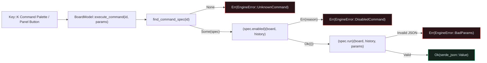

## Why Engine-First `egui` Apps Route Actions Through `CommandSpec`

As an `egui` CAD application grows, scattering state mutations across dozens of `if ui.button(...).clicked()` closures makes it hard to keep menu items, keyboard shortcuts, command palettes, and CLI/automation scripts in sync.{{sidenote: **The Three-Tier Command Taxonomy (`egui-command-engine`):** In an engine-first architecture, state-mutating operations and read-only queries live in a static `CommandSpec` table (`COMMAND_SPECS`), while shell/view toggles (`Key::K` palette modal, viewport pan/zoom) delegate to `BoardModel::execute_command`.}}

By defining a static `COMMAND_SPECS: &[CommandSpec]` registry inside `crates/pcb-doc` (`L1`), every command declares:

1. **Identity & Discoverability (`id`, `label`, `shortcut`, `journal`)**: Canonical dotted IDs (`"review.addPin"`, `"review.clearPins"`, `"history.undo"`, `"session.inspect"`) searchable by `filter_command_specs(query)`.
2. **Informative Precondition Guard (`enabled: EnabledFn`)**: A plain function pointer `fn(&BoardModel, &BoardHistory) -> Result<(), String>` returning *why* a command is unavailable (e.g., `"board has no review pins to clear"` or `"undo stack is empty"`), which surfaces as `EngineError::DisabledCommand`.
3. **Validated Execution (`run: RunFn`)**: A function pointer `fn(&mut BoardModel, &mut BoardHistory, &serde_json::Value) -> Result<serde_json::Value, EngineError>` that validates untrusted JSON parameters (`0.0..=100.0`, non-empty comments) before mutating state or recording an undo entry.



## Tier 5 `panic_hunt` Fuzzing & `COMMAND_PARITY_FLOOR`

Because `CommandSpec::run` accepts dynamic `&serde_json::Value` payloads (which can originate from a UI dialog, a CLI flag, or an MCP automation client), it must **never** panic when handed `null`, negative coordinates, out-of-bounds numbers, or whitespace-only strings.{{sidenote: **Ratchets Only Move Up (`COMMAND_PARITY_FLOOR`):** Asserting `COMMAND_SPECS.len() >= COMMAND_PARITY_FLOOR` ensures that refactoring command modules never silently drops a registered command from the palette.}}

```rust caption="CommandSpec registry and execute_command dispatcher in crates/pcb-doc/src/lib.rs"
pub type EnabledFn = fn(&BoardModel, &BoardHistory) -> Result<(), String>;
pub type RunFn = fn(
    &mut BoardModel,
    &mut BoardHistory,
    &serde_json::Value,
) -> Result<serde_json::Value, EngineError>;

#[derive(Clone, Copy, Debug)]
pub struct CommandSpec {
    pub id: &'static str,
    pub label: &'static str,
    pub shortcut: Option<&'static str>,
    pub journal: bool,
    pub enabled: EnabledFn,
    pub run: RunFn,
}

impl BoardModel {
    pub fn execute_command(
        &mut self,
        history: &mut BoardHistory,
        id: &str,
        params: &serde_json::Value,
    ) -> Result<serde_json::Value, EngineError> {
        let spec =
            find_command_spec(id).ok_or_else(|| EngineError::UnknownCommand(id.to_owned()))?;
        (spec.enabled)(self, history).map_err(|reason| EngineError::DisabledCommand {
            id: spec.id.to_owned(),
            reason,
        })?;
        (spec.run)(self, history, params)
    }
}
```

{{widget:command-palette-sim}}

:::exercise id="ex0019" title="Interactive Lab 2: Dispatch `CommandSpec` Function Pointers & Guard Preconditions" badge="Skill Practice • CommandSpec & Function Pointers"
Complete `has_review_pins`, `BoardModel::execute_command`, and `PcbReviewerApp::dispatch_ui_command` so disabled or unknown commands return typed `EngineError` values cleanly.

```rust
fn has_review_pins(board: &BoardModel, _history: &BoardHistory) -> Result<(), String> {
    if board.review_pins.{{blank:is_empty()|Check whether board.review_pins is empty|is_empty()|115px}} {
        Err("board has no review pins to clear".to_owned())
    } else {
        Ok(())
    }
}

pub fn execute_command(
    &mut self,
    history: &mut BoardHistory,
    id: &str,
    params: &serde_json::Value,
) -> Result<serde_json::Value, EngineError> {
    let spec =
        {{blank:find_command_spec(id)|Look up the CommandSpec in COMMAND_SPECS by id|find_command_spec(...)|205px}}.ok_or_else(|| EngineError::UnknownCommand(id.to_owned()))?;
    (spec.enabled)(self, history).map_err(|reason| EngineError::DisabledCommand {
        id: spec.id.to_owned(),
        reason,
    })?;
    {{blank:(spec.run)(self, history, params)|Invoke the spec.run function pointer with (self, history, params)|(spec.run)(...)|285px}}
}
```

:::prompts
hint: Check `board.review_pins.is_empty()` in `has_review_pins`, look up `find_command_spec(id)` in `execute_command`, and invoke `(spec.run)(self, history, params)` after the `enabled` guard succeeds.
success: Awesome! Every command is looked up in `COMMAND_SPECS`, checked against `(spec.enabled)(self, history)`, and executed via `(spec.run)(self, history, params)`.
:::
:::

:::verify id="verify-0019" title="Lab 3: Command Registry Parity, `panic_hunt` Fuzzer & Mutation Gate (`0019`)" badge="cargo test --workspace + panic_hunt + cargo mutants" tier="Tier 5 (panic_hunt) + Tier 6" caught="238 / 238 (100%)" missed="0 Missed"
Run the workspace test suite (including `command_registry_dispatch_and_panic_hunt_fuzzer_preserve_invariants`) and mutate all `CommandSpec` precondition guards, parameter validators, and palette UI handlers:

```bash caption="Run panic_hunt and cargo-mutants on 0018 CommandSpec engine"
cargo test --manifest-path ./apps/0019-the-command-pattern-and-command-palette/Cargo.toml --workspace
cargo mutants --manifest-path ./apps/0019-the-command-pattern-and-command-palette/Cargo.toml --workspace --in-place -F "always_enabled|has_review_pins|can_undo_history|run_add_pin|run_clear_pins|run_history_undo|run_session_inspect|find_command_spec|filter_command_specs|execute_command|toggle_command_palette|dispatch_ui_command|render_command_palette_window"
```

- [ ] `cargo test --manifest-path ./apps/0019-the-command-pattern-and-command-palette/Cargo.toml --workspace` passes all **17 tests** (**11** in `pcb-doc` and **6** in `pcb-reviewer`).
- [ ] `command_registry_dispatch_and_panic_hunt_fuzzer_preserve_invariants` verifies `COMMAND_SPECS.len() >= COMMAND_PARITY_FLOOR` and asserts that missing keys, negative/out-of-bounds coordinates (`-1.0`, `105.0`, `-2.0`, `75.0`), and blank comments return `Err(EngineError::BadParams)` without panicking.
- [ ] `cargo mutants` catches all **21 viable new `CommandSpec` & Command Palette mutants** (`2 unviable, 0 missed`), bringing the workspace total to **238 / 238 viable mutants caught (0 missed)**.
:::

:::quiz id="quiz-0019"
Q: Why does `CommandSpec` store an `EnabledFn` returning `Result<(), String>` instead of a bare `bool`?
- [ ] To serialize function pointers directly into JSON session files
- [x] To report a human-readable disabled reason to UI tooltips
- [ ] To bypass the borrow checker during background thread spawns
- [ ] To force every registered command to mutate board state
why: Returning `Result<(), String>` lets both the `egui` frontend and external automation clients inspect the exact reason a command is currently unavailable (such as `"undo stack is empty"`).
hint: Look at `EngineError::DisabledCommand { id, reason }` in `crates/pcb-doc/src/lib.rs`.

Q: What does the Tier 5 `panic_hunt` test verify across all registered `CommandSpec` entries?
- [ ] That every command renders a custom GPU triangle mesh
- [ ] That command IDs are sorted in reverse alphabetical order
- [x] That adversarial JSON inputs return typed errors without panicking
- [ ] That undo history stacks never exceed four total entries
why: `panic_hunt` feeds missing keys, out-of-range coordinates, and empty strings into `execute_command` to guarantee every command validates its parameters and returns `Result` rather than panicking.
hint: Check the adversarial payload loop in `command_registry_dispatch_and_panic_hunt_fuzzer_preserve_invariants`.

Q: Why do we assert `COMMAND_SPECS.len() >= COMMAND_PARITY_FLOOR` inside our workspace test suite?
- [x] To prevent accidental command deletions from regressing registry coverage
- [ ] To limit the maximum number of open floating windows
- [ ] To pre-allocate fixed stack buffers inside the GPU driver
- [ ] To disable keyboard shortcuts whenever the palette is closed
why: A monotonic parity floor ratchet ensures that refactoring command tables never accidentally drops registered commands without failing CI.
hint: Review `COMMAND_PARITY_FLOOR` in `crates/pcb-doc/src/lib.rs`.
:::

## Recommended Primary Source

:::callout
**Read (5 mins):** [The Rust Programming Language — §19.4 "Advanced Functions and Closures (`fn` Function Pointers)"](https://doc.rust-lang.org/book/ch19-05-advanced-functions-and-closures.html) and [`serde_json::Value` Official API Docs](https://docs.rs/serde_json/latest/serde_json/enum.Value.html).
:::

:::teacher-prompt
Next up: [Lesson 0020: Spatial Viewport Culling (`Rect::intersects`), Batched Geometry & Frame Performance Budgets](./0020-viewport-culling-and-cached-tessellation.html), where we keep our 2D PCB canvas locked at 60 FPS on dense boards and prove spatial culling equivalence with `proptest`!
:::
