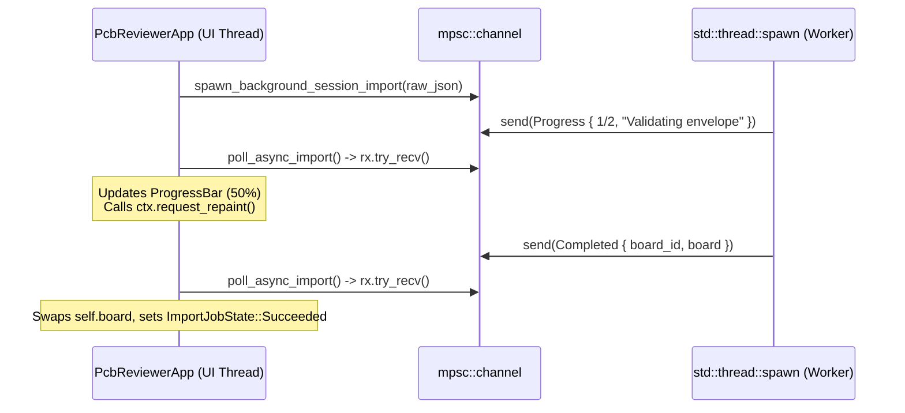

## Why Synchronous File Parsing Freezes Immediate-Mode GUIs

In Lesson `0015`, `import_session_from_json` ran synchronously on the main UI thread inside `update(&mut self, ctx, frame)`. For a small 2 KB review envelope, that takes microseconds—but when an engineer opens a 50 MB industrial `.kicad_pcb` board file with 100,000 trace segments, synchronous parsing blocks `update()` for ratusan milliseconds, freezing panning, zooming, and OS window events.{{sidenote: **Never Block `eframe::App::update`:** Because `egui` runs on a single UI thread, any operation taking more than ~4 ms should run on a background thread (`std::thread::spawn`) and communicate back via non-blocking message passing (`std::sync::mpsc::Receiver::try_recv`).}}

We keep the UI locked at 60 FPS with a three-part pattern:

1. **Spawn & Stream (`spawn_background_session_import`)**: Creates a `std::sync::mpsc::channel::<ImportJobMessage>()`, spawns a worker thread owning the raw JSON `String` (`Send + 'static`), emits staged `ImportJobMessage::Progress` updates (`"Validating envelope"`, `"Loading copper layers"`), and finishes with `Completed { board_id, board }` or `Failed(SessionIoError)`.
2. **Non-Blocking Poll (`poll_async_import`)**: At the start of each frame, drains available messages with `while let Ok(msg) = rx.try_recv()`—never blocking `update()`!
3. **Continuous Repaint & Cancellation (`ctx.request_repaint()`)**: In reactive desktop mode, `egui` sleeps when the mouse is idle. Calling `ctx.request_repaint()` while `matches!(self.import_state, ImportJobState::Running { .. })` ensures `update()` keeps polling the channel until the worker finishes, and dropping `self.import_rx = None` cancels an in-flight job cleanly.



## Channel Messages & `ImportJobState`

```rust caption="Background worker and ImportJobState in crates/pcb-doc/src/lib.rs"
#[derive(Clone, Debug, PartialEq)]
pub enum ImportJobMessage {
    Progress {
        completed_steps: usize,
        total_steps: usize,
        phase: String,
    },
    Completed {
        board_id: String,
        board: BoardModel,
    },
    Failed(SessionIoError),
}

#[derive(Clone, Debug, PartialEq)]
pub enum ImportJobState {
    Idle,
    Running { fraction: f32, phase: String },
    Succeeded { board_id: String },
    Failed(String),
}

pub fn spawn_background_session_import(
    raw_json: String,
) -> std::sync::mpsc::Receiver<ImportJobMessage> {
    let (tx, rx) = std::sync::mpsc::channel();
    std::thread::spawn(move || {
        if tx
            .send(ImportJobMessage::Progress {
                completed_steps: 1,
                total_steps: 2,
                phase: "Validating envelope".to_owned(),
            })
            .is_err()
        {
            return;
        }
        match BoardModel::from_session_json(&raw_json) {
            Ok((board_id, board)) => {
                let _ = tx.send(ImportJobMessage::Progress {
                    completed_steps: 2,
                    total_steps: 2,
                    phase: "Loading copper layers".to_owned(),
                });
                let _ = tx.send(ImportJobMessage::Completed { board_id, board });
            }
            Err(err) => {
                let _ = tx.send(ImportJobMessage::Failed(err));
            }
        }
    });
    rx
}
```

{{widget:async-import-sim}}

:::exercise id="ex0020" title="Interactive Lab 2: Poll `mpsc::Receiver::try_recv()` & Drive `egui::ProgressBar`" badge="Skill Practice • Background mpsc & ProgressBar"
Complete `ImportJobState::progress_fraction`, `PcbReviewerApp::cancel_async_import`, and the `egui::ProgressBar` rendering inside `render_session_panel`.

```rust
pub fn progress_fraction(completed_steps: usize, total_steps: usize) -> f32 {
    if total_steps == 0 {
        return 0.0;
    }
    (completed_steps as f32 / total_steps as f32).{{blank:clamp(0.0, 1.0)|Clamp the progress ratio to 0.0..=1.0|clamp(...)|155px}}
}

pub fn cancel_async_import(&mut self) {
    self.import_rx = {{blank:None|Drop the mpsc::Receiver by setting import_rx to None|None|85px}};
    self.import_state = ImportJobState::Idle;
}

// Inside render_session_panel:
if let ImportJobState::Running { fraction, phase } = &self.import_state {
    ui.add(egui::{{blank:ProgressBar::new(*fraction)|Construct an egui::ProgressBar with *fraction|ProgressBar::new(...)|235px}}.text(phase));
}
```

:::prompts
hint: Clamp the step ratio with `.clamp(0.0, 1.0)`, drop the channel receiver by setting `self.import_rx = None`, and construct `egui::ProgressBar::new(*fraction)`.
success: Well done! Background imports stream progress over `mpsc::channel`, update `egui::ProgressBar` without blocking the UI thread, and cancel cleanly when `import_rx` is set to `None`.
:::
:::

:::verify id="verify-0020" title="Lab 3: Background Worker `mpsc` Channel & Progress UI Mutation Gate (`0020`)" badge="cargo test --workspace + cargo mutants" tier="Tier 2 + Tier 6 (Headless UI)" caught="269 / 269 (100%)" missed="0 Missed"
Run the workspace test suite and mutate the background import worker, progress fraction math, non-blocking `try_recv()` polling, and `SidePanel::right` controls:

```bash caption="Run workspace tests and cargo-mutants on 0020 async import functions"
cargo test --manifest-path ./apps/0020-non-blocking-file-import-and-progress-ui/Cargo.toml --workspace
cargo mutants --manifest-path ./apps/0020-non-blocking-file-import-and-progress-ui/Cargo.toml --workspace --in-place -F "progress_fraction|ImportJobState|apply_import_message|spawn_background_session_import|start_async_import|cancel_async_import|poll_async_import"
```

- [ ] `cargo test --manifest-path ./apps/0020-non-blocking-file-import-and-progress-ui/Cargo.toml --workspace` passes all **20 tests** (**14** in `pcb-doc` and **6** in `pcb-reviewer`).
- [ ] `background_session_import_streams_progress_and_handles_errors_and_cancellation` verifies staged `Progress` messages, `Completed` state transitions, `Failed(SessionIoError)` reporting, and receiver drop cancellation.
- [ ] `cargo mutants` catches all **14 viable new background import & UI mutants** (`4 unviable, 0 missed`), bringing the workspace total to **269 / 269 viable mutants caught (0 missed)**.
:::

:::quiz id="quiz-0020"
Q: Why does `poll_async_import` call `Receiver::try_recv()` inside a `while let Ok(msg)` loop instead of `recv()`?
- [ ] Because `recv()` drops all pending messages from the channel buffer
- [x] Because `recv()` blocks the UI thread and freezes immediate-mode frames
- [ ] Because `try_recv()` automatically spawns a fresh operating system worker thread
- [ ] Because `recv()` cannot deserialize versioned JSON envelopes across thread boundaries
why: `Receiver::recv()` blocks the calling thread until a message arrives, which would freeze the `egui` window; `try_recv()` returns `Err(TryRecvError::Empty)` immediately when no message is waiting.
hint: Think about what happens to a 60-FPS UI loop if `update()` blocks waiting on a thread.

Q: Why do we call `ctx.request_repaint()` whenever `self.import_state` is `ImportJobState::Running`?
- [ ] To clear the undo history stack before loading copper layers
- [ ] To lock the GPU mutex across all active test threads
- [x] To wake `egui` on the next frame so progress updates
- [ ] To terminate the background worker thread immediately after one message
why: When the user is not moving the mouse or pressing keys, `eframe` pauses repaints to save CPU/battery; `ctx.request_repaint()` schedules another frame so `poll_async_import` continues draining worker progress.
hint: Check `poll_async_import` in `apps/0020-non-blocking-file-import-and-progress-ui/src/main.rs`.

Q: How does `cancel_async_import` cleanly stop receiving messages from an in-flight background import worker?
- [x] By setting `import_rx` to `None` and resetting `import_state` to `Idle`
- [ ] By calling `std::process::exit` inside the right-hand session inspector panel closure
- [ ] By mutating the static command registry slice at runtime directly
- [ ] By panicking inside the worker thread when progress reaches fifty
why: Dropping the `mpsc::Receiver` (`self.import_rx = None`) closes the channel, causing subsequent `tx.send(...)` calls in the worker thread to return `Err` and exit cleanly.
hint: Look at `cancel_async_import` and `if tx.send(...).is_err() { return; }`.
:::

## Recommended Primary Source

:::callout
**Read (5 mins):** [`std::sync::mpsc::Receiver::try_recv` Standard Library Docs](https://doc.rust-lang.org/std/sync/mpsc/struct.Receiver.html#method.try_recv) and [`egui::ProgressBar` Official API Docs](https://docs.rs/egui/latest/egui/widgets/struct.ProgressBar.html).
:::

:::teacher-prompt
Next up: [Lesson 0021: Offscreen Snapshot Parity (`gpu_lock`), Quality Scorecards & WebAssembly (`wasm32`) Readiness](./0021-headless-snapshot-testing-and-wasm-build.html), where we complete Act V with deterministic 64-bit FNV-1a visual snapshot digests, process-wide `gpu_lock()` serialization, `wasm32` target gates, and a self-auditing release scorecard!
:::
