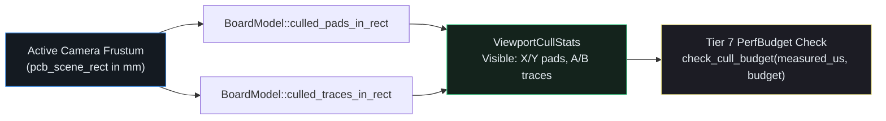

## Why Immediate-Mode CAD Canvases Need Viewport Frustum Culling

On a dense multi-layer PCB with 50,000+ SMD pads and trace segments, zoomed in on a single microcontroller (`U1`), 95% of the board geometry lies outside the visible camera rectangle (`self.view.pcb_scene_rect`). If `paint_board` blindly submits every trace and pad to `egui::Painter` on every frame, `egui` still has to transform coordinates and tessellate thousands of off-screen primitives into vertex/index meshes before the GPU clips them.{{sidenote: **Axis-Aligned Bounding Box (AABB) Culling:** Testing `primitive.bounds_mm().intersects(viewport_mm)` costs only four float comparisons (`self.min.x <= other.max.x && other.min.x <= self.max.x && ...`), which is orders of magnitude cheaper than tessellating stroke geometry.}}

In `crates/pcb-doc` (`L1`), we give both `SmdPad` and `TraceSegment` exact millimetre bounding boxes:

1. **Pad AABB (`SmdPad::bounds_mm`)**: `Rect::from_center_size(self.center_mm, self.size_mm)`.
2. **Stroke-Expanded Trace AABB (`TraceSegment::bounds_mm`)**: A trace from `start` to `end` with copper thickness `width_mm` extends `width_mm * 0.5` beyond its centreline endpoints. We compute `Rect::from_two_pos(self.start, self.end).expand(self.width_mm * 0.5)` so thick power traces partially overlapping the viewport edge are never popped out prematurely!
3. **Tier 7 Frame Budget Gate (`check_cull_budget`)**: Enforces that spatial culling stays within a deterministic microsecond budget (`measured_us <= budget.target_max_us`).



## Pre-Allocating Visible Batches & `proptest` Equivalence

To avoid repeated heap reallocations during per-frame culling, `culled_pads_in_rect` and `culled_traces_in_rect` pre-allocate with `Vec::with_capacity` and collect only primitives whose `bounds_mm().intersects(viewport_mm)` is `true`.

```rust caption="Stroke-expanded TraceSegment::bounds_mm and viewport culling in crates/pcb-doc/src/lib.rs"
impl TraceSegment {
    pub fn bounds_mm(&self) -> Rect {
        Rect::from_two_pos(self.start, self.end).expand(self.width_mm * 0.5)
    }
}

#[derive(Clone, Copy, Debug, PartialEq, Eq)]
pub struct ViewportCullStats {
    pub visible_pads: usize,
    pub total_pads: usize,
    pub visible_traces: usize,
    pub total_traces: usize,
}

impl ViewportCullStats {
    pub fn culled_count(&self) -> usize {
        (self.total_pads - self.visible_pads) + (self.total_traces - self.visible_traces)
    }

    pub fn summary_badge(&self) -> String {
        format!(
            "Cull: {}/{} pads, {}/{} traces ({} skipped)",
            self.visible_pads,
            self.total_pads,
            self.visible_traces,
            self.total_traces,
            self.culled_count()
        )
    }
}

impl BoardModel {
    pub fn culled_pads_in_rect(&self, viewport_mm: Rect) -> Vec<SmdPad> {
        let mut out = Vec::with_capacity(self.pads.len());
        for pad in self.pads.iter() {
            if pad.bounds_mm().intersects(viewport_mm) {
                out.push(*pad);
            }
        }
        out
    }

    pub fn culled_traces_in_rect(&self, viewport_mm: Rect) -> Vec<TraceSegment> {
        let mut out = Vec::with_capacity(self.traces.len());
        for seg in self.traces.iter() {
            if seg.bounds_mm().intersects(viewport_mm) {
                out.push(*seg);
            }
        }
        out
    }
}
```

{{widget:viewport-cull-sim}}

:::exercise id="ex0020" title="Interactive Lab 2: Implement `TraceSegment::bounds_mm` & `Rect::intersects` Culling" badge="Skill Practice • AABB Culling & PerfBudget"
Complete `TraceSegment::bounds_mm`, `BoardModel::culled_pads_in_rect`, and `check_cull_budget`.

```rust
impl TraceSegment {
    pub fn bounds_mm(&self) -> Rect {
        Rect::from_two_pos(self.start, self.end).{{blank:expand(self.width_mm * 0.5);;expand(0.5 * self.width_mm)|Expand the segment bounding box by half the stroke width (self.width_mm * 0.5)|expand(...)|255px}}
    }
}

pub fn culled_pads_in_rect(&self, viewport_mm: Rect) -> Vec<SmdPad> {
    let mut out = Vec::with_capacity(self.pads.len());
    for pad in self.pads.iter() {
        if pad.bounds_mm().{{blank:intersects(viewport_mm)|Keep pads whose bounding box intersects viewport_mm|intersects(...)|215px}} {
            out.push(*pad);
        }
    }
    out
}

pub fn check_cull_budget(measured_us: u64, target_max_us: u64) -> Result<u64, u64> {
    if measured_us {{blank:<= target_max_us|Pass the budget when measured_us is less than or equal to target_max_us|<= target_max_us|165px}} {
        Ok(measured_us)
    } else {
        Err(measured_us)
    }
}
```

:::prompts
hint: Expand `Rect::from_two_pos(self.start, self.end)` by `expand(self.width_mm * 0.5)`, test overlap with `intersects(viewport_mm)`, and accept `measured_us <= target_max_us`.
success: Locked in! Off-screen pads and traces are culled via `Rect::intersects` before `Painter` tessellation and verified against our frame budget.
:::
:::

:::verify id="verify-0020" title="Lab 3: Spatial Culling `proptest`, Budget Gate & Mutation Coverage (`0020`)" badge="cargo test --workspace + proptest + cargo mutants" tier="Tier 2 (proptest) + Tier 7 (PerfBudget)" caught="255 / 255 (100%)" missed="0 Missed"
Run the workspace test suite (including `prop_spatial_culling_matches_reference_and_preserves_counts`) and mutate the spatial culling, statistics, and budget functions:

```bash caption="Run spatial-culling proptest and cargo-mutants on 0019"
cargo test --manifest-path ./apps/0020-viewport-culling-and-cached-tessellation/Cargo.toml --workspace
cargo mutants --manifest-path ./apps/0020-viewport-culling-and-cached-tessellation/Cargo.toml --workspace --in-place -F "TraceSegment::bounds_mm|ViewportCullStats|culled_pads_in_rect|culled_traces_in_rect|cull_stats_for_rect|check_cull_budget|active_cull_stats"
```

- [ ] `cargo test --manifest-path ./apps/0020-viewport-culling-and-cached-tessellation/Cargo.toml --workspace` passes all **19 tests** (**13** in `pcb-doc` and **6** in `pcb-reviewer`).
- [ ] `prop_spatial_culling_matches_reference_and_preserves_counts` verifies across randomized camera rectangles that `culled_pads_in_rect` and `culled_traces_in_rect` match reference filtering and satisfy `visible + culled == total`.
- [ ] `cargo mutants` catches all **17 viable new spatial-culling & budget mutants** (`5 unviable, 0 missed`), bringing the workspace total to **255 / 255 viable mutants caught (0 missed)**.
:::

:::quiz id="quiz-0020"
Q: Why does `TraceSegment::bounds_mm` expand `Rect::from_two_pos(self.start, self.end)` by `self.width_mm * 0.5`?
- [ ] To convert millimetre coordinates into normalized device shader coordinates
- [x] To include the half-stroke copper thickness around segment endpoints
- [ ] To force horizontal traces to sort before vertical traces
- [ ] To prevent ratsnest airwires from intersecting with copper pads
why: A trace's rendered copper stroke extends `width_mm * 0.5` on each side of its centreline; expanding the bounding box prevents thick traces near the viewport edge from being culled while half of their stroke is still visible.
hint: Think about a horizontal segment whose `start.y == end.y == 22.0` with `width_mm = 0.8`.

Q: Which `emath::Rect` method tests whether a primitive's bounding box overlaps the active camera viewport?
- [ ] The `contains_rect` method on the parent window viewport builder
- [ ] The `union` method inside the iterator reduction closure block
- [x] The `intersects` method comparing the primitive and viewport rectangles
- [ ] The `clamp` method bounding the minimap camera preview rectangle
why: `Rect::intersects(other)` returns `true` whenever two axis-aligned rectangles share any overlapping area (even if neither completely contains the other).
hint: Check `culled_pads_in_rect` in `crates/pcb-doc/src/lib.rs`.

Q: What does the `proptest` spatial culling equivalence test verify in `crates/pcb-doc`?
- [x] That culled queries match brute-force filtering for arbitrary viewports
- [ ] That every copper trace shares the exact same net
- [ ] That GPU shaders compile without warnings on mobile devices
- [ ] That JSON serialization compresses all off-screen pads to zero
why: Property testing `culled_pads_in_rect` and `culled_traces_in_rect` against arbitrary `(min_x, min_y, width, height)` camera rectangles proves that spatial culling never drops visible primitives or miscounts skipped items.
hint: Review `prop_spatial_culling_matches_reference_and_preserves_counts`.
:::

## Recommended Primary Source

:::callout
**Read (5 mins):** [`emath::Rect::intersects` & `Rect::expand` Official API Docs](https://docs.rs/emath/latest/emath/struct.Rect.html#method.intersects) and [`std::vec::Vec::with_capacity` Standard Library Docs](https://doc.rust-lang.org/std/vec/struct.Vec.html#method.with_capacity).
:::

:::teacher-prompt
Next up: [Lesson 0021: Non-Blocking Background File Import (`std::sync::mpsc`) & Live `ProgressBar` UI](./0021-non-blocking-file-import-and-progress-ui.html), where we offload session parsing onto a worker thread with staged progress reporting, clean cancellation, and `ctx.request_repaint()`!
:::
