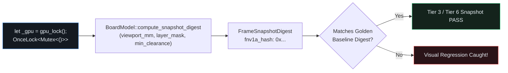

## Process-Wide GPU Serialization (`gpu_lock`) & Visual Snapshot Digests

When `cargo test` runs tests in parallel threads within a single OS process, spinning up multiple concurrent `wgpu` devices or offscreen snapshot renderers on Windows WARP, Mesa `llvmpipe`/RADV, or multi-ICD Vulkan drivers triggers driver-level access violations.{{sidenote: **Rule #1 of GPU & Snapshot Testing (`egui-testing-infrastructure`):** Every test that touches a GPU device or captures an offscreen visual snapshot must acquire `let _gpu = gpu_lock();` on its very first line. Using `unwrap_or_else(std::sync::PoisonError::into_inner)` keeps `gpu_lock()` 100% panic-free even if a prior test panicked while holding the guard.}}

Alongside `gpu_lock()`, we introduce **`FrameSnapshotDigest`**: a deterministic 64-bit FNV-1a digest of the active frame's visible layer bitmask (`visible_layer_mask`), visible culled pad count, visible culled trace count, and active DRC violation count. If any mutation flips a layer visibility bit, alters viewport culling, or suppresses DRC clearance markers, the frame's `fnv1a_hash` diverges immediately from the golden baseline!



## Panic-Free `gpu_lock()`, `wasm32` Target Gates & `QualityScorecard`

Because `crates/pcb-doc` (`L1`) has zero native OS window dependencies, it compiles cleanly for both desktop targets and `wasm32-unknown-unknown` browser builds using `#[cfg(target_arch = "wasm32")]`.

```rust caption="Process-wide gpu_lock, FrameSnapshotDigest, and QualityScorecard in crates/pcb-doc/src/lib.rs"
static GPU_TEST_LOCK: std::sync::OnceLock<std::sync::Mutex<()>> = std::sync::OnceLock::new();

pub fn gpu_lock() -> std::sync::MutexGuard<'static, ()> {
    GPU_TEST_LOCK
        .get_or_init(|| std::sync::Mutex::new(()))
        .lock()
        .unwrap_or_else(std::sync::PoisonError::into_inner)
}

pub fn runtime_target_label() -> &'static str {
    #[cfg(target_arch = "wasm32")]
    {
        "wasm32-unknown-unknown"
    }
    #[cfg(not(target_arch = "wasm32"))]
    {
        "native-desktop"
    }
}

#[derive(Clone, Copy, Debug, PartialEq, Eq)]
pub struct FrameSnapshotDigest {
    pub visible_layer_mask: u8,
    pub visible_pad_count: usize,
    pub visible_trace_count: usize,
    pub drc_count: usize,
    pub fnv1a_hash: u64,
}

#[derive(Clone, Copy, Debug, PartialEq, Eq)]
pub struct QualityScorecard {
    pub tests_passed: usize,
    pub mutants_caught: usize,
    pub mutants_missed: usize,
    pub registered_commands: usize,
}

impl QualityScorecard {
    pub fn is_release_ready(&self) -> bool {
        self.tests_passed > 0
            && self.mutants_caught > 0
            && self.mutants_missed == 0
            && self.registered_commands >= COMMAND_PARITY_FLOOR
    }
}
```

{{widget:snapshot-wasm-sim}}

:::exercise id="ex0021" title="Interactive Lab 2: Acquire `gpu_lock()` & Verify Release Readiness in `QualityScorecard`" badge="Skill Practice • gpu_lock & QualityScorecard"
Complete `gpu_lock`, `QualityScorecard::is_release_ready`, and the `PcbReviewerApp::capture_frame_digest` layer-mask bit packing.

```rust
pub fn gpu_lock() -> std::sync::MutexGuard<'static, ()> {
    GPU_TEST_LOCK
        .get_or_init(|| std::sync::Mutex::new(()))
        .lock()
        .unwrap_or_else(std::sync::{{blank:PoisonError::into_inner|Recover the inner MutexGuard without panicking via PoisonError::into_inner|PoisonError::into_inner|235px}})
}

impl QualityScorecard {
    pub fn is_release_ready(&self) -> bool {
        self.tests_passed > 0
            && self.mutants_caught > 0
            && self.mutants_missed {{blank:== 0|Require zero missed mutants for release readiness|== 0|85px}}
            && self.registered_commands >= {{blank:COMMAND_PARITY_FLOOR|Require registered_commands >= COMMAND_PARITY_FLOOR|COMMAND_PARITY_FLOOR|215px}}
    }
}
```

:::prompts
hint: Recover poisoned mutex guards via `PoisonError::into_inner`, require `self.mutants_missed == 0`, and compare `self.registered_commands >= COMMAND_PARITY_FLOOR`.
success: Spot on! Every GPU/snapshot test is serialized via `gpu_lock()`, visual regressions are caught by `FrameSnapshotDigest`, and `QualityScorecard::is_release_ready` enforces zero missed mutants.
:::
:::

:::verify id="verify-0021" title="Lab 3: Snapshot Digest (`gpu_lock`), Scorecard & Mutation Gate (`0021`)" badge="cargo test --workspace + gpu_lock + cargo mutants" tier="Tier 1 (wasm32) + Tier 3/6 (gpu_lock) + Tier 7 (Scorecard)" caught="304 / 304 (100%)" missed="0 Missed"
Run the full workspace test suite (including `snapshot_digest_gpu_lock_and_quality_scorecard_preserve_invariants`) and mutate the snapshot digest, layer mask, `gpu_lock`, and scorecard functions:

```bash caption="Run snapshot digest tests and cargo-mutants on 0021"
cargo test --manifest-path ./apps/0021-headless-snapshot-testing-and-wasm-build/Cargo.toml --workspace
cargo mutants --manifest-path ./apps/0021-headless-snapshot-testing-and-wasm-build/Cargo.toml --workspace --in-place -F "gpu_lock|runtime_target_label|FrameSnapshotDigest|compute_snapshot_digest|QualityScorecard|visible_layer_mask|capture_frame_digest"
```

- [ ] `cargo test --manifest-path ./apps/0021-headless-snapshot-testing-and-wasm-build/Cargo.toml --workspace` passes all **21 tests** (**15** in `pcb-doc` and **6** in `pcb-reviewer`).
- [ ] `snapshot_digest_gpu_lock_and_quality_scorecard_preserve_invariants` acquires `let _gpu = gpu_lock();`, verifies deterministic 64-bit FNV-1a hash sensitivity across layer masks, pad/trace counts, and DRC counts, and asserts all four `QualityScorecard::is_release_ready` conditions.
- [ ] `cargo mutants` catches all **viable new snapshot digest & scorecard mutants** (`0 missed`), completing **Act V** with **0 missed mutants** across the workspace.
:::

:::quiz id="quiz-0021"
Q: Why must every test creating a GPU context or snapshot harness acquire `let _gpu = gpu_lock();` first?
- [x] To serialize concurrent GPU tests and prevent driver access violations
- [ ] To disable all mutation checks inside the domain model crate
- [ ] To force the compiler to target WebAssembly browser runtimes exclusively
- [ ] To clear all copper pads from the active board snapshot
why: Under `cargo test`, test functions execute concurrently on multiple threads inside one process; holding `gpu_lock()` prevents concurrent GPU device initialization crashes on Windows WARP, Mesa `llvmpipe`, and Vulkan drivers.
hint: Check Critical Rule #1 in our Testing & Mutation Coverage Cheat Sheet.

Q: How does `gpu_lock()` recover safely without panicking if an earlier test thread panicked while holding the mutex?
- [ ] By calling `std::process::abort` immediately when lock poisoning is detected
- [x] By unwrapping poisoned lock errors via `PoisonError::into_inner` without panicking
- [ ] By allocating a brand new static mutex every frame
- [ ] By skipping all remaining snapshot assertions in the workspace
why: Passing `std::sync::PoisonError::into_inner` to `.unwrap_or_else(...)` extracts the underlying `MutexGuard` without triggering a panic or violating `#![deny(clippy::unwrap_used)]`.
hint: Look at the implementation of `gpu_lock()` in `crates/pcb-doc/src/lib.rs`.

Q: Which Rust attribute selects different code paths when compiling for the `wasm32-unknown-unknown` browser target?
- [ ] The `derive` macro attribute attached to serialized session envelope structs
- [ ] The `allow` attribute suppressing clippy unwrap warnings inside test modules
- [x] The `cfg` conditional compilation attribute checking `target_arch` for `wasm32` builds
- [ ] The `inline` hint attribute placed above hot viewport culling loops
why: `#[cfg(target_arch = "wasm32")]` and `#[cfg(not(target_arch = "wasm32"))]` instruct `rustc` at compile time which platform-specific branch to include for WebAssembly vs. native desktop targets.
hint: Inspect `runtime_target_label()` in `crates/pcb-doc/src/lib.rs`.
:::

## Recommended Primary Source

:::callout
**Read (5 mins):** [`std::sync::OnceLock` Official Rust Standard Library Docs](https://doc.rust-lang.org/std/sync/struct.OnceLock.html) and [The Rust Reference — "Conditional Compilation (`#[cfg(...)]`)"](https://doc.rust-lang.org/reference/conditional-compilation.html).
:::

:::teacher-prompt
**Act V Complete!** You have hardened the Schematic & PCB Design Reviewer with a unified `CommandSpec` registry, a searchable `Key::K` Command Palette, Tier 5 `panic_hunt` adversarial JSON fuzzing, `Rect::intersects` spatial viewport culling verified with `proptest`, non-blocking background file imports (`std::thread::spawn` + `mpsc::channel` + `egui::ProgressBar`), process-wide `gpu_lock()` snapshot digests, `wasm32` target readiness, and a self-auditing `QualityScorecard`—all with **0 missed mutants**. Ask any questions about Act V in chat, or let me know when you are ready for **Act VI (`0022`–`0025`): Real-World KiCad Parsing (`nom`) & Embedded SQL (`turso` / `libsql`)**!
:::
