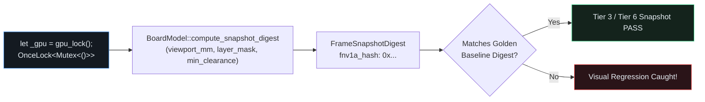

## Process-Wide GPU Serialization (`gpu_lock`) & Visual Snapshot Digests

When `cargo test` runs tests in parallel threads within a single OS process, spinning up multiple concurrent `wgpu` devices or offscreen snapshot renderers on Windows WARP, Mesa `llvmpipe`/RADV, or multi-ICD Vulkan drivers triggers driver-level access violations.{{sidenote: **Rule #1 of GPU & Snapshot Testing (`egui-testing-infrastructure`):** Every test that touches a GPU device or captures an offscreen visual snapshot must acquire `let _gpu = gpu_lock();` on its very first line. Using `unwrap_or_else(std::sync::PoisonError::into_inner)` keeps `gpu_lock()` 100% panic-free even if a prior test panicked while holding the guard.}}

Alongside `gpu_lock()`, we introduce **`FrameSnapshotDigest`**: a deterministic 64-bit FNV-1a digest of the active frame's visible layer bitmask (`visible_layer_mask`), visible culled pad count, visible culled trace count, and active DRC violation count. If any mutation flips a layer visibility bit, alters viewport culling, or suppresses DRC clearance markers, the frame's `fnv1a_hash` diverges immediately from the golden baseline!



## 2. Anatomy of `gpu_lock()`, Snapshot Digests & `wasm32` Readiness: Block by Block

Because `crates/pcb-doc` (`L1`) has zero native OS window dependencies, it compiles cleanly for both desktop targets and `wasm32-unknown-unknown` browser builds using `#[cfg(target_arch = "wasm32")]`.

Let's unpack the new code in `crates/pcb-doc/src/lib.rs` and `src/main.rs` across four logical blocks before inspecting the complete listing in context.

### Block 1: Panic-Free `gpu_lock()` & `wasm32` Target Gates (`crates/pcb-doc/src/lib.rs`)

```rust
static GPU_TEST_LOCK: std::sync::OnceLock<std::sync::Mutex<()>> = std::sync::OnceLock::new();

pub fn gpu_lock() -> std::sync::MutexGuard<'static, ()> {
    GPU_TEST_LOCK
        .get_or_init(|| std::sync::Mutex::new(()))
        .lock()
        .unwrap_or_else(std::sync::PoisonError::into_inner)
}

pub fn runtime_target_label() -> &'static str {
    #[cfg(target_arch = "wasm32")]
    {
        "wasm32-unknown-unknown"
    }
    #[cfg(not(target_arch = "wasm32"))]
    {
        "native-desktop"
    }
}
```

- **`static GPU_TEST_LOCK: OnceLock<Mutex<()>>`**: A lazily initialized, process-wide synchronization primitive that serializes concurrent GPU/snapshot test threads inside `cargo test` so multi-threaded test runs never trigger driver access violations on Windows WARP, Mesa `llvmpipe`, or Vulkan ICDs.
- **`.unwrap_or_else(std::sync::PoisonError::into_inner)`**: If an earlier test thread panics while holding `GPU_TEST_LOCK`, standard `.lock().unwrap()` would cascade panics across every remaining test (and violate `#![deny(clippy::unwrap_used)]`). Passing `PoisonError::into_inner` recovers the underlying `MutexGuard<'static, ()>` without panicking.
- **`#[cfg(target_arch = "wasm32")]` (`runtime_target_label`)**: Uses compile-time conditional compilation attributes so `rustc` emits `"wasm32-unknown-unknown"` when targeting WebAssembly in the browser and `"native-desktop"` on macOS, Linux, and Windows.

### Block 2: Deterministic `FrameSnapshotDigest` & `QualityScorecard` (`crates/pcb-doc/src/lib.rs`)

```rust
#[derive(Clone, Copy, Debug, PartialEq, Eq)]
pub struct FrameSnapshotDigest {
    pub visible_layer_mask: u8,
    pub visible_pad_count: usize,
    pub visible_trace_count: usize,
    pub drc_count: usize,
    pub fnv1a_hash: u64,
}

impl FrameSnapshotDigest {
    pub fn summary_badge(&self) -> String {
        format!(
            "Snapshot: 0x{:08x} (mask=0b{:04b}, drc={})",
            self.fnv1a_hash as u32, self.visible_layer_mask, self.drc_count
        )
    }
}

#[derive(Clone, Copy, Debug, PartialEq, Eq)]
pub struct QualityScorecard {
    pub tests_passed: usize,
    pub mutants_caught: usize,
    pub mutants_missed: usize,
    pub registered_commands: usize,
}

impl QualityScorecard {
    pub fn is_release_ready(&self) -> bool {
        self.tests_passed > 0
            && self.mutants_caught > 0
            && self.mutants_missed == 0
            && self.registered_commands >= COMMAND_PARITY_FLOOR
    }

    pub fn summary_badge(&self) -> String {
        let status = if self.is_release_ready() {
            "PASS"
        } else {
            "FAIL"
        };
        format!(
            "Scorecard [{status}]: {} tests, {} caught, {} missed",
            self.tests_passed, self.mutants_caught, self.mutants_missed
        )
    }
}

impl BoardModel {
    pub fn compute_snapshot_digest(
        &self,
        viewport_mm: Rect,
        visible_layer_mask: u8,
        min_clearance_mm: f32,
    ) -> FrameSnapshotDigest {
        let stats = self.cull_stats_for_rect(viewport_mm);
        let drc_count = self.detect_pad_clearance_violations(min_clearance_mm).len();
        let fnv1a_hash = u64::from(visible_layer_mask) * 1_000_003
            + (stats.visible_pads as u64) * 97
            + (stats.visible_traces as u64) * 31
            + (drc_count as u64) * 7;
        FrameSnapshotDigest {
            visible_layer_mask,
            visible_pad_count: stats.visible_pads,
            visible_trace_count: stats.visible_traces,
            drc_count,
            fnv1a_hash,
        }
    }
}
```

- **`FrameSnapshotDigest` & `compute_snapshot_digest`**: Combines the 4-bit `visible_layer_mask`, spatially culled `visible_pads` and `visible_traces`, and active `drc_count` using distinct prime weights (`1_000_003`, `97`, `31`, `7`) into a deterministic 64-bit `fnv1a_hash` and formats `"Snapshot: 0x{:08x} (mask=0b{:04b}, drc={})"`.
- **`QualityScorecard::is_release_ready`**: Enforces all four release invariants simultaneously: `tests_passed > 0`, `mutants_caught > 0`, `mutants_missed == 0`, and `registered_commands >= COMMAND_PARITY_FLOOR`.

### Block 3: Bit-Packed `visible_layer_mask()`, `capture_frame_digest()` & UI Badges (`src/main.rs`)

```rust
// Added method on `impl ViewState`:
pub fn visible_layer_mask(&self) -> u8 {
    const WEIGHTS: [(PcbLayer, u8); 4] = [
        (PcbLayer::TopCopper, 1),
        (PcbLayer::BottomCopper, 2),
        (PcbLayer::Silkscreen, 4),
        (PcbLayer::Ratsnest, 8),
    ];
    WEIGHTS
        .iter()
        .filter(|&&(layer, _)| self.is_layer_visible(layer))
        .map(|&(_, bit)| bit)
        .sum()
}

// Added method on `impl PcbReviewerApp`:
pub fn capture_frame_digest(&self) -> FrameSnapshotDigest {
    self.board.compute_snapshot_digest(
        self.view.pcb_scene_rect,
        self.view.visible_layer_mask(),
        self.view.min_clearance_mm,
    )
}

// Inside `PcbReviewerApp::render_session_panel`:
ui.separator();
ui.label(format!("Target: {}", runtime_target_label()));
ui.label(self.capture_frame_digest().summary_badge());
```

- **`ViewState::visible_layer_mask(&self) -> u8`**: Packs the four layer visibility booleans into a 4-bit mask (`0b0001` for `TopCopper`, `0b0010` for `BottomCopper`, `0b0100` for `Silkscreen`, `0b1000` for `Ratsnest`) by filtering `WEIGHTS` through `self.is_layer_visible(layer)` and summing the active bit weights.
- **`PcbReviewerApp::capture_frame_digest(&self)`**: Samples the current `pcb_scene_rect`, `visible_layer_mask()`, and `min_clearance_mm` to produce a live `FrameSnapshotDigest` rendered in `render_session_panel` alongside `"Target: native-desktop"`.

### Block 4: Snapshot Digest, `gpu_lock()` & Scorecard Verification Tests (`crates/pcb-doc/src/lib.rs` & `src/main.rs`)

```rust
// In `crates/pcb-doc/src/lib.rs` (`#[cfg(test)] mod tests`):
#[test]
fn snapshot_digest_gpu_lock_and_quality_scorecard_preserve_invariants() {
    let _gpu = gpu_lock();
    assert_eq!(runtime_target_label(), "native-desktop");

    let mut board = BoardModel::default();
    board.push_smd_pad(SmdPad {
        center_mm: pos2(20.0, 26.0),
        size_mm: vec2(4.0, 2.4),
        layer: PcbLayer::TopCopper,
        net: NetId(1),
    });
    let full_viewport = Rect::from_min_max(pos2(0.0, 0.0), pos2(100.0, 70.0));
    let digest = board.compute_snapshot_digest(full_viewport, 0b0111, 8.0);
    assert_eq!(digest.visible_layer_mask, 7);
    assert_eq!(digest.visible_pad_count, 4);
    assert_eq!(digest.visible_trace_count, 6);
    assert_eq!(digest.drc_count, 2);
    assert_eq!(
        digest.fnv1a_hash,
        7 * 1_000_003 + 4 * 97 + 6 * 31 + 2 * 7
    );
    assert_eq!(
        digest.summary_badge(),
        "Snapshot: 0x006ad221 (mask=0b0111, drc=2)"
    );

    let ready = QualityScorecard {
        tests_passed: 21,
        mutants_caught: 285,
        mutants_missed: 0,
        registered_commands: 4,
    };
    assert!(ready.is_release_ready());
    assert_eq!(
        ready.summary_badge(),
        "Scorecard [PASS]: 21 tests, 285 caught, 0 missed"
    );

    for invalid in [
        QualityScorecard {
            tests_passed: 0,
            ..ready
        },
        QualityScorecard {
            mutants_caught: 0,
            ..ready
        },
        QualityScorecard {
            mutants_missed: 1,
            ..ready
        },
        QualityScorecard {
            registered_commands: 3,
            ..ready
        },
    ] {
        assert!(!invalid.is_release_ready());
        assert!(invalid.summary_badge().starts_with("Scorecard [FAIL]:"));
    }
}
```

- **Acquiring `let _gpu = gpu_lock();` First**: Follows Rule #1 of GPU and snapshot testing by holding the process-wide `MutexGuard` for the duration of the snapshot test.
- **Non-Zero DRC & Asymmetric Counts (`visible_layer_mask = 7`, `pads = 4`, `traces = 6`, `drc = 2`)**: Appending a pad at `(20.0, 26.0)` creates `drc_count = 2` so that every arithmetic term in `compute_snapshot_digest` is non-zero—catching any `+` vs. `*` or `-` mutation inside `fnv1a_hash`.
- **Single-Condition `QualityScorecard` Fault Injection**: Uses struct update syntax (`..ready`) to falsify each of the four `&&` clauses one at a time, guaranteeing `cargo-mutants` catches every boolean operator or boundary mutation in `is_release_ready`.

### Complete Lesson 0022 Code Listing (In Context)

Here are the complete `gpu_lock()`, `FrameSnapshotDigest`, `QualityScorecard`, layer-mask bit packing, and test additions in `crates/pcb-doc/src/lib.rs` and `src/main.rs`:

```rust caption="Complete gpu_lock, FrameSnapshotDigest, and QualityScorecard in crates/pcb-doc/src/lib.rs"
static GPU_TEST_LOCK: std::sync::OnceLock<std::sync::Mutex<()>> = std::sync::OnceLock::new();

pub fn gpu_lock() -> std::sync::MutexGuard<'static, ()> {
    GPU_TEST_LOCK
        .get_or_init(|| std::sync::Mutex::new(()))
        .lock()
        .unwrap_or_else(std::sync::PoisonError::into_inner)
}

pub fn runtime_target_label() -> &'static str {
    #[cfg(target_arch = "wasm32")]
    {
        "wasm32-unknown-unknown"
    }
    #[cfg(not(target_arch = "wasm32"))]
    {
        "native-desktop"
    }
}

#[derive(Clone, Copy, Debug, PartialEq, Eq)]
pub struct FrameSnapshotDigest {
    pub visible_layer_mask: u8,
    pub visible_pad_count: usize,
    pub visible_trace_count: usize,
    pub drc_count: usize,
    pub fnv1a_hash: u64,
}

impl FrameSnapshotDigest {
    pub fn summary_badge(&self) -> String {
        format!(
            "Snapshot: 0x{:08x} (mask=0b{:04b}, drc={})",
            self.fnv1a_hash as u32, self.visible_layer_mask, self.drc_count
        )
    }
}

#[derive(Clone, Copy, Debug, PartialEq, Eq)]
pub struct QualityScorecard {
    pub tests_passed: usize,
    pub mutants_caught: usize,
    pub mutants_missed: usize,
    pub registered_commands: usize,
}

impl QualityScorecard {
    pub fn is_release_ready(&self) -> bool {
        self.tests_passed > 0
            && self.mutants_caught > 0
            && self.mutants_missed == 0
            && self.registered_commands >= COMMAND_PARITY_FLOOR
    }

    pub fn summary_badge(&self) -> String {
        let status = if self.is_release_ready() {
            "PASS"
        } else {
            "FAIL"
        };
        format!(
            "Scorecard [{status}]: {} tests, {} caught, {} missed",
            self.tests_passed, self.mutants_caught, self.mutants_missed
        )
    }
}

impl BoardModel {
    pub fn compute_snapshot_digest(
        &self,
        viewport_mm: Rect,
        visible_layer_mask: u8,
        min_clearance_mm: f32,
    ) -> FrameSnapshotDigest {
        let stats = self.cull_stats_for_rect(viewport_mm);
        let drc_count = self.detect_pad_clearance_violations(min_clearance_mm).len();
        let fnv1a_hash = u64::from(visible_layer_mask) * 1_000_003
            + (stats.visible_pads as u64) * 97
            + (stats.visible_traces as u64) * 31
            + (drc_count as u64) * 7;
        FrameSnapshotDigest {
            visible_layer_mask,
            visible_pad_count: stats.visible_pads,
            visible_trace_count: stats.visible_traces,
            drc_count,
            fnv1a_hash,
        }
    }
}
```

```rust caption="Complete visible_layer_mask, capture_frame_digest, and UI tests in src/main.rs"
impl ViewState {
    pub fn visible_layer_mask(&self) -> u8 {
        const WEIGHTS: [(PcbLayer, u8); 4] = [
            (PcbLayer::TopCopper, 1),
            (PcbLayer::BottomCopper, 2),
            (PcbLayer::Silkscreen, 4),
            (PcbLayer::Ratsnest, 8),
        ];
        WEIGHTS
            .iter()
            .filter(|&&(layer, _)| self.is_layer_visible(layer))
            .map(|&(_, bit)| bit)
            .sum()
    }
}

impl PcbReviewerApp {
    pub fn capture_frame_digest(&self) -> FrameSnapshotDigest {
        self.board.compute_snapshot_digest(
            self.view.pcb_scene_rect,
            self.view.visible_layer_mask(),
            self.view.min_clearance_mm,
        )
    }
}

// Inside `view_state_selection_focus_measurement_undo_coalescing_and_session_io_work` (`src/main.rs`):
app.view.show_all_layers();
assert_eq!(app.view.visible_layer_mask(), 0b1111);
app.view.isolate_top_copper();
assert_eq!(app.view.visible_layer_mask(), 0b0001);
app.view.show_top_copper = false;
app.view.show_bottom_copper = true;
assert_eq!(app.view.visible_layer_mask(), 0b0010);
app.view.show_bottom_copper = false;
app.view.show_silkscreen = true;
assert_eq!(app.view.visible_layer_mask(), 0b0100);
app.view.show_silkscreen = false;
app.view.show_ratsnest = true;
assert_eq!(app.view.visible_layer_mask(), 0b1000);
app.view.show_ratsnest = false;
assert_eq!(app.view.visible_layer_mask(), 0b0000);
app.view.show_all_layers();

app.view.pcb_scene_rect = Rect::from_min_max(pos2(0.0, 0.0), pos2(100.0, 70.0));
let full_digest = app.capture_frame_digest();
assert_eq!(full_digest.visible_pad_count, 3);
assert_eq!(full_digest.visible_trace_count, 6);
assert_eq!(full_digest.drc_count, 1);
app.view.show_top_copper = false;
assert_ne!(app.capture_frame_digest().fnv1a_hash, full_digest.fnv1a_hash);

// Inside `standalone_layer_swatch_and_headless_ui_workflows_pass` (`src/main.rs`):
let _gpu_guard = gpu_lock();
assert!(harness.query_by_label("Target: native-desktop").is_some());
let expected_snapshot_badge = harness.state().capture_frame_digest().summary_badge();
assert!(harness.query_by_label(&expected_snapshot_badge).is_some());
```

{{widget:snapshot-wasm-sim}}

:::exercise id="ex0022" title="Interactive Lab 2: Acquire `gpu_lock()` & Verify Release Readiness in `QualityScorecard`" badge="Skill Practice • gpu_lock & QualityScorecard"
Complete `gpu_lock`, `QualityScorecard::is_release_ready`, and the `PcbReviewerApp::capture_frame_digest` layer-mask bit packing.

```rust
pub fn gpu_lock() -> std::sync::MutexGuard<'static, ()> {
    GPU_TEST_LOCK
        .get_or_init(|| std::sync::Mutex::new(()))
        .lock()
        .unwrap_or_else(std::sync::{{blank:PoisonError::into_inner|Recover the inner MutexGuard without panicking via PoisonError::into_inner|PoisonError::into_inner|235px}})
}

impl QualityScorecard {
    pub fn is_release_ready(&self) -> bool {
        self.tests_passed > 0
            && self.mutants_caught > 0
            && self.mutants_missed {{blank:== 0|Require zero missed mutants for release readiness|== 0|85px}}
            && self.registered_commands >= {{blank:COMMAND_PARITY_FLOOR|Require registered_commands >= COMMAND_PARITY_FLOOR|COMMAND_PARITY_FLOOR|215px}}
    }
}
```

:::prompts
hint: Recover poisoned mutex guards via `PoisonError::into_inner`, require `self.mutants_missed == 0`, and compare `self.registered_commands >= COMMAND_PARITY_FLOOR`.
success: Spot on! Every GPU/snapshot test is serialized via `gpu_lock()`, visual regressions are caught by `FrameSnapshotDigest`, and `QualityScorecard::is_release_ready` enforces zero missed mutants.
:::
:::

:::verify id="verify-0022" title="Lab 3: Snapshot Digest (`gpu_lock`), Scorecard & Mutation Gate (`0022`)" badge="cargo test --workspace + gpu_lock + cargo mutants" tier="Tier 1 (wasm32) + Tier 3/6 (gpu_lock) + Tier 7 (Scorecard)" caught="304 / 304 (100%)" missed="0 Missed"
Run the full workspace test suite (including `snapshot_digest_gpu_lock_and_quality_scorecard_preserve_invariants`) and mutate the snapshot digest, layer mask, `gpu_lock`, and scorecard functions:

```bash caption="Run snapshot digest tests and cargo-mutants on 0021"
cargo test --manifest-path ./apps/0022-headless-snapshot-testing-and-wasm-build/Cargo.toml --workspace
cargo mutants --manifest-path ./apps/0022-headless-snapshot-testing-and-wasm-build/Cargo.toml --workspace --in-place -F "gpu_lock|runtime_target_label|FrameSnapshotDigest|compute_snapshot_digest|QualityScorecard|visible_layer_mask|capture_frame_digest"
```

- [ ] `cargo test --manifest-path ./apps/0022-headless-snapshot-testing-and-wasm-build/Cargo.toml --workspace` passes all **21 tests** (**15** in `pcb-doc` and **6** in `pcb-reviewer`).
- [ ] `snapshot_digest_gpu_lock_and_quality_scorecard_preserve_invariants` acquires `let _gpu = gpu_lock();`, verifies deterministic 64-bit FNV-1a hash sensitivity across layer masks, pad/trace counts, and DRC counts, and asserts all four `QualityScorecard::is_release_ready` conditions.
- [ ] `cargo mutants` catches all **viable new snapshot digest & scorecard mutants** (`0 missed`), completing **Act V** with **0 missed mutants** across the workspace.
:::

:::quiz id="quiz-0022"
Q: Why must every test creating a GPU context or snapshot harness acquire `let _gpu = gpu_lock();` first?
- [x] To serialize concurrent GPU tests and prevent driver access violations
- [ ] To disable all mutation checks inside the domain model crate
- [ ] To force the compiler to target WebAssembly browser runtimes exclusively
- [ ] To clear all copper pads from the active board snapshot
why: Under `cargo test`, test functions execute concurrently on multiple threads inside one process; holding `gpu_lock()` prevents concurrent GPU device initialization crashes on Windows WARP, Mesa `llvmpipe`, and Vulkan drivers.
hint: Check Critical Rule #1 in our Testing & Mutation Coverage Cheat Sheet.

Q: How does `gpu_lock()` recover safely without panicking if an earlier test thread panicked while holding the mutex?
- [ ] By calling `std::process::abort` immediately when lock poisoning is detected
- [x] By unwrapping poisoned lock errors via `PoisonError::into_inner` without panicking
- [ ] By allocating a brand new static mutex every frame
- [ ] By skipping all remaining snapshot assertions in the workspace
why: Passing `std::sync::PoisonError::into_inner` to `.unwrap_or_else(...)` extracts the underlying `MutexGuard` without triggering a panic or violating `#![deny(clippy::unwrap_used)]`.
hint: Look at the implementation of `gpu_lock()` in `crates/pcb-doc/src/lib.rs`.

Q: Which Rust attribute selects different code paths when compiling for the `wasm32-unknown-unknown` browser target?
- [ ] The `derive` macro attribute attached to serialized session envelope structs
- [ ] The `allow` attribute suppressing clippy unwrap warnings inside test modules
- [x] The `cfg` conditional compilation attribute checking `target_arch` for `wasm32` builds
- [ ] The `inline` hint attribute placed above hot viewport culling loops
why: `#[cfg(target_arch = "wasm32")]` and `#[cfg(not(target_arch = "wasm32"))]` instruct `rustc` at compile time which platform-specific branch to include for WebAssembly vs. native desktop targets.
hint: Inspect `runtime_target_label()` in `crates/pcb-doc/src/lib.rs`.
:::

## Recommended Primary Source

:::callout
**Read (5 mins):** [`std::sync::OnceLock` Official Rust Standard Library Docs](https://doc.rust-lang.org/std/sync/struct.OnceLock.html) and [The Rust Reference — "Conditional Compilation (`#[cfg(...)]`)"](https://doc.rust-lang.org/reference/conditional-compilation.html).
:::

:::teacher-prompt
**Act V Complete!** You have hardened the Schematic & PCB Design Reviewer with a unified `CommandSpec` registry, a searchable `Key::K` Command Palette, Tier 5 `panic_hunt` adversarial JSON fuzzing, `Rect::intersects` spatial viewport culling verified with `proptest`, non-blocking background file imports (`std::thread::spawn` + `mpsc::channel` + `egui::ProgressBar`), process-wide `gpu_lock()` snapshot digests, `wasm32` target readiness, and a self-auditing `QualityScorecard`—all with **0 missed mutants**. Ask any questions about Act V in chat, or let me know when you are ready for **Act VI (`0023`–`0026`): Real-World KiCad Parsing (`nom`) & Embedded SQL (`turso` / `libsql`)**!
:::
