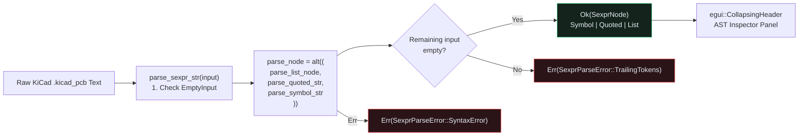

## Why KiCad Uses S-Expressions & Why Parsers Live at Layer `L0`

Real-world KiCad `.kicad_pcb` and `.kicad_sch` files store every board outline, net definition, footprint, pad, and copper trace segment as nested **symbolic expressions (S-expressions)**:{{sidenote: **Standalone `L0` Format Crates (`egui-app-architecture`):** Principle #2 of our architecture requires format parsers like `crates/kicad-sexpr` to sit at Layer `L0` (`Standalone`) with **zero workspace or UI dependencies** (`validate_l0_standalone_manifest`). That keeps the parser independently testable, fuzzable, and reusable across CLI tools, WebAssembly builds, and language servers.}}

```text
(kicad_pcb
  (version 20240108)
  (net 1 "VCC_3V3")
  (footprint "SOT-23" (ref "U1") (val "LDO_3V3") (at 20.0 27.0) (size 12.0 16.0) (net 1))
  (pad "1" smd (at 20.0 22.0) (size 4.0 2.4) (layer "F.Cu") (net 1)))
```

Instead of hand-rolling fragile index-based character loops that can panic on UTF-8 boundaries or unclosed parentheses, we use **[`nom`](https://docs.rs/nom/latest/nom/)**—Rust's declarative parser combinator library. Every `nom` parser is a pure function `fn(&str) -> IResult<&str, Output>` returning `Ok((remaining_input, parsed_value))` or a structured `Err` without panicking.



## Recursive `SexprNode` Trees & `nom` Combinators in `crates/kicad-sexpr`

An S-expression has only three grammar productions:

1. **`SexprNode::Symbol(String)`**: An unquoted token of non-whitespace characters excluding `(`, `)`, and `"` (parsed by `take_while1(is_symbol_char)`).
2. **`SexprNode::Quoted(String)`**: A double-quoted string literal `"..."` (parsed by `delimited(char('"'), take_while(|c| c != '"'), char('"'))`).
3. **`SexprNode::List(Vec<SexprNode>)`**: A parenthesized list `(...)` containing zero or more whitespace-separated child nodes (parsed recursively by `delimited(char('('), many0(delimited(multispace0, parse_node, multispace0)), char(')'))`).

```rust caption="Composing nom combinators in crates/kicad-sexpr/src/lib.rs"
#[derive(Clone, Debug, PartialEq, Eq)]
pub enum SexprNode {
    Symbol(String),
    Quoted(String),
    List(Vec<SexprNode>),
}

pub fn is_symbol_char(c: char) -> bool {
    !c.is_whitespace() && c != '(' && c != ')' && c != '"'
}

fn parse_quoted_str(input: &str) -> IResult<&str, SexprNode> {
    map(
        delimited(char('"'), take_while(|c: char| c != '"'), char('"')),
        |s: &str| SexprNode::Quoted(s.to_owned()),
    )(input)
}

fn parse_symbol_str(input: &str) -> IResult<&str, SexprNode> {
    map(take_while1(is_symbol_char), |s: &str| {
        SexprNode::Symbol(s.to_owned())
    })(input)
}

fn parse_list_node(input: &str) -> IResult<&str, SexprNode> {
    map(
        delimited(
            char('('),
            many0(delimited(multispace0, parse_node, multispace0)),
            char(')'),
        ),
        SexprNode::List,
    )(input)
}

fn parse_node(input: &str) -> IResult<&str, SexprNode> {
    alt((parse_list_node, parse_quoted_str, parse_symbol_str))(input)
}
```

{{widget:sexpr-ast-sim}}

:::exercise id="ex0023" title="Interactive Lab 2: Compose `nom` Combinators & Inspect `SexprNode` Trees" badge="Skill Practice • nom & SexprNode"
Complete `is_symbol_char`, `parse_list_node`, and `parse_sexpr_str` in `crates/kicad-sexpr/src/lib.rs`.

```rust
pub fn is_symbol_char(c: char) -> bool {
    !c.is_whitespace() && c != '(' && c != ')' && c {{blank:!= '"'|Reject double-quote characters inside unquoted symbols|!= '"'|95px}}
}

fn parse_list_node(input: &str) -> IResult<&str, SexprNode> {
    map(
        {{blank:delimited|Use nom::sequence::delimited to match '(' ... ')'|delimited|125px}}(
            char('('),
            many0(delimited(multispace0, parse_node, multispace0)),
            char(')'),
        ),
        SexprNode::List,
    )(input)
}

pub fn parse_sexpr_str(input: &str) -> Result<SexprNode, SexprParseError> {
    let trimmed = input.trim();
    if trimmed.is_empty() {
        return Err(SexprParseError::{{blank:EmptyInput|Return SexprParseError::EmptyInput on blank input|EmptyInput|135px}});
    }
    match parse_node(trimmed) {
        Ok((rest, node)) => {
            let trailing = rest.trim();
            if trailing.is_empty() {
                Ok(node)
            } else {
                Err(SexprParseError::TrailingTokens(trailing.to_owned()))
            }
        }
        Err(_) => Err(SexprParseError::SyntaxError(trimmed.to_owned())),
    }
}
```

:::prompts
hint: Reject `c != '"'` in `is_symbol_char`, wrap the parenthesized list in `delimited(char('('), ..., char(')'))`, and return `SexprParseError::EmptyInput` when `trimmed.is_empty()`.
success: Cleanly parsed! Your `L0` `kicad-sexpr` crate tokenizes and parses nested KiCad S-expressions without `unsafe` or `unwrap()`, and renders the AST inside `egui::CollapsingHeader`.
:::
:::

:::verify id="verify-0023" title="Lab 3: `L0` Standalone Layer Gate, `nom` Property Fuzzing & Mutation Gate (`0023`)" badge="cargo test --workspace + proptest + cargo mutants" tier="Tier 1 (L0 Gate) + Tier 2 (proptest & Mutants)" caught="342 / 342 (100%)" missed="0 Missed"
Run the 3-crate workspace test suite (`kicad-sexpr`, `pcb-doc`, and `pcb-reviewer`) and mutate all `kicad-sexpr` combinators, AST metrics, and `egui::CollapsingHeader` UI handlers:

```bash caption="Run workspace tests and cargo-mutants on 0022 kicad-sexpr and pcb-reviewer"
cargo test --manifest-path ./apps/0023-sexpr-tokenizer-and-ast-with-nom/Cargo.toml --workspace
cargo mutants --manifest-path ./apps/0023-sexpr-tokenizer-and-ast-with-nom/Cargo.toml --workspace --in-place -F "validate_l0_standalone_manifest|SexprNode|is_symbol_char|parse_quoted_str|parse_symbol_str|parse_list_node|parse_node|parse_sexpr_str|parse_active_sexpr|ast_status_badge"
```

- [ ] `cargo test --manifest-path ./apps/0023-sexpr-tokenizer-and-ast-with-nom/Cargo.toml --workspace` passes all **24 tests** (**3** in `kicad-sexpr`, **15** in `pcb-doc`, and **6** in `pcb-reviewer`).
- [ ] `l0_standalone_manifest_gate_rejects_workspace_and_ui_deps` verifies that `crates/kicad-sexpr/Cargo.toml` has zero workspace or UI dependencies, and `prop_sexpr_parser_roundtrips_arbitrary_footprints` fuzzes randomized KiCad `(footprint ...)` trees.
- [ ] `cargo mutants` catches **100% of viable `kicad-sexpr` and AST inspector mutants** (`0 missed`).
:::

:::quiz id="quiz-0023"
Q: Why does our architecture place `kicad-sexpr` at Layer `L0` as a standalone parser crate?
- [x] To parse files without workspace or UI dependencies
- [ ] To render GPU triangle meshes inside parser combinators
- [ ] To bypass all compiler lint gates during testing
- [ ] To store mutable window handles inside syntax trees
why: Standalone `L0` format crates (`egui-app-architecture` Principle #2) have zero workspace or UI dependencies so they compile rapidly, run on `wasm32`, and remain independently reusable and testable.
hint: Check `validate_l0_standalone_manifest` in `crates/kicad-sexpr/src/lib.rs`.

Q: How does the `nom` `delimited` combinator parse a parenthesized S-expression list in `parse_list_node`?
- [ ] By splitting the input string on every comma character
- [x] By matching opening and closing parentheses around child nodes
- [ ] By converting every symbol directly into an integer token
- [ ] By discarding all nested lists deeper than level one
why: `delimited(char('('), many0(...), char(')'))` consumes the opening `'('`, parses zero or more inner child nodes, requires a matching closing `')'`, and returns the inner `Vec<SexprNode>`.
hint: Inspect `parse_list_node` in `crates/kicad-sexpr/src/lib.rs`.

Q: Why does `parse_sexpr_str` check whether trailing input remains after `parse_node` succeeds?
- [ ] To allow multiple unparenthesized root lists in one node
- [ ] To automatically append missing closing parentheses to broken files
- [x] To reject unexpected extra tokens following a complete expression
- [ ] To skip whitespace trimming before starting the parser combinator
why: A `nom` parser returns `Ok((rest, node))` as soon as one valid node is matched; verifying `rest.trim().is_empty()` ensures stray trailing garbage after the closing `)` is caught as `SexprParseError::TrailingTokens`.
hint: Look at the `Ok((rest, node))` branch in `parse_sexpr_str`.
:::

## Recommended Primary Source

:::callout
**Read (5 mins):** [`nom` Official Crate Documentation & Combinator Recipes](https://docs.rs/nom/latest/nom/) and [`egui::CollapsingHeader` API Docs](https://docs.rs/egui/latest/egui/containers/collapsing_header/struct.CollapsingHeader.html).
:::

:::teacher-prompt
Next up: [Lesson 0024: Lowering KiCad `.kicad_pcb` & `.kicad_sch` ASTs into the Domain Model & Corpus Oracles](./0024-parsing-kicad-pcb-and-sch-into-domain-model.html), where we lower `SexprNode` trees into typed `SmdPad`, `TraceSegment`, and `ComponentSymbol` structs and build a Tier 4 pinned KiCad corpus oracle harness!
:::
