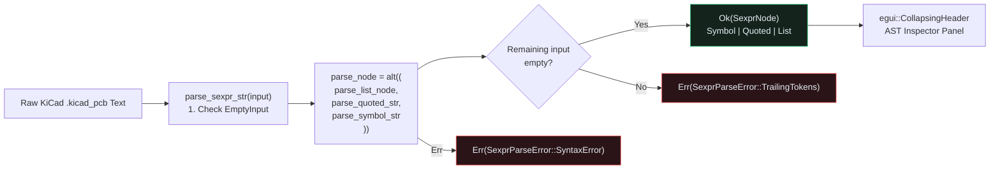

## Why KiCad Uses S-Expressions & Why Parsers Live at Layer `L0`

Real-world KiCad `.kicad_pcb` and `.kicad_sch` files store every board outline, net definition, footprint, pad, and copper trace segment as nested **symbolic expressions (S-expressions)**:{{sidenote: **Standalone `L0` Format Crates (`egui-app-architecture`):** Principle #2 of our architecture requires format parsers like `crates/kicad-sexpr` to sit at Layer `L0` (`Standalone`) with **zero workspace or UI dependencies** (`validate_l0_standalone_manifest`). That keeps the parser independently testable, fuzzable, and reusable across CLI tools, WebAssembly builds, and language servers.}}

```text
(kicad_pcb
  (version 20240108)
  (net 1 "VCC_3V3")
  (footprint "SOT-23" (ref "U1") (val "LDO_3V3") (at 20.0 27.0) (size 12.0 16.0) (net 1))
  (pad "1" smd (at 20.0 22.0) (size 4.0 2.4) (layer "F.Cu") (net 1)))
```

Instead of hand-rolling fragile index-based character loops that can panic on UTF-8 boundaries or unclosed parentheses, we use **[`nom`](https://docs.rs/nom/latest/nom/)**—Rust's declarative parser combinator library. Every `nom` parser is a pure function `fn(&str) -> IResult<&str, Output>` returning `Ok((remaining_input, parsed_value))` or a structured `Err` without panicking.

Scaffold the standalone `crates/kicad-sexpr` library crate and add `nom`, `thiserror`, and `proptest` with `cargo add`:

```console
cargo new --lib crates/kicad-sexpr
cargo add --package kicad-sexpr nom@7.1.3 thiserror
cargo add --package kicad-sexpr --dev proptest
cargo add --package pcb-doc --path crates/kicad-sexpr
```

Here are the resulting `crates/kicad-sexpr/Cargo.toml` and `crates/pcb-doc/Cargo.toml`:

```toml caption="crates/kicad-sexpr/Cargo.toml"
[package]
name = "kicad-sexpr"
version = "0.1.0"
edition = "2024"

[lints]
workspace = true

[dependencies]
nom = "7.1.3"
thiserror = "2.0"

[dev-dependencies]
proptest = "1.11"
```

```toml caption="crates/pcb-doc/Cargo.toml"
[package]
name = "pcb-doc"
version = "0.1.0"
edition = "2024"

[lints]
workspace = true

[dependencies]
emath = { version = "0.37", features = ["serde"] }
kicad-sexpr = { path = "../kicad-sexpr" }
serde = { version = "1.0", features = ["derive", "rc"] }
serde_json = "1.0"
thiserror = "2.0"

[dev-dependencies]
proptest = "1.11"
```



## 2. Anatomy of `crates/kicad-sexpr` & `src/main.rs`: Block by Block

An S-expression has only three grammar productions:

1. **`SexprNode::Symbol(String)`**: An unquoted token of non-whitespace characters excluding `(`, `)`, and `"` (parsed by `take_while1(is_symbol_char)`).
2. **`SexprNode::Quoted(String)`**: A double-quoted string literal `"..."` (parsed by `delimited(char('"'), take_while(|c| c != '"'), char('"'))`).
3. **`SexprNode::List(Vec<SexprNode>)`**: A parenthesized list `(...)` containing zero or more whitespace-separated child nodes (parsed recursively by `delimited(char('('), many0(delimited(multispace0, parse_node, multispace0)), char(')'))`).

Let's walk through the standalone `crates/kicad-sexpr/src/lib.rs` parser, its `crates/pcb-doc/src/lib.rs` re-export, and the `egui::CollapsingHeader` AST inspector in `src/main.rs` block by block before viewing the complete listings in context.

### Block 1: `L0` Standalone Manifest Gate & Recursive `SexprNode` AST (`crates/kicad-sexpr/src/lib.rs`)

```rust caption="Enforcing L0 standalone boundaries and defining SexprNode in crates/kicad-sexpr/src/lib.rs"
/// Standalone `L0` parser crates must have zero workspace or UI dependencies.
pub const FORBIDDEN_DEPS_IN_L0_STANDALONE: &[&str] = &[
    "pcb-doc",
    "pcb-reviewer",
    "egui",
    "eframe",
    "winit",
    "egui_kittest",
    "rfd",
];

/// Verifies that an `L0` standalone parser crate's `Cargo.toml` has no workspace or UI dependencies.
pub fn validate_l0_standalone_manifest(cargo_toml: &str) -> Result<(), &'static str> {
    for &forbidden in FORBIDDEN_DEPS_IN_L0_STANDALONE {
        let key_eq = format!("{forbidden} =");
        let key_dot = format!("dependencies.{forbidden}");
        if cargo_toml.contains(&key_eq) || cargo_toml.contains(&key_dot) {
            return Err(forbidden);
        }
    }
    Ok(())
}

/// Typed, panic-free errors returned by the KiCad S-expression parser.
#[derive(Clone, Debug, Error, PartialEq, Eq)]
pub enum SexprParseError {
    #[error("input must not be empty")]
    EmptyInput,
    #[error("unclosed or malformed S-expression near `{0}`")]
    SyntaxError(String),
    #[error("unexpected trailing tokens: `{0}`")]
    TrailingTokens(String),
}

/// Recursive S-expression abstract syntax tree node for KiCad `.kicad_pcb` and `.kicad_sch` files.
#[derive(Clone, Debug, PartialEq, Eq)]
pub enum SexprNode {
    Symbol(String),
    Quoted(String),
    List(Vec<SexprNode>),
}
```

- **`FORBIDDEN_DEPS_IN_L0_STANDALONE` & `validate_l0_standalone_manifest`**: Enforces Principle #2 of our architecture (`L0` standalone format crates have zero workspace or UI dependencies). Scanning `Cargo.toml` for both `"{forbidden} ="` and `"dependencies.{forbidden}"` catches both inline and table-header dependency declarations, returning `Err(forbidden)` if a higher-layer crate (`pcb-doc`, `egui`, `eframe`, etc.) is ever added.
- **`SexprParseError`**: Uses `thiserror::Error` to classify all syntax failures into three deterministic variants: `EmptyInput` (whitespace-only strings), `SyntaxError(String)` (unclosed parentheses or quotes), and `TrailingTokens(String)` (extra unparsed characters after the root expression).
- **`SexprNode` Recursive Enum**: Models arbitrary S-expression trees using three variants: `Symbol(String)` for bare identifiers/numbers like `kicad_pcb` or `20.0`, `Quoted(String)` for string literals like `"SOT-23"`, and `List(Vec<SexprNode>)` for parenthesized expressions `(...)`. Because `Vec<SexprNode>` is heap-allocated, Rust knows the exact stack size of `SexprNode` without needing explicit `Box<SexprNode>` indirection.

### Block 2: AST Navigation & Telemetry Methods (`impl SexprNode`)

```rust caption="Inspecting tags, child slices, node counts, and tree depth on SexprNode"
impl SexprNode {
    /// If this node is a parenthesized list whose first element is an unquoted `Symbol`,
    /// returns that symbol's name (e.g., `"kicad_pcb"`, `"footprint"`, `"pad"`).
    pub fn tag_name(&self) -> Option<&str> {
        match self {
            SexprNode::List(items) => match items.first() {
                Some(SexprNode::Symbol(tag)) => Some(tag.as_str()),
                _ => None,
            },
            _ => None,
        }
    }

    /// Returns the text of a `Symbol` or `Quoted` leaf node, or `None` for a `List`.
    pub fn as_text(&self) -> Option<&str> {
        match self {
            SexprNode::Symbol(s) | SexprNode::Quoted(s) => Some(s.as_str()),
            SexprNode::List(_) => None,
        }
    }

    /// Returns the slice of child nodes following the leading tag in a `List` node.
    pub fn children(&self) -> &[SexprNode] {
        match self {
            SexprNode::List(items) => items.get(1..).unwrap_or(&[]),
            _ => &[],
        }
    }

    /// Finds the first child list whose `tag_name()` equals `tag`.
    pub fn find_child_list(&self, tag: &str) -> Option<&SexprNode> {
        self.children()
            .iter()
            .find(|node| node.tag_name() == Some(tag))
    }

    /// Counts the total number of AST nodes (`Symbol`, `Quoted`, and `List`) in this subtree.
    pub fn node_count(&self) -> usize {
        match self {
            SexprNode::Symbol(_) | SexprNode::Quoted(_) => 1,
            SexprNode::List(items) => 1 + items.iter().map(Self::node_count).sum::<usize>(),
        }
    }

    /// Computes the maximum nesting depth of lists in this subtree (`0` for leaf atoms).
    pub fn max_depth(&self) -> usize {
        match self {
            SexprNode::Symbol(_) | SexprNode::Quoted(_) => 0,
            SexprNode::List(items) => 1 + items.iter().map(Self::max_depth).max().unwrap_or(0),
        }
    }

    /// Formats a concise telemetry badge summarizing the root tag, total nodes, and depth.
    pub fn summary_badge(&self) -> String {
        format!(
            "AST: ({}) • {} nodes, depth {}",
            self.tag_name().unwrap_or("atom"),
            self.node_count(),
            self.max_depth()
        )
    }
}
```

- **`tag_name(&self) -> Option<&str>`**: In KiCad S-expressions, the first element inside a list `(footprint ...)` is an unquoted `SexprNode::Symbol` naming the record type. Using `items.first()` avoids out-of-bounds indexing on empty lists `()`.
- **`children(&self) -> &[SexprNode]`**: Uses safe range slicing `items.get(1..).unwrap_or(&[])` to return all arguments following the head tag without panicking when a list is empty or has only one element.
- **`find_child_list(&self, tag: &str)`**: Scans `self.children()` for the first nested list whose `tag_name()` matches `tag` (such as `(at 20.0 27.0)` or `(ref "U1")`), which Lesson 0024 will use to lower footprints, pads, and segments into `BoardModel`.
- **`node_count` & `max_depth`**: Recursively fold over `items.iter()` using `.map(Self::node_count).sum::<usize>()` and `.map(Self::max_depth).max().unwrap_or(0)` to compute structural telemetry for `summary_badge()`.

### Block 3: Composing `nom` Parser Combinators (`parse_sexpr_str`)

```rust caption="Composing nom combinators in crates/kicad-sexpr/src/lib.rs"
pub fn is_symbol_char(c: char) -> bool {
    !c.is_whitespace() && c != '(' && c != ')' && c != '"'
}

fn parse_quoted_str(input: &str) -> IResult<&str, SexprNode> {
    map(
        delimited(char('"'), take_while(|c: char| c != '"'), char('"')),
        |s: &str| SexprNode::Quoted(s.to_owned()),
    )(input)
}

fn parse_symbol_str(input: &str) -> IResult<&str, SexprNode> {
    map(take_while1(is_symbol_char), |s: &str| {
        SexprNode::Symbol(s.to_owned())
    })(input)
}

fn parse_list_node(input: &str) -> IResult<&str, SexprNode> {
    map(
        delimited(
            char('('),
            many0(delimited(multispace0, parse_node, multispace0)),
            char(')'),
        ),
        SexprNode::List,
    )(input)
}

fn parse_node(input: &str) -> IResult<&str, SexprNode> {
    alt((parse_list_node, parse_quoted_str, parse_symbol_str))(input)
}

/// Parses a complete KiCad S-expression string into a `SexprNode` without panicking.
pub fn parse_sexpr_str(input: &str) -> Result<SexprNode, SexprParseError> {
    let trimmed = input.trim();
    if trimmed.is_empty() {
        return Err(SexprParseError::EmptyInput);
    }
    match parse_node(trimmed) {
        Ok((rest, node)) => {
            let trailing = rest.trim();
            if trailing.is_empty() {
                Ok(node)
            } else {
                Err(SexprParseError::TrailingTokens(trailing.to_owned()))
            }
        }
        Err(_) => Err(SexprParseError::SyntaxError(trimmed.to_owned())),
    }
}
```

- **`IResult<&str, SexprNode>`**: Every internal `nom` combinator takes an input slice `&str` and returns `Ok((remaining_slice, parsed_node))` or a `nom::Err`, slicing UTF-8 string views in zero-copy fashion until `.to_owned()` constructs the owned `SexprNode` leaf.
- **`is_symbol_char` & `take_while1`**: Accepts any character that is not whitespace, `(`, `)`, or `"`. Because `(` and `"` are excluded from symbol characters, tightly packed KiCad tokens like `(footprint"SOT-23"(at 20.0 27.0))` tokenize cleanly without requiring spaces before delimiters.
- **`delimited`, `many0`, and `alt`**:
  - `parse_quoted_str` uses `delimited(char('"'), take_while(|c| c != '"'), char('"'))` to consume opening and closing quotes and return the inner slice.
  - `parse_list_node` uses `delimited(char('('), many0(delimited(multispace0, parse_node, multispace0)), char(')'))` to recursively collect zero or more whitespace-padded child nodes into a `Vec<SexprNode>` wrapped by `SexprNode::List`.
  - `parse_node` uses `alt((parse_list_node, parse_quoted_str, parse_symbol_str))` to try each branch in order.
- **`parse_sexpr_str` Entry Point**: Trims outer whitespace, guards against `EmptyInput`, invokes `parse_node(trimmed)`, and checks that `rest.trim()` is empty so stray tokens after the closing `)` return `Err(SexprParseError::TrailingTokens(...))`.

### Block 4: Re-Exporting `kicad-sexpr` & Interactive AST Inspector (`crates/pcb-doc` & `src/main.rs`)

```rust caption="Re-exporting kicad-sexpr in crates/pcb-doc/src/lib.rs and rendering egui::CollapsingHeader in src/main.rs"
// In crates/pcb-doc/src/lib.rs:
pub use kicad_sexpr::{
    FORBIDDEN_DEPS_IN_L0_STANDALONE, SAMPLE_KICAD_PCB_SNIPPET, SexprNode, SexprParseError,
    is_symbol_char, parse_sexpr_str, validate_l0_standalone_manifest,
};

// In src/main.rs (ViewState fields & methods):
pub struct ViewState {
    // ... existing fields ...
    pub ast_source_text: String,
    pub parsed_ast: Option<SexprNode>,
    pub last_ast_error: Option<String>,
}

impl ViewState {
    pub fn parse_active_sexpr(&mut self) -> bool {
        match parse_sexpr_str(&self.ast_source_text) {
            Ok(node) => {
                self.parsed_ast = Some(node);
                self.last_ast_error = None;
                true
            }
            Err(err) => {
                self.parsed_ast = None;
                self.last_ast_error = Some(err.to_string());
                false
            }
        }
    }

    pub fn ast_status_badge(&self) -> String {
        if let Some(err) = &self.last_ast_error {
            format!("AST Error: {err}")
        } else if let Some(node) = &self.parsed_ast {
            node.summary_badge()
        } else {
            "AST: None".to_owned()
        }
    }
}

// Inside PcbReviewerApp::render_session_panel(&mut self, ui: &mut egui::Ui):
        ui.separator();
        ui.heading("KiCad S-Expr AST (nom)");
        ui.label(self.view.ast_status_badge());
        ui.horizontal(|ui| {
            if ui.button("Parse Sample KiCad AST").clicked() {
                self.view.ast_source_text = SAMPLE_KICAD_PCB_SNIPPET.to_owned();
                self.view.parse_active_sexpr();
            }
            if ui.button("Test Unclosed S-Expr").clicked() {
                self.view.ast_source_text = "(kicad_pcb (net 1".to_owned();
                self.view.parse_active_sexpr();
            }
        });
        if let Some(root) = &self.view.parsed_ast {
            egui::CollapsingHeader::new(format!(
                "Root ({}) [{} children]",
                root.tag_name().unwrap_or("atom"),
                root.children().len()
            ))
            .default_open(true)
            .show(ui, |ui| {
                for child in root.children() {
                    if let Some(tag) = child.tag_name() {
                        ui.label(format!("Node: ({tag}) • {} items", child.children().len()));
                    }
                }
            });
        }
```

- **Clean `L0 -> L1 -> L7` Layering**: `crates/pcb-doc` (`L1`) depends on `kicad-sexpr` (`L0`) and re-exports `SexprNode`, `SexprParseError`, and `parse_sexpr_str` so the `pcb-reviewer` binary (`L7`) can inspect parsed syntax trees without violating layer boundaries.
- **`ViewState::parse_active_sexpr` & `ast_status_badge`**: Synchronizes `self.parsed_ast` and `self.last_ast_error` whenever the user clicks `"Parse Sample KiCad AST"` or `"Test Unclosed S-Expr"`, formatting either `AST Error: ...`, `AST: (kicad_pcb) • 51 nodes, depth 3`, or `AST: None`.
- **`egui::CollapsingHeader`**: Renders a foldable tree container titled `"Root (kicad_pcb) [5 children]"` (`.default_open(true)`), iterating over `root.children()` inside its closure to display each child list's tag and item count (`Node: (footprint) • 6 items`).

### Block 5: Unit, `proptest!`, and Headless UI Tests (`crates/kicad-sexpr/src/lib.rs` & `src/main.rs`)

```rust caption="Testing L0 manifest gates, edge-case S-expressions, and proptest fuzzing in crates/kicad-sexpr/src/lib.rs"
    #[test]
    fn l0_standalone_manifest_gate_rejects_workspace_and_ui_deps() {
        let actual_manifest = include_str!("../Cargo.toml");
        assert_eq!(validate_l0_standalone_manifest(actual_manifest), Ok(()));
        assert_eq!(
            validate_l0_standalone_manifest("[dependencies]\npcb-doc = { path = \"../pcb-doc\" }"),
            Err("pcb-doc")
        );
        assert_eq!(
            validate_l0_standalone_manifest("[dependencies.egui]\nversion = \"0.37\""),
            Err("egui")
        );
    }

    proptest! {
        #[test]
        fn prop_sexpr_parser_roundtrips_arbitrary_footprints(
            ref_des in "[A-Z]{1,3}[0-9]{1,3}",
            val in "[A-Za-z0-9_.-]{1,12}",
            x in -100.0_f32..100.0_f32,
            y in -100.0_f32..100.0_f32,
        ) {
            let src = format!(
                "(footprint \"SOT-23\" (ref \"{ref_des}\") (val \"{val}\") (at {x:.1} {y:.1}))"
            );
            let ast = parse_sexpr_str(&src).unwrap();
            prop_assert_eq!(ast.tag_name(), Some("footprint"));
            prop_assert_eq!(ast.max_depth(), 2);
            prop_assert_eq!(ast.node_count(), 13);
            let ref_node = ast.find_child_list("ref").unwrap();
            prop_assert_eq!(ref_node.children()[0].as_text(), Some(ref_des.as_str()));
            let val_node = ast.find_child_list("val").unwrap();
            prop_assert_eq!(val_node.children()[0].as_text(), Some(val.as_str()));
        }
    }
```

- **Compile-Time Manifest Verification**: `include_str!("../Cargo.toml")` embeds the actual `crates/kicad-sexpr/Cargo.toml` into the test binary so `validate_l0_standalone_manifest` proves zero workspace or UI dependencies are present.
- **Property-Based Fuzzing (`proptest!`)**: Generates randomized `ref_des`, `val`, and `(x, y)` coordinates, formats a KiCad `(footprint ...)` expression, and asserts that `parse_sexpr_str`, `max_depth()`, `node_count()`, and `find_child_list(...)` recover the exact input tokens across hundreds of generated cases.

### Complete `crates/kicad-sexpr/src/lib.rs` & Updated `src/main.rs` Context Listing

Here is the complete, runnable `crates/kicad-sexpr/src/lib.rs` alongside the AST inspector additions in `src/main.rs`:

```rust caption="Complete crates/kicad-sexpr/src/lib.rs"
#![forbid(unsafe_code)]
#![deny(
    clippy::unwrap_used,
    clippy::expect_used,
    clippy::panic,
    clippy::unimplemented,
    clippy::todo,
    clippy::unreachable
)]

use nom::{
    IResult,
    branch::alt,
    bytes::complete::{take_while, take_while1},
    character::complete::{char, multispace0},
    combinator::map,
    multi::many0,
    sequence::delimited,
};
use thiserror::Error;

/// Standalone `L0` parser crates must have zero workspace or UI dependencies.
pub const FORBIDDEN_DEPS_IN_L0_STANDALONE: &[&str] = &[
    "pcb-doc",
    "pcb-reviewer",
    "egui",
    "eframe",
    "winit",
    "egui_kittest",
    "rfd",
];

/// Verifies that an `L0` standalone parser crate's `Cargo.toml` has no workspace or UI dependencies.
pub fn validate_l0_standalone_manifest(cargo_toml: &str) -> Result<(), &'static str> {
    for &forbidden in FORBIDDEN_DEPS_IN_L0_STANDALONE {
        let key_eq = format!("{forbidden} =");
        let key_dot = format!("dependencies.{forbidden}");
        if cargo_toml.contains(&key_eq) || cargo_toml.contains(&key_dot) {
            return Err(forbidden);
        }
    }
    Ok(())
}

/// Sample KiCad `.kicad_pcb` S-expression snippet used by the AST inspector and tests.
pub const SAMPLE_KICAD_PCB_SNIPPET: &str = "(kicad_pcb (version 20240108) (net 1 \"VCC_3V3\") (net 2 \"SPI_CLK\") (footprint \"SOT-23\" (ref \"U1\") (val \"LDO_3V3\") (at 20.0 27.0) (size 12.0 16.0) (net 1)) (pad \"1\" smd (at 20.0 22.0) (size 4.0 2.4) (layer \"F.Cu\") (net 1)))";

/// Typed, panic-free errors returned by the KiCad S-expression parser.
#[derive(Clone, Debug, Error, PartialEq, Eq)]
pub enum SexprParseError {
    #[error("input must not be empty")]
    EmptyInput,
    #[error("unclosed or malformed S-expression near `{0}`")]
    SyntaxError(String),
    #[error("unexpected trailing tokens: `{0}`")]
    TrailingTokens(String),
}

/// Recursive S-expression abstract syntax tree node for KiCad `.kicad_pcb` and `.kicad_sch` files.
#[derive(Clone, Debug, PartialEq, Eq)]
pub enum SexprNode {
    Symbol(String),
    Quoted(String),
    List(Vec<SexprNode>),
}

impl SexprNode {
    /// If this node is a parenthesized list whose first element is an unquoted `Symbol`,
    /// returns that symbol's name (e.g., `"kicad_pcb"`, `"footprint"`, `"pad"`).
    pub fn tag_name(&self) -> Option<&str> {
        match self {
            SexprNode::List(items) => match items.first() {
                Some(SexprNode::Symbol(tag)) => Some(tag.as_str()),
                _ => None,
            },
            _ => None,
        }
    }

    /// Returns the text of a `Symbol` or `Quoted` leaf node, or `None` for a `List`.
    pub fn as_text(&self) -> Option<&str> {
        match self {
            SexprNode::Symbol(s) | SexprNode::Quoted(s) => Some(s.as_str()),
            SexprNode::List(_) => None,
        }
    }

    /// Returns the slice of child nodes following the leading tag in a `List` node.
    pub fn children(&self) -> &[SexprNode] {
        match self {
            SexprNode::List(items) => items.get(1..).unwrap_or(&[]),
            _ => &[],
        }
    }

    /// Finds the first child list whose `tag_name()` equals `tag`.
    pub fn find_child_list(&self, tag: &str) -> Option<&SexprNode> {
        self.children()
            .iter()
            .find(|node| node.tag_name() == Some(tag))
    }

    /// Counts the total number of AST nodes (`Symbol`, `Quoted`, and `List`) in this subtree.
    pub fn node_count(&self) -> usize {
        match self {
            SexprNode::Symbol(_) | SexprNode::Quoted(_) => 1,
            SexprNode::List(items) => 1 + items.iter().map(Self::node_count).sum::<usize>(),
        }
    }

    /// Computes the maximum nesting depth of lists in this subtree (`0` for leaf atoms).
    pub fn max_depth(&self) -> usize {
        match self {
            SexprNode::Symbol(_) | SexprNode::Quoted(_) => 0,
            SexprNode::List(items) => 1 + items.iter().map(Self::max_depth).max().unwrap_or(0),
        }
    }

    /// Formats a concise telemetry badge summarizing the root tag, total nodes, and depth.
    pub fn summary_badge(&self) -> String {
        format!(
            "AST: ({}) • {} nodes, depth {}",
            self.tag_name().unwrap_or("atom"),
            self.node_count(),
            self.max_depth()
        )
    }
}

pub fn is_symbol_char(c: char) -> bool {
    !c.is_whitespace() && c != '(' && c != ')' && c != '"'
}

fn parse_quoted_str(input: &str) -> IResult<&str, SexprNode> {
    map(
        delimited(char('"'), take_while(|c: char| c != '"'), char('"')),
        |s: &str| SexprNode::Quoted(s.to_owned()),
    )(input)
}

fn parse_symbol_str(input: &str) -> IResult<&str, SexprNode> {
    map(take_while1(is_symbol_char), |s: &str| {
        SexprNode::Symbol(s.to_owned())
    })(input)
}

fn parse_list_node(input: &str) -> IResult<&str, SexprNode> {
    map(
        delimited(
            char('('),
            many0(delimited(multispace0, parse_node, multispace0)),
            char(')'),
        ),
        SexprNode::List,
    )(input)
}

fn parse_node(input: &str) -> IResult<&str, SexprNode> {
    alt((parse_list_node, parse_quoted_str, parse_symbol_str))(input)
}

/// Parses a complete KiCad S-expression string into a `SexprNode` without panicking.
pub fn parse_sexpr_str(input: &str) -> Result<SexprNode, SexprParseError> {
    let trimmed = input.trim();
    if trimmed.is_empty() {
        return Err(SexprParseError::EmptyInput);
    }
    match parse_node(trimmed) {
        Ok((rest, node)) => {
            let trailing = rest.trim();
            if trailing.is_empty() {
                Ok(node)
            } else {
                Err(SexprParseError::TrailingTokens(trailing.to_owned()))
            }
        }
        Err(_) => Err(SexprParseError::SyntaxError(trimmed.to_owned())),
    }
}

#[cfg(test)]
#[allow(clippy::unwrap_used, clippy::expect_used, clippy::panic)]
mod tests {
    use super::*;
    use proptest::prelude::*;

    #[test]
    fn l0_standalone_manifest_gate_rejects_workspace_and_ui_deps() {
        let actual_manifest = include_str!("../Cargo.toml");
        assert_eq!(validate_l0_standalone_manifest(actual_manifest), Ok(()));
        assert_eq!(
            validate_l0_standalone_manifest("[dependencies]\npcb-doc = { path = \"../pcb-doc\" }"),
            Err("pcb-doc")
        );
        assert_eq!(
            validate_l0_standalone_manifest("[dependencies.egui]\nversion = \"0.37\""),
            Err("egui")
        );
    }

    #[test]
    fn is_symbol_char_and_sexpr_combinators_parse_and_reject_edge_cases() {
        assert!(is_symbol_char('a'));
        assert!(is_symbol_char('2'));
        assert!(is_symbol_char('.'));
        assert!(!is_symbol_char(' '));
        assert!(!is_symbol_char('\n'));
        assert!(!is_symbol_char('('));
        assert!(!is_symbol_char(')'));
        assert!(!is_symbol_char('"'));

        assert_eq!(parse_sexpr_str("   \n\t "), Err(SexprParseError::EmptyInput));
        assert_eq!(
            parse_sexpr_str("(kicad_pcb (net 1)"),
            Err(SexprParseError::SyntaxError("(kicad_pcb (net 1)".to_owned()))
        );
        assert_eq!(
            parse_sexpr_str("\"unterminated"),
            Err(SexprParseError::SyntaxError("\"unterminated".to_owned()))
        );
        assert_eq!(
            parse_sexpr_str("(net 1 \"VCC\") extra_token"),
            Err(SexprParseError::TrailingTokens("extra_token".to_owned()))
        );

        // Tightly packed tokens without spaces before `(`, `)`, or `"`
        let packed = parse_sexpr_str("(footprint\"SOT-23\"(at 20.0 27.0))").unwrap();
        assert_eq!(packed.tag_name(), Some("footprint"));
        assert_eq!(packed.children().len(), 2);
        assert_eq!(packed.children()[0].as_text(), Some("SOT-23"));
        assert_eq!(
            packed
                .find_child_list("at")
                .and_then(|n| n.children().first())
                .and_then(SexprNode::as_text),
            Some("20.0")
        );
        assert_eq!(packed.find_child_list("missing"), None);

        // Leaf node and empty list edge cases
        let sym = SexprNode::Symbol("F.Cu".to_owned());
        assert_eq!(sym.tag_name(), None);
        assert_eq!(sym.as_text(), Some("F.Cu"));
        assert!(sym.children().is_empty());
        assert_eq!(sym.node_count(), 1);
        assert_eq!(sym.max_depth(), 0);
        assert_eq!(sym.summary_badge(), "AST: (atom) • 1 nodes, depth 0");

        let empty_list = parse_sexpr_str("()").unwrap();
        assert_eq!(empty_list.tag_name(), None);
        assert_eq!(empty_list.as_text(), None);
        assert!(empty_list.children().is_empty());
        assert_eq!(empty_list.node_count(), 1);
        assert_eq!(empty_list.max_depth(), 1);

        let quoted_head = parse_sexpr_str("(\"quoted_head\" 42)").unwrap();
        assert_eq!(quoted_head.tag_name(), None);
        assert_eq!(quoted_head.children().len(), 1);

        // Full sample KiCad snippet metrics
        let root = parse_sexpr_str(SAMPLE_KICAD_PCB_SNIPPET).unwrap();
        assert_eq!(root.tag_name(), Some("kicad_pcb"));
        assert_eq!(root.children().len(), 5);
        assert_eq!(root.node_count(), 51);
        assert_eq!(root.max_depth(), 3);
        assert_eq!(
            root.summary_badge(),
            "AST: (kicad_pcb) • 51 nodes, depth 3"
        );
    }

    proptest! {
        #[test]
        fn prop_sexpr_parser_roundtrips_arbitrary_footprints(
            ref_des in "[A-Z]{1,3}[0-9]{1,3}",
            val in "[A-Za-z0-9_.-]{1,12}",
            x in -100.0_f32..100.0_f32,
            y in -100.0_f32..100.0_f32,
        ) {
            let src = format!(
                "(footprint \"SOT-23\" (ref \"{ref_des}\") (val \"{val}\") (at {x:.1} {y:.1}))"
            );
            let ast = parse_sexpr_str(&src).unwrap();
            prop_assert_eq!(ast.tag_name(), Some("footprint"));
            prop_assert_eq!(ast.max_depth(), 2);
            prop_assert_eq!(ast.node_count(), 13);
            let ref_node = ast.find_child_list("ref").unwrap();
            prop_assert_eq!(ref_node.children()[0].as_text(), Some(ref_des.as_str()));
            let val_node = ast.find_child_list("val").unwrap();
            prop_assert_eq!(val_node.children()[0].as_text(), Some(val.as_str()));
        }
    }
}
```

```rust caption="AST inspector state, UI section, and egui_kittest assertions in src/main.rs"
impl ViewState {
    pub fn parse_active_sexpr(&mut self) -> bool {
        match parse_sexpr_str(&self.ast_source_text) {
            Ok(node) => {
                self.parsed_ast = Some(node);
                self.last_ast_error = None;
                true
            }
            Err(err) => {
                self.parsed_ast = None;
                self.last_ast_error = Some(err.to_string());
                false
            }
        }
    }

    pub fn ast_status_badge(&self) -> String {
        if let Some(err) = &self.last_ast_error {
            format!("AST Error: {err}")
        } else if let Some(node) = &self.parsed_ast {
            node.summary_badge()
        } else {
            "AST: None".to_owned()
        }
    }
    // ...
}

// Inside PcbReviewerApp::render_session_panel(&mut self, ui: &mut egui::Ui):
        ui.separator();
        ui.heading("KiCad S-Expr AST (nom)");
        ui.label(self.view.ast_status_badge());
        ui.horizontal(|ui| {
            if ui.button("Parse Sample KiCad AST").clicked() {
                self.view.ast_source_text = SAMPLE_KICAD_PCB_SNIPPET.to_owned();
                self.view.parse_active_sexpr();
            }
            if ui.button("Test Unclosed S-Expr").clicked() {
                self.view.ast_source_text = "(kicad_pcb (net 1".to_owned();
                self.view.parse_active_sexpr();
            }
        });
        if let Some(root) = &self.view.parsed_ast {
            egui::CollapsingHeader::new(format!(
                "Root ({}) [{} children]",
                root.tag_name().unwrap_or("atom"),
                root.children().len()
            ))
            .default_open(true)
            .show(ui, |ui| {
                for child in root.children() {
                    if let Some(tag) = child.tag_name() {
                        ui.label(format!("Node: ({tag}) • {} items", child.children().len()));
                    }
                }
            });
        }

// Inside tests::standalone_layer_swatch_and_headless_ui_workflows_pass in src/main.rs:
        assert!(
            harness
                .query_by_label("AST: (kicad_pcb) • 51 nodes, depth 3")
                .is_some()
        );
        assert!(
            harness
                .query_by_label("Node: (footprint) • 6 items")
                .is_some()
        );

        harness.get_by_label("Test Unclosed S-Expr").click();
        harness.run();
        assert!(harness.state().view.parsed_ast.is_none());
        assert!(
            harness
                .state()
                .view
                .ast_status_badge()
                .starts_with("AST Error:")
        );

        harness.get_by_label("Parse Sample KiCad AST").click();
        harness.run();
        assert!(
            harness
                .query_by_label("AST: (kicad_pcb) • 51 nodes, depth 3")
                .is_some()
        );

        harness.state_mut().view.parsed_ast = None;
        harness.state_mut().view.last_ast_error = None;
        assert_eq!(harness.state().view.ast_status_badge(), "AST: None");
```

{{widget:sexpr-ast-sim}}

:::exercise id="ex0023" title="Interactive Lab 2: Compose `nom` Combinators & Inspect `SexprNode` Trees" badge="Skill Practice • nom & SexprNode"
Complete `is_symbol_char`, `parse_list_node`, and `parse_sexpr_str` in `crates/kicad-sexpr/src/lib.rs`.

```rust
pub fn is_symbol_char(c: char) -> bool {
    !c.is_whitespace() && c != '(' && c != ')' && c {{blank:!= '"'|Reject double-quote characters inside unquoted symbols|!= '"'|95px}}
}

fn parse_list_node(input: &str) -> IResult<&str, SexprNode> {
    map(
        {{blank:delimited|Use nom::sequence::delimited to match '(' ... ')'|delimited|125px}}(
            char('('),
            many0(delimited(multispace0, parse_node, multispace0)),
            char(')'),
        ),
        SexprNode::List,
    )(input)
}

pub fn parse_sexpr_str(input: &str) -> Result<SexprNode, SexprParseError> {
    let trimmed = input.trim();
    if trimmed.is_empty() {
        return Err(SexprParseError::{{blank:EmptyInput|Return SexprParseError::EmptyInput on blank input|EmptyInput|135px}});
    }
    match parse_node(trimmed) {
        Ok((rest, node)) => {
            let trailing = rest.trim();
            if trailing.is_empty() {
                Ok(node)
            } else {
                Err(SexprParseError::TrailingTokens(trailing.to_owned()))
            }
        }
        Err(_) => Err(SexprParseError::SyntaxError(trimmed.to_owned())),
    }
}
```

:::prompts
hint: Reject `c != '"'` in `is_symbol_char`, wrap the parenthesized list in `delimited(char('('), ..., char(')'))`, and return `SexprParseError::EmptyInput` when `trimmed.is_empty()`.
success: Cleanly parsed! Your `L0` `kicad-sexpr` crate tokenizes and parses nested KiCad S-expressions without `unsafe` or `unwrap()`, and renders the AST inside `egui::CollapsingHeader`.
:::
:::

:::verify id="verify-0023" title="Lab 3: `L0` Standalone Layer Gate, `nom` Property Fuzzing & Mutation Gate (`0023`)" badge="cargo test --workspace + proptest + cargo mutants" tier="Tier 1 (L0 Gate) + Tier 2 (proptest & Mutants)" caught="342 / 342 (100%)" missed="0 Missed"
Run the 3-crate workspace test suite (`kicad-sexpr`, `pcb-doc`, and `pcb-reviewer`) and mutate all `kicad-sexpr` combinators, AST metrics, and `egui::CollapsingHeader` UI handlers:

```bash caption="Run workspace tests and cargo-mutants on 0022 kicad-sexpr and pcb-reviewer"
cargo test --manifest-path ./apps/0023-sexpr-tokenizer-and-ast-with-nom/Cargo.toml --workspace
cargo mutants --manifest-path ./apps/0023-sexpr-tokenizer-and-ast-with-nom/Cargo.toml --workspace --in-place -F "validate_l0_standalone_manifest|SexprNode|is_symbol_char|parse_quoted_str|parse_symbol_str|parse_list_node|parse_node|parse_sexpr_str|parse_active_sexpr|ast_status_badge"
```

- [ ] `cargo test --manifest-path ./apps/0023-sexpr-tokenizer-and-ast-with-nom/Cargo.toml --workspace` passes all **24 tests** (**3** in `kicad-sexpr`, **15** in `pcb-doc`, and **6** in `pcb-reviewer`).
- [ ] `l0_standalone_manifest_gate_rejects_workspace_and_ui_deps` verifies that `crates/kicad-sexpr/Cargo.toml` has zero workspace or UI dependencies, and `prop_sexpr_parser_roundtrips_arbitrary_footprints` fuzzes randomized KiCad `(footprint ...)` trees.
- [ ] `cargo mutants` catches **100% of viable `kicad-sexpr` and AST inspector mutants** (`0 missed`).
:::

:::quiz id="quiz-0023"
Q: Why does our architecture place `kicad-sexpr` at Layer `L0` as a standalone parser crate?
- [x] To parse files without workspace or UI dependencies
- [ ] To render GPU triangle meshes inside parser combinators
- [ ] To bypass all compiler lint gates during testing
- [ ] To store mutable window handles inside syntax trees
why: Standalone `L0` format crates (`egui-app-architecture` Principle #2) have zero workspace or UI dependencies so they compile rapidly, run on `wasm32`, and remain independently reusable and testable.
hint: Check `validate_l0_standalone_manifest` in `crates/kicad-sexpr/src/lib.rs`.

Q: How does the `nom` `delimited` combinator parse a parenthesized S-expression list in `parse_list_node`?
- [ ] By splitting the input string on every comma character
- [x] By matching opening and closing parentheses around child nodes
- [ ] By converting every symbol directly into an integer token
- [ ] By discarding all nested lists deeper than level one
why: `delimited(char('('), many0(...), char(')'))` consumes the opening `'('`, parses zero or more inner child nodes, requires a matching closing `')'`, and returns the inner `Vec<SexprNode>`.
hint: Inspect `parse_list_node` in `crates/kicad-sexpr/src/lib.rs`.

Q: Why does `parse_sexpr_str` check whether trailing input remains after `parse_node` succeeds?
- [ ] To allow multiple unparenthesized root lists in one node
- [ ] To automatically append missing closing parentheses to broken files
- [x] To reject unexpected extra tokens following a complete expression
- [ ] To skip whitespace trimming before starting the parser combinator
why: A `nom` parser returns `Ok((rest, node))` as soon as one valid node is matched; verifying `rest.trim().is_empty()` ensures stray trailing garbage after the closing `)` is caught as `SexprParseError::TrailingTokens`.
hint: Look at the `Ok((rest, node))` branch in `parse_sexpr_str`.
:::

## Recommended Primary Source

:::callout
**Read (5 mins):** [`nom` Official Crate Documentation & Combinator Recipes](https://docs.rs/nom/latest/nom/) and [`egui::CollapsingHeader` API Docs](https://docs.rs/egui/latest/egui/containers/collapsing_header/struct.CollapsingHeader.html).
:::

:::teacher-prompt
Next up: [Lesson 0024: Lowering KiCad `.kicad_pcb` & `.kicad_sch` ASTs into the Domain Model & Corpus Oracles](./0024-parsing-kicad-pcb-and-sch-into-domain-model.html), where we lower `SexprNode` trees into typed `SmdPad`, `TraceSegment`, and `ComponentSymbol` structs and build a Tier 4 pinned KiCad corpus oracle harness!
:::
