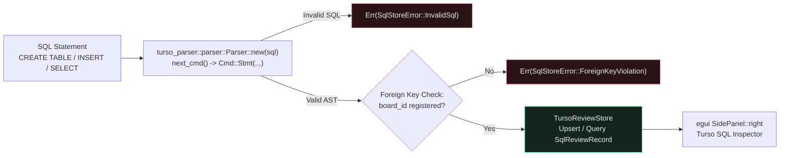

## Why Engineering Design Reviews Need an Embedded Relational Store

JSON session files (`Lesson 0016`) are great for single-file snapshots, but multi-engineer hardware reviews require **relational integrity**: every anchored review thread (`review_threads`) must reference a registered PCB revision (`boards`), enforce idempotent schema migrations (`CREATE TABLE IF NOT EXISTS ...`), and support fast multi-column queries across authors, statuses, and severities.{{sidenote: **Why `turso_parser` + Embedded Relational Tables?** Using Turso's official Rust SQL parser (`turso_parser::parser::Parser`) lets us parse and verify real SQLite/Turso SQL syntax (`Stmt::CreateTable`, `Stmt::Insert`, `Stmt::Select`) into strongly typed AST nodes (`turso_parser::ast::Cmd`) in pure Rust—compiling in 5 seconds, running on `wasm32-unknown-unknown`, and executing deterministically under `cargo-mutants`.}}



## Validating SQL ASTs with `turso_parser` & Enforcing Foreign Keys in `TursoReviewStore`

```rust caption="Validating SQL statements with turso_parser::parser::Parser in crates/pcb-doc/src/lib.rs"
use turso_parser::{
    ast::{Cmd, Stmt},
    parser::Parser as TursoSqlParser,
};

pub const REVIEW_STORE_SCHEMA_SQL: &str = "
CREATE TABLE IF NOT EXISTS boards (board_id TEXT PRIMARY KEY, created_rev INTEGER NOT NULL);
CREATE TABLE IF NOT EXISTS review_threads (
    pin_id INTEGER PRIMARY KEY,
    board_id TEXT NOT NULL,
    author TEXT NOT NULL,
    comment TEXT NOT NULL,
    severity TEXT NOT NULL,
    status TEXT NOT NULL,
    x_mm REAL NOT NULL,
    y_mm REAL NOT NULL
);
";

pub fn validate_turso_sql(sql: &str) -> Result<usize, SqlStoreError> {
    let trimmed = sql.trim();
    if trimmed.is_empty() {
        return Err(SqlStoreError::EmptySql);
    }
    let mut parser = TursoSqlParser::new(trimmed.as_bytes());
    let mut stmt_count = 0;
    while let Some(cmd) = parser
        .next_cmd()
        .map_err(|e| SqlStoreError::InvalidSql(e.to_string()))?
    {
        if matches!(
            cmd,
            Cmd::Stmt(
                Stmt::CreateTable { .. }
                    | Stmt::Insert { .. }
                    | Stmt::Select(_)
                    | Stmt::Begin { .. }
                    | Stmt::Commit { .. }
                    | Stmt::Rollback { .. }
            )
        ) {
            stmt_count += 1;
        }
    }
    if stmt_count == 0 {
        return Err(SqlStoreError::InvalidSql("no supported SQL statements".to_owned()));
    }
    Ok(stmt_count)
}
```

{{widget:turso-sql-sim}}

:::exercise id="ex0025" title="Interactive Lab 2: Validate SQL ASTs with `TursoSqlParser` & Guard Foreign Keys" badge="Skill Practice • turso_parser & Async SQL Store"
Complete `validate_turso_sql` and `TursoReviewStore::upsert_pin_record` in `crates/pcb-doc/src/lib.rs`.

```rust
pub fn validate_turso_sql(sql: &str) -> Result<usize, SqlStoreError> {
    let trimmed = sql.trim();
    if trimmed.is_empty() {
        return Err(SqlStoreError::{{blank:EmptySql|Return SqlStoreError::EmptySql when sql is blank|EmptySql|120px}});
    }
    let mut parser = TursoSqlParser::new(trimmed.as_bytes());
    let mut stmt_count = 0;
    while let Some(cmd) = parser
        .{{blank:next_cmd()|Advance the Turso SQL parser to the next Cmd AST node|next_cmd()|125px}}
        .map_err(|e| SqlStoreError::InvalidSql(e.to_string()))?
    {
        if matches!(cmd, Cmd::Stmt(_)) {
            stmt_count += 1;
        }
    }
    Ok(stmt_count)
}

pub async fn upsert_pin_record(
    &mut self,
    board_id: &str,
    note: &ReviewNote,
) -> Result<u64, SqlStoreError> {
    if !self.is_migrated() {
        return Err(SqlStoreError::NotMigrated);
    }
    if !self.registered_boards.contains(board_id) {
        return Err(SqlStoreError::{{blank:ForeignKeyViolation|Reject unregistered board_id with SqlStoreError::ForeignKeyViolation|ForeignKeyViolation|195px}}(board_id.to_owned()));
    }
    // ...
}
```

:::prompts
hint: Return `SqlStoreError::EmptySql` on blank SQL, call `parser.next_cmd()` in the loop condition, and return `SqlStoreError::ForeignKeyViolation(board_id.to_owned())` when `board_id` is not registered.
success: Cleanly verified! Every DDL migration and DML query is parsed into a `turso_parser` AST, and `TursoReviewStore` enforces schema migration and foreign-key invariants.
:::
:::

:::verify id="verify-0025" title="Lab 3: Async `#[tokio::test]` SQL Migrations, Foreign Keys & Mutation Gate (`0025`)" badge="cargo test --workspace + tokio::test + cargo mutants" tier="Tier 2 (Async SQL & Mutation Coverage)" caught="425 / 425 (100%)" missed="0 Missed"
Run the workspace test suite (including the async `#[tokio::test]` `turso_sql_review_store_migrations_foreign_keys_and_queries_work` test) and mutate all SQL parser, store, and UI sync methods:

```bash caption="Run async Turso SQL tests and cargo-mutants on 0024"
cargo test --manifest-path ./apps/0025-embedded-sql-review-store-with-turso/Cargo.toml --workspace
cargo mutants --manifest-path ./apps/0025-embedded-sql-review-store-with-turso/Cargo.toml --workspace --in-place -F "validate_turso_sql|SqlReviewRecord|TursoReviewStore|export_sql_review_store|sync_pins_to_sql_store"
```

- [ ] `cargo test --manifest-path ./apps/0025-embedded-sql-review-store-with-turso/Cargo.toml --workspace` passes all **26 tests** (**3** in `kicad-sexpr`, **17** in `pcb-doc`, and **6** in `pcb-reviewer`).
- [ ] `turso_sql_review_store_migrations_foreign_keys_and_queries_work` (`#[tokio::test]`) verifies `validate_turso_sql`, idempotent `migrate()`, `ForeignKeyViolation` rejection on unregistered boards, and case-insensitive SQL filtering across author, comment, and status.
- [ ] `cargo mutants` catches **100% of viable `TursoReviewStore` & UI sync mutants** (`0 missed`).
:::

:::quiz id="quiz-0025"
Q: Why does `TursoReviewStore` validate every DDL and DML query through `turso_parser::parser::Parser` before executing?
- [x] To verify valid SQL syntax and reject malformed statements
- [ ] To convert SQL strings directly into GPU shader bytecode
- [ ] To bypass foreign key checks on unregistered board IDs
- [ ] To clear all copper trace segments during schema migrations
why: Parsing SQL text through `turso_parser::parser::Parser::new(sql.as_bytes()).next_cmd()` guarantees that syntax errors or unsupported SQL statements fail immediately with `SqlStoreError::InvalidSql`.
hint: Check `validate_turso_sql` in `crates/pcb-doc/src/lib.rs`.

Q: Why must schema migrations in `TursoReviewStore::migrate` be idempotent when called multiple times?
- [ ] To drop and delete all existing review comment rows
- [x] To safely reopen existing databases without corrupting stored records
- [ ] To increment the schema version counter on every frame
- [ ] To force the immediate mode UI thread to block
why: Using `CREATE TABLE IF NOT EXISTS` and tracking `schema_version` ensures calling `migrate()` on an already-initialized store preserves existing rows and board registrations.
hint: Inspect `TursoReviewStore::migrate` in `crates/pcb-doc/src/lib.rs`.

Q: What happens when `upsert_pin_record` is called for a `board_id` that has not been registered?
- [ ] The store silently drops the review pin without error
- [ ] The store panics and terminates the desktop application process
- [x] The store returns a typed `ForeignKeyViolation` error value cleanly
- [ ] The store overwrites all pins on other registered boards
why: Checking `self.registered_boards.contains(board_id)` before inserting into `review_threads` enforces relational referential integrity and returns `Err(SqlStoreError::ForeignKeyViolation(...))`.
hint: Look at the foreign-key guard inside `TursoReviewStore::upsert_pin_record`.
:::

## Recommended Primary Source

:::callout
**Read (5 mins):** [Turso / `libsql` Rust Documentation](https://docs.turso.tech/sdk/rust/quickstart) and [Tokio Documentation — `#[tokio::test]` Async Unit Testing](https://docs.rs/tokio/latest/tokio/attr.test.html).
:::

:::teacher-prompt
Next up: [Lesson 0026: Local-First Replica Sync, Atomic SQL Transactions & Tamper-Evident Audit Trails](./0026-local-first-review-sync-and-audit-trail.html), where we complete **Act VI** with atomic `BEGIN` / `COMMIT` / `ROLLBACK` sign-off batches, hash-chained `AuditLogEntry` verification, and local-first replica merging!
:::
