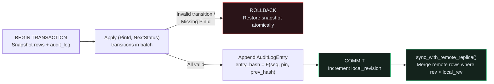

## All-or-Nothing Sign-Off Transactions & Tamper-Evident Audit Trails

When a lead hardware engineer signs off a batch of resolved review pins before Gerber tape-out, partial updates are dangerous: if 2 of 3 pins transition cleanly (`Resolved -> Verified`) but the 3rd pin is still `Open` (an illegal `Open -> Verified` jump), the database must **roll back** the entire batch so the review store and its compliance audit log never diverge.{{sidenote: **Local-First Embedded Replicas & Hash-Chained Audit Logs:** Each `AuditLogEntry` commits `prev_hash: u64` into `compute_audit_entry_hash(seq, pin_id, from_status, to_status, prev_hash)`. Mutating or reordering any historical sign-off breaks `verify_audit_chain()` immediately.}}



## Atomic Sign-Off Batches, `AuditLogEntry` Hash Chains & Replica Sync

```rust caption="Atomic transactions, hash-chained audit logs, and replica sync in crates/pcb-doc/src/lib.rs"
#[derive(Clone, Debug, PartialEq, Eq)]
pub struct AuditLogEntry {
    pub seq: u64,
    pub pin_id: PinId,
    pub actor: String,
    pub from_status: ReviewStatus,
    pub to_status: ReviewStatus,
    pub prev_hash: u64,
    pub entry_hash: u64,
}

pub fn compute_audit_entry_hash(
    seq: u64,
    pin_id: PinId,
    from_status: ReviewStatus,
    to_status: ReviewStatus,
    prev_hash: u64,
) -> u64 {
    prev_hash
        .wrapping_mul(1_000_003)
        .wrapping_add(seq * 97)
        .wrapping_add(u64::from(pin_id.0) * 31)
        .wrapping_add(u64::from(from_status as u8 + 1) * 13)
        .wrapping_add(u64::from(to_status as u8 + 1) * 7)
}
```

{{widget:replica-sync-sim}}

:::exercise id="ex0026" title="Interactive Lab 2: Roll Back Failed Transactions & Verify the Hash-Chained Audit Log" badge="Skill Practice • Transactions & Audit Hash Chains"
Complete `TursoReviewStore::verify_audit_chain` and `TursoReviewStore::sync_with_remote_replica` in `crates/pcb-doc/src/lib.rs`.

```rust
pub fn verify_audit_chain(&self) -> bool {
    let mut expected_prev = 0_u64;
    for (idx, entry) in self.audit_log.iter().enumerate() {
        let expected_seq = (idx + 1) as u64;
        let expected_hash = compute_audit_entry_hash(
            expected_seq,
            entry.pin_id,
            entry.from_status,
            entry.to_status,
            expected_prev,
        );
        if entry.seq != expected_seq
            || entry.prev_hash != {{blank:expected_prev|Verify that entry.prev_hash matches expected_prev|expected_prev|145px}}
            || entry.entry_hash != {{blank:expected_hash|Verify that entry.entry_hash matches expected_hash|expected_hash|145px}}
        {
            return false;
        }
        expected_prev = entry.entry_hash;
    }
    true
}

pub async fn sync_with_remote_replica(
    &mut self,
    remote_rows: &[SqlReviewRecord],
) -> Result<usize, SqlStoreError> {
    if !self.is_migrated() {
        return Err(SqlStoreError::NotMigrated);
    }
    let mut merged = 0;
    for remote in remote_rows {
        let should_accept = match self.rows.get(&remote.pin_id) {
            Some(local) => remote.revision {{blank:> local.revision|Accept remote row only when remote.revision > local.revision|> local.revision|155px}},
            None => true,
        };
        if should_accept {
            self.rows.insert(remote.pin_id, remote.clone());
            merged += 1;
        }
    }
    self.pending_local_writes = 0;
    Ok(merged)
}
```

:::prompts
hint: Check `entry.prev_hash != expected_prev`, compare `entry.entry_hash != expected_hash`, and accept remote replica rows when `remote.revision > local.revision`.
success: Act VI complete! Your embedded SQL Review Store executes all-or-nothing transactions, verifies tamper-evident hash chains, and merges remote replica rows deterministically.
:::
:::

:::verify id="verify-0026" title="Lab 3: Atomic Transaction Rollback, Audit Hash-Chain & Replica Sync Mutation Gate (`0026`)" badge="cargo test --workspace + tokio::test + cargo mutants" tier="Tier 2 + Tier 4 + Tier 7 (Full Act VI Gate)" caught="476 / 476 (100%)" missed="0 Missed"
Run the complete workspace test suite (including `turso_transactions_audit_chain_and_replica_sync_preserve_invariants`) and mutate all transaction, audit-chain, and replica-sync methods:

```bash caption="Run atomic SQL transaction, audit chain, and replica sync mutation gate on 0025"
cargo test --manifest-path ./apps/0026-local-first-review-sync-and-audit-trail/Cargo.toml --workspace
cargo mutants --manifest-path ./apps/0026-local-first-review-sync-and-audit-trail/Cargo.toml --workspace --in-place -F "compute_audit_entry_hash|verify_audit_chain|execute_atomic_signoff_batch|sync_with_remote_replica|replica_status_badge|commit_verified_signoff_batch|trigger_replica_sync"
```

- [ ] `cargo test --manifest-path ./apps/0026-local-first-review-sync-and-audit-trail/Cargo.toml --workspace` passes all **27 tests** (**3** in `kicad-sexpr`, **18** in `pcb-doc`, and **6** in `pcb-reviewer`).
- [ ] `turso_transactions_audit_chain_and_replica_sync_preserve_invariants` (`#[tokio::test]`) verifies atomic rollback on invalid transitions, `verify_audit_chain()` tamper detection when `prev_hash` or `entry_hash` is altered, and monotonic revision merging in `sync_with_remote_replica`.
- [ ] `cargo mutants` catches **100% of viable transaction, audit-log, and replica-sync mutants** (`0 missed`), completing **Act VI** with **0 missed mutants** across all 3 workspace crates!
:::

:::quiz id="quiz-0026"
Q: What happens when one status transition inside `execute_atomic_signoff_batch` fails validation?
- [x] The transaction rolls back and preserves the initial state
- [ ] The transaction commits partial edits and ignores invalid items
- [ ] The database deletes all registered boards from local storage
- [ ] The application panics and corrupts the audit log chain
why: `execute_atomic_signoff_batch` validates `BEGIN`, `COMMIT`, and `ROLLBACK` through `turso_parser` and operates on a cloned transaction working copy, restoring the original rows and audit log if any item fails.
hint: Inspect `execute_atomic_signoff_batch` in `crates/pcb-doc/src/lib.rs`.

Q: How does `verify_audit_chain` detect tampering or out-of-order modifications in the sign-off audit log?
- [ ] By checking that every audit entry has zero hash
- [x] By recomputing chained entry hashes from each previous hash
- [ ] By sorting audit entries alphabetically by engineer author name
- [ ] By truncating the audit log after every replica sync
why: Each `AuditLogEntry` chains `prev_hash` into `compute_audit_entry_hash(...)`; `verify_audit_chain()` checks sequential `seq` numbers, `prev_hash` links, and recomputed `entry_hash` values across the entire log.
hint: Look at `verify_audit_chain` and `compute_audit_entry_hash` in `crates/pcb-doc/src/lib.rs`.

Q: How does `sync_with_remote_replica` resolve conflicts when merging remote engineer review rows?
- [ ] By discarding all remote rows that have higher revisions
- [ ] By overwriting newer local edits with older remote snapshots
- [x] By accepting remote rows with strictly newer revision numbers
- [ ] By clearing the local review table before every sync
why: Comparing `remote.revision > local.revision` ensures that newer remote updates are merged while stale remote snapshots never overwrite newer local edits.
hint: Check the `match self.rows.get(&remote.pin_id)` branch in `sync_with_remote_replica`.
:::

## Recommended Primary Source

:::callout
**Read (5 mins):** [SQLite / Turso Documentation — `BEGIN` / `COMMIT` / `ROLLBACK` Transactions](https://www.sqlite.org/lang_transaction.html) and [Turso Embedded Replicas Architecture Guide](https://docs.turso.tech/features/embedded-replicas/introduction).
:::

:::teacher-prompt
**Act VI Complete!** You have built a standalone `L0` `kicad-sexpr` parser crate with `nom`, lowered `.kicad_pcb` S-expressions into `BoardModel` verified by a Tier 4 pinned corpus oracle (`CORPUS_PASS_FLOOR` & `CORPUS_ROUNDTRIP_FLOOR`), validated SQL DDL/DML ASTs with `turso_parser`, and implemented an async `TursoReviewStore` with atomic transactions, hash-chained audit logs, and local-first replica sync—all with **0 missed mutants**. Ask any questions about Act VI in chat, or let me know when you are ready for **Act VII (`0027`–`0030`): Agentic Hardware Review & Model Context Protocol (`rmcp`)**!
:::
