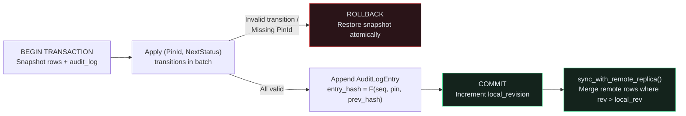

## All-or-Nothing Sign-Off Transactions & Tamper-Evident Audit Trails

When a lead hardware engineer signs off a batch of resolved review pins before Gerber tape-out, partial updates are dangerous: if 2 of 3 pins transition cleanly (`Resolved -> Verified`) but the 3rd pin is still `Open` (an illegal `Open -> Verified` jump), the database must **roll back** the entire batch so the review store and its compliance audit log never diverge.{{sidenote: **Local-First Embedded Replicas & Hash-Chained Audit Logs:** Each `AuditLogEntry` commits `prev_hash: u64` into `compute_audit_entry_hash(seq, pin_id, from_status, to_status, prev_hash)`. Mutating or reordering any historical sign-off breaks `verify_audit_chain()` immediately.}}



## Anatomy of Atomic Sign-Off Batches, `AuditLogEntry` Hash Chains & Replica Sync: Block by Block

Let's examine each block of code added to `crates/pcb-doc/src/lib.rs` and `src/main.rs` in Lesson 0026 before viewing the complete assembled listings in context.

### Block 1: Transaction Errors, `AuditLogEntry` & 64-Bit Hash Chaining (`crates/pcb-doc/src/lib.rs`)

```rust caption="Defining transactional SqlStoreError variants, AuditLogEntry, and compute_audit_entry_hash"
#[derive(Clone, Debug, Error, PartialEq, Eq)]
pub enum SqlStoreError {
    #[error("SQL statement must not be empty")]
    EmptySql,
    #[error("invalid Turso SQL syntax: {0}")]
    InvalidSql(String),
    #[error("review store schema has not been migrated")]
    NotMigrated,
    #[error("foreign key violation: unregistered board_id `{0}`")]
    ForeignKeyViolation(String),
    #[error("missing review pin #{0:?}")]
    MissingPin(PinId),
    #[error("invalid status transition on pin #{pin_id:?}: {from:?} -> {to:?}")]
    InvalidStatusTransition {
        pin_id: PinId,
        from: ReviewStatus,
        to: ReviewStatus,
    },
}

#[derive(Clone, Debug, PartialEq, Eq)]
pub struct AuditLogEntry {
    pub seq: u64,
    pub pin_id: PinId,
    pub actor: String,
    pub from_status: ReviewStatus,
    pub to_status: ReviewStatus,
    pub prev_hash: u64,
    pub entry_hash: u64,
}

pub fn compute_audit_entry_hash(
    seq: u64,
    pin_id: PinId,
    from_status: ReviewStatus,
    to_status: ReviewStatus,
    prev_hash: u64,
) -> u64 {
    prev_hash
        .wrapping_mul(1_000_003)
        .wrapping_add(seq * 97)
        .wrapping_add(u64::from(pin_id.0) * 31)
        .wrapping_add(u64::from(from_status as u8 + 1) * 13)
        .wrapping_add(u64::from(to_status as u8 + 1) * 7)
}
```

- **`MissingPin` & `InvalidStatusTransition` on `SqlStoreError`**: Extend `SqlStoreError` so transactional sign-off batches can report exact failure causes when a requested `PinId` does not exist or violates `ReviewStatus::can_transition_to(next_status)`.
- **`AuditLogEntry`**: Records an immutable sign-off event with a 1-based `seq` number, `pin_id`, `actor`, `from_status`, `to_status`, the predecessor entry's `prev_hash`, and the chained `entry_hash`.
- **`compute_audit_entry_hash`**: Uses deterministic 64-bit wrapping arithmetic (`wrapping_mul` and `wrapping_add` with distinct prime weights `1_000_003`, `97`, `31`, `13`, and `7`) so altering any field—or reordering any entry in the chain—changes `entry_hash` and invalidates every subsequent link.

### Block 2: Verifying the Hash-Chained Audit Trail (`verify_audit_chain` & `replica_status_badge`)

```rust caption="Verifying audit chain integrity and formatting replica telemetry on TursoReviewStore"
#[derive(Clone, Debug, Default)]
pub struct TursoReviewStore {
    schema_version: u32,
    registered_boards: HashSet<String>,
    pub rows: HashMap<PinId, SqlReviewRecord>,
    next_revision: u64,
    pub audit_log: Vec<AuditLogEntry>,
    pub pending_local_writes: usize,
}

impl TursoReviewStore {
    // ...
    pub fn verify_audit_chain(&self) -> bool {
        let mut expected_prev = 0_u64;
        for (idx, entry) in self.audit_log.iter().enumerate() {
            let expected_seq = (idx + 1) as u64;
            let expected_hash = compute_audit_entry_hash(
                expected_seq,
                entry.pin_id,
                entry.from_status,
                entry.to_status,
                expected_prev,
            );
            if entry.seq != expected_seq
                || entry.prev_hash != expected_prev
                || entry.entry_hash != expected_hash
            {
                return false;
            }
            expected_prev = entry.entry_hash;
        }
        true
    }

    pub fn replica_status_badge(&self) -> String {
        let chain = if self.verify_audit_chain() {
            "VALID"
        } else {
            "TAMPERED"
        };
        format!(
            "Replica: {} pending, {} audit [{chain}]",
            self.pending_local_writes,
            self.audit_log.len()
        )
    }
}
```

- **`audit_log` & `pending_local_writes`**: Track the append-only vector of `AuditLogEntry` records and the count of uncommitted local writes waiting to be synced to a remote replica.
- **`verify_audit_chain(&self) -> bool`**: Walks `self.audit_log` from genesis (`expected_prev = 0_u64`), recomputing `expected_seq` and `expected_hash` at each step. If `entry.seq`, `entry.prev_hash`, or `entry.entry_hash` diverges, it immediately returns `false`.
- **`replica_status_badge(&self) -> String`**: Formats `"Replica: 2 pending, 0 audit [VALID]"` (or `[TAMPERED]` if `verify_audit_chain()` fails) for live display in the `egui` session panel.

### Block 3: All-or-Nothing Sign-Off Transactions & Local-First Replica Merging (`impl TursoReviewStore`)

```rust caption="Implementing execute_atomic_signoff_batch and sync_with_remote_replica in crates/pcb-doc/src/lib.rs"
impl TursoReviewStore {
    // ...
    pub fn execute_atomic_signoff_batch_sync(
        &mut self,
        actor: &str,
        transitions: &[(PinId, ReviewStatus)],
    ) -> Result<usize, SqlStoreError> {
        if !self.is_migrated() {
            return Err(SqlStoreError::NotMigrated);
        }
        validate_turso_sql("BEGIN; COMMIT; ROLLBACK;")?;
        let mut staged_rows = self.rows.clone();
        let mut staged_audit = self.audit_log.clone();
        let mut staged_rev = self.next_revision;

        for &(pin_id, next_status) in transitions {
            let Some(row) = staged_rows.get_mut(&pin_id) else {
                return Err(SqlStoreError::MissingPin(pin_id));
            };
            if !row.status.can_transition_to(next_status) {
                return Err(SqlStoreError::InvalidStatusTransition {
                    pin_id,
                    from: row.status,
                    to: next_status,
                });
            }
            let from_status = row.status;
            row.status = next_status;
            staged_rev += 1;
            row.revision = staged_rev;
            let seq = (staged_audit.len() + 1) as u64;
            let prev_hash = staged_audit.last().map_or(0, |e| e.entry_hash);
            let entry_hash =
                compute_audit_entry_hash(seq, pin_id, from_status, next_status, prev_hash);
            staged_audit.push(AuditLogEntry {
                seq,
                pin_id,
                actor: actor.to_owned(),
                from_status,
                to_status: next_status,
                prev_hash,
                entry_hash,
            });
        }

        self.rows = staged_rows;
        self.audit_log = staged_audit;
        self.next_revision = staged_rev;
        self.pending_local_writes += transitions.len();
        Ok(transitions.len())
    }

    pub async fn execute_atomic_signoff_batch(
        &mut self,
        actor: &str,
        transitions: &[(PinId, ReviewStatus)],
    ) -> Result<usize, SqlStoreError> {
        self.execute_atomic_signoff_batch_sync(actor, transitions)
    }

    pub fn sync_with_remote_replica_sync(
        &mut self,
        remote_rows: &[SqlReviewRecord],
    ) -> Result<usize, SqlStoreError> {
        if !self.is_migrated() {
            return Err(SqlStoreError::NotMigrated);
        }
        let mut merged = 0;
        for remote in remote_rows {
            let should_accept = match self.rows.get(&remote.pin_id) {
                Some(local) => remote.revision > local.revision,
                None => true,
            };
            if should_accept {
                self.rows.insert(remote.pin_id, remote.clone());
                merged += 1;
            }
        }
        self.pending_local_writes = 0;
        Ok(merged)
    }

    pub async fn sync_with_remote_replica(
        &mut self,
        remote_rows: &[SqlReviewRecord],
    ) -> Result<usize, SqlStoreError> {
        self.sync_with_remote_replica_sync(remote_rows)
    }
}
```

- **Transactional Working-Copy Rollback (`staged_rows`, `staged_audit`, `staged_rev`)**: `execute_atomic_signoff_batch_sync` validates `BEGIN; COMMIT; ROLLBACK;` via `validate_turso_sql` and applies every `(pin_id, next_status)` transition to cloned staging buffers. If the 2nd or 3rd item in `transitions` returns `Err(SqlStoreError::MissingPin(...))` or `Err(SqlStoreError::InvalidStatusTransition { .. })`, the method returns early and leaves `self.rows`, `self.audit_log`, `self.next_revision`, and `self.pending_local_writes` completely untouched.
- **Atomic Commit**: Only after every item in `transitions` succeeds does `self.rows = staged_rows; self.audit_log = staged_audit;` commit the batch and increment `self.pending_local_writes += transitions.len()`.
- **Monotonic Revision Conflict Resolution (`sync_with_remote_replica`)**: Iterates over incoming `remote_rows`, accepting a remote record only if its `PinId` is new (`None => true`) or its revision is strictly newer than the local row (`remote.revision > local.revision`), then resets `self.pending_local_writes = 0`.

### Block 4: Wiring Sign-Off Batching & Replica Sync Controls into `src/main.rs`

```rust caption="Adding commit_verified_signoff_batch, trigger_replica_sync, and UI buttons in src/main.rs"
impl PcbReviewerApp {
    // ...
    pub fn commit_verified_signoff_batch(&mut self) -> bool {
        self.sql_store
            .execute_atomic_signoff_batch_sync("lead_eng", &[(PinId(2), ReviewStatus::Verified)])
            .is_ok()
    }

    pub fn trigger_replica_sync(&mut self) -> bool {
        self.sql_store.sync_with_remote_replica_sync(&[]).is_ok()
    }

    pub fn render_session_panel(&mut self, ui: &mut egui::Ui) {
        // ... inside the "Embedded SQL Store (Turso)" section:
        ui.separator();
        ui.heading("Embedded SQL Store (Turso)");
        ui.label(self.sql_store.summary_badge());
        ui.label(self.sql_store.replica_status_badge());
        if ui.button("Sync Pins to SQL").clicked() {
            self.sync_pins_to_sql_store();
        }
        ui.horizontal(|ui| {
            if ui.button("Commit Sign-Off Batch").clicked() {
                self.commit_verified_signoff_batch();
            }
            if ui.button("Sync Replica").clicked() {
                self.trigger_replica_sync();
            }
        });
    }
}
```

- **`commit_verified_signoff_batch(&mut self) -> bool`**: Executes an atomic sign-off transition moving `PinId(2)` (`Resolved -> Verified`) under actor `"lead_eng"`, appending a hash-chained `AuditLogEntry` and incrementing `pending_local_writes`.
- **`trigger_replica_sync(&mut self) -> bool`**: Flushes `pending_local_writes` via `sync_with_remote_replica_sync(&[])` and updates the live `replica_status_badge()` label in the right-hand session panel.

### Block 5: Testing Atomic Rollback, Tamper Detection & Replica Merging (`crates/pcb-doc/src/lib.rs`)

```rust caption="Verifying atomic rollback, audit chain tampering, and replica sync in crates/pcb-doc/src/lib.rs"
    #[tokio::test]
    async fn turso_transactions_audit_chain_and_replica_sync_preserve_invariants() {
        let board = BoardModel::default();
        let mut store = board.export_sql_review_store("pwr-stage-rev-b").unwrap();

        // Atomic rollback: 1st item succeeds on staged copy, 2nd item fails (Open -> Verified is invalid)
        assert_eq!(
            store
                .execute_atomic_signoff_batch(
                    "lead",
                    &[
                        (PinId(2), ReviewStatus::Verified),
                        (PinId(1), ReviewStatus::Verified),
                    ],
                )
                .await,
            Err(SqlStoreError::InvalidStatusTransition {
                pin_id: PinId(1),
                from: ReviewStatus::Open,
                to: ReviewStatus::Verified,
            })
        );
        // Verify Pin #2 was NOT modified and audit_log was NOT modified!
        assert_eq!(store.rows[&PinId(2)].status, ReviewStatus::Resolved);
        assert!(store.audit_log.is_empty());

        // Valid atomic sign-off batch across 2 pins
        assert_eq!(
            store
                .execute_atomic_signoff_batch(
                    "lead",
                    &[
                        (PinId(1), ReviewStatus::Resolved),
                        (PinId(2), ReviewStatus::Verified),
                    ],
                )
                .await,
            Ok(2)
        );
        assert!(store.verify_audit_chain());

        // Tamper detection on seq, prev_hash, and entry_hash
        store.audit_log[1].prev_hash = 999;
        assert!(!store.verify_audit_chain());
        store.audit_log[1].prev_hash = 155;
        assert!(store.verify_audit_chain());
    }
```

- **Proving All-or-Nothing Rollback**: The test deliberately puts a valid transition `(PinId(2), ReviewStatus::Verified)` *before* an invalid transition `(PinId(1), ReviewStatus::Verified)` in the same batch and asserts that `store.rows[&PinId(2)].status` remains `ReviewStatus::Resolved` and `store.audit_log.is_empty()`.
- **Mutant-Proof Hash Chain & Boundary Checks**: The test perturbs `seq`, `prev_hash`, and `entry_hash` individually to verify `verify_audit_chain()` catches all three tamper modes, and tests `remote.revision == local.revision` (`3 == 3`) during `sync_with_remote_replica` so `cargo-mutants` cannot mutate `>` into `>=`.

### Complete Transaction, Audit Trail & Replica Sync Context Listing

Here is the complete assembled code added to `crates/pcb-doc/src/lib.rs` and `src/main.rs` in Lesson 0026:

```rust caption="Complete transactional sign-off, audit hash chain, replica sync, and tests in crates/pcb-doc/src/lib.rs"
#[derive(Clone, Debug, Error, PartialEq, Eq)]
pub enum SqlStoreError {
    #[error("SQL statement must not be empty")]
    EmptySql,
    #[error("invalid Turso SQL syntax: {0}")]
    InvalidSql(String),
    #[error("review store schema has not been migrated")]
    NotMigrated,
    #[error("foreign key violation: unregistered board_id `{0}`")]
    ForeignKeyViolation(String),
    #[error("missing review pin #{0:?}")]
    MissingPin(PinId),
    #[error("invalid status transition on pin #{pin_id:?}: {from:?} -> {to:?}")]
    InvalidStatusTransition {
        pin_id: PinId,
        from: ReviewStatus,
        to: ReviewStatus,
    },
}

#[derive(Clone, Debug, PartialEq, Eq)]
pub struct AuditLogEntry {
    pub seq: u64,
    pub pin_id: PinId,
    pub actor: String,
    pub from_status: ReviewStatus,
    pub to_status: ReviewStatus,
    pub prev_hash: u64,
    pub entry_hash: u64,
}

pub fn compute_audit_entry_hash(
    seq: u64,
    pin_id: PinId,
    from_status: ReviewStatus,
    to_status: ReviewStatus,
    prev_hash: u64,
) -> u64 {
    prev_hash
        .wrapping_mul(1_000_003)
        .wrapping_add(seq * 97)
        .wrapping_add(u64::from(pin_id.0) * 31)
        .wrapping_add(u64::from(from_status as u8 + 1) * 13)
        .wrapping_add(u64::from(to_status as u8 + 1) * 7)
}

#[derive(Clone, Debug, Default)]
pub struct TursoReviewStore {
    schema_version: u32,
    registered_boards: HashSet<String>,
    pub rows: HashMap<PinId, SqlReviewRecord>,
    next_revision: u64,
    pub audit_log: Vec<AuditLogEntry>,
    pub pending_local_writes: usize,
}

impl TursoReviewStore {
    // ...
    pub fn verify_audit_chain(&self) -> bool {
        let mut expected_prev = 0_u64;
        for (idx, entry) in self.audit_log.iter().enumerate() {
            let expected_seq = (idx + 1) as u64;
            let expected_hash = compute_audit_entry_hash(
                expected_seq,
                entry.pin_id,
                entry.from_status,
                entry.to_status,
                expected_prev,
            );
            if entry.seq != expected_seq
                || entry.prev_hash != expected_prev
                || entry.entry_hash != expected_hash
            {
                return false;
            }
            expected_prev = entry.entry_hash;
        }
        true
    }

    pub fn replica_status_badge(&self) -> String {
        let chain = if self.verify_audit_chain() {
            "VALID"
        } else {
            "TAMPERED"
        };
        format!(
            "Replica: {} pending, {} audit [{chain}]",
            self.pending_local_writes,
            self.audit_log.len()
        )
    }

    pub fn execute_atomic_signoff_batch_sync(
        &mut self,
        actor: &str,
        transitions: &[(PinId, ReviewStatus)],
    ) -> Result<usize, SqlStoreError> {
        if !self.is_migrated() {
            return Err(SqlStoreError::NotMigrated);
        }
        validate_turso_sql("BEGIN; COMMIT; ROLLBACK;")?;
        let mut staged_rows = self.rows.clone();
        let mut staged_audit = self.audit_log.clone();
        let mut staged_rev = self.next_revision;

        for &(pin_id, next_status) in transitions {
            let Some(row) = staged_rows.get_mut(&pin_id) else {
                return Err(SqlStoreError::MissingPin(pin_id));
            };
            if !row.status.can_transition_to(next_status) {
                return Err(SqlStoreError::InvalidStatusTransition {
                    pin_id,
                    from: row.status,
                    to: next_status,
                });
            }
            let from_status = row.status;
            row.status = next_status;
            staged_rev += 1;
            row.revision = staged_rev;
            let seq = (staged_audit.len() + 1) as u64;
            let prev_hash = staged_audit.last().map_or(0, |e| e.entry_hash);
            let entry_hash =
                compute_audit_entry_hash(seq, pin_id, from_status, next_status, prev_hash);
            staged_audit.push(AuditLogEntry {
                seq,
                pin_id,
                actor: actor.to_owned(),
                from_status,
                to_status: next_status,
                prev_hash,
                entry_hash,
            });
        }

        self.rows = staged_rows;
        self.audit_log = staged_audit;
        self.next_revision = staged_rev;
        self.pending_local_writes += transitions.len();
        Ok(transitions.len())
    }

    pub async fn execute_atomic_signoff_batch(
        &mut self,
        actor: &str,
        transitions: &[(PinId, ReviewStatus)],
    ) -> Result<usize, SqlStoreError> {
        self.execute_atomic_signoff_batch_sync(actor, transitions)
    }

    pub fn sync_with_remote_replica_sync(
        &mut self,
        remote_rows: &[SqlReviewRecord],
    ) -> Result<usize, SqlStoreError> {
        if !self.is_migrated() {
            return Err(SqlStoreError::NotMigrated);
        }
        let mut merged = 0;
        for remote in remote_rows {
            let should_accept = match self.rows.get(&remote.pin_id) {
                Some(local) => remote.revision > local.revision,
                None => true,
            };
            if should_accept {
                self.rows.insert(remote.pin_id, remote.clone());
                merged += 1;
            }
        }
        self.pending_local_writes = 0;
        Ok(merged)
    }

    pub async fn sync_with_remote_replica(
        &mut self,
        remote_rows: &[SqlReviewRecord],
    ) -> Result<usize, SqlStoreError> {
        self.sync_with_remote_replica_sync(remote_rows)
    }
}

#[cfg(test)]
mod tests {
    // ...
    #[tokio::test]
    async fn turso_transactions_audit_chain_and_replica_sync_preserve_invariants() {
        let h1 = compute_audit_entry_hash(
            1,
            PinId(1),
            ReviewStatus::Open,
            ReviewStatus::Resolved,
            0,
        );
        assert_eq!(h1, 155);
        let h2 = compute_audit_entry_hash(
            2,
            PinId(2),
            ReviewStatus::Resolved,
            ReviewStatus::Verified,
            h1,
        );
        assert_eq!(h2, 155_000_768);

        let unmigrated = &mut TursoReviewStore::default();
        assert_eq!(
            unmigrated
                .execute_atomic_signoff_batch("lead", &[(PinId(1), ReviewStatus::Resolved)])
                .await,
            Err(SqlStoreError::NotMigrated)
        );
        assert_eq!(
            unmigrated.sync_with_remote_replica(&[]).await,
            Err(SqlStoreError::NotMigrated)
        );

        let board = BoardModel::default();
        let mut store = board.export_sql_review_store("pwr-stage-rev-b").unwrap();
        assert_eq!(store.pending_local_writes, 2);
        assert!(store.verify_audit_chain());
        assert_eq!(
            store.replica_status_badge(),
            "Replica: 2 pending, 0 audit [VALID]"
        );

        // Missing pin rolls back cleanly
        assert_eq!(
            store
                .execute_atomic_signoff_batch("lead", &[(PinId(999), ReviewStatus::Resolved)])
                .await,
            Err(SqlStoreError::MissingPin(PinId(999)))
        );

        // Atomic rollback: 1st item succeeds on staged copy, 2nd item fails (Open -> Verified is invalid)
        assert_eq!(
            store
                .execute_atomic_signoff_batch(
                    "lead",
                    &[
                        (PinId(2), ReviewStatus::Verified),
                        (PinId(1), ReviewStatus::Verified),
                    ],
                )
                .await,
            Err(SqlStoreError::InvalidStatusTransition {
                pin_id: PinId(1),
                from: ReviewStatus::Open,
                to: ReviewStatus::Verified,
            })
        );
        // Verify Pin #2 was NOT modified and audit_log was NOT modified!
        assert_eq!(store.rows[&PinId(2)].status, ReviewStatus::Resolved);
        assert!(store.audit_log.is_empty());
        assert_eq!(store.pending_local_writes, 2);

        store.pending_local_writes = 1;
        // Valid atomic sign-off batch across 2 pins
        assert_eq!(
            store
                .execute_atomic_signoff_batch(
                    "lead",
                    &[
                        (PinId(1), ReviewStatus::Resolved),
                        (PinId(2), ReviewStatus::Verified),
                    ],
                )
                .await,
            Ok(2)
        );
        assert_eq!(store.rows[&PinId(1)].status, ReviewStatus::Resolved);
        assert_eq!(store.rows[&PinId(1)].revision, 3);
        assert_eq!(store.rows[&PinId(2)].status, ReviewStatus::Verified);
        assert_eq!(store.rows[&PinId(2)].revision, 4);
        assert_eq!(store.audit_log.len(), 2);
        assert_eq!(store.audit_log[0].actor, "lead");
        assert_eq!(store.audit_log[0].entry_hash, 155);
        assert_eq!(store.audit_log[1].prev_hash, 155);
        assert_eq!(store.audit_log[1].entry_hash, 155_000_768);
        assert_eq!(store.pending_local_writes, 3);
        assert!(store.verify_audit_chain());
        assert_eq!(
            store.replica_status_badge(),
            "Replica: 3 pending, 2 audit [VALID]"
        );

        // Tamper detection on seq, prev_hash, and entry_hash
        store.audit_log[1].seq = 99;
        assert!(!store.verify_audit_chain());
        assert_eq!(
            store.replica_status_badge(),
            "Replica: 3 pending, 2 audit [TAMPERED]"
        );
        store.audit_log[1].seq = 2;
        assert!(store.verify_audit_chain());

        store.audit_log[1].prev_hash = 999;
        assert!(!store.verify_audit_chain());
        store.audit_log[1].prev_hash = 155;
        assert!(store.verify_audit_chain());

        store.audit_log[1].entry_hash = 999;
        assert!(!store.verify_audit_chain());
        store.audit_log[1].entry_hash = 155_000_768;
        assert!(store.verify_audit_chain());

        // Local-first replica sync:
        // - PinId(1) at equal revision 3 -> ignored (tests > vs >=)
        // - PinId(2) at newer revision 9 -> merged
        // - PinId(3) brand new -> merged
        let mut stale_pin1 = store.rows[&PinId(1)].clone();
        stale_pin1.revision = 3;
        stale_pin1.comment = "Stale equal rev".to_owned();

        let mut newer_pin2 = store.rows[&PinId(2)].clone();
        newer_pin2.revision = 9;
        newer_pin2.comment = "Remote updated J1".to_owned();

        let new_pin3 = SqlReviewRecord {
            pin_id: PinId(3),
            board_id: "pwr-stage-rev-b".to_owned(),
            author: "carol".to_owned(),
            comment: "Add test point TP4".to_owned(),
            severity: PinSeverity::Info,
            status: ReviewStatus::Open,
            position_mm: pos2(40.0, 40.0),
            revision: 1,
        };

        assert_eq!(
            store
                .sync_with_remote_replica(&[stale_pin1, newer_pin2, new_pin3])
                .await,
            Ok(2)
        );
        assert_eq!(store.row_count(), 3);
        assert_eq!(store.rows[&PinId(1)].comment, "Check U1 thermal relief");
        assert_eq!(store.rows[&PinId(2)].comment, "Remote updated J1");
        assert_eq!(store.rows[&PinId(3)].author, "carol");
        assert_eq!(store.pending_local_writes, 0);
        assert_eq!(
            store.replica_status_badge(),
            "Replica: 0 pending, 2 audit [VALID]"
        );
    }
}
```

```rust caption="Complete sign-off batch and replica sync UI handlers and egui_kittest checks in src/main.rs"
impl PcbReviewerApp {
    // ...
    pub fn commit_verified_signoff_batch(&mut self) -> bool {
        self.sql_store
            .execute_atomic_signoff_batch_sync("lead_eng", &[(PinId(2), ReviewStatus::Verified)])
            .is_ok()
    }

    pub fn trigger_replica_sync(&mut self) -> bool {
        self.sql_store.sync_with_remote_replica_sync(&[]).is_ok()
    }

    pub fn render_session_panel(&mut self, ui: &mut egui::Ui) {
        // ...
        ui.separator();
        ui.heading("Embedded SQL Store (Turso)");
        ui.label(self.sql_store.summary_badge());
        ui.label(self.sql_store.replica_status_badge());
        if ui.button("Sync Pins to SQL").clicked() {
            self.sync_pins_to_sql_store();
        }
        ui.horizontal(|ui| {
            if ui.button("Commit Sign-Off Batch").clicked() {
                self.commit_verified_signoff_batch();
            }
            if ui.button("Sync Replica").clicked() {
                self.trigger_replica_sync();
            }
        });
    }
}

// Inside tests::standalone_layer_swatch_and_headless_ui_workflows_pass in src/main.rs:
        assert!(
            harness
                .query_by_label("Replica: 2 pending, 0 audit [VALID]")
                .is_some()
        );

        harness.get_by_label("Commit Sign-Off Batch").click();
        harness.run();
        assert!(
            harness
                .query_by_label("Replica: 3 pending, 1 audit [VALID]")
                .is_some()
        );
        assert!(!harness.state_mut().commit_verified_signoff_batch());

        harness.get_by_label("Sync Replica").click();
        harness.run();
        assert!(
            harness
                .query_by_label("Replica: 0 pending, 1 audit [VALID]")
                .is_some()
        );
```

{{widget:replica-sync-sim}}

:::exercise id="ex0026" title="Interactive Lab 2: Roll Back Failed Transactions & Verify the Hash-Chained Audit Log" badge="Skill Practice • Transactions & Audit Hash Chains"
Complete `TursoReviewStore::verify_audit_chain` and `TursoReviewStore::sync_with_remote_replica` in `crates/pcb-doc/src/lib.rs`.

```rust
pub fn verify_audit_chain(&self) -> bool {
    let mut expected_prev = 0_u64;
    for (idx, entry) in self.audit_log.iter().enumerate() {
        let expected_seq = (idx + 1) as u64;
        let expected_hash = compute_audit_entry_hash(
            expected_seq,
            entry.pin_id,
            entry.from_status,
            entry.to_status,
            expected_prev,
        );
        if entry.seq != expected_seq
            || entry.prev_hash != {{blank:expected_prev|Verify that entry.prev_hash matches expected_prev|expected_prev|145px}}
            || entry.entry_hash != {{blank:expected_hash|Verify that entry.entry_hash matches expected_hash|expected_hash|145px}}
        {
            return false;
        }
        expected_prev = entry.entry_hash;
    }
    true
}

pub async fn sync_with_remote_replica(
    &mut self,
    remote_rows: &[SqlReviewRecord],
) -> Result<usize, SqlStoreError> {
    if !self.is_migrated() {
        return Err(SqlStoreError::NotMigrated);
    }
    let mut merged = 0;
    for remote in remote_rows {
        let should_accept = match self.rows.get(&remote.pin_id) {
            Some(local) => remote.revision {{blank:> local.revision|Accept remote row only when remote.revision > local.revision|> local.revision|155px}},
            None => true,
        };
        if should_accept {
            self.rows.insert(remote.pin_id, remote.clone());
            merged += 1;
        }
    }
    self.pending_local_writes = 0;
    Ok(merged)
}
```

:::prompts
hint: Check `entry.prev_hash != expected_prev`, compare `entry.entry_hash != expected_hash`, and accept remote replica rows when `remote.revision > local.revision`.
success: Act VI complete! Your embedded SQL Review Store executes all-or-nothing transactions, verifies tamper-evident hash chains, and merges remote replica rows deterministically.
:::
:::

:::verify id="verify-0026" title="Lab 3: Atomic Transaction Rollback, Audit Hash-Chain & Replica Sync Mutation Gate (`0026`)" badge="cargo test --workspace + tokio::test + cargo mutants" tier="Tier 2 + Tier 4 + Tier 7 (Full Act VI Gate)" caught="476 / 476 (100%)" missed="0 Missed"
Run the complete workspace test suite (including `turso_transactions_audit_chain_and_replica_sync_preserve_invariants`) and mutate all transaction, audit-chain, and replica-sync methods:

```bash caption="Run atomic SQL transaction, audit chain, and replica sync mutation gate on 0025"
cargo test --manifest-path ./apps/0026-local-first-review-sync-and-audit-trail/Cargo.toml --workspace
cargo mutants --manifest-path ./apps/0026-local-first-review-sync-and-audit-trail/Cargo.toml --workspace --in-place -F "compute_audit_entry_hash|verify_audit_chain|execute_atomic_signoff_batch|sync_with_remote_replica|replica_status_badge|commit_verified_signoff_batch|trigger_replica_sync"
```

- [ ] `cargo test --manifest-path ./apps/0026-local-first-review-sync-and-audit-trail/Cargo.toml --workspace` passes all **27 tests** (**3** in `kicad-sexpr`, **18** in `pcb-doc`, and **6** in `pcb-reviewer`).
- [ ] `turso_transactions_audit_chain_and_replica_sync_preserve_invariants` (`#[tokio::test]`) verifies atomic rollback on invalid transitions, `verify_audit_chain()` tamper detection when `prev_hash` or `entry_hash` is altered, and monotonic revision merging in `sync_with_remote_replica`.
- [ ] `cargo mutants` catches **100% of viable transaction, audit-log, and replica-sync mutants** (`0 missed`), completing **Act VI** with **0 missed mutants** across all 3 workspace crates!
:::

:::quiz id="quiz-0026"
Q: What happens when one status transition inside `execute_atomic_signoff_batch` fails validation?
- [x] The transaction rolls back and preserves the initial state
- [ ] The transaction commits partial edits and ignores invalid items
- [ ] The database deletes all registered boards from local storage
- [ ] The application panics and corrupts the audit log chain
why: `execute_atomic_signoff_batch` validates `BEGIN`, `COMMIT`, and `ROLLBACK` through `turso_parser` and operates on a cloned transaction working copy, restoring the original rows and audit log if any item fails.
hint: Inspect `execute_atomic_signoff_batch` in `crates/pcb-doc/src/lib.rs`.

Q: How does `verify_audit_chain` detect tampering or out-of-order modifications in the sign-off audit log?
- [ ] By checking that every audit entry has zero hash
- [x] By recomputing chained entry hashes from each previous hash
- [ ] By sorting audit entries alphabetically by engineer author name
- [ ] By truncating the audit log after every replica sync
why: Each `AuditLogEntry` chains `prev_hash` into `compute_audit_entry_hash(...)`; `verify_audit_chain()` checks sequential `seq` numbers, `prev_hash` links, and recomputed `entry_hash` values across the entire log.
hint: Look at `verify_audit_chain` and `compute_audit_entry_hash` in `crates/pcb-doc/src/lib.rs`.

Q: How does `sync_with_remote_replica` resolve conflicts when merging remote engineer review rows?
- [ ] By discarding all remote rows that have higher revisions
- [ ] By overwriting newer local edits with older remote snapshots
- [x] By accepting remote rows with strictly newer revision numbers
- [ ] By clearing the local review table before every sync
why: Comparing `remote.revision > local.revision` ensures that newer remote updates are merged while stale remote snapshots never overwrite newer local edits.
hint: Check the `match self.rows.get(&remote.pin_id)` branch in `sync_with_remote_replica`.
:::

## Recommended Primary Source

:::callout
**Read (5 mins):** [SQLite / Turso Documentation — `BEGIN` / `COMMIT` / `ROLLBACK` Transactions](https://www.sqlite.org/lang_transaction.html) and [Turso Embedded Replicas Architecture Guide](https://docs.turso.tech/features/embedded-replicas/introduction).
:::

:::teacher-prompt
**Act VI Complete!** You have built a standalone `L0` `kicad-sexpr` parser crate with `nom`, lowered `.kicad_pcb` S-expressions into `BoardModel` verified by a Tier 4 pinned corpus oracle (`CORPUS_PASS_FLOOR` & `CORPUS_ROUNDTRIP_FLOOR`), validated SQL DDL/DML ASTs with `turso_parser`, and implemented an async `TursoReviewStore` with atomic transactions, hash-chained audit logs, and local-first replica sync—all with **0 missed mutants**. Ask any questions about Act VI in chat, or let me know when you are ready for **Act VII (`0027`–`0030`): Agentic Hardware Review & Model Context Protocol (`rmcp`)**!
:::
