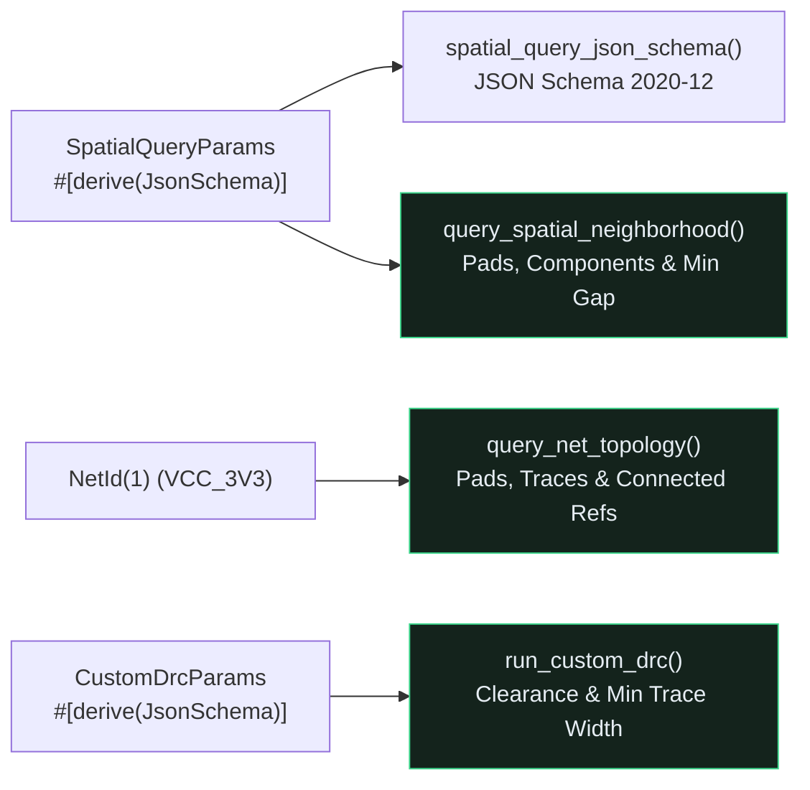

## Why Raw S-Expressions Fail AI Hardware Reviewers

Large Language Models excel at high-level reasoning across datasheets and design checklists, but they struggle when asked to compute Euclidean pad-to-pad clearances or trace net connectivity directly from thousands of raw `(segment (start ...))` lines in a `.kicad_pcb` file.{{sidenote: **High-Leverage Agent Queries vs. Raw Token Dumps:** Instead of feeding an entire `.kicad_pcb` file into an LLM context window and hoping it calculates $\sqrt{\Delta x^2 + \Delta y^2}$ accurately, an engine-first CAD tool exposes deterministic spatial and topological query methods backed by strict `schemars::JsonSchema` parameter contracts.}}



## Spatial Neighborhood, Net Topology & `schemars::JsonSchema`

Add `schemars` to `crates/pcb-doc` with `cargo add`:

```console
cargo add --package pcb-doc schemars@=1.2.2
```

Here is the resulting `crates/pcb-doc/Cargo.toml`:

```toml caption="crates/pcb-doc/Cargo.toml"
[package]
name = "pcb-doc"
version = "0.1.0"
edition = "2024"

[lints]
workspace = true

[dependencies]
emath = { version = "0.37", features = ["serde"] }
kicad-sexpr = { path = "../kicad-sexpr" }
schemars = "=1.2.2"
serde = { version = "1.0", features = ["derive", "rc"] }
serde_json = "1.0"
thiserror = "2.0"
turso_parser = "=0.8.1"

[dev-dependencies]
proptest = "1.11"
tokio = { version = "1", features = ["rt", "macros"] }
```

By deriving `schemars::JsonSchema` alongside `Serialize` and `Deserialize`, Rust generates a standard JSON Schema 2020-12 specification via `schemars::schema_for!(SpatialQueryParams)` that MCP servers (`rmcp`) advertise directly to AI agents. Rather than reading all of the new `pcb-doc` and `src/main.rs` additions at once, let's unpack them block by block before viewing the complete assembled listings.

### Block 1: `schemars::JsonSchema` Query Contracts & Error Types (`crates/pcb-doc/src/lib.rs`)

```rust
pub use schemars::{self, JsonSchema, schema_for};

#[derive(Clone, Copy, Debug, PartialEq, Eq, Serialize, Deserialize, JsonSchema)]
pub struct NetId(pub u32);

#[derive(Clone, Debug, Error, PartialEq, Eq)]
pub enum AgentQueryError {
    #[error("component ref_des must not be empty")]
    EmptyRefDes,
    #[error("unknown component `{0}`")]
    UnknownComponent(String),
    #[error("search radius_mm must be > 0.0")]
    NonPositiveRadius,
    #[error("custom DRC thresholds must be > 0.0")]
    InvalidDrcThreshold,
}

#[derive(Clone, Debug, PartialEq, Serialize, Deserialize, JsonSchema)]
pub struct SpatialQueryParams {
    pub ref_des: String,
    pub radius_mm: f32,
}

#[derive(Clone, Debug, PartialEq, Eq, Serialize, Deserialize, JsonSchema)]
pub struct SpatialNeighborhoodReport {
    pub ref_des: String,
    pub nearby_pads: usize,
    pub nearby_components: usize,
}

impl SpatialNeighborhoodReport {
    pub fn summary_badge(&self) -> String {
        format!(
            "Spatial [{}]: {} pads, {} comps",
            self.ref_des, self.nearby_pads, self.nearby_components
        )
    }
}

#[derive(Clone, Debug, PartialEq, Eq, Serialize, Deserialize, JsonSchema)]
pub struct NetTopologyReport {
    pub net: NetId,
    pub signal_name: String,
    pub pad_count: usize,
    pub trace_count: usize,
    pub connected_refs: Vec<String>,
}

impl NetTopologyReport {
    pub fn summary_badge(&self) -> String {
        format!(
            "Topology [{}]: {} pads, {} traces ({} refs)",
            self.signal_name,
            self.pad_count,
            self.trace_count,
            self.connected_refs.len()
        )
    }
}

#[derive(Clone, Copy, Debug, PartialEq, Serialize, Deserialize, JsonSchema)]
pub struct CustomDrcParams {
    pub min_clearance_mm: f32,
    pub min_copper_width_mm: f32,
}

#[derive(Clone, Copy, Debug, PartialEq, Eq, Serialize, Deserialize, JsonSchema)]
pub struct CustomDrcReport {
    pub clearance_violations: usize,
    pub narrow_traces: usize,
}

impl CustomDrcReport {
    pub fn is_clean(&self) -> bool {
        self.clearance_violations == 0 && self.narrow_traces == 0
    }

    pub fn summary_badge(&self) -> String {
        let status = if self.is_clean() { "CLEAN" } else { "FAIL" };
        format!(
            "Custom DRC [{status}]: {} gap, {} width",
            self.clearance_violations, self.narrow_traces
        )
    }
}

pub fn spatial_query_json_schema() -> serde_json::Value {
    serde_json::to_value(schema_for!(SpatialQueryParams)).unwrap_or_default()
}
```

- **`#[derive(JsonSchema)]` on `NetId`, `SpatialQueryParams`, `NetTopologyReport`, `CustomDrcParams`, and `CustomDrcReport`**: Instructs [`schemars`](https://docs.rs/schemars/latest/schemars/) to generate compile-time JSON Schema 2020-12 metadata for every parameter and report struct, including nested newtypes like `NetId(pub u32)`.
- **`AgentQueryError` (`#[derive(Error)]`)**: Provides panic-free, deterministic error variants (`EmptyRefDes`, `UnknownComponent`, `NonPositiveRadius`, `InvalidDrcThreshold`) whenever an LLM passes blank reference designators, non-existent components, or non-positive millimetre thresholds.
- **`summary_badge(&self)` & `CustomDrcReport::is_clean(&self)`**: Formats compact, deterministic telemetry strings (`"Spatial [U1]: 2 pads, 0 comps"`, `"Topology [VCC_3V3]: 1 pads, 3 traces (2 refs)"`, `"Custom DRC [FAIL]: 1 gap, 0 width"`) that both the `egui` inspector panel and `egui_kittest` assertions verify.
- **`spatial_query_json_schema()`**: Calls `schema_for!(SpatialQueryParams)` and converts the resulting `Schema` into a `serde_json::Value` so unit tests and MCP tool registries can inspect `"title"`, `"type": "object"`, and required `"properties"`.

### Block 2: Spatial Neighborhood, Net Topology & Custom DRC Engine Methods (`crates/pcb-doc/src/lib.rs`)

```rust
impl BoardModel {
    pub fn query_spatial_neighborhood(
        &self,
        params: &SpatialQueryParams,
    ) -> Result<SpatialNeighborhoodReport, AgentQueryError> {
        let trimmed = params.ref_des.trim();
        if trimmed.is_empty() {
            return Err(AgentQueryError::EmptyRefDes);
        }
        if params.radius_mm <= 0.0 {
            return Err(AgentQueryError::NonPositiveRadius);
        }
        let Some(anchor) = self.find_component(trimmed) else {
            return Err(AgentQueryError::UnknownComponent(trimmed.to_owned()));
        };
        let nearby_pads = self
            .pads
            .iter()
            .filter(|p| (p.center_mm - anchor.center_mm).length() <= params.radius_mm)
            .count();
        let nearby_components = self
            .components
            .iter()
            .filter(|c| {
                c.ref_des != anchor.ref_des
                    && (c.center_mm - anchor.center_mm).length() <= params.radius_mm
            })
            .count();
        Ok(SpatialNeighborhoodReport {
            ref_des: anchor.ref_des.clone(),
            nearby_pads,
            nearby_components,
        })
    }

    pub fn query_net_topology(&self, net: NetId) -> NetTopologyReport {
        let pad_count = self.pads.iter().filter(|p| p.net == net).count();
        let trace_count = self.traces.iter().filter(|t| t.net == Some(net)).count();
        let mut connected_refs: Vec<String> = self
            .components
            .iter()
            .filter(|c| c.primary_net == net)
            .map(|c| c.ref_des.clone())
            .collect();
        connected_refs.sort();
        NetTopologyReport {
            net,
            signal_name: net.signal_name().to_owned(),
            pad_count,
            trace_count,
            connected_refs,
        }
    }

    pub fn run_custom_drc(
        &self,
        params: &CustomDrcParams,
    ) -> Result<CustomDrcReport, AgentQueryError> {
        if params.min_clearance_mm <= 0.0 || params.min_copper_width_mm <= 0.0 {
            return Err(AgentQueryError::InvalidDrcThreshold);
        }
        let clearance_violations = self
            .detect_pad_clearance_violations(params.min_clearance_mm)
            .len();
        let narrow_traces = self
            .traces
            .iter()
            .filter(|t| {
                matches!(t.layer, PcbLayer::TopCopper | PcbLayer::BottomCopper)
                    && t.width_mm < params.min_copper_width_mm
            })
            .count();
        Ok(CustomDrcReport {
            clearance_violations,
            narrow_traces,
        })
    }
}
```

- **`query_spatial_neighborhood(&self, params: &SpatialQueryParams)`**: Trims `params.ref_des`, validates `radius_mm > 0.0`, resolves the anchor component via `self.find_component(trimmed)`, and counts SMD pads and neighboring components (`c.ref_des != anchor.ref_des`) whose Euclidean center distance `(pos - anchor.center_mm).length()` is `<= params.radius_mm`.
- **`query_net_topology(&self, net: NetId)`**: Aggregates the pad count, routed trace segment count (`t.net == Some(net)`), and lexicographically sorted `connected_refs` (`connected_refs.sort()`) for any `NetId`.
- **`run_custom_drc(&self, params: &CustomDrcParams)`**: Rejects non-positive thresholds (`<= 0.0`) with `AgentQueryError::InvalidDrcThreshold`, reuses `detect_pad_clearance_violations(params.min_clearance_mm)`, and filters physical copper layers (`matches!(t.layer, PcbLayer::TopCopper | PcbLayer::BottomCopper)`) for traces narrower than `params.min_copper_width_mm` without false-flagging silkscreen or ratsnest lines.

### Block 3: Interactive Agent Query Preview Controls in `egui` (`src/main.rs`)

```rust
// In pub struct ViewState (and ViewState::default()):
pub last_agent_query_badge: String, // initialized to "Agent Query: Ready".to_owned()

// In impl PcbReviewerApp:
pub fn run_u1_spatial_query(&mut self) -> bool {
    match self.board.query_spatial_neighborhood(&SpatialQueryParams {
        ref_des: "U1".to_owned(),
        radius_mm: 15.0,
    }) {
        Ok(report) => {
            self.view.last_agent_query_badge = report.summary_badge();
            true
        }
        Err(err) => {
            self.view.last_agent_query_badge = format!("Query Err: {err}");
            false
        }
    }
}

pub fn run_vcc_net_query(&mut self) {
    self.view.last_agent_query_badge = self.board.query_net_topology(NetId(1)).summary_badge();
}

pub fn run_board_custom_drc(&mut self) -> bool {
    match self.board.run_custom_drc(&CustomDrcParams {
        min_clearance_mm: self.view.min_clearance_mm,
        min_copper_width_mm: 0.5,
    }) {
        Ok(report) => {
            self.view.last_agent_query_badge = report.summary_badge();
            true
        }
        Err(err) => {
            self.view.last_agent_query_badge = format!("DRC Err: {err}");
            false
        }
    }
}

// Inside PcbReviewerApp::render_session_panel(&mut self, ui: &mut egui::Ui):
ui.label(&self.view.last_agent_query_badge);
ui.horizontal(|ui| {
    if ui.button("Query U1 Neighborhood").clicked() {
        self.run_u1_spatial_query();
    }
    if ui.button("Run Custom DRC").clicked() {
        self.run_board_custom_drc();
    }
});
if ui.button("Query VCC_3V3 Topology").clicked() {
    self.run_vcc_net_query();
}
```

- **`ViewState::last_agent_query_badge`**: Stores the latest agent query status string (`"Agent Query: Ready"` at startup) so the right-hand session panel can render live telemetry every frame.
- **`run_u1_spatial_query`, `run_vcc_net_query`, and `run_board_custom_drc`**: Bridge `PcbReviewerApp` UI actions directly to `BoardModel`'s `L1` query methods, updating `last_agent_query_badge` on both `Ok` and `Err` outcomes.
- **Session Panel Query Buttons**: Renders `"Query U1 Neighborhood"`, `"Run Custom DRC"`, and `"Query VCC_3V3 Topology"` in `render_session_panel`, letting engineers preview the exact query payloads an MCP agent receives.

### Block 4: Unit & Headless `egui_kittest` Verification (`crates/pcb-doc/src/lib.rs` & `src/main.rs`)

```rust
// In crates/pcb-doc/src/lib.rs (#[cfg(test)] mod tests):
#[test]
fn llm_spatial_topology_and_custom_drc_queries_preserve_invariants() {
    let schema = spatial_query_json_schema();
    assert_eq!(schema["title"], "SpatialQueryParams");
    assert_eq!(schema["type"], "object");
    assert!(schema["properties"]["ref_des"].is_object());
    assert!(schema["properties"]["radius_mm"].is_object());

    let board = BoardModel::default();
    assert_eq!(
        board.query_spatial_neighborhood(&SpatialQueryParams {
            ref_des: "   ".to_owned(),
            radius_mm: 15.0,
        }),
        Err(AgentQueryError::EmptyRefDes)
    );
    assert_eq!(
        board.query_spatial_neighborhood(&SpatialQueryParams {
            ref_des: "U1".to_owned(),
            radius_mm: 0.0,
        }),
        Err(AgentQueryError::NonPositiveRadius)
    );
    assert_eq!(
        board.query_spatial_neighborhood(&SpatialQueryParams {
            ref_des: "U1".to_owned(),
            radius_mm: -2.0,
        }),
        Err(AgentQueryError::NonPositiveRadius)
    );
    assert_eq!(
        board.query_spatial_neighborhood(&SpatialQueryParams {
            ref_des: "U999".to_owned(),
            radius_mm: 15.0,
        }),
        Err(AgentQueryError::UnknownComponent("U999".to_owned()))
    );

    // U1 is at (20, 27); pads #0 and #1 are at (20, 22) and (20, 32) -> exact distance 5.0 mm.
    let tight = board
        .query_spatial_neighborhood(&SpatialQueryParams {
            ref_des: "  U1  ".to_owned(),
            radius_mm: 5.0,
        })
        .unwrap();
    assert_eq!(
        tight,
        SpatialNeighborhoodReport {
            ref_des: "U1".to_owned(),
            nearby_pads: 2,
            nearby_components: 0,
        }
    );
    assert_eq!(tight.summary_badge(), "Spatial [U1]: 2 pads, 0 comps");

    let sub_5 = board
        .query_spatial_neighborhood(&SpatialQueryParams {
            ref_des: "U1".to_owned(),
            radius_mm: 4.9,
        })
        .unwrap();
    assert_eq!(sub_5.nearby_pads, 0);

    // Exact component distance boundary: R12 is at (52, 35) from J1 at (68, 35) -> exact distance 16.0 mm!
    let j1_exact = board
        .query_spatial_neighborhood(&SpatialQueryParams {
            ref_des: "J1".to_owned(),
            radius_mm: 16.0,
        })
        .unwrap();
    assert_eq!(j1_exact.nearby_components, 1);

    let j1_under = board
        .query_spatial_neighborhood(&SpatialQueryParams {
            ref_des: "J1".to_owned(),
            radius_mm: 15.9,
        })
        .unwrap();
    assert_eq!(j1_under.nearby_components, 0);

    let vcc_topo = board.query_net_topology(NetId(1));
    assert_eq!(
        vcc_topo,
        NetTopologyReport {
            net: NetId(1),
            signal_name: "VCC_3V3".to_owned(),
            pad_count: 1,
            trace_count: 3,
            connected_refs: vec!["J1".to_owned(), "U1".to_owned()],
        }
    );
    assert_eq!(
        vcc_topo.summary_badge(),
        "Topology [VCC_3V3]: 1 pads, 3 traces (2 refs)"
    );

    let spi_topo = board.query_net_topology(NetId(2));
    assert_eq!(spi_topo.pad_count, 2);
    assert_eq!(spi_topo.trace_count, 2);
    assert_eq!(spi_topo.connected_refs, vec!["R12".to_owned()]);

    for bad_drc in [
        CustomDrcParams {
            min_clearance_mm: 0.0,
            min_copper_width_mm: 0.5,
        },
        CustomDrcParams {
            min_clearance_mm: -1.0,
            min_copper_width_mm: 0.5,
        },
        CustomDrcParams {
            min_clearance_mm: 8.0,
            min_copper_width_mm: 0.0,
        },
        CustomDrcParams {
            min_clearance_mm: 8.0,
            min_copper_width_mm: -0.5,
        },
    ] {
        assert_eq!(
            board.run_custom_drc(&bad_drc),
            Err(AgentQueryError::InvalidDrcThreshold)
        );
    }

    let clean_drc = board
        .run_custom_drc(&CustomDrcParams {
            min_clearance_mm: 7.6,
            min_copper_width_mm: 0.8,
        })
        .unwrap();
    assert!(clean_drc.is_clean());
    assert_eq!(clean_drc.summary_badge(), "Custom DRC [CLEAN]: 0 gap, 0 width");

    let fail_drc = board
        .run_custom_drc(&CustomDrcParams {
            min_clearance_mm: 8.0,
            min_copper_width_mm: 0.85,
        })
        .unwrap();
    assert!(!fail_drc.is_clean());
    assert_eq!(fail_drc.summary_badge(), "Custom DRC [FAIL]: 1 gap, 4 width");
}

// In src/main.rs (standalone_layer_swatch_and_headless_ui_workflows_pass):
assert!(harness.query_by_label("Agent Query: Ready").is_some());
harness.get_by_label("Query U1 Neighborhood").click();
harness.run();
assert!(
    harness
        .query_by_label("Spatial [U1]: 2 pads, 0 comps")
        .is_some()
);

harness.get_by_label("Query VCC_3V3 Topology").click();
harness.run();
assert!(
    harness
        .query_by_label("Topology [VCC_3V3]: 1 pads, 3 traces (2 refs)")
        .is_some()
);

harness.get_by_label("Run Custom DRC").click();
harness.run();
assert!(
    harness
        .query_by_label("Custom DRC [FAIL]: 1 gap, 0 width")
        .is_some()
);
```

- **Exact Euclidean Boundary Assertions (`5.0` vs. `4.9` mm and `16.0` vs. `15.9` mm)**: Pins the `<=` boundary in `query_spatial_neighborhood` so `cargo-mutants` cannot flip `<=` to `<` without failing the test suite.
- **Copper Width Threshold Boundary (`0.8` vs. `0.85` mm)**: Verifies that `width_mm < params.min_copper_width_mm` treats `0.8 mm` copper traces as clean when `min_copper_width_mm == 0.8`, catching `<` to `<=` mutations.
- **Headless `egui_kittest` Button Clicks**: Clicks `"Query U1 Neighborhood"`, `"Query VCC_3V3 Topology"`, and `"Run Custom DRC"` inside `Harness::new_eframe` and asserts that the rendered badge updates on screen.

### Complete Lesson 0027 Additions Listing (`crates/pcb-doc/src/lib.rs` & `src/main.rs`)

Here are the complete assembled Lesson `0027` additions in context across `crates/pcb-doc/src/lib.rs` and `src/main.rs`:

```rust caption="Complete Lesson 0027 additions in crates/pcb-doc/src/lib.rs and src/main.rs"
// ============================================================================
// crates/pcb-doc/src/lib.rs — Spatial, Net Topology & Custom DRC Queries
// ============================================================================
pub use schemars::{self, JsonSchema, schema_for};

impl BoardModel {
    pub fn query_spatial_neighborhood(
        &self,
        params: &SpatialQueryParams,
    ) -> Result<SpatialNeighborhoodReport, AgentQueryError> {
        let trimmed = params.ref_des.trim();
        if trimmed.is_empty() {
            return Err(AgentQueryError::EmptyRefDes);
        }
        if params.radius_mm <= 0.0 {
            return Err(AgentQueryError::NonPositiveRadius);
        }
        let Some(anchor) = self.find_component(trimmed) else {
            return Err(AgentQueryError::UnknownComponent(trimmed.to_owned()));
        };
        let nearby_pads = self
            .pads
            .iter()
            .filter(|p| (p.center_mm - anchor.center_mm).length() <= params.radius_mm)
            .count();
        let nearby_components = self
            .components
            .iter()
            .filter(|c| {
                c.ref_des != anchor.ref_des
                    && (c.center_mm - anchor.center_mm).length() <= params.radius_mm
            })
            .count();
        Ok(SpatialNeighborhoodReport {
            ref_des: anchor.ref_des.clone(),
            nearby_pads,
            nearby_components,
        })
    }

    pub fn query_net_topology(&self, net: NetId) -> NetTopologyReport {
        let pad_count = self.pads.iter().filter(|p| p.net == net).count();
        let trace_count = self.traces.iter().filter(|t| t.net == Some(net)).count();
        let mut connected_refs: Vec<String> = self
            .components
            .iter()
            .filter(|c| c.primary_net == net)
            .map(|c| c.ref_des.clone())
            .collect();
        connected_refs.sort();
        NetTopologyReport {
            net,
            signal_name: net.signal_name().to_owned(),
            pad_count,
            trace_count,
            connected_refs,
        }
    }

    pub fn run_custom_drc(
        &self,
        params: &CustomDrcParams,
    ) -> Result<CustomDrcReport, AgentQueryError> {
        if params.min_clearance_mm <= 0.0 || params.min_copper_width_mm <= 0.0 {
            return Err(AgentQueryError::InvalidDrcThreshold);
        }
        let clearance_violations = self
            .detect_pad_clearance_violations(params.min_clearance_mm)
            .len();
        let narrow_traces = self
            .traces
            .iter()
            .filter(|t| {
                matches!(t.layer, PcbLayer::TopCopper | PcbLayer::BottomCopper)
                    && t.width_mm < params.min_copper_width_mm
            })
            .count();
        Ok(CustomDrcReport {
            clearance_violations,
            narrow_traces,
        })
    }
}

#[derive(Clone, Debug, Error, PartialEq, Eq)]
pub enum AgentQueryError {
    #[error("component ref_des must not be empty")]
    EmptyRefDes,
    #[error("unknown component `{0}`")]
    UnknownComponent(String),
    #[error("search radius_mm must be > 0.0")]
    NonPositiveRadius,
    #[error("custom DRC thresholds must be > 0.0")]
    InvalidDrcThreshold,
}

#[derive(Clone, Debug, PartialEq, Serialize, Deserialize, JsonSchema)]
pub struct SpatialQueryParams {
    pub ref_des: String,
    pub radius_mm: f32,
}

#[derive(Clone, Debug, PartialEq, Eq, Serialize, Deserialize, JsonSchema)]
pub struct SpatialNeighborhoodReport {
    pub ref_des: String,
    pub nearby_pads: usize,
    pub nearby_components: usize,
}

impl SpatialNeighborhoodReport {
    pub fn summary_badge(&self) -> String {
        format!(
            "Spatial [{}]: {} pads, {} comps",
            self.ref_des, self.nearby_pads, self.nearby_components
        )
    }
}

#[derive(Clone, Debug, PartialEq, Eq, Serialize, Deserialize, JsonSchema)]
pub struct NetTopologyReport {
    pub net: NetId,
    pub signal_name: String,
    pub pad_count: usize,
    pub trace_count: usize,
    pub connected_refs: Vec<String>,
}

impl NetTopologyReport {
    pub fn summary_badge(&self) -> String {
        format!(
            "Topology [{}]: {} pads, {} traces ({} refs)",
            self.signal_name,
            self.pad_count,
            self.trace_count,
            self.connected_refs.len()
        )
    }
}

#[derive(Clone, Copy, Debug, PartialEq, Serialize, Deserialize, JsonSchema)]
pub struct CustomDrcParams {
    pub min_clearance_mm: f32,
    pub min_copper_width_mm: f32,
}

#[derive(Clone, Copy, Debug, PartialEq, Eq, Serialize, Deserialize, JsonSchema)]
pub struct CustomDrcReport {
    pub clearance_violations: usize,
    pub narrow_traces: usize,
}

impl CustomDrcReport {
    pub fn is_clean(&self) -> bool {
        self.clearance_violations == 0 && self.narrow_traces == 0
    }

    pub fn summary_badge(&self) -> String {
        let status = if self.is_clean() { "CLEAN" } else { "FAIL" };
        format!(
            "Custom DRC [{status}]: {} gap, {} width",
            self.clearance_violations, self.narrow_traces
        )
    }
}

pub fn spatial_query_json_schema() -> serde_json::Value {
    serde_json::to_value(schema_for!(SpatialQueryParams)).unwrap_or_default()
}

// ============================================================================
// src/main.rs — Agent Query Preview Methods & Session Panel Integration
// ============================================================================
impl PcbReviewerApp {
    pub fn run_u1_spatial_query(&mut self) -> bool {
        match self.board.query_spatial_neighborhood(&SpatialQueryParams {
            ref_des: "U1".to_owned(),
            radius_mm: 15.0,
        }) {
            Ok(report) => {
                self.view.last_agent_query_badge = report.summary_badge();
                true
            }
            Err(err) => {
                self.view.last_agent_query_badge = format!("Query Err: {err}");
                false
            }
        }
    }

    pub fn run_vcc_net_query(&mut self) {
        self.view.last_agent_query_badge = self.board.query_net_topology(NetId(1)).summary_badge();
    }

    pub fn run_board_custom_drc(&mut self) -> bool {
        match self.board.run_custom_drc(&CustomDrcParams {
            min_clearance_mm: self.view.min_clearance_mm,
            min_copper_width_mm: 0.5,
        }) {
            Ok(report) => {
                self.view.last_agent_query_badge = report.summary_badge();
                true
            }
            Err(err) => {
                self.view.last_agent_query_badge = format!("DRC Err: {err}");
                false
            }
        }
    }
}
```

{{widget:spatial-query-sim}}

:::exercise id="ex0027" title="Interactive Lab 2: Implement Spatial Neighborhood & Custom DRC Queries" badge="Skill Practice • Spatial Queries & schemars"
Complete `BoardModel::query_spatial_neighborhood` and `BoardModel::run_custom_drc` in `crates/pcb-doc/src/lib.rs`.

```rust
pub fn query_spatial_neighborhood(
    &self,
    params: &SpatialQueryParams,
) -> Result<SpatialNeighborhoodReport, AgentQueryError> {
    let trimmed = params.ref_des.trim();
    if trimmed.is_empty() {
        return Err(AgentQueryError::EmptyRefDes);
    }
    if params.radius_mm <= 0.0 {
        return Err(AgentQueryError::NonPositiveRadius);
    }
    let Some(anchor) = self.find_component(trimmed) else {
        return Err(AgentQueryError::UnknownComponent(trimmed.to_owned()));
    };
    let nearby_pads = self
        .pads
        .iter()
        .filter(|p| {
            let dist = (p.center_mm - anchor.center_mm).length();
            dist {{blank:<= params.radius_mm|Include pads whose Euclidean distance from anchor.center_mm is <= params.radius_mm|<= params.radius_mm|165px}}
        })
        .count();
    let nearby_components = self
        .components
        .iter()
        .filter(|c| {
            c.ref_des != anchor.ref_des
                && (c.center_mm - anchor.center_mm).length() <= params.radius_mm
        })
        .count();
    Ok(SpatialNeighborhoodReport {
        ref_des: anchor.ref_des.clone(),
        nearby_pads,
        nearby_components,
    })
}

pub fn run_custom_drc(
    &self,
    params: &CustomDrcParams,
) -> Result<CustomDrcReport, AgentQueryError> {
    if params.min_clearance_mm <= 0.0 || params.min_copper_width_mm <= 0.0 {
        return Err(AgentQueryError::InvalidDrcThreshold);
    }
    let clearance_violations = self
        .detect_pad_clearance_violations(params.min_clearance_mm)
        .len();
    let narrow_traces = self
        .traces
        .iter()
        .filter(|t| {
            matches!(t.layer, PcbLayer::TopCopper | PcbLayer::BottomCopper)
                && t.width_mm {{blank:< params.min_copper_width_mm|Flag copper traces whose width_mm is strictly less than params.min_copper_width_mm|< params.min_copper_width_mm|215px}}
        })
        .count();
    Ok(CustomDrcReport {
        clearance_violations,
        narrow_traces,
    })
}
```

:::prompts
hint: Check `dist <= params.radius_mm` when counting pads within the neighborhood radius, and flag copper traces where `t.width_mm < params.min_copper_width_mm`.
success: Your `pcb-doc` engine now executes deterministic spatial neighborhood, net-topology, and custom DRC queries backed by `schemars::JsonSchema`!
:::
:::

:::verify id="verify-0027" title="Lab 3: Spatial Query, Net Topology & JSON Schema Mutation Gate (`0027`)" badge="cargo test --workspace + proptest + cargo mutants" tier="Tier 2 + Tier 5 (Schema & Spatial Query Gate)" caught="497 / 497 (100%)" missed="0 Missed"
Run the workspace test suite (including `llm_spatial_topology_and_custom_drc_queries_preserve_invariants`) and mutate all spatial query, topology, and schema helper methods:

```bash caption="Run spatial query, net topology, and JSON Schema mutation gate on 0026"
cargo test --manifest-path ./apps/0027-llm-native-spatial-and-electrical-queries/Cargo.toml --workspace
cargo mutants --manifest-path ./apps/0027-llm-native-spatial-and-electrical-queries/Cargo.toml --workspace --in-place -F "spatial_query_json_schema|query_spatial_neighborhood|query_net_topology|run_custom_drc|SpatialNeighborhoodReport|NetTopologyReport|CustomDrcReport|run_u1_spatial_query|run_vcc_net_query|run_board_custom_drc"
```

- [ ] `cargo test --manifest-path ./apps/0027-llm-native-spatial-and-electrical-queries/Cargo.toml --workspace` passes all **28 tests** (**3** in `kicad-sexpr`, **19** in `pcb-doc`, and **6** in `pcb-reviewer`).
- [ ] `spatial_query_json_schema()` produces a valid JSON Schema 2020-12 object declaring `"ref_des"` and `"radius_mm"` as required properties.
- [ ] `cargo mutants` catches **100% of viable spatial, net-topology, and custom DRC mutants** (`0 missed`).
:::

:::quiz id="quiz-0027"
Q: Why should a CAD engine expose dedicated spatial neighborhood queries instead of asking an LLM to inspect raw KiCad S-expression coordinates directly?
- [x] Deterministic Euclidean queries prevent LLM coordinate arithmetic hallucinations
- [ ] Raw S-expression text automatically calculates Euclidean clearance gaps
- [ ] Large language models cannot read standard JSON objects
- [ ] Spatial queries delete copper traces outside the viewport
why: LLMs are probabilistic token predictors; computing exact 2D Euclidean distances and pad-to-pad clearances in Rust (`pcb-doc`) gives the agent exact geometric facts in a compact JSON payload.
hint: Consider how LLMs process floating-point coordinate pairs in raw text.

Q: What does `#[derive(schemars::JsonSchema)]` on `SpatialQueryParams` enable in an MCP-capable Rust application?
- [ ] It compiles GLSL fragment shaders for the 2D canvas
- [x] It generates machine-readable JSON Schema contracts for tool parameters
- [ ] It encrypts SQLite database rows before local replica sync
- [ ] It replaces the Cargo workspace resolver with a script
why: `schemars::JsonSchema` derives compile-time reflection metadata so `schema_for!(SpatialQueryParams)` (and `rmcp`'s `#[tool]` macro) can publish exact JSON Schema 2020-12 parameter definitions.
hint: Inspect `spatial_query_json_schema()` in `crates/pcb-doc/src/lib.rs`.

Q: Which trace layers are inspected for minimum copper width violations inside `BoardModel::run_custom_drc`?
- [ ] Only Silkscreen text outlines and unrouted Ratsnest airwires
- [ ] Every non-copper mechanical courtyard and board edge layer
- [x] Only physical `TopCopper` and `BottomCopper` routed trace segments
- [ ] Only schematic symbol pin labels inside the toolbar
why: `run_custom_drc` filters traces with `matches!(t.layer, PcbLayer::TopCopper | PcbLayer::BottomCopper)` so silkscreen lines (`0.3 mm`) and ratsnest airwires (`0.25 mm`) are not false-flagged as narrow copper traces.
hint: Check the `matches!(t.layer, ...)` filter inside `run_custom_drc`.
:::

## Recommended Primary Source

:::callout
**Read (5 mins):** [`schemars` Official Documentation on docs.rs](https://docs.rs/schemars/latest/schemars/) — deriving `JsonSchema` and inspecting generated schemas with `schema_for!`.
:::

:::teacher-prompt
Next up in [**Lesson 0028: Headless MCP Server (`rmcp`) & In-Memory Duplex Mock Client**](./0028-headless-mcp-server-rmcp-and-mock-client.md), we will wrap `BoardModel` and our `schemars` queries inside an official `rmcp` `ServerHandler` (`#[tool_router]`, `#[tool]`, `#[tool_handler]`), expose `kicad://` resources and review prompts, and verify full client$\leftrightarrow$server round-trips over `tokio::io::duplex`!
:::
