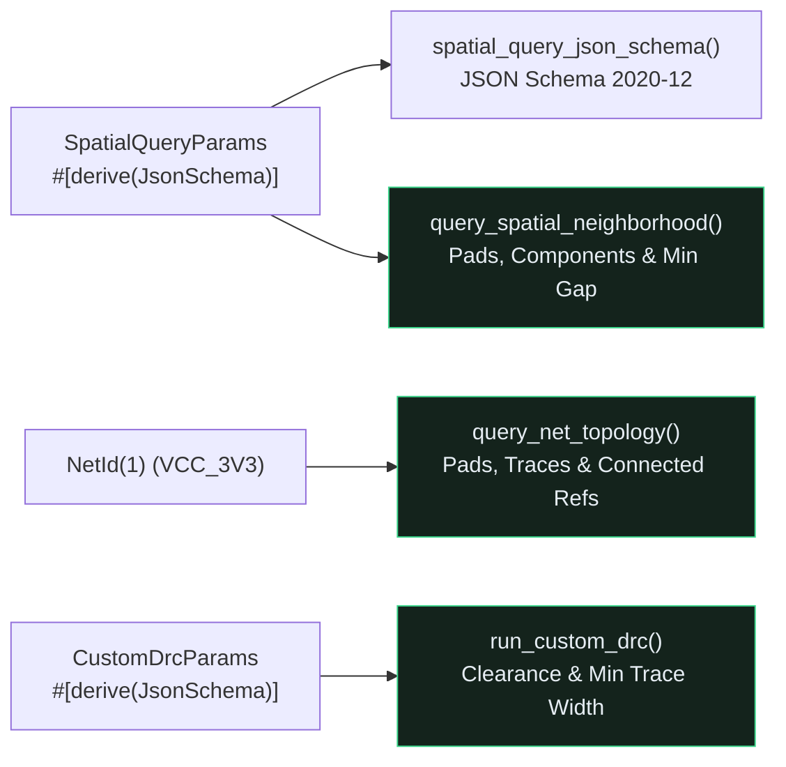

## Why Raw S-Expressions Fail AI Hardware Reviewers

Large Language Models excel at high-level reasoning across datasheets and design checklists, but they struggle when asked to compute Euclidean pad-to-pad clearances or trace net connectivity directly from thousands of raw `(segment (start ...))` lines in a `.kicad_pcb` file.{{sidenote: **High-Leverage Agent Queries vs. Raw Token Dumps:** Instead of feeding an entire `.kicad_pcb` file into an LLM context window and hoping it calculates $\sqrt{\Delta x^2 + \Delta y^2}$ accurately, an engine-first CAD tool exposes deterministic spatial and topological query methods backed by strict `schemars::JsonSchema` parameter contracts.}}



## Spatial Neighborhood, Net Topology & `schemars::JsonSchema`

Add `schemars` to `crates/pcb-doc` with `cargo add`:

```console
cargo add --package pcb-doc schemars@=1.2.2
```

Here is the resulting `crates/pcb-doc/Cargo.toml`:

```toml caption="crates/pcb-doc/Cargo.toml"
[package]
name = "pcb-doc"
version = "0.1.0"
edition = "2024"

[lints]
workspace = true

[dependencies]
emath = { version = "0.37", features = ["serde"] }
kicad-sexpr = { path = "../kicad-sexpr" }
schemars = "=1.2.2"
serde = { version = "1.0", features = ["derive", "rc"] }
serde_json = "1.0"
thiserror = "2.0"
turso_parser = "=0.8.1"

[dev-dependencies]
proptest = "1.11"
tokio = { version = "1", features = ["rt", "macros"] }
```

By deriving `schemars::JsonSchema` alongside `Serialize` and `Deserialize`, Rust generates a standard JSON Schema 2020-12 specification via `schemars::schema_for!(SpatialQueryParams)` that MCP servers (`rmcp`) advertise directly to AI agents:

```rust caption="Typed spatial, net-topology, and custom DRC queries in crates/pcb-doc/src/lib.rs"
use schemars::{JsonSchema, schema_for};

#[derive(Clone, Debug, PartialEq, Serialize, Deserialize, JsonSchema)]
pub struct SpatialQueryParams {
    pub ref_des: String,
    pub radius_mm: f32,
}

#[derive(Clone, Debug, PartialEq, Eq, Serialize, Deserialize, JsonSchema)]
pub struct NetTopologyReport {
    pub net: NetId,
    pub signal_name: String,
    pub pad_count: usize,
    pub trace_count: usize,
    pub connected_refs: Vec<String>,
}

pub fn spatial_query_json_schema() -> serde_json::Value {
    serde_json::to_value(schema_for!(SpatialQueryParams)).unwrap_or_default()
}
```

{{widget:spatial-query-sim}}

:::exercise id="ex0027" title="Interactive Lab 2: Implement Spatial Neighborhood & Custom DRC Queries" badge="Skill Practice • Spatial Queries & schemars"
Complete `BoardModel::query_spatial_neighborhood` and `BoardModel::run_custom_drc` in `crates/pcb-doc/src/lib.rs`.

```rust
pub fn query_spatial_neighborhood(
    &self,
    params: &SpatialQueryParams,
) -> Result<SpatialNeighborhoodReport, AgentQueryError> {
    let trimmed = params.ref_des.trim();
    if trimmed.is_empty() {
        return Err(AgentQueryError::EmptyRefDes);
    }
    if params.radius_mm <= 0.0 {
        return Err(AgentQueryError::NonPositiveRadius);
    }
    let Some(anchor) = self.find_component(trimmed) else {
        return Err(AgentQueryError::UnknownComponent(trimmed.to_owned()));
    };
    let nearby_pads = self
        .pads
        .iter()
        .filter(|p| {
            let dist = (p.center_mm - anchor.center_mm).length();
            dist {{blank:<= params.radius_mm|Include pads whose Euclidean distance from anchor.center_mm is <= params.radius_mm|<= params.radius_mm|165px}}
        })
        .count();
    let nearby_components = self
        .components
        .iter()
        .filter(|c| {
            c.ref_des != anchor.ref_des
                && (c.center_mm - anchor.center_mm).length() <= params.radius_mm
        })
        .count();
    Ok(SpatialNeighborhoodReport {
        ref_des: anchor.ref_des.clone(),
        nearby_pads,
        nearby_components,
    })
}

pub fn run_custom_drc(
    &self,
    params: &CustomDrcParams,
) -> Result<CustomDrcReport, AgentQueryError> {
    if params.min_clearance_mm <= 0.0 || params.min_copper_width_mm <= 0.0 {
        return Err(AgentQueryError::InvalidDrcThreshold);
    }
    let clearance_violations = self
        .detect_pad_clearance_violations(params.min_clearance_mm)
        .len();
    let narrow_traces = self
        .traces
        .iter()
        .filter(|t| {
            matches!(t.layer, PcbLayer::TopCopper | PcbLayer::BottomCopper)
                && t.width_mm {{blank:< params.min_copper_width_mm|Flag copper traces whose width_mm is strictly less than params.min_copper_width_mm|< params.min_copper_width_mm|215px}}
        })
        .count();
    Ok(CustomDrcReport {
        clearance_violations,
        narrow_traces,
    })
}
```

:::prompts
hint: Check `dist <= params.radius_mm` when counting pads within the neighborhood radius, and flag copper traces where `t.width_mm < params.min_copper_width_mm`.
success: Your `pcb-doc` engine now executes deterministic spatial neighborhood, net-topology, and custom DRC queries backed by `schemars::JsonSchema`!
:::
:::

:::verify id="verify-0027" title="Lab 3: Spatial Query, Net Topology & JSON Schema Mutation Gate (`0027`)" badge="cargo test --workspace + proptest + cargo mutants" tier="Tier 2 + Tier 5 (Schema & Spatial Query Gate)" caught="497 / 497 (100%)" missed="0 Missed"
Run the workspace test suite (including `llm_spatial_topology_and_custom_drc_queries_preserve_invariants`) and mutate all spatial query, topology, and schema helper methods:

```bash caption="Run spatial query, net topology, and JSON Schema mutation gate on 0026"
cargo test --manifest-path ./apps/0027-llm-native-spatial-and-electrical-queries/Cargo.toml --workspace
cargo mutants --manifest-path ./apps/0027-llm-native-spatial-and-electrical-queries/Cargo.toml --workspace --in-place -F "spatial_query_json_schema|query_spatial_neighborhood|query_net_topology|run_custom_drc|SpatialNeighborhoodReport|NetTopologyReport|CustomDrcReport|run_u1_spatial_query|run_vcc_net_query|run_board_custom_drc"
```

- [ ] `cargo test --manifest-path ./apps/0027-llm-native-spatial-and-electrical-queries/Cargo.toml --workspace` passes all **28 tests** (**3** in `kicad-sexpr`, **19** in `pcb-doc`, and **6** in `pcb-reviewer`).
- [ ] `spatial_query_json_schema()` produces a valid JSON Schema 2020-12 object declaring `"ref_des"` and `"radius_mm"` as required properties.
- [ ] `cargo mutants` catches **100% of viable spatial, net-topology, and custom DRC mutants** (`0 missed`).
:::

:::quiz id="quiz-0027"
Q: Why should a CAD engine expose dedicated spatial neighborhood queries instead of asking an LLM to inspect raw KiCad S-expression coordinates directly?
- [x] Deterministic Euclidean queries prevent LLM coordinate arithmetic hallucinations
- [ ] Raw S-expression text automatically calculates Euclidean clearance gaps
- [ ] Large language models cannot read standard JSON objects
- [ ] Spatial queries delete copper traces outside the viewport
why: LLMs are probabilistic token predictors; computing exact 2D Euclidean distances and pad-to-pad clearances in Rust (`pcb-doc`) gives the agent exact geometric facts in a compact JSON payload.
hint: Consider how LLMs process floating-point coordinate pairs in raw text.

Q: What does `#[derive(schemars::JsonSchema)]` on `SpatialQueryParams` enable in an MCP-capable Rust application?
- [ ] It compiles GLSL fragment shaders for the 2D canvas
- [x] It generates machine-readable JSON Schema contracts for tool parameters
- [ ] It encrypts SQLite database rows before local replica sync
- [ ] It replaces the Cargo workspace resolver with a script
why: `schemars::JsonSchema` derives compile-time reflection metadata so `schema_for!(SpatialQueryParams)` (and `rmcp`'s `#[tool]` macro) can publish exact JSON Schema 2020-12 parameter definitions.
hint: Inspect `spatial_query_json_schema()` in `crates/pcb-doc/src/lib.rs`.

Q: Which trace layers are inspected for minimum copper width violations inside `BoardModel::run_custom_drc`?
- [ ] Only Silkscreen text outlines and unrouted Ratsnest airwires
- [ ] Every non-copper mechanical courtyard and board edge layer
- [x] Only physical `TopCopper` and `BottomCopper` routed trace segments
- [ ] Only schematic symbol pin labels inside the toolbar
why: `run_custom_drc` filters traces with `matches!(t.layer, PcbLayer::TopCopper | PcbLayer::BottomCopper)` so silkscreen lines (`0.3 mm`) and ratsnest airwires (`0.25 mm`) are not false-flagged as narrow copper traces.
hint: Check the `matches!(t.layer, ...)` filter inside `run_custom_drc`.
:::

## Recommended Primary Source

:::callout
**Read (5 mins):** [`schemars` Official Documentation on docs.rs](https://docs.rs/schemars/latest/schemars/) — deriving `JsonSchema` and inspecting generated schemas with `schema_for!`.
:::

:::teacher-prompt
Next up in [**Lesson 0028: Headless MCP Server (`rmcp`) & In-Memory Duplex Mock Client**](./0028-headless-mcp-server-rmcp-and-mock-client.md), we will wrap `BoardModel` and our `schemars` queries inside an official `rmcp` `ServerHandler` (`#[tool_router]`, `#[tool]`, `#[tool_handler]`), expose `kicad://` resources and review prompts, and verify full client$\leftrightarrow$server round-trips over `tokio::io::duplex`!
:::
