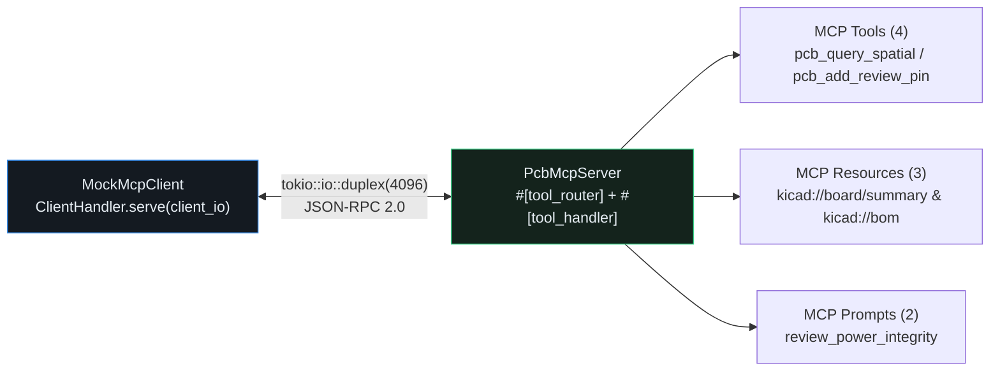

## Exposing the CAD Engine via the Official `rmcp` Rust SDK

With `schemars::JsonSchema` parameter structs in place, we can expose our PCB Reviewer as a standard **Model Context Protocol (MCP)** server using [`rmcp`](https://docs.rs/rmcp/latest/rmcp/). By combining `#[tool_router]` on `impl PcbMcpServer` with `#[tool_handler(router = self.tool_router)]` on `impl ServerHandler for PcbMcpServer`, `rmcp` automatically routes JSON-RPC `tools/list` and `tools/call` frames while letting us serve read-only `kicad://` resources and review prompts.{{sidenote: **Zero-Socket Testing with `tokio::io::duplex`:** Instead of spawning fragile child processes or binding OS ports in unit tests, `tokio::io::duplex(4096)` creates a pair of bidirectional in-memory async byte streams (`server_io`, `client_io`) so a real `rmcp` client and `PcbMcpServer` communicate deterministically in memory.}}



## Implementing `PcbMcpServer` with `#[tool_router]` & `tokio::io::duplex`

```rust caption="PcbMcpServer with #[tool_router], kicad:// resources, and review prompts in crates/pcb-doc/src/lib.rs"
use rmcp::{
    ClientHandler, Json, ServerHandler, ServiceExt,
    handler::server::{router::tool::ToolRouter, wrapper::Parameters},
    model::{CallToolRequestParams, Tool},
    tool, tool_handler, tool_router,
};

#[derive(Clone, Debug)]
pub struct PcbMcpServer {
    pub board_id: String,
    pub board: Arc<std::sync::Mutex<BoardModel>>,
    tool_router: ToolRouter<Self>,
}

#[tool_handler(router = self.tool_router)]
impl ServerHandler for PcbMcpServer {}
```

{{widget:headless-mcp-sim}}

:::exercise id="ex0028" title="Interactive Lab 2: Route `kicad://` Resources & Test Over `tokio::io::duplex`" badge="Skill Practice • rmcp Server & Duplex Client"
Complete `PcbMcpServer::read_kicad_resource` and the in-memory `tokio::io::duplex` round-trip helper in `crates/pcb-doc/src/lib.rs`.

```rust
pub fn read_kicad_resource(&self, uri: &str) -> Result<String, McpServerError> {
    let guard = self
        .board
        .lock()
        .unwrap_or_else(std::sync::PoisonError::into_inner);
    match uri.trim() {
        "kicad://board/summary" => Ok(serde_json::json!({
            "board_id": self.board_id,
            "components": guard.components.len(),
            "pads": guard.pads.len(),
            "traces": guard.traces.len(),
            "pins": guard.review_pins.len(),
        })
        .to_string()),
        "kicad://bom" => {
            let refs: Vec<String> = guard.components.iter().map(|c| c.ref_des.clone()).collect();
            Ok(serde_json::json!({ "bom_refs": refs }).to_string())
        }
        other if other.starts_with({{blank:"kicad://net/"|Match net resource URIs starting with "kicad://net/"|"kicad://net/"|145px}}) => {
            let net_name = &other["kicad://net/".len()..];
            let net_id = if net_name == "VCC_3V3" {
                NetId(1)
            } else if net_name == "SPI_CLK" {
                NetId(2)
            } else {
                return Err(McpServerError::UnknownResource(other.to_owned()));
            };
            let topo = guard.query_net_topology(net_id);
            Ok(serde_json::to_string(&topo).unwrap_or_default())
        }
        other => Err(McpServerError::UnknownResource(other.to_owned())),
    }
}

pub async fn run_duplex_mcp_roundtrip() -> Result<usize, String> {
    let (server_io, client_io) = {{blank:tokio::io::duplex(4096)|Create a 4096-byte in-memory duplex stream via tokio::io::duplex(4096)|tokio::io::duplex(4096)|215px}};
    let server = PcbMcpServer::new("pwr-stage-rev-b", BoardModel::default());
    let server_task = tokio::spawn(async move {
        if let Ok(running) = server.serve(server_io).await {
            let _ = running.waiting().await;
        }
    });
    let client = MockMcpClient
        .serve(client_io)
        .await
        .map_err(|e| e.to_string())?;
    let tools = client.list_all_tools().await.map_err(|e| e.to_string())?;
    let count = tools.len();
    let _ = client.cancel().await;
    let _ = server_task.await;
    Ok(count)
}
```

:::prompts
hint: Match net resource URIs with `"kicad://net/"` and create the bidirectional in-memory transport using `tokio::io::duplex(4096)`.
success: `PcbMcpServer` now serves tools, `kicad://` resources, and review prompts over `rmcp` and verifies round-trips over `tokio::io::duplex`!
:::
:::

:::verify id="verify-0028" title="Lab 3: Headless `rmcp` Server & `tokio::io::duplex` Client Mutation Gate (`0028`)" badge="cargo test --workspace + tokio::test + cargo mutants" tier="Tier 2 + Tier 6 (MCP Duplex Integration Gate)" caught="507 / 507 (100%)" missed="0 Missed"
Run the workspace test suite (including `rmcp_headless_server_duplex_client_resources_and_prompts_work`) and mutate all `PcbMcpServer` tool, resource, and prompt handlers:

```bash caption="Run headless rmcp server and duplex mock client mutation gate on 0027"
cargo test --manifest-path ./apps/0028-headless-mcp-server-rmcp-and-mock-client/Cargo.toml --workspace
cargo mutants --manifest-path ./apps/0028-headless-mcp-server-rmcp-and-mock-client/Cargo.toml --workspace --in-place -F "read_kicad_resource|build_review_prompt|run_duplex_mcp_roundtrip|inspect_mcp_board_summary|run_mcp_power_prompt"
```

- [ ] `cargo test --manifest-path ./apps/0028-headless-mcp-server-rmcp-and-mock-client/Cargo.toml --workspace` passes all **29 tests** (**3** in `kicad-sexpr`, **20** in `pcb-doc`, and **6** in `pcb-reviewer`).
- [ ] `rmcp_headless_server_duplex_client_resources_and_prompts_work` (`#[tokio::test]`) connects `MockMcpClient` to `PcbMcpServer` over `tokio::io::duplex(4096)`, verifies `list_all_tools()`, executes `call_tool` on all 4 registered tools, and tests `read_kicad_resource` and `build_review_prompt`.
- [ ] `cargo mutants` catches **100% of viable `PcbMcpServer` and UI bridge mutants** (`0 missed`).
:::

:::quiz id="quiz-0028"
Q: How do `#[tool_router]` and `#[tool_handler]` cooperate on `PcbMcpServer` in the `rmcp` SDK?
- [x] `#[tool_router]` collects `#[tool]` methods and `#[tool_handler]` wires them into `ServerHandler`
- [ ] `#[tool_router]` opens a TCP socket and `#[tool_handler]` compiles WGSL shaders
- [ ] Both macros delete the `BoardModel` state after every tool call
- [ ] Both macros replace `serde_json` with raw binary pointer memory dumps
why: `#[tool_router]` generates `Self::tool_router()` with JSON Schema metadata for every `#[tool]` method, and `#[tool_handler(router = self.tool_router)]` implements `list_tools` and `call_tool` on `rmcp::ServerHandler`.
hint: Check the `#[tool_router]` and `#[tool_handler]` annotations on `PcbMcpServer`.

Q: Why do we use `tokio::io::duplex(4096)` when testing `PcbMcpServer` and `MockMcpClient` in `cargo test`?
- [ ] Because `tokio::io::duplex` requires root administrator local network firewall kernel permissions
- [x] Because it connects client and server in memory without ports
- [ ] Because it disables JSON Schema validation on tool call arguments
- [ ] Because it converts Rust async futures into blocking OS threads
why: `tokio::io::duplex` provides a fast, deterministic in-memory `AsyncRead + AsyncWrite` pipe so MCP client↔server handshakes, tool calls, and error paths run in milliseconds with zero network flakiness.
hint: Look at `run_duplex_mcp_roundtrip` in `crates/pcb-doc/src/lib.rs`.

Q: What does `PcbMcpServer::read_kicad_resource` return when given an unrecognized URI such as `"kicad://unknown/path"`?
- [ ] It panics and terminates the async tokio runtime thread
- [ ] It returns an empty `Ok("")` string with status 200
- [x] It returns a typed `Err(McpServerError::UnknownResource)` error value to callers
- [ ] It overwrites the active board's review pins in SQLite
why: Returning `Err(McpServerError::UnknownResource(...))` ensures malformed or hallucinated resource URIs are rejected cleanly without panicking.
hint: Check the final match arm in `PcbMcpServer::read_kicad_resource`.
:::

## Recommended Primary Source

:::callout
**Read (5 mins):** [Official `rmcp` Rust SDK Documentation on docs.rs](https://docs.rs/rmcp/latest/rmcp/) — `ServerHandler`, `#[tool_router]`, `#[tool]`, and `ServiceExt::serve`.
:::

:::teacher-prompt
Next up in [**Lesson 0029: Bridged MCP Control Channel (`127.0.0.1` + Bearer Token) & Cropped Live-GUI Snapshots**](./0029-bridged-mcp-control-channel-and-live-gui-snapshots.md), we will add an authenticated loopback control bridge so an MCP agent can pan/zoom the live `egui` 2D CAD camera (`ui.focus_region`), drop review pins in real time, and capture cropped PNG region snapshots returned as multimodal `ContentBlock::image` payloads!
:::
