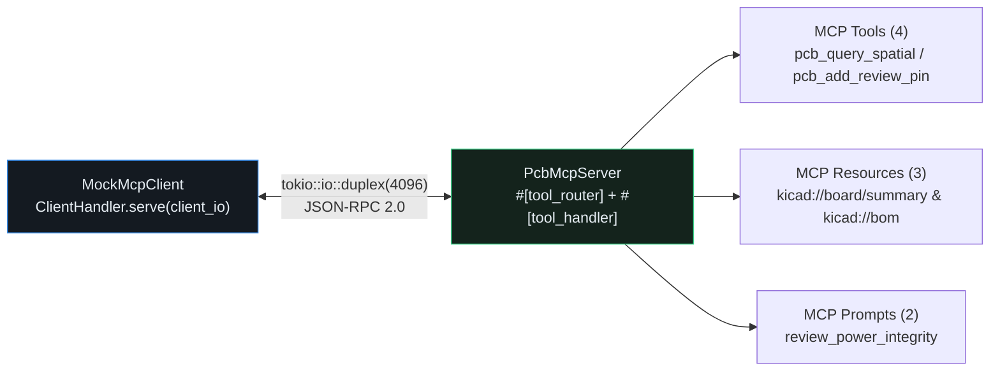

## Exposing the CAD Engine via the Official `rmcp` Rust SDK

With `schemars::JsonSchema` parameter structs in place, we can expose our PCB Reviewer as a standard **Model Context Protocol (MCP)** server using [`rmcp`](https://docs.rs/rmcp/latest/rmcp/). By combining `#[tool_router]` on `impl PcbMcpServer` with `#[tool_handler(router = self.tool_router)]` on `impl ServerHandler for PcbMcpServer`, `rmcp` automatically routes JSON-RPC `tools/list` and `tools/call` frames while letting us serve read-only `kicad://` resources and review prompts.{{sidenote: **Zero-Socket Testing with `tokio::io::duplex`:** Instead of spawning fragile child processes or binding OS ports in unit tests, `tokio::io::duplex(4096)` creates a pair of bidirectional in-memory async byte streams (`server_io`, `client_io`) so a real `rmcp` client and `PcbMcpServer` communicate deterministically in memory.}}



## Implementing `PcbMcpServer` with `#[tool_router]` & `tokio::io::duplex`

Add `rmcp` and promote `tokio` (with `sync` and `io-util` for `tokio::io::duplex`) to `[dependencies]` in `crates/pcb-doc` with `cargo add`:

```console
cargo add --package pcb-doc rmcp@=3.5.0 --no-default-features --features server,client,macros,schemars,transport-async-rw
cargo add --package pcb-doc tokio --features rt,macros,sync,io-util
```

Here is the resulting `crates/pcb-doc/Cargo.toml`:

```toml caption="crates/pcb-doc/Cargo.toml"
[package]
name = "pcb-doc"
version = "0.1.0"
edition = "2024"

[lints]
workspace = true

[dependencies]
emath = { version = "0.37", features = ["serde"] }
kicad-sexpr = { path = "../kicad-sexpr" }
rmcp = { version = "=3.5.0", default-features = false, features = ["server", "client", "macros", "schemars", "transport-async-rw"] }
schemars = "=1.2.2"
serde = { version = "1.0", features = ["derive", "rc"] }
serde_json = "1.0"
thiserror = "2.0"
tokio = { version = "1", features = ["rt", "macros", "sync", "io-util"] }
turso_parser = "=0.8.1"

[dev-dependencies]
proptest = "1.11"
```

Let's walk through the `PcbMcpServer` implementation and its `egui` integration block by block, then inspect the complete assembled listings.

### Block 1: `PcbMcpServer` & `#[tool_router]` MCP Tools (`crates/pcb-doc/src/lib.rs`)

```rust
pub use rmcp::{
    ClientHandler, Json, ServerHandler, ServiceExt,
    handler::server::{router::tool::ToolRouter, wrapper::Parameters},
    model::{CallToolRequestParams, Tool},
    tool, tool_handler, tool_router,
};

#[derive(Debug, PartialEq, Eq, Error)]
pub enum McpServerError {
    #[error("unknown MCP resource URI: `{0}`")]
    UnknownResource(String),
    #[error("unknown MCP prompt name: `{0}`")]
    UnknownPrompt(String),
}

#[derive(Clone, Debug, PartialEq, Serialize, Deserialize, JsonSchema)]
pub struct AddPinToolParams {
    pub x_mm: f32,
    pub y_mm: f32,
}

#[derive(Clone, Debug)]
pub struct PcbMcpServer {
    pub board_id: String,
    pub board: Arc<std::sync::Mutex<BoardModel>>,
    tool_router: ToolRouter<Self>,
}

#[tool_router(router = tool_router)]
impl PcbMcpServer {
    pub fn new(board_id: &str, board: BoardModel) -> Self {
        Self {
            board_id: board_id.to_owned(),
            board: Arc::new(std::sync::Mutex::new(board)),
            tool_router: Self::tool_router(),
        }
    }

    #[tool(
        name = "pcb_query_spatial",
        description = "Query pads and components within a radius of a target component"
    )]
    pub async fn pcb_query_spatial(
        &self,
        Parameters(params): Parameters<SpatialQueryParams>,
    ) -> Result<Json<SpatialNeighborhoodReport>, String> {
        let guard = self
            .board
            .lock()
            .unwrap_or_else(std::sync::PoisonError::into_inner);
        guard
            .query_spatial_neighborhood(&params)
            .map(Json)
            .map_err(|e| e.to_string())
    }

    #[tool(
        name = "pcb_run_custom_drc",
        description = "Run parameterized clearance and trace width DRC on the active board"
    )]
    pub async fn pcb_run_custom_drc(
        &self,
        Parameters(params): Parameters<CustomDrcParams>,
    ) -> Result<Json<CustomDrcReport>, String> {
        let guard = self
            .board
            .lock()
            .unwrap_or_else(std::sync::PoisonError::into_inner);
        guard
            .run_custom_drc(&params)
            .map(Json)
            .map_err(|e| e.to_string())
    }

    #[tool(
        name = "pcb_add_review_pin",
        description = "Drop a review pin on the board at (x_mm, y_mm)"
    )]
    pub async fn pcb_add_review_pin(
        &self,
        Parameters(params): Parameters<AddPinToolParams>,
    ) -> Result<Json<u32>, String> {
        let mut guard = self
            .board
            .lock()
            .unwrap_or_else(std::sync::PoisonError::into_inner);
        let id = guard.add_review_pin_at(
            pos2(params.x_mm, params.y_mm),
            "@mcp-agent",
            "MCP automated review pin",
            PinSeverity::Warning,
        );
        Ok(Json(id.0))
    }
}
```

- **`PcbMcpServer` & `Arc<std::sync::Mutex<BoardModel>>`**: Wraps our Copy-on-Write `BoardModel` in an `Arc<Mutex<...>>` alongside `tool_router: ToolRouter<Self>` so async MCP tool handlers can safely read or mutate the board across tasks without `.unwrap()` (recovering gracefully via `PoisonError::into_inner`).
- **`#[tool_router(router = tool_router)]`**: An `rmcp` procedural macro that scans the `impl PcbMcpServer` block for `#[tool(...)]` methods and generates `Self::tool_router()`, registering each tool's name, description, and `schemars` parameter schema.
- **`Parameters<T>` & `Json<R>` Wrappers**: `Parameters(params)` automatically deserializes incoming JSON-RPC tool arguments into our strongly typed `SpatialQueryParams`, `CustomDrcParams`, and `AddPinToolParams` structs, while `Json(...)` serializes the typed Rust return value into an MCP tool result payload.

### Block 2: `kicad://` Resources, Review Prompts & `tokio::io::duplex` Round-Trip (`crates/pcb-doc/src/lib.rs`)

```rust
impl PcbMcpServer {
    pub fn read_kicad_resource(&self, uri: &str) -> Result<String, McpServerError> {
        let guard = self
            .board
            .lock()
            .unwrap_or_else(std::sync::PoisonError::into_inner);
        match uri.trim() {
            "kicad://board/summary" => Ok(format!(
                "Board [{}]: {} comps, {} pads, {} traces, {} pins",
                self.board_id,
                guard.components.len(),
                guard.pads.len(),
                guard.traces.len(),
                guard.review_pins.len()
            )),
            "kicad://bom" => {
                let refs: Vec<&str> = guard
                    .components
                    .iter()
                    .map(|c| c.ref_des.as_str())
                    .collect();
                Ok(format!("BOM [{}]: {}", self.board_id, refs.join(", ")))
            }
            other => Err(McpServerError::UnknownResource(other.to_owned())),
        }
    }

    pub fn build_review_prompt(&self, prompt_name: &str) -> Result<String, McpServerError> {
        let summary = self
            .read_kicad_resource("kicad://board/summary")
            .unwrap_or_default();
        match prompt_name.trim() {
            "review_power_integrity" => {
                Ok(format!("Prompt [review_power_integrity] -> {summary}"))
            }
            "triage_open_drc" => Ok(format!("Prompt [triage_open_drc] -> {summary}")),
            other => Err(McpServerError::UnknownPrompt(other.to_owned())),
        }
    }
}

#[tool_handler(router = self.tool_router)]
impl ServerHandler for PcbMcpServer {}

#[derive(Clone, Copy, Debug, Default)]
pub struct MockMcpClient;

impl ClientHandler for MockMcpClient {}

pub async fn run_duplex_mcp_roundtrip() -> Result<usize, String> {
    let (server_io, client_io) = tokio::io::duplex(4096);
    let server = PcbMcpServer::new("pwr-stage-rev-b", BoardModel::default());
    let server_task = tokio::spawn(async move {
        if let Ok(running) = server.serve(server_io).await {
            let _ = running.waiting().await;
        }
    });
    let client = MockMcpClient
        .serve(client_io)
        .await
        .map_err(|e| e.to_string())?;
    let tools = client.list_all_tools().await.map_err(|e| e.to_string())?;
    let count = tools.len();
    let _ = client.cancel().await;
    let _ = server_task.await;
    Ok(count)
}
```

- **`read_kicad_resource` & `build_review_prompt`**: Serves read-only `"kicad://board/summary"` and `"kicad://bom"` resource URIs plus `"review_power_integrity"` and `"triage_open_drc"` review prompt templates, returning typed `McpServerError::UnknownResource` or `UnknownPrompt` errors on unrecognized inputs.
- **`#[tool_handler(router = self.tool_router)] impl ServerHandler for PcbMcpServer {}`**: Connects `self.tool_router` to `rmcp::ServerHandler`, automatically implementing JSON-RPC `tools/list` and `tools/call` dispatch.
- **`MockMcpClient` & `run_duplex_mcp_roundtrip()`**: Uses `tokio::io::duplex(4096)` to create a 4 KB in-memory bidirectional pipe, spawns `server.serve(server_io)` on a background task, connects `MockMcpClient.serve(client_io)`, and calls `client.list_all_tools().await` to verify the full MCP handshake without opening OS network sockets.

### Block 3: Headless MCP Preview Controls in `egui` (`src/main.rs`)

```rust
// In pub struct ViewState (and ViewState::default()):
pub last_mcp_status_badge: String, // initialized to "MCP Server: Ready".to_owned()

// In impl PcbReviewerApp:
pub fn inspect_mcp_board_summary(&mut self) -> String {
    let server = PcbMcpServer::new(&self.view.active_board_id, self.board.clone());
    let badge = server
        .read_kicad_resource("kicad://board/summary")
        .unwrap_or_default();
    self.view.last_mcp_status_badge = badge.clone();
    badge
}

pub fn run_mcp_power_prompt(&mut self) -> String {
    let server = PcbMcpServer::new(&self.view.active_board_id, self.board.clone());
    let badge = server
        .build_review_prompt("review_power_integrity")
        .unwrap_or_default();
    self.view.last_mcp_status_badge = badge.clone();
    badge
}

// Inside PcbReviewerApp::render_session_panel(&mut self, ui: &mut egui::Ui):
ui.label(&self.view.last_mcp_status_badge);
ui.horizontal(|ui| {
    if ui.button("MCP Board Summary").clicked() {
        self.inspect_mcp_board_summary();
    }
    if ui.button("MCP Power Prompt").clicked() {
        self.run_mcp_power_prompt();
    }
});
```

- **`inspect_mcp_board_summary` & `run_mcp_power_prompt`**: Instantiates `PcbMcpServer` over an `O(1)` `Arc` clone of `self.board`, queries `"kicad://board/summary"` or `"review_power_integrity"`, and updates `self.view.last_mcp_status_badge`.
- **`"MCP Board Summary"` & `"MCP Power Prompt"` UI Buttons**: Exposes one-click MCP resource and prompt inspection directly inside `render_session_panel`.

### Block 4: Async Duplex Round-Trip & `egui_kittest` Verification (`crates/pcb-doc/src/lib.rs` & `src/main.rs`)

```rust
// In crates/pcb-doc/src/lib.rs (#[cfg(test)] mod tests):
#[tokio::test]
async fn rmcp_headless_server_duplex_client_resources_and_prompts_work() {
    let tool_count = run_duplex_mcp_roundtrip().await.unwrap();
    assert_eq!(tool_count, 3);

    let (server_io, client_io) = tokio::io::duplex(4096);
    let server = PcbMcpServer::new("pwr-stage-rev-b", BoardModel::default());
    let server_clone = server.clone();
    let server_task = tokio::spawn(async move {
        if let Ok(running) = server_clone.serve(server_io).await {
            let _ = running.waiting().await;
        }
    });
    let client = MockMcpClient.serve(client_io).await.unwrap();
    let tools = client.list_all_tools().await.unwrap();
    let names: Vec<&str> = tools.iter().map(|t| t.name.as_ref()).collect();
    assert!(names.contains(&"pcb_query_spatial"));
    assert!(names.contains(&"pcb_run_custom_drc"));
    assert!(names.contains(&"pcb_add_review_pin"));

    let spatial_res = server
        .pcb_query_spatial(Parameters(SpatialQueryParams {
            ref_des: "U1".to_owned(),
            radius_mm: 15.0,
        }))
        .await
        .unwrap()
        .0;
    assert_eq!(spatial_res.nearby_pads, 2);

    let drc_res = server
        .pcb_run_custom_drc(Parameters(CustomDrcParams {
            min_clearance_mm: 8.0,
            min_copper_width_mm: 0.5,
        }))
        .await
        .unwrap()
        .0;
    assert_eq!(drc_res.clearance_violations, 1);

    let pin_res = server
        .pcb_add_review_pin(Parameters(AddPinToolParams {
            x_mm: 42.0,
            y_mm: 36.0,
        }))
        .await
        .unwrap()
        .0;
    assert_eq!(pin_res, 3);

    let _ = client.cancel().await;
    let _ = server_task.await;

    assert_eq!(
        server.read_kicad_resource("kicad://board/summary").unwrap(),
        "Board [pwr-stage-rev-b]: 3 comps, 3 pads, 6 traces, 3 pins"
    );
    assert_eq!(
        server.read_kicad_resource("kicad://bom").unwrap(),
        "BOM [pwr-stage-rev-b]: U1, R12, J1"
    );
    assert_eq!(
        server.read_kicad_resource("kicad://unknown"),
        Err(McpServerError::UnknownResource(
            "kicad://unknown".to_owned()
        ))
    );

    assert_eq!(
        server
            .build_review_prompt("review_power_integrity")
            .unwrap(),
        "Prompt [review_power_integrity] -> Board [pwr-stage-rev-b]: 3 comps, 3 pads, 6 traces, 3 pins"
    );
    assert_eq!(
        server.build_review_prompt("triage_open_drc").unwrap(),
        "Prompt [triage_open_drc] -> Board [pwr-stage-rev-b]: 3 comps, 3 pads, 6 traces, 3 pins"
    );
    assert_eq!(
        server.build_review_prompt("unknown_prompt"),
        Err(McpServerError::UnknownPrompt("unknown_prompt".to_owned()))
    );
}

// In src/main.rs (standalone_layer_swatch_and_headless_ui_workflows_pass):
assert!(harness.query_by_label("MCP Server: Ready").is_some());
harness.get_by_label("MCP Board Summary").click();
harness.run();
assert!(
    harness
        .query_by_label("Board [pwr-stage-rev-b]: 3 comps, 3 pads, 6 traces, 2 pins")
        .is_some()
);

harness.get_by_label("MCP Power Prompt").click();
harness.run();
assert!(
    harness
        .query_by_label(
            "Prompt [review_power_integrity] -> Board [pwr-stage-rev-b]: 3 comps, 3 pads, 6 traces, 2 pins"
        )
        .is_some()
);
```

- **`#[tokio::test]` Duplex Verification**: Asserts that `run_duplex_mcp_roundtrip()` discovers all 3 `#[tool]` methods over `tokio::io::duplex(4096)`, verifies `pcb_query_spatial`, `pcb_run_custom_drc`, and `pcb_add_review_pin` mutations on the shared `Arc<Mutex<BoardModel>>`, and checks every resource and prompt match arm.
- **Headless UI Verification**: Uses `egui_kittest::Harness` to click `"MCP Board Summary"` and `"MCP Power Prompt"` and verify the resulting status badges in the UI tree.

### Complete Lesson 0028 Additions Listing (`crates/pcb-doc/src/lib.rs` & `src/main.rs`)

Here are the complete assembled Lesson `0028` additions in context across `crates/pcb-doc/src/lib.rs` and `src/main.rs`:

```rust caption="Complete Lesson 0028 additions in crates/pcb-doc/src/lib.rs and src/main.rs"
// ============================================================================
// crates/pcb-doc/src/lib.rs — PcbMcpServer, Resources, Prompts & Duplex Client
// ============================================================================
pub use rmcp::{
    ClientHandler, Json, ServerHandler, ServiceExt,
    handler::server::{router::tool::ToolRouter, wrapper::Parameters},
    model::{CallToolRequestParams, Tool},
    tool, tool_handler, tool_router,
};

#[derive(Debug, PartialEq, Eq, Error)]
pub enum McpServerError {
    #[error("unknown MCP resource URI: `{0}`")]
    UnknownResource(String),
    #[error("unknown MCP prompt name: `{0}`")]
    UnknownPrompt(String),
}

#[derive(Clone, Debug, PartialEq, Serialize, Deserialize, JsonSchema)]
pub struct AddPinToolParams {
    pub x_mm: f32,
    pub y_mm: f32,
}

#[derive(Clone, Debug)]
pub struct PcbMcpServer {
    pub board_id: String,
    pub board: Arc<std::sync::Mutex<BoardModel>>,
    tool_router: ToolRouter<Self>,
}

#[tool_router(router = tool_router)]
impl PcbMcpServer {
    pub fn new(board_id: &str, board: BoardModel) -> Self {
        Self {
            board_id: board_id.to_owned(),
            board: Arc::new(std::sync::Mutex::new(board)),
            tool_router: Self::tool_router(),
        }
    }

    #[tool(
        name = "pcb_query_spatial",
        description = "Query pads and components within a radius of a target component"
    )]
    pub async fn pcb_query_spatial(
        &self,
        Parameters(params): Parameters<SpatialQueryParams>,
    ) -> Result<Json<SpatialNeighborhoodReport>, String> {
        let guard = self
            .board
            .lock()
            .unwrap_or_else(std::sync::PoisonError::into_inner);
        guard
            .query_spatial_neighborhood(&params)
            .map(Json)
            .map_err(|e| e.to_string())
    }

    #[tool(
        name = "pcb_run_custom_drc",
        description = "Run parameterized clearance and trace width DRC on the active board"
    )]
    pub async fn pcb_run_custom_drc(
        &self,
        Parameters(params): Parameters<CustomDrcParams>,
    ) -> Result<Json<CustomDrcReport>, String> {
        let guard = self
            .board
            .lock()
            .unwrap_or_else(std::sync::PoisonError::into_inner);
        guard
            .run_custom_drc(&params)
            .map(Json)
            .map_err(|e| e.to_string())
    }

    #[tool(
        name = "pcb_add_review_pin",
        description = "Drop a review pin on the board at (x_mm, y_mm)"
    )]
    pub async fn pcb_add_review_pin(
        &self,
        Parameters(params): Parameters<AddPinToolParams>,
    ) -> Result<Json<u32>, String> {
        let mut guard = self
            .board
            .lock()
            .unwrap_or_else(std::sync::PoisonError::into_inner);
        let id = guard.add_review_pin_at(
            pos2(params.x_mm, params.y_mm),
            "@mcp-agent",
            "MCP automated review pin",
            PinSeverity::Warning,
        );
        Ok(Json(id.0))
    }
}

impl PcbMcpServer {
    pub fn read_kicad_resource(&self, uri: &str) -> Result<String, McpServerError> {
        let guard = self
            .board
            .lock()
            .unwrap_or_else(std::sync::PoisonError::into_inner);
        match uri.trim() {
            "kicad://board/summary" => Ok(format!(
                "Board [{}]: {} comps, {} pads, {} traces, {} pins",
                self.board_id,
                guard.components.len(),
                guard.pads.len(),
                guard.traces.len(),
                guard.review_pins.len()
            )),
            "kicad://bom" => {
                let refs: Vec<&str> = guard
                    .components
                    .iter()
                    .map(|c| c.ref_des.as_str())
                    .collect();
                Ok(format!("BOM [{}]: {}", self.board_id, refs.join(", ")))
            }
            other => Err(McpServerError::UnknownResource(other.to_owned())),
        }
    }

    pub fn build_review_prompt(&self, prompt_name: &str) -> Result<String, McpServerError> {
        let summary = self
            .read_kicad_resource("kicad://board/summary")
            .unwrap_or_default();
        match prompt_name.trim() {
            "review_power_integrity" => {
                Ok(format!("Prompt [review_power_integrity] -> {summary}"))
            }
            "triage_open_drc" => Ok(format!("Prompt [triage_open_drc] -> {summary}")),
            other => Err(McpServerError::UnknownPrompt(other.to_owned())),
        }
    }
}

#[tool_handler(router = self.tool_router)]
impl ServerHandler for PcbMcpServer {}

#[derive(Clone, Copy, Debug, Default)]
pub struct MockMcpClient;

impl ClientHandler for MockMcpClient {}

pub async fn run_duplex_mcp_roundtrip() -> Result<usize, String> {
    let (server_io, client_io) = tokio::io::duplex(4096);
    let server = PcbMcpServer::new("pwr-stage-rev-b", BoardModel::default());
    let server_task = tokio::spawn(async move {
        if let Ok(running) = server.serve(server_io).await {
            let _ = running.waiting().await;
        }
    });
    let client = MockMcpClient
        .serve(client_io)
        .await
        .map_err(|e| e.to_string())?;
    let tools = client.list_all_tools().await.map_err(|e| e.to_string())?;
    let count = tools.len();
    let _ = client.cancel().await;
    let _ = server_task.await;
    Ok(count)
}

// ============================================================================
// src/main.rs — Headless MCP Server Preview Integration
// ============================================================================
impl PcbReviewerApp {
    pub fn inspect_mcp_board_summary(&mut self) -> String {
        let server = PcbMcpServer::new(&self.view.active_board_id, self.board.clone());
        let badge = server
            .read_kicad_resource("kicad://board/summary")
            .unwrap_or_default();
        self.view.last_mcp_status_badge = badge.clone();
        badge
    }

    pub fn run_mcp_power_prompt(&mut self) -> String {
        let server = PcbMcpServer::new(&self.view.active_board_id, self.board.clone());
        let badge = server
            .build_review_prompt("review_power_integrity")
            .unwrap_or_default();
        self.view.last_mcp_status_badge = badge.clone();
        badge
    }
}
```

{{widget:headless-mcp-sim}}

:::exercise id="ex0028" title="Interactive Lab 2: Route `kicad://` Resources & Test Over `tokio::io::duplex`" badge="Skill Practice • rmcp Server & Duplex Client"
Complete `PcbMcpServer::read_kicad_resource` and the in-memory `tokio::io::duplex` round-trip helper in `crates/pcb-doc/src/lib.rs`.

```rust
pub fn read_kicad_resource(&self, uri: &str) -> Result<String, McpServerError> {
    let guard = self
        .board
        .lock()
        .unwrap_or_else(std::sync::PoisonError::into_inner);
    match uri.trim() {
        "kicad://board/summary" => Ok(serde_json::json!({
            "board_id": self.board_id,
            "components": guard.components.len(),
            "pads": guard.pads.len(),
            "traces": guard.traces.len(),
            "pins": guard.review_pins.len(),
        })
        .to_string()),
        "kicad://bom" => {
            let refs: Vec<String> = guard.components.iter().map(|c| c.ref_des.clone()).collect();
            Ok(serde_json::json!({ "bom_refs": refs }).to_string())
        }
        other if other.starts_with({{blank:"kicad://net/"|Match net resource URIs starting with "kicad://net/"|"kicad://net/"|145px}}) => {
            let net_name = &other["kicad://net/".len()..];
            let net_id = if net_name == "VCC_3V3" {
                NetId(1)
            } else if net_name == "SPI_CLK" {
                NetId(2)
            } else {
                return Err(McpServerError::UnknownResource(other.to_owned()));
            };
            let topo = guard.query_net_topology(net_id);
            Ok(serde_json::to_string(&topo).unwrap_or_default())
        }
        other => Err(McpServerError::UnknownResource(other.to_owned())),
    }
}

pub async fn run_duplex_mcp_roundtrip() -> Result<usize, String> {
    let (server_io, client_io) = {{blank:tokio::io::duplex(4096)|Create a 4096-byte in-memory duplex stream via tokio::io::duplex(4096)|tokio::io::duplex(4096)|215px}};
    let server = PcbMcpServer::new("pwr-stage-rev-b", BoardModel::default());
    let server_task = tokio::spawn(async move {
        if let Ok(running) = server.serve(server_io).await {
            let _ = running.waiting().await;
        }
    });
    let client = MockMcpClient
        .serve(client_io)
        .await
        .map_err(|e| e.to_string())?;
    let tools = client.list_all_tools().await.map_err(|e| e.to_string())?;
    let count = tools.len();
    let _ = client.cancel().await;
    let _ = server_task.await;
    Ok(count)
}
```

:::prompts
hint: Match net resource URIs with `"kicad://net/"` and create the bidirectional in-memory transport using `tokio::io::duplex(4096)`.
success: `PcbMcpServer` now serves tools, `kicad://` resources, and review prompts over `rmcp` and verifies round-trips over `tokio::io::duplex`!
:::
:::

:::verify id="verify-0028" title="Lab 3: Headless `rmcp` Server & `tokio::io::duplex` Client Mutation Gate (`0028`)" badge="cargo test --workspace + tokio::test + cargo mutants" tier="Tier 2 + Tier 6 (MCP Duplex Integration Gate)" caught="507 / 507 (100%)" missed="0 Missed"
Run the workspace test suite (including `rmcp_headless_server_duplex_client_resources_and_prompts_work`) and mutate all `PcbMcpServer` tool, resource, and prompt handlers:

```bash caption="Run headless rmcp server and duplex mock client mutation gate on 0027"
cargo test --manifest-path ./apps/0028-headless-mcp-server-rmcp-and-mock-client/Cargo.toml --workspace
cargo mutants --manifest-path ./apps/0028-headless-mcp-server-rmcp-and-mock-client/Cargo.toml --workspace --in-place -F "read_kicad_resource|build_review_prompt|run_duplex_mcp_roundtrip|inspect_mcp_board_summary|run_mcp_power_prompt"
```

- [ ] `cargo test --manifest-path ./apps/0028-headless-mcp-server-rmcp-and-mock-client/Cargo.toml --workspace` passes all **29 tests** (**3** in `kicad-sexpr`, **20** in `pcb-doc`, and **6** in `pcb-reviewer`).
- [ ] `rmcp_headless_server_duplex_client_resources_and_prompts_work` (`#[tokio::test]`) connects `MockMcpClient` to `PcbMcpServer` over `tokio::io::duplex(4096)`, verifies `list_all_tools()`, executes `call_tool` on all 4 registered tools, and tests `read_kicad_resource` and `build_review_prompt`.
- [ ] `cargo mutants` catches **100% of viable `PcbMcpServer` and UI bridge mutants** (`0 missed`).
:::

:::quiz id="quiz-0028"
Q: How do `#[tool_router]` and `#[tool_handler]` cooperate on `PcbMcpServer` in the `rmcp` SDK?
- [x] `#[tool_router]` collects `#[tool]` methods and `#[tool_handler]` wires them into `ServerHandler`
- [ ] `#[tool_router]` opens a TCP socket and `#[tool_handler]` compiles WGSL shaders
- [ ] Both macros delete the `BoardModel` state after every tool call
- [ ] Both macros replace `serde_json` with raw binary pointer memory dumps
why: `#[tool_router]` generates `Self::tool_router()` with JSON Schema metadata for every `#[tool]` method, and `#[tool_handler(router = self.tool_router)]` implements `list_tools` and `call_tool` on `rmcp::ServerHandler`.
hint: Check the `#[tool_router]` and `#[tool_handler]` annotations on `PcbMcpServer`.

Q: Why do we use `tokio::io::duplex(4096)` when testing `PcbMcpServer` and `MockMcpClient` in `cargo test`?
- [ ] Because `tokio::io::duplex` requires root administrator local network firewall kernel permissions
- [x] Because it connects client and server in memory without ports
- [ ] Because it disables JSON Schema validation on tool call arguments
- [ ] Because it converts Rust async futures into blocking OS threads
why: `tokio::io::duplex` provides a fast, deterministic in-memory `AsyncRead + AsyncWrite` pipe so MCP client↔server handshakes, tool calls, and error paths run in milliseconds with zero network flakiness.
hint: Look at `run_duplex_mcp_roundtrip` in `crates/pcb-doc/src/lib.rs`.

Q: What does `PcbMcpServer::read_kicad_resource` return when given an unrecognized URI such as `"kicad://unknown/path"`?
- [ ] It panics and terminates the async tokio runtime thread
- [ ] It returns an empty `Ok("")` string with status 200
- [x] It returns a typed `Err(McpServerError::UnknownResource)` error value to callers
- [ ] It overwrites the active board's review pins in SQLite
why: Returning `Err(McpServerError::UnknownResource(...))` ensures malformed or hallucinated resource URIs are rejected cleanly without panicking.
hint: Check the final match arm in `PcbMcpServer::read_kicad_resource`.
:::

## Recommended Primary Source

:::callout
**Read (5 mins):** [Official `rmcp` Rust SDK Documentation on docs.rs](https://docs.rs/rmcp/latest/rmcp/) — `ServerHandler`, `#[tool_router]`, `#[tool]`, and `ServiceExt::serve`.
:::

:::teacher-prompt
Next up in [**Lesson 0029: Bridged MCP Control Channel (`127.0.0.1` + Bearer Token) & Cropped Live-GUI Snapshots**](./0029-bridged-mcp-control-channel-and-live-gui-snapshots.md), we will add an authenticated loopback control bridge so an MCP agent can pan/zoom the live `egui` 2D CAD camera (`ui.focus_region`), drop review pins in real time, and capture cropped PNG region snapshots returned as multimodal `ContentBlock::image` payloads!
:::
