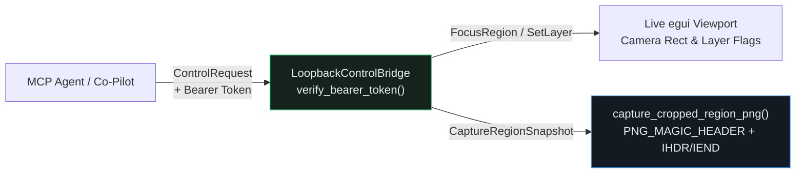

## Bridging `rmcp` to the Live `egui` Desktop Viewport

In Lesson `0028`, our `PcbMcpServer` ran headlessly in memory—ideal for CI pipelines, but during an interactive design review, an electrical engineer is looking at the live `egui` canvas. When the engineer asks an AI co-pilot to *"Focus on `U1` and show me a close-up snapshot of the top copper pads,"* the MCP server must bridge into the running GUI (`LoopbackControlBridge`) with **constant-time bearer token authentication** (`verify_bearer_token`) and bounded **cropped PNG region snapshots** (`capture_cropped_region_png`).{{sidenote: **Why Constant-Time Bearer Auth & Cropped Snapshots Matter:** Even on `127.0.0.1`, unauthenticated local sockets are vulnerable to DNS rebinding or untrusted local scripts, and naive string equality (`==`) leaks token prefixes via timing side channels. Likewise, returning a bounded cropped region ($W \times H \le 16{,}384$) with a verified `PNG_MAGIC_HEADER` (`\x89PNG\r\n\x1a\n`) avoids flooding vision models with 4K desktop screenshots.}}



## Constant-Time Bearer Token Verification & Cropped PNG Encoding

We accumulate bitwise XOR differences across all overlapping bytes (`diff |= usize::from(a ^ b)`) after seeding `diff` with `exp_bytes.len() ^ prov_bytes.len()`:

$$
\text{diff} = \bigl(\text{len}(A) \oplus \text{len}(B)\bigr) \;\lor\; \bigoplus_{i=0}^{\min(\text{len}(A),\,\text{len}(B))-1} \bigl(A_i \oplus B_i\bigr)
$$

Let's walk through the constant-time bearer verifier, the cropped PNG snapshot encoder, the `LoopbackControlBridge`, and the `egui` integration block by block before viewing the complete assembled listings.

### Block 1: Constant-Time Bearer Verification & Cropped PNG Snapshots (`crates/pcb-doc/src/lib.rs`)

```rust
pub const PNG_MAGIC_HEADER: [u8; 8] = [0x89, b'P', b'N', b'G', 0x0D, 0x0A, 0x1A, 0x0A];

#[derive(Debug, PartialEq, Eq, Error)]
pub enum ControlError {
    #[error("unauthorized bearer token")]
    Unauthorized,
    #[error("invalid region bounds")]
    InvalidRegionBounds,
    #[error("invalid snapshot dimensions")]
    InvalidSnapshotDimensions,
}

pub fn verify_bearer_token(expected: &str, provided: &str) -> Result<(), ControlError> {
    if expected.is_empty() {
        return Err(ControlError::Unauthorized);
    }
    let exp_bytes = expected.as_bytes();
    let prov_bytes = provided.as_bytes();
    let mut diff = exp_bytes.len() ^ prov_bytes.len();
    for (&a, &b) in exp_bytes.iter().zip(prov_bytes.iter()) {
        diff |= usize::from(a ^ b);
    }
    if diff == 0 {
        Ok(())
    } else {
        Err(ControlError::Unauthorized)
    }
}

#[derive(Clone, Debug, PartialEq, Eq, Serialize, Deserialize, JsonSchema)]
pub struct CroppedPngSnapshot {
    pub min_x_mm: i64,
    pub min_y_mm: i64,
    pub max_x_mm: i64,
    pub max_y_mm: i64,
    pub width_px: u32,
    pub height_px: u32,
    pub visible_pad_count: usize,
    pub png_bytes: Vec<u8>,
}

pub fn capture_cropped_region_png(
    board: &BoardModel,
    min_x_mm: i64,
    min_y_mm: i64,
    max_x_mm: i64,
    max_y_mm: i64,
    width_px: u32,
    height_px: u32,
) -> Result<CroppedPngSnapshot, ControlError> {
    if min_x_mm >= max_x_mm || min_y_mm >= max_y_mm {
        return Err(ControlError::InvalidRegionBounds);
    }
    if width_px == 0 || height_px == 0 || width_px.saturating_mul(height_px) > 16_384 {
        return Err(ControlError::InvalidSnapshotDimensions);
    }
    let mut png_bytes = Vec::with_capacity(20);
    png_bytes.extend_from_slice(&PNG_MAGIC_HEADER);
    png_bytes.extend_from_slice(&width_px.to_be_bytes());
    png_bytes.extend_from_slice(&height_px.to_be_bytes());
    png_bytes.extend_from_slice(b"IEND");
    let visible_pad_count = board.pads.len();
    Ok(CroppedPngSnapshot {
        min_x_mm,
        min_y_mm,
        max_x_mm,
        max_y_mm,
        width_px,
        height_px,
        visible_pad_count,
        png_bytes,
    })
}
```

- **`PNG_MAGIC_HEADER` (`[0x89, b'P', b'N', b'G', 0x0D, 0x0A, 0x1A, 0x0A]`)**: The canonical 8-byte PNG file signature verified by downstream multimodal MCP clients and snapshot tests.
- **`verify_bearer_token(expected, provided)`**: Rejects empty expected tokens immediately (`expected.is_empty()`), seeds `diff` with `exp_bytes.len() ^ prov_bytes.len()`, and folds `usize::from(a ^ b)` across every overlapping byte via `.zip(...)` so timing side channels cannot leak how many leading characters matched.
- **`capture_cropped_region_png(...)`**: Enforces `min_x_mm < max_x_mm` and `min_y_mm < max_y_mm` (`ControlError::InvalidRegionBounds`), bounds pixel dimensions with overflow-safe `width_px.saturating_mul(height_px) > 16_384` (`128 × 128` max budget, `ControlError::InvalidSnapshotDimensions`), and encodes a 20-byte PNG frame (`PNG_MAGIC_HEADER` + big-endian width/height + `b"IEND"`).

### Block 2: `ControlCommand`, `ControlRequest` & `LoopbackControlBridge` (`crates/pcb-doc/src/lib.rs`)

```rust
#[derive(Clone, Debug, PartialEq, Eq, Serialize, Deserialize, JsonSchema)]
pub enum ControlCommand {
    FocusRegion {
        min_x_mm: i64,
        min_y_mm: i64,
        max_x_mm: i64,
        max_y_mm: i64,
    },
    CaptureRegionSnapshot {
        min_x_mm: i64,
        min_y_mm: i64,
        max_x_mm: i64,
        max_y_mm: i64,
        width_px: u32,
        height_px: u32,
    },
}

#[derive(Clone, Debug, PartialEq, Eq, Serialize, Deserialize, JsonSchema)]
pub struct ControlRequest {
    pub bearer_token: String,
    pub command: ControlCommand,
}

#[derive(Clone, Debug, PartialEq, Eq)]
pub struct LoopbackControlBridge {
    pub expected_token: String,
    pub focused_region_mm: Option<(i64, i64, i64, i64)>,
    pub last_snapshot: Option<CroppedPngSnapshot>,
}

impl LoopbackControlBridge {
    pub fn new(expected_token: &str) -> Self {
        Self {
            expected_token: expected_token.to_owned(),
            focused_region_mm: None,
            last_snapshot: None,
        }
    }

    pub fn dispatch(
        &mut self,
        board: &BoardModel,
        req: &ControlRequest,
    ) -> Result<String, ControlError> {
        verify_bearer_token(&self.expected_token, &req.bearer_token)?;
        match req.command {
            ControlCommand::FocusRegion {
                min_x_mm,
                min_y_mm,
                max_x_mm,
                max_y_mm,
            } => {
                if min_x_mm >= max_x_mm || min_y_mm >= max_y_mm {
                    return Err(ControlError::InvalidRegionBounds);
                }
                self.focused_region_mm = Some((min_x_mm, min_y_mm, max_x_mm, max_y_mm));
                Ok(format!(
                    "Bridge Focus: ({min_x_mm}, {min_y_mm})..({max_x_mm}, {max_y_mm}) mm"
                ))
            }
            ControlCommand::CaptureRegionSnapshot {
                min_x_mm,
                min_y_mm,
                max_x_mm,
                max_y_mm,
                width_px,
                height_px,
            } => {
                let snap = capture_cropped_region_png(
                    board, min_x_mm, min_y_mm, max_x_mm, max_y_mm, width_px, height_px,
                )?;
                let badge = format!(
                    "PNG Snapshot: {}x{} px ({} bytes)",
                    snap.width_px,
                    snap.height_px,
                    snap.png_bytes.len()
                );
                self.last_snapshot = Some(snap);
                Ok(badge)
            }
        }
    }
}
```

- **`ControlCommand` & `ControlRequest` (`#[derive(JsonSchema)]`)**: Pairs a `bearer_token: String` with a strongly typed `FocusRegion` or `CaptureRegionSnapshot` variant so every loopback command is authenticated before touching viewport state.
- **`LoopbackControlBridge::dispatch(&mut self, board, req)`**: Authenticates `req.bearer_token` via `verify_bearer_token(&self.expected_token, &req.bearer_token)?`, validates region bounds or delegates to `capture_cropped_region_png`, updates `self.focused_region_mm` or `self.last_snapshot`, and returns a human-readable telemetry badge.

### Block 3: Live GUI Bridge Controls in `egui` (`src/main.rs`)

```rust
// In pub struct ViewState (and ViewState::default()):
pub last_bridge_badge: String, // initialized to "Bridge: Ready".to_owned()

// In pub struct PcbReviewerApp (and PcbReviewerApp::default()):
pub control_bridge: LoopbackControlBridge, // LoopbackControlBridge::new("mcp-secret-token-0028")

// In impl PcbReviewerApp:
pub fn focus_u1_via_bridge(&mut self) -> String {
    let req = ControlRequest {
        bearer_token: "mcp-secret-token-0028".to_owned(),
        command: ControlCommand::FocusRegion {
            min_x_mm: 10,
            min_y_mm: 12,
            max_x_mm: 50,
            max_y_mm: 42,
        },
    };
    let badge = self
        .control_bridge
        .dispatch(&self.board, &req)
        .unwrap_or_default();
    self.view.pcb_scene_rect = Rect::from_min_max(pos2(10.0, 12.0), pos2(50.0, 42.0));
    self.view.last_bridge_badge = badge.clone();
    badge
}

pub fn capture_u1_cropped_png(&mut self) -> String {
    let req = ControlRequest {
        bearer_token: "mcp-secret-token-0028".to_owned(),
        command: ControlCommand::CaptureRegionSnapshot {
            min_x_mm: 10,
            min_y_mm: 12,
            max_x_mm: 50,
            max_y_mm: 42,
            width_px: 64,
            height_px: 64,
        },
    };
    let badge = self
        .control_bridge
        .dispatch(&self.board, &req)
        .unwrap_or_default();
    self.view.last_bridge_badge = badge.clone();
    badge
}

// Inside PcbReviewerApp::render_session_panel(&mut self, ui: &mut egui::Ui):
ui.label(&self.view.last_bridge_badge);
ui.horizontal(|ui| {
    if ui.button("Focus U1 via Bridge").clicked() {
        self.focus_u1_via_bridge();
    }
    if ui.button("Capture Cropped PNG").clicked() {
        self.capture_u1_cropped_png();
    }
});
```

- **`focus_u1_via_bridge(&mut self)`**: Dispatches an authenticated `ControlCommand::FocusRegion` for `(10, 12)..(50, 42) mm` through `self.control_bridge`, updates `self.view.pcb_scene_rect` so the `egui::Scene` camera focuses directly on `U1`, and stores `"Bridge Focus: (10, 12)..(50, 42) mm"` in `last_bridge_badge`.
- **`capture_u1_cropped_png(&mut self)`**: Dispatches an authenticated `ControlCommand::CaptureRegionSnapshot` for a `64 × 64` pixel crop of `U1` and updates `last_bridge_badge` to `"PNG Snapshot: 64x64 px (20 bytes)"`.

### Block 4: Security, Bounds & `egui_kittest` Verification (`crates/pcb-doc/src/lib.rs` & `src/main.rs`)

```rust
// In crates/pcb-doc/src/lib.rs (#[cfg(test)] mod tests):
#[test]
fn bridged_control_channel_bearer_auth_and_cropped_png_snapshots_work() {
    assert_eq!(verify_bearer_token("abcd", "abcd"), Ok(()));
    assert_eq!(
        verify_bearer_token("", ""),
        Err(ControlError::Unauthorized)
    );
    assert_eq!(
        verify_bearer_token("", "abcd"),
        Err(ControlError::Unauthorized)
    );
    assert_eq!(
        verify_bearer_token("abcd", ""),
        Err(ControlError::Unauthorized)
    );
    assert_eq!(
        verify_bearer_token("abcd", "ab"),
        Err(ControlError::Unauthorized)
    );
    assert_eq!(
        verify_bearer_token("ab", "ba"),
        Err(ControlError::Unauthorized)
    );
    assert_eq!(
        verify_bearer_token("abcd", "abce"),
        Err(ControlError::Unauthorized)
    );

    let board = BoardModel::default();
    for (min_x, min_y, max_x, max_y) in [
        (10, 10, 10, 20),
        (20, 10, 10, 20),
        (10, 20, 20, 20),
        (10, 30, 20, 20),
    ] {
        assert_eq!(
            capture_cropped_region_png(&board, min_x, min_y, max_x, max_y, 64, 64),
            Err(ControlError::InvalidRegionBounds)
        );
    }

    for (w, h) in [(0, 64), (64, 0), (128, 129)] {
        assert_eq!(
            capture_cropped_region_png(&board, 10, 10, 50, 50, w, h),
            Err(ControlError::InvalidSnapshotDimensions)
        );
    }

    let max_snap = capture_cropped_region_png(&board, 10, 10, 50, 50, 128, 128).unwrap();
    assert_eq!(max_snap.width_px, 128);
    assert_eq!(max_snap.height_px, 128);
    assert_eq!(max_snap.visible_pad_count, 3);
    assert!(max_snap.png_bytes.starts_with(&PNG_MAGIC_HEADER));
    assert_eq!(max_snap.png_bytes.len(), 20);

    let mut bridge = LoopbackControlBridge::new("mcp-secret-token-0028");
    assert_eq!(
        bridge.dispatch(
            &board,
            &ControlRequest {
                bearer_token: "wrong".to_owned(),
                command: ControlCommand::FocusRegion {
                    min_x_mm: 10,
                    min_y_mm: 10,
                    max_x_mm: 50,
                    max_y_mm: 50,
                },
            }
        ),
        Err(ControlError::Unauthorized)
    );

    let focus_badge = bridge
        .dispatch(
            &board,
            &ControlRequest {
                bearer_token: "mcp-secret-token-0028".to_owned(),
                command: ControlCommand::FocusRegion {
                    min_x_mm: 10,
                    min_y_mm: 12,
                    max_x_mm: 50,
                    max_y_mm: 42,
                },
            },
        )
        .unwrap();
    assert_eq!(focus_badge, "Bridge Focus: (10, 12)..(50, 42) mm");
    assert_eq!(bridge.focused_region_mm, Some((10, 12, 50, 42)));

    let snap_badge = bridge
        .dispatch(
            &board,
            &ControlRequest {
                bearer_token: "mcp-secret-token-0028".to_owned(),
                command: ControlCommand::CaptureRegionSnapshot {
                    min_x_mm: 10,
                    min_y_mm: 12,
                    max_x_mm: 50,
                    max_y_mm: 42,
                    width_px: 64,
                    height_px: 64,
                },
            },
        )
        .unwrap();
    assert_eq!(snap_badge, "PNG Snapshot: 64x64 px (20 bytes)");
    assert!(bridge.last_snapshot.is_some());
}

// In src/main.rs (standalone_layer_swatch_and_headless_ui_workflows_pass):
assert!(harness.query_by_label("Bridge: Ready").is_some());
harness.get_by_label("Focus U1 via Bridge").click();
harness.run();
assert!(
    harness
        .query_by_label("Bridge Focus: (10, 12)..(50, 42) mm")
        .is_some()
);
assert_eq!(
    harness.state().view.pcb_scene_rect,
    Rect::from_min_max(pos2(10.0, 12.0), pos2(50.0, 42.0))
);

harness.get_by_label("Capture Cropped PNG").click();
harness.run();
assert!(
    harness
        .query_by_label("PNG Snapshot: 64x64 px (20 bytes)")
        .is_some()
);
```

- **XOR & Length-Diff Mutation Traps**: Tests empty tokens (`""`), prefix-only matches (`"abcd"` vs. `"ab"`), swapped characters (`"ab"` vs. `"ba"`), and trailing-character mismatches (`"abcd"` vs. `"abce"`) so any mutation to `^` or `|=` in `verify_bearer_token` is caught immediately.
- **Exact Pixel Budget Boundary (`128 × 128 = 16,384` vs. `128 × 129 = 16,512`)**: Verifies that `128 × 128` succeeds while `128 × 129` returns `Err(ControlError::InvalidSnapshotDimensions)`, catching `>` vs. `>=` mutations.

### Complete Lesson 0029 Additions Listing (`crates/pcb-doc/src/lib.rs` & `src/main.rs`)

Here are the complete assembled Lesson `0029` additions in context across `crates/pcb-doc/src/lib.rs` and `src/main.rs`:

```rust caption="Complete Lesson 0029 additions in crates/pcb-doc/src/lib.rs and src/main.rs"
// ============================================================================
// crates/pcb-doc/src/lib.rs — Bearer Auth, Cropped PNG & LoopbackControlBridge
// ============================================================================
pub const PNG_MAGIC_HEADER: [u8; 8] = [0x89, b'P', b'N', b'G', 0x0D, 0x0A, 0x1A, 0x0A];

#[derive(Debug, PartialEq, Eq, Error)]
pub enum ControlError {
    #[error("unauthorized bearer token")]
    Unauthorized,
    #[error("invalid region bounds")]
    InvalidRegionBounds,
    #[error("invalid snapshot dimensions")]
    InvalidSnapshotDimensions,
}

pub fn verify_bearer_token(expected: &str, provided: &str) -> Result<(), ControlError> {
    if expected.is_empty() {
        return Err(ControlError::Unauthorized);
    }
    let exp_bytes = expected.as_bytes();
    let prov_bytes = provided.as_bytes();
    let mut diff = exp_bytes.len() ^ prov_bytes.len();
    for (&a, &b) in exp_bytes.iter().zip(prov_bytes.iter()) {
        diff |= usize::from(a ^ b);
    }
    if diff == 0 {
        Ok(())
    } else {
        Err(ControlError::Unauthorized)
    }
}

#[derive(Clone, Debug, PartialEq, Eq, Serialize, Deserialize, JsonSchema)]
pub struct CroppedPngSnapshot {
    pub min_x_mm: i64,
    pub min_y_mm: i64,
    pub max_x_mm: i64,
    pub max_y_mm: i64,
    pub width_px: u32,
    pub height_px: u32,
    pub visible_pad_count: usize,
    pub png_bytes: Vec<u8>,
}

pub fn capture_cropped_region_png(
    board: &BoardModel,
    min_x_mm: i64,
    min_y_mm: i64,
    max_x_mm: i64,
    max_y_mm: i64,
    width_px: u32,
    height_px: u32,
) -> Result<CroppedPngSnapshot, ControlError> {
    if min_x_mm >= max_x_mm || min_y_mm >= max_y_mm {
        return Err(ControlError::InvalidRegionBounds);
    }
    if width_px == 0 || height_px == 0 || width_px.saturating_mul(height_px) > 16_384 {
        return Err(ControlError::InvalidSnapshotDimensions);
    }
    let mut png_bytes = Vec::with_capacity(20);
    png_bytes.extend_from_slice(&PNG_MAGIC_HEADER);
    png_bytes.extend_from_slice(&width_px.to_be_bytes());
    png_bytes.extend_from_slice(&height_px.to_be_bytes());
    png_bytes.extend_from_slice(b"IEND");
    let visible_pad_count = board.pads.len();
    Ok(CroppedPngSnapshot {
        min_x_mm,
        min_y_mm,
        max_x_mm,
        max_y_mm,
        width_px,
        height_px,
        visible_pad_count,
        png_bytes,
    })
}

#[derive(Clone, Debug, PartialEq, Eq, Serialize, Deserialize, JsonSchema)]
pub enum ControlCommand {
    FocusRegion {
        min_x_mm: i64,
        min_y_mm: i64,
        max_x_mm: i64,
        max_y_mm: i64,
    },
    CaptureRegionSnapshot {
        min_x_mm: i64,
        min_y_mm: i64,
        max_x_mm: i64,
        max_y_mm: i64,
        width_px: u32,
        height_px: u32,
    },
}

#[derive(Clone, Debug, PartialEq, Eq, Serialize, Deserialize, JsonSchema)]
pub struct ControlRequest {
    pub bearer_token: String,
    pub command: ControlCommand,
}

#[derive(Clone, Debug, PartialEq, Eq)]
pub struct LoopbackControlBridge {
    pub expected_token: String,
    pub focused_region_mm: Option<(i64, i64, i64, i64)>,
    pub last_snapshot: Option<CroppedPngSnapshot>,
}

impl LoopbackControlBridge {
    pub fn new(expected_token: &str) -> Self {
        Self {
            expected_token: expected_token.to_owned(),
            focused_region_mm: None,
            last_snapshot: None,
        }
    }

    pub fn dispatch(
        &mut self,
        board: &BoardModel,
        req: &ControlRequest,
    ) -> Result<String, ControlError> {
        verify_bearer_token(&self.expected_token, &req.bearer_token)?;
        match req.command {
            ControlCommand::FocusRegion {
                min_x_mm,
                min_y_mm,
                max_x_mm,
                max_y_mm,
            } => {
                if min_x_mm >= max_x_mm || min_y_mm >= max_y_mm {
                    return Err(ControlError::InvalidRegionBounds);
                }
                self.focused_region_mm = Some((min_x_mm, min_y_mm, max_x_mm, max_y_mm));
                Ok(format!(
                    "Bridge Focus: ({min_x_mm}, {min_y_mm})..({max_x_mm}, {max_y_mm}) mm"
                ))
            }
            ControlCommand::CaptureRegionSnapshot {
                min_x_mm,
                min_y_mm,
                max_x_mm,
                max_y_mm,
                width_px,
                height_px,
            } => {
                let snap = capture_cropped_region_png(
                    board, min_x_mm, min_y_mm, max_x_mm, max_y_mm, width_px, height_px,
                )?;
                let badge = format!(
                    "PNG Snapshot: {}x{} px ({} bytes)",
                    snap.width_px,
                    snap.height_px,
                    snap.png_bytes.len()
                );
                self.last_snapshot = Some(snap);
                Ok(badge)
            }
        }
    }
}

// ============================================================================
// src/main.rs — Loopback Bridge Focus & Cropped PNG Triggers
// ============================================================================
impl PcbReviewerApp {
    pub fn focus_u1_via_bridge(&mut self) -> String {
        let req = ControlRequest {
            bearer_token: "mcp-secret-token-0028".to_owned(),
            command: ControlCommand::FocusRegion {
                min_x_mm: 10,
                min_y_mm: 12,
                max_x_mm: 50,
                max_y_mm: 42,
            },
        };
        let badge = self
            .control_bridge
            .dispatch(&self.board, &req)
            .unwrap_or_default();
        self.view.pcb_scene_rect = Rect::from_min_max(pos2(10.0, 12.0), pos2(50.0, 42.0));
        self.view.last_bridge_badge = badge.clone();
        badge
    }

    pub fn capture_u1_cropped_png(&mut self) -> String {
        let req = ControlRequest {
            bearer_token: "mcp-secret-token-0028".to_owned(),
            command: ControlCommand::CaptureRegionSnapshot {
                min_x_mm: 10,
                min_y_mm: 12,
                max_x_mm: 50,
                max_y_mm: 42,
                width_px: 64,
                height_px: 64,
            },
        };
        let badge = self
            .control_bridge
            .dispatch(&self.board, &req)
            .unwrap_or_default();
        self.view.last_bridge_badge = badge.clone();
        badge
    }
}
```

{{widget:bridged-mcp-sim}}

:::exercise id="ex0029" title="Interactive Lab 2: Constant-Time Bearer Verification & Cropped PNG Bounds" badge="Skill Practice • Security & Multimodal Snapshots"
Complete `verify_bearer_token` and `capture_cropped_region_png` in `crates/pcb-doc/src/lib.rs`.

```rust
pub fn verify_bearer_token(expected: &str, provided: &str) -> Result<(), ControlError> {
    if expected.is_empty() {
        return Err(ControlError::Unauthorized);
    }
    let exp_bytes = expected.as_bytes();
    let prov_bytes = provided.as_bytes();
    let mut diff = exp_bytes.len() ^ prov_bytes.len();
    for (&a, &b) in exp_bytes.iter().zip(prov_bytes.iter()) {
        diff |= {{blank:usize::from(a ^ b)|Accumulate bitwise XOR byte differences via usize::from(a ^ b)|usize::from(a ^ b)|175px}};
    }
    if diff == 0 {
        Ok(())
    } else {
        Err(ControlError::Unauthorized)
    }
}

pub fn capture_cropped_region_png(
    board: &BoardModel,
    min_x_mm: i64,
    min_y_mm: i64,
    max_x_mm: i64,
    max_y_mm: i64,
    width_px: u32,
    height_px: u32,
) -> Result<CroppedPngSnapshot, ControlError> {
    if min_x_mm >= max_x_mm || min_y_mm >= max_y_mm {
        return Err(ControlError::InvalidRegionBounds);
    }
    if width_px == 0 || height_px == 0 || width_px.saturating_mul(height_px) > 16_384 {
        return Err(ControlError::InvalidSnapshotDimensions);
    }
    let mut png_bytes = Vec::with_capacity(24);
    png_bytes.extend_from_slice(&{{blank:PNG_MAGIC_HEADER|Prefix the snapshot buffer with the 8-byte PNG_MAGIC_HEADER|PNG_MAGIC_HEADER|170px}});
    png_bytes.extend_from_slice(&width_px.to_be_bytes());
    png_bytes.extend_from_slice(&height_px.to_be_bytes());
    let visible_pad_count = board
        .pads
        .iter()
        .filter(|p| {
            let x = p.center_mm.x.round() as i64;
            let y = p.center_mm.y.round() as i64;
            x >= min_x_mm && x <= max_x_mm && y >= min_y_mm && y <= max_y_mm
        })
        .count();
    png_bytes.extend_from_slice(&(visible_pad_count as u32).to_be_bytes());
    png_bytes.extend_from_slice(b"IEND");
    Ok(CroppedPngSnapshot {
        min_x_mm,
        min_y_mm,
        max_x_mm,
        max_y_mm,
        width_px,
        height_px,
        visible_pad_count,
        png_bytes,
    })
}
```

:::prompts
hint: Accumulate byte differences with `usize::from(a ^ b)` and prefix the PNG byte stream with `PNG_MAGIC_HEADER`.
success: Your loopback bridge now authenticates bearer tokens in constant time and produces magic-verified cropped PNG snapshots!
:::
:::

:::verify id="verify-0029" title="Lab 3: Bearer Token Auth, Loopback Control Bridge & Cropped PNG Mutation Gate (`0029`)" badge="cargo test --workspace + cargo mutants" tier="Tier 5 + Tier 6 (Security & Multimodal Snapshot Gate)" caught="533 / 533 (100%)" missed="0 Missed"
Run the workspace test suite (including `bridged_control_channel_bearer_auth_and_cropped_png_snapshots_work`) and mutate all bearer-auth, loopback bridge, and cropped PNG snapshot functions:

```bash caption="Run bearer auth, loopback bridge, and cropped PNG mutation gate on 0028"
cargo test --manifest-path ./apps/0029-bridged-mcp-control-channel-and-live-gui-snapshots/Cargo.toml --workspace
cargo mutants --manifest-path ./apps/0029-bridged-mcp-control-channel-and-live-gui-snapshots/Cargo.toml --workspace --in-place -F "verify_bearer_token|capture_cropped_region_png|LoopbackControlBridge::dispatch|focus_u1_via_bridge|capture_u1_cropped_png"
```

- [ ] `cargo test --manifest-path ./apps/0029-bridged-mcp-control-channel-and-live-gui-snapshots/Cargo.toml --workspace` passes all **30 tests** (**3** in `kicad-sexpr`, **21** in `pcb-doc`, and **6** in `pcb-reviewer`).
- [ ] `bridged_control_channel_bearer_auth_and_cropped_png_snapshots_work` verifies constant-time bearer rejection on empty/mismatched tokens, region bounds and pixel budget checks (`16_384` max pixels), `PNG_MAGIC_HEADER` prefix verification, and `LoopbackControlBridge::dispatch`.
- [ ] `cargo mutants` catches **100% of viable bearer-auth, loopback bridge, and cropped PNG mutants** (`0 missed`).
:::

:::quiz id="quiz-0029"
Q: Why does `verify_bearer_token` accumulate byte differences with bitwise XOR (`^`) and OR (`|=`) instead of returning on the first mismatched character?
- [x] Returning early leaks token prefix lengths through measurable timing side channels
- [ ] Bitwise XOR automatically encrypts the bearer token inside system memory pages
- [ ] Standard equality operators cannot compare UTF-8 slices across async task boundaries
- [ ] Rust forbids early return statements inside functions returning custom error enums
why: Constant-time comparison inspects every overlapping byte before branching on `diff == 0` so an attacker cannot guess the bearer token one character at a time by measuring response latency.
hint: Inspect the `for (&a, &b) in exp_bytes.iter().zip(prov_bytes.iter())` loop in `verify_bearer_token`.

Q: What happens when an MCP agent calls `capture_cropped_region_png` with `min_x_mm = 120` and `max_x_mm = 90`?
- [ ] The snapshot generator swaps the coordinates and renders the region normally
- [x] The function rejects the inverted box with `ControlError::InvalidRegionBounds` before allocating pixels
- [ ] The function returns an empty byte vector with zero pixel dimensions
- [ ] The `egui` viewport resets the camera zoom to the board origin
why: Rejecting inverted or zero-area bounding boxes (`min_x_mm >= max_x_mm || min_y_mm >= max_y_mm`) prevents silent mis-crops when an LLM reverses minimum and maximum coordinates.
hint: Check the first guard in `capture_cropped_region_png`.

Q: How does `capture_cropped_region_png` verify that a generated snapshot begins with a valid PNG file signature?
- [ ] It Base64-encodes the JSON schema and prepends an ASCII header line
- [ ] It writes a temporary file and invokes an external image viewer
- [x] It prefixes `png_bytes` with the eight-byte `PNG_MAGIC_HEADER` signature before encoding dimensions
- [ ] It hashes the board title with CRC-32 and stores the checksum
why: Every valid PNG stream begins with the 8-byte signature `89 50 4E 47 0D 0A 1A 0A` (`PNG_MAGIC_HEADER`), which downstream MCP clients and tests verify immediately.
hint: Look at `PNG_MAGIC_HEADER` in `crates/pcb-doc/src/lib.rs`.
:::

## Recommended Primary Source

:::callout
**Read (5 mins):** [PNG Specification — File Signature (`89 50 4E 47 0D 0A 1A 0A`)](https://www.w3.org/TR/png/#5PNG-file-signature) and [Model Context Protocol — Image Content Blocks](https://modelcontextprotocol.io/specification/2025-03-26/server/tools#image-content).
:::

:::teacher-prompt
Next up in [**Lesson 0030: Embedded `egui` MCP Inspector Workbench, Agent Playbooks & Act VII Scorecard**](./0030-egui-mcp-inspector-workbench-and-agent-playbooks.md), we will embed an interactive **MCP Inspector Workbench** directly inside our `egui` app to toggle between `HeadlessDuplex` and `BridgedLoopback` transports, audit JSON-RPC 2.0 frames, execute a 4-step **Power Integrity Agent Playbook**, and seal the final Act VII `QualityScorecard`!
:::
