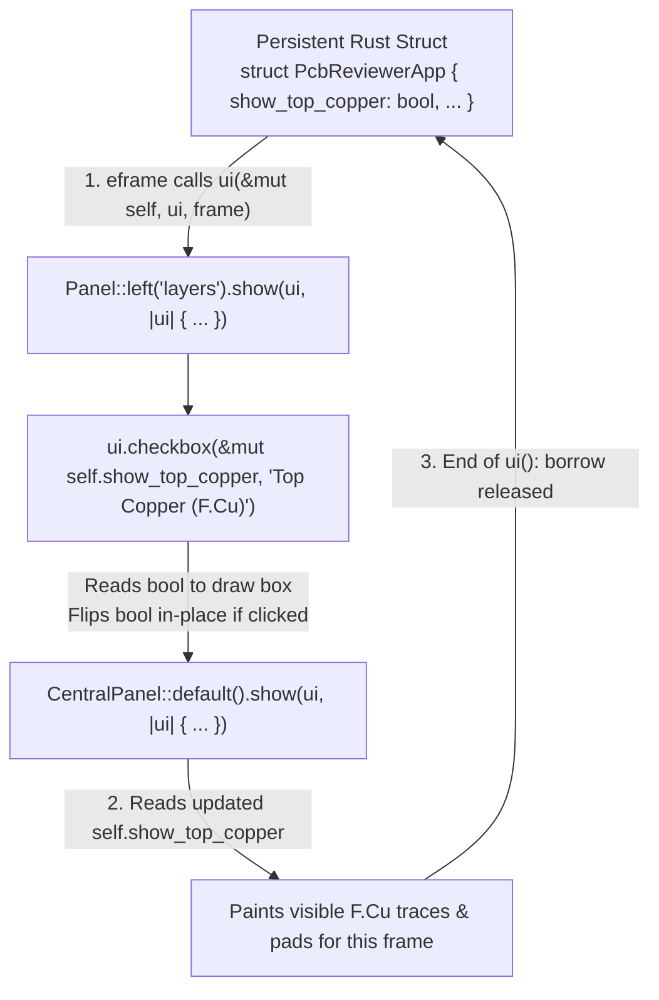

## 1. The Mental Model (One Frame = One Function Call)


_The `eframe::App::ui` lifecycle across a single frame._

## 2. Complete Runnable Skeleton (`src/main.rs`)

```rust
use eframe::egui;

fn main() -> eframe::Result {
    let mut options = eframe::NativeOptions::default();
    options.viewport = egui::ViewportBuilder::default()
        .with_inner_size([1024.0, 720.0]);

    eframe::run_native(
        "Schematic & PCB Design Reviewer",
        options,
        Box::new(|_cc| Ok(Box::new(PcbReviewerApp::default()))),
    )
}

// 1. Persistent domain & view state lives in your struct
pub struct PcbReviewerApp {
    pub show_top_copper: bool,
    pub show_bottom_copper: bool,
    pub show_silkscreen: bool,
    pub show_ratsnest: bool,
}

impl Default for PcbReviewerApp {
    fn default() -> Self {
        let mut app = Self {
            show_top_copper: false,
            show_bottom_copper: false,
            show_silkscreen: false,
            show_ratsnest: false,
        };
        app.reset_layers();
        app
    }
}

impl PcbReviewerApp {
    pub fn reset_layers(&mut self) {
        self.show_top_copper = true;
        self.show_bottom_copper = true;
        self.show_silkscreen = true;
        self.show_ratsnest = false;
    }

    pub fn isolate_top_copper(&mut self) {
        self.show_top_copper = true;
        self.show_bottom_copper = false;
        self.show_silkscreen = false;
        self.show_ratsnest = false;
    }

    pub fn show_all_layers(&mut self) {
        self.show_top_copper = true;
        self.show_bottom_copper = true;
        self.show_silkscreen = true;
        self.show_ratsnest = true;
    }
}

// 2. Implement eframe::App to define the per-frame UI
impl eframe::App for PcbReviewerApp {
    fn ui(&mut self, ui: &mut egui::Ui, _frame: &mut eframe::Frame) {
        // Always declare edge Panels (left/right/top/bottom) BEFORE CentralPanel!
        egui::Panel::left("layer_panel").show(ui, |ui| {
            ui.heading("PCB Layers");
            ui.checkbox(&mut self.show_top_copper, "Top Copper (F.Cu)");
            ui.checkbox(&mut self.show_bottom_copper, "Bottom Copper (B.Cu)");
            ui.checkbox(&mut self.show_silkscreen, "Silkscreen (F.SilkS)");
            ui.checkbox(&mut self.show_ratsnest, "Ratsnest (Unrouted)");

            ui.separator();
            if ui.button("Isolate Top Copper").clicked() {
                self.isolate_top_copper();
            }
            if ui.button("Show All Layers").clicked() {
                self.show_all_layers();
            }
        });

        egui::CentralPanel::default().show(ui, |ui| {
            ui.heading("PCB Viewport Ready");
        });
    }
}
```

## 3. Common Panel & Widget Signatures

| Pattern | Rust Code | Why It Works This Way |
| --- | --- | --- |
| **Two-way boolean toggle** | `ui.checkbox(&mut self.flag, "Label")` | Borrows `self.flag` mutably for the duration of the call; flips the boolean if clicked and returns a `Response`. |
| **Momentary action button** | `if ui.button("Reset").clicked() { ... }` | Buttons don't store a boolean; they return a `Response` whose `.clicked()` method is `true` on the frame the click occurred. |
| **Panel ordering rule** | `Panel` first, `CentralPanel` last | `CentralPanel` claims all remaining area left over in the root `Ui` after outer panels allocate their widths/heights ([docs.rs](https://docs.rs/egui/latest/egui/containers/panel/struct.CentralPanel.html)). |
