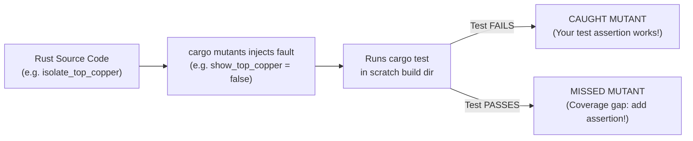

## 1. Why Mutation Testing Beats Line Coverage in `egui`

Traditional line coverage only tells you whether a line of Rust code _executed_ during a test—not whether your test would fail if that line were wrong. Turns out, in an immediate-mode GUI, calling `app.update(...)` executes almost every line of your panel layout even if your test contains zero assertions!

So, we use Martin Pool's [`cargo-mutants`](https://mutants.rs/) to test our tests: it copies your project to a scratch directory, systematically injects small faults (**mutants**—such as flipping `true` to `false`, replacing `+` with `-`, or emptying a method body), and runs `cargo test` against each mutant.


_How `cargo mutants` distinguishes verified logic (Caught) from unasserted code paths (Missed)._

## 2. Essential Commands & Outcomes

```bash
# 1. Install cargo-mutants once (works with stable Rust, no nightly required)
cargo install --locked cargo-mutants

# 2. Run the unit & integration test suite
cargo test

# 3. Run mutation testing across the current crate and list any missed mutants
cargo mutants

# 4. Mutate only a single file or function during fast iteration
cargo mutants -f src/main.rs
```

| Outcome | Meaning | Action to Take |
| --- | --- | --- |
| **Caught** | `cargo test` failed when this mutation was injected. Your test suite actively guards this line of code. | Celebrate—this behaviour is locked down. |
| **Missed** | `cargo test` still passed even with the mutated code! Either no test exercises this path or an assertion is missing. | Add a unit/harness assertion that fails under the mutated value. |
| **Unviable** | The mutated code failed to type-check or compile (Rust's type system caught it before tests even ran). | Ignored automatically by `cargo mutants`. |
| **Timeout** | The mutation caused an infinite loop in a test. | Inspect loop termination bounds. |

## 3. Scoping Visual Entrypoints with `.cargo/mutants.toml`

In a desktop application, `fn main()` opens a blocking OS window via `eframe::run_native`, which should not run inside headless unit tests. Create `.cargo/mutants.toml` in your crate root to explicitly track which functions are excluded from mutation until a higher-tier harness is introduced:

```toml
# .cargo/mutants.toml
# Reuse the target directory across scratch builds so mutation runs finish quickly.
copy_target = true

# Explicitly exclude the OS window launcher and raw panel draw loop in Act I;
# we remove "update" from this list in Lesson 0006 when we add egui_kittest!
exclude_re = [
    "replace main",
    "<impl eframe::App for PcbReviewerApp>::update",
]
```

## 4. Progression of Testing Across the Six Acts

| Curriculum Stage | Testing Mechanism Introduced | What `cargo test` + `cargo mutants` Verifies |
| --- | --- | --- |
| **Lessons 0000–0001 & Act I (0002–0005)** | `#[cfg(test)]`, `#[test]`, `assert_eq!`, pure domain/maths methods | Default layer visibility flags, preset state transitions, `Rect` bounds, `TSTransform` pan/zoom round-trips, layer Z-ordering, and net hit-testing. |
| **Act II (0006–0009)** | `egui_kittest::Harness` (headless UI queries & simulated key presses) | Un-skips `eframe::App::update`! Verifies rendered schematic labels, dual-viewport cross-probing, BOM filtering, and `F` / `M` / `Esc` hotkeys. |
| **Act III (0010–0013)** | Workflow state-machine tests & `Harness::new_ui` widget mounts | Review pin CRUD in `HashMap`, `Open` → `Resolved` → `Verified` triage rules, DRC clearance bounds, and custom `egui::Widget` layer swatches. |
| **Act IV (0014–0017)** | Workspace layer gates, panic-free lints & `proptest!` | `#![deny(clippy::unwrap_used)]`, sub-second `cargo mutants -p pcb-doc`, corrupt JSON rejection, and `Arc::make_mut` undo/redo snapshot invariants. |
| **Act V (0018–0021)** | `panic_hunt` command fuzzer, perf budgets & `gpu_lock()` snapshots | Adversarial JSON fuzzing of every `CommandSpec`, spatial culling equivalence, background worker cancellation, and offscreen `wgpu` PNG visual parity. |
| **Act VI (0022–0025)** | Real-file KiCad corpus oracles & `#[tokio::test]` SQL harnesses | `nom` S-expression parser edge cases, pinned `.kicad_pcb` oracle pass/round-trip ratchets, Turso (`libsql`) transactions, and `docs/scorecard.md`. |
